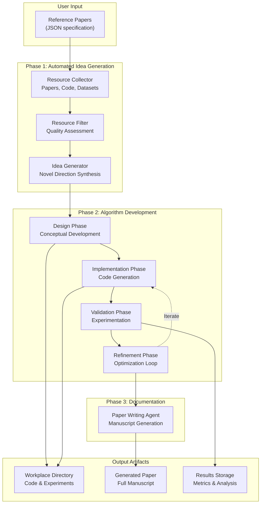
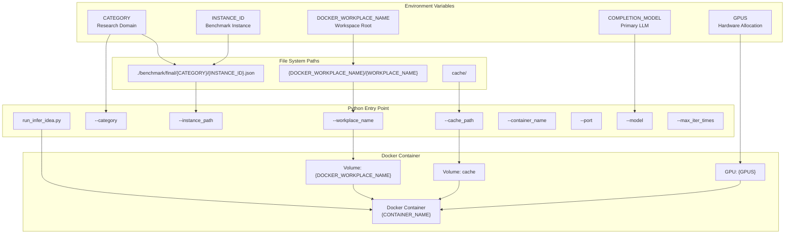
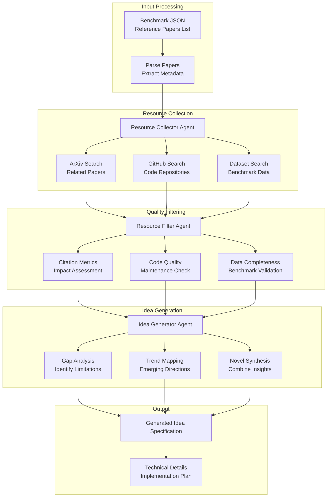

<!-- source: DeepWiki mcp.deepwiki.com · repo HKUDS/AI-Researcher · page 6.3 Level 2 Tasks (Reference-based) · fetched 2026-11-09 -->

# Level 2 Tasks (Reference-based)

<details>
<summary>Relevant source files</summary>

The following files were used as context for generating this wiki page:

- [.env.template](.env.template)
- [README.md](README.md)

</details>


## Purpose and Scope

This document provides technical guidance for executing Level 2 tasks in the AI-Researcher system, where users provide only reference papers without a detailed research idea. The system autonomously generates novel research directions from these references and implements them through the full research pipeline.

For running tasks with pre-defined research ideas, see [Level 1 Tasks (Given Ideas)](#6.2). For general installation and setup instructions, see [Installation & Setup](#6.1). For understanding the underlying research workflow, see [Research Workflow](#2.2).

## Level 2 Task Workflow Overview

Level 2 tasks represent the most autonomous mode of operation in AI-Researcher. Unlike Level 1 tasks that skip the literature review phase, Level 2 tasks execute the complete three-phase research pipeline including automated idea generation.



**Sources:** [README.md:36-43](), [README.md:933-955]()

## Configuration Requirements

Level 2 tasks require specific configuration in the `.env` file that differs from Level 1 tasks. The critical distinction is the absence of `TASK_LEVEL` specification, as Level 2 tasks automatically determine the appropriate execution path.

### Required Environment Variables

| Variable | Purpose | Level 2 Configuration |
|----------|---------|----------------------|
| `DOCKER_WORKPLACE_NAME` | Workspace directory name | `workplace_paper` |
| `BASE_IMAGES` | Docker image for execution environment | `tjbtech1/airesearcher:v1` |
| `COMPLETION_MODEL` | Primary LLM for complex operations | `openrouter/google/gemini-2.5-pro-preview-05-20` |
| `CHEEP_MODEL` | Secondary LLM for simple operations | `openrouter/google/gemini-2.5-pro-preview-05-20` |
| `GPUS` | GPU allocation | `"device=0"`, `"device=0,1"`, `"all"`, or `None` |
| `CONTAINER_NAME` | Docker container identifier | `paper_eval` |
| `WORKPLACE_NAME` | Internal workplace directory | `workplace` |
| `CACHE_PATH` | Cache directory for intermediate results | `cache` |
| `PORT` | API service port | `7020` |
| `CATEGORY` | Research domain category | `diffu_flow`, `gnn`, `reasoning`, `vq`, etc. |
| `INSTANCE_ID` | Specific benchmark instance | e.g., `one_layer_vq` |
| `OPENROUTER_API_KEY` | API key for OpenRouter | Required for LLM access |
| `MAX_ITER_TIMES` | Maximum refinement iterations | `0` (auto-determine) or positive integer |

**Sources:** [.env.template:1-53](), [README.md:156-210]()

### Configuration-to-Code Mapping



**Sources:** [README.md:1010-1027](), [.env.template:36-53]()

## Running Level 2 Tasks

### Command-Line Execution

Level 2 tasks are executed via the `run_infer_idea.py` script, which orchestrates the complete research pipeline including idea generation. The script is typically invoked through a shell wrapper for convenience.

**Script Template:**
```bash
#!/bin/bash
current_dir=$(dirname "$(readlink -f "$0")")
cd $current_dir

export DOCKER_WORKPLACE_NAME=workplace_paper
export BASE_IMAGES=tjbtech1/airesearcher:v1
export COMPLETION_MODEL=openrouter/google/gemini-2.5-pro-preview-05-20
export CHEEP_MODEL=openrouter/google/gemini-2.5-pro-preview-05-20

category=vq
instance_id=one_layer_vq
export GPUS='"device=0,1"'

python run_infer_idea.py \
    --instance_path ../benchmark/final/${category}/${instance_id}.json \
    --container_name paper_eval \
    --model $COMPLETION_MODEL \
    --workplace_name workplace \
    --cache_path cache \
    --port 12372 \
    --max_iter_times 0 \
    --category ${category}
```

**Sources:** [README.md:1010-1027]()

### Execution Parameters

| Parameter | Required | Description | Example Values |
|-----------|----------|-------------|----------------|
| `--instance_path` | Yes | Path to benchmark JSON defining reference papers | `../benchmark/final/vq/one_layer_vq.json` |
| `--container_name` | Yes | Name for Docker container instance | `paper_eval` |
| `--model` | Yes | LLM model identifier for primary operations | `openrouter/google/gemini-2.5-pro-preview-05-20` |
| `--workplace_name` | Yes | Subdirectory name within Docker workplace | `workplace` |
| `--cache_path` | Yes | Directory for caching intermediate results | `cache` |
| `--port` | Yes | Port for container API service | `12372`, `7020` |
| `--max_iter_times` | Yes | Maximum iterations for refinement loop | `0` (unlimited), `1`, `2`, etc. |
| `--category` | Yes | Research domain category | `vq`, `gnn`, `diffu_flow`, `reasoning` |

**Note:** Unlike Level 1 tasks, Level 2 tasks do **not** accept `--task_level` parameter, as they automatically execute the full pipeline including idea generation.

**Sources:** [README.md:1010-1027]()

## Input Specification Format

Level 2 tasks require a JSON specification file that defines the reference papers and metadata. This file is located in the benchmark directory structure: `./benchmark/final/{CATEGORY}/{INSTANCE_ID}.json`.

### JSON Structure

The input JSON must contain a reference paper list without a detailed idea specification. The system uses these references to autonomously generate research directions.

**Example Structure:**
```json
{
  "instance_id": "one_layer_vq",
  "category": "vq",
  "reference_papers": [
    {
      "title": "Neural discrete representation learning",
      "authors": ["van den Oord, Aaron", "Vinyals, Oriol", "Kavukcuoglu, Koray"],
      "year": 2017,
      "venue": "NeurIPS",
      "url": "https://arxiv.org/abs/1711.00937"
    },
    {
      "title": "Straightening out the straight-through estimator",
      "authors": ["Yin, Mingzhang", "Zhou, Mingyuan"],
      "year": 2023,
      "venue": "ICML"
    }
  ],
  "task_description": "Generate innovative ideas from reference papers in vector quantization",
  "metadata": {
    "domain": "generative_modeling",
    "difficulty": "medium"
  }
}
```

**Key Differences from Level 1:**
- No `detailed_idea` field with implementation steps
- No `core_techniques` specification
- Minimal `task_description` (general guidance only)
- System autonomously fills these gaps through Phase 1

**Sources:** [README.md:240-320](), [README.md:400-418]()

## Execution Pipeline Details

### Phase 1: Literature Review & Idea Generation

This phase is unique to Level 2 tasks and executes before algorithm development begins.



**Sources:** [README.md:933-955]()

### Phase 2: Algorithm Development

After Phase 1 generates a detailed idea specification, execution continues identically to Level 1 tasks through the four-stage development cycle: Design → Implementation → Validation → Refinement.

**Key Agent Interactions:**

1. **Design Agent:** Receives generated idea specification and creates conceptual framework
2. **Implementation Agent:** Transforms design into executable code within Docker container
3. **Validation Agent:** Runs experiments using GPU resources specified in `GPUS` configuration
4. **Refinement Agent:** Analyzes results and iterates up to `MAX_ITER_TIMES` iterations

For detailed information on this phase, see [Research Agent](#3.1).

**Sources:** [README.md:942-951]()

### Phase 3: Paper Writing

The paper writing phase is invoked after successful completion of algorithm development. This phase is identical for both Level 1 and Level 2 tasks.

**Invocation:**
```bash
python paper_agent/writing.py \
    --research_field ${category} \
    --instance_id ${instance_id}
```

For detailed information, see [Paper Writing Agent](#3.2).

**Sources:** [README.md:1031-1045]()

## Output Artifacts

Level 2 task execution produces a comprehensive set of output artifacts organized in the workspace directory structure.

### Directory Structure

```
{DOCKER_WORKPLACE_NAME}/{WORKPLACE_NAME}/
├── {category}/
│   └── {instance_id}/
│       ├── code/
│       │   ├── main.py           # Generated implementation
│       │   ├── model.py          # Model definitions
│       │   ├── train.py          # Training scripts
│       │   └── test.py           # Testing scripts
│       ├── experiments/
│       │   ├── exp_001/          # Experiment runs
│       │   ├── exp_002/
│       │   └── results.json      # Aggregated results
│       ├── idea_generation/
│       │   ├── collected_papers.json
│       │   ├── filtered_resources.json
│       │   └── generated_idea.json
│       ├── logs/
│       │   ├── design.log
│       │   ├── implementation.log
│       │   ├── validation.log
│       │   └── refinement.log
│       └── paper/
│           ├── paper.pdf         # Generated manuscript
│           ├── paper.tex         # LaTeX source
│           └── figures/          # Generated figures
```

**Sources:** [.env.template:19-22]()

### Artifact Types

| Artifact Category | File Location | Description |
|------------------|---------------|-------------|
| **Generated Idea** | `idea_generation/generated_idea.json` | Complete idea specification synthesized from references |
| **Collected Resources** | `idea_generation/collected_papers.json` | Papers, code repos, datasets found during collection |
| **Filtered Resources** | `idea_generation/filtered_resources.json` | High-quality resources after filtering |
| **Implementation Code** | `code/*.py` | Complete codebase for proposed method |
| **Experiment Results** | `experiments/results.json` | Performance metrics and analysis |
| **Execution Logs** | `logs/*.log` | Detailed logs from each agent phase |
| **Generated Paper** | `paper/paper.pdf` | Full-length academic manuscript |
| **LaTeX Source** | `paper/paper.tex` | Editable manuscript source |

**Sources:** [README.md:322-337](), [README.md:420-436]()

## Level 1 vs Level 2 Comparison

Understanding the differences between Level 1 and Level 2 tasks helps users select the appropriate execution mode for their research needs.

```mermaid
graph TB
    subgraph "Level 1: Given Ideas"
        L1_INPUT["User Input<br/>Detailed Idea + References"]
        L1_SKIP["SKIP Phase 1<br/>No Idea Generation"]
        L1_DESIGN["Phase 2: Algorithm Development<br/>Design → Implement → Validate → Refine"]
        L1_PAPER["Phase 3: Paper Writing"]
        L1_OUTPUT["Output: Code + Paper"]
        
        L1_INPUT --> L1_SKIP
        L1_SKIP --> L1_DESIGN
        L1_DESIGN --> L1_PAPER
        L1_PAPER --> L1_OUTPUT
    end
    
    subgraph "Level 2: Reference-based"
        L2_INPUT["User Input<br/>References Only"]
        L2_PHASE1["Phase 1: Idea Generation<br/>Collect → Filter → Generate"]
        L2_DESIGN["Phase 2: Algorithm Development<br/>Design → Implement → Validate → Refine"]
        L2_PAPER["Phase 3: Paper Writing"]
        L2_OUTPUT["Output: Idea + Code + Paper"]
        
        L2_INPUT --> L2_PHASE1
        L2_PHASE1 --> L2_DESIGN
        L2_DESIGN --> L2_PAPER
        L2_PAPER --> L2_OUTPUT
    end
```



### Detailed Comparison Table

| Aspect | Level 1 Tasks | Level 2 Tasks |
|--------|---------------|---------------|
| **Entry Point** | `run_infer_plan.py` | `run_infer_idea.py` |
| **Task Level Param** | `--task_level task1` | No task level parameter |
| **Input Requirements** | Detailed idea description + references | References only |
| **Phase 1 Execution** | Skipped | Full execution (Collect → Filter → Generate) |
| **Idea Specification** | User-provided | AI-generated |
| **Execution Time** | Shorter (skips Phase 1) | Longer (includes Phase 1) |
| **User Expertise Required** | High (must formulate idea) | Low (minimal domain knowledge) |
| **Autonomy Level** | Semi-autonomous | Fully autonomous |
| **Output Artifacts** | Code + Paper | Idea + Code + Paper |
| **Best Use Case** | Testing specific implementations | Exploratory research |

**Sources:** [README.md:36-43](), [README.md:990-1027]()

### Execution Command Comparison

**Level 1:**
```bash
python run_infer_plan.py \
    --instance_path ../benchmark/final/${category}/${instance_id}.json \
    --task_level task1 \
    --model $COMPLETION_MODEL \
    # ... other parameters
```

**Level 2:**
```bash
python run_infer_idea.py \
    --instance_path ../benchmark/final/${category}/${instance_id}.json \
    --model $COMPLETION_MODEL \
    # ... other parameters (no task_level)
```

**Sources:** [README.md:990-1027]()

## Execution Monitoring and Debugging

### Log Files

Level 2 tasks generate comprehensive logs throughout execution, particularly important for monitoring the idea generation phase.

**Phase 1 Logs:**
- `logs/resource_collection.log` - Papers, code, datasets discovered
- `logs/resource_filtering.log` - Quality assessment decisions
- `logs/idea_generation.log` - Idea synthesis process

**Phase 2 Logs:**
- `logs/design.log` - Conceptual development
- `logs/implementation.log` - Code generation
- `logs/validation.log` - Experiment execution
- `logs/refinement.log` - Optimization iterations

**Sources:** [.env.template:19-22]()

### Docker Container Inspection

Monitor running containers:
```bash
# List running containers
docker ps

# View container logs
docker logs paper_eval

# Execute commands in container
docker exec -it paper_eval /bin/bash
```

### Common Issues

| Issue | Symptom | Resolution |
|-------|---------|-----------|
| **Insufficient References** | Idea generation fails early | Provide at least 3-5 high-quality reference papers |
| **API Rate Limiting** | Slow or failed LLM calls | Configure `CHEEP_MODEL` for less critical operations |
| **GPU Out of Memory** | Validation crashes | Reduce batch size or use `GPUS=None` for CPU-only |
| **Port Conflicts** | Container fails to start | Change `PORT` to available port number |
| **Cache Corruption** | Inconsistent results | Clear `cache/` directory before execution |

**Sources:** [.env.template:1-53]()

## Best Practices

### Reference Paper Selection

For optimal idea generation in Level 2 tasks:

1. **Diversity:** Include papers from different years and venues
2. **Quality:** Select highly-cited or recent impactful papers
3. **Coverage:** Mix foundational papers with recent advances
4. **Relevance:** Ensure papers are within the same research domain
5. **Quantity:** Provide 5-10 references (minimum 3, maximum 20)

### Resource Allocation

**GPU Configuration:**
- Small models (image classification): `GPUS='"device=0"'`
- Medium models (NLP, GNN): `GPUS='"device=0,1"'`
- Large models (diffusion, LLM): `GPUS='"all"'`
- CPU-only testing: `GPUS=None`

**Iteration Limits:**
- Initial runs: `MAX_ITER_TIMES=0` (unlimited, auto-terminate)
- Time-constrained: `MAX_ITER_TIMES=2` (2 refinement cycles)
- Quick testing: `MAX_ITER_TIMES=1` (single refinement)

**Sources:** [.env.template:11-16](), [.env.template:51-52]()

### Cost Optimization

Level 2 tasks consume more LLM API calls due to Phase 1. Optimize costs:

1. **Dual-Model Strategy:** Use expensive model for idea generation, cheap model for routine tasks
2. **Cache Utilization:** Enable caching to avoid redundant API calls
3. **Batch Processing:** Run multiple instances with shared cache
4. **Provider Selection:** Compare pricing between OpenRouter, GitHub AI, etc.

**Sources:** [.env.template:7-10](), [.env.template:28-34]()

---

