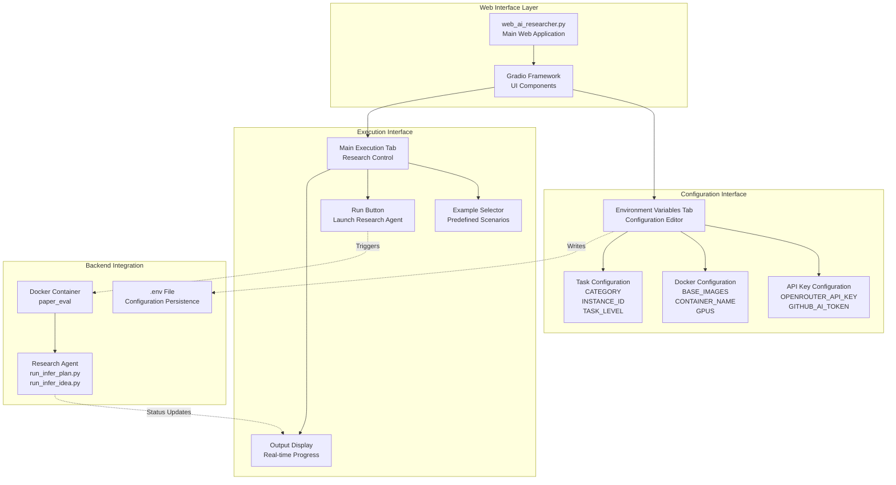
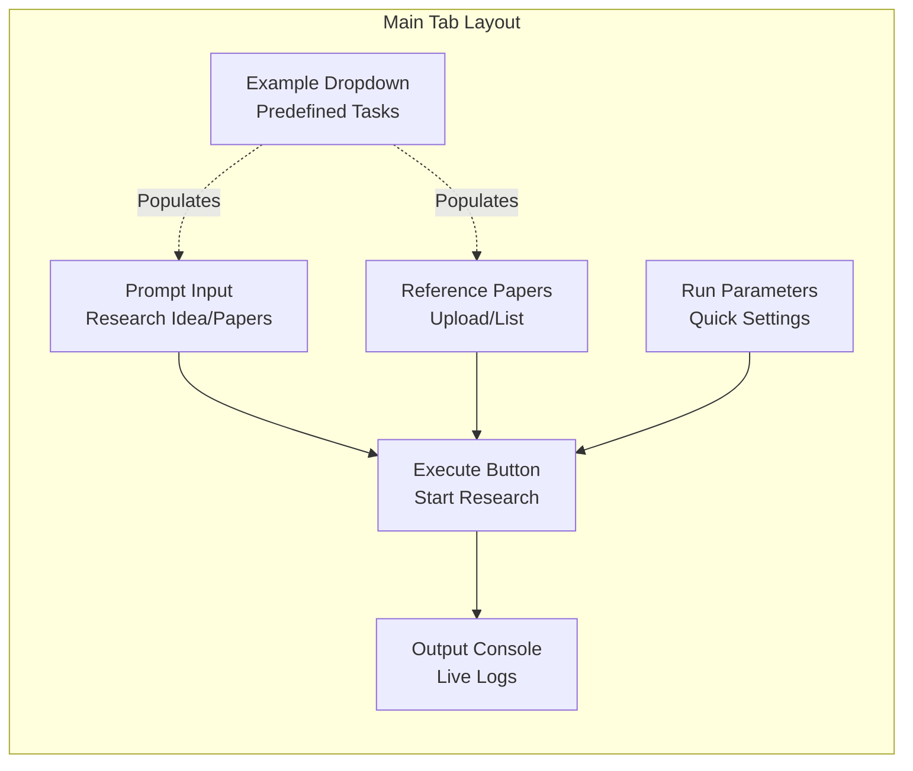
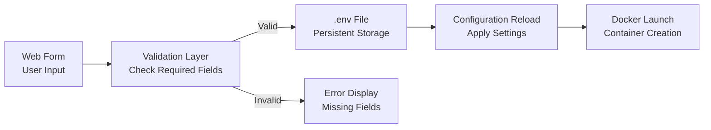
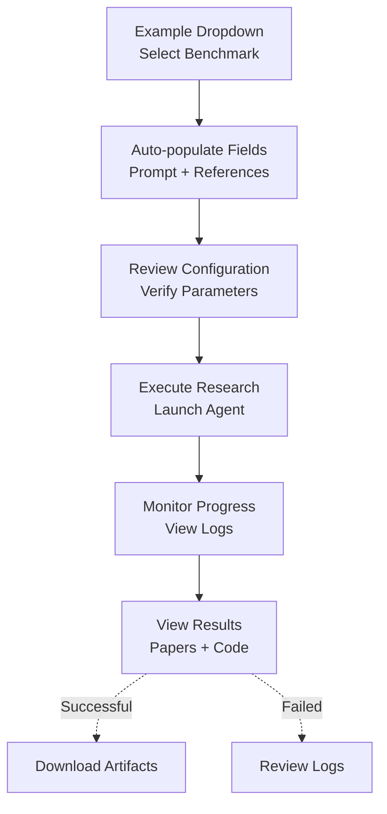
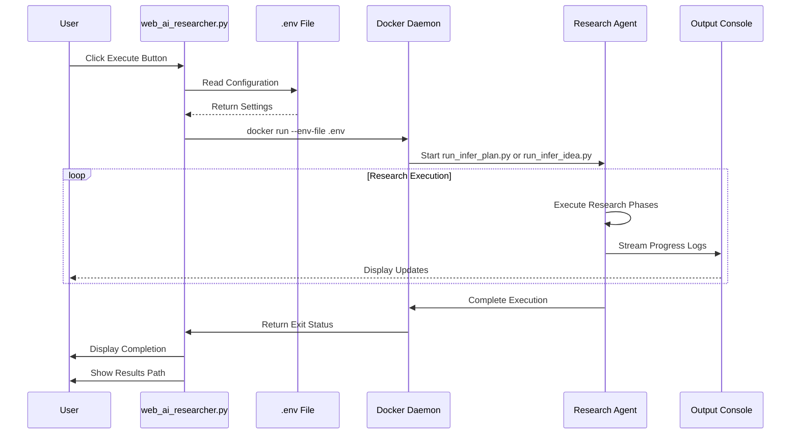
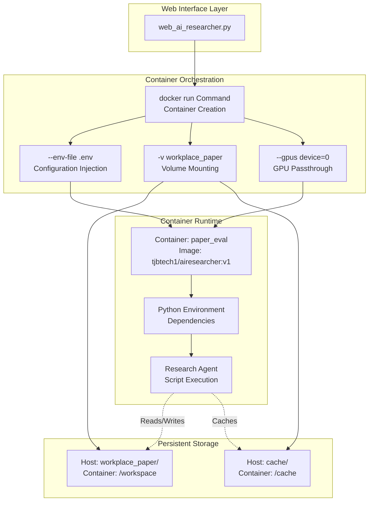
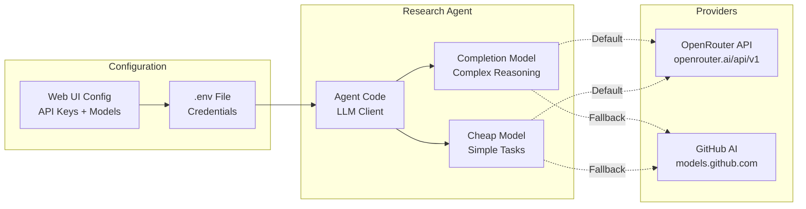

<!-- source: DeepWiki mcp.deepwiki.com · repo HKUDS/AI-Researcher · page 6.4 Web Interface · fetched 2026-11-09 -->

# Web Interface

<details>
<summary>Relevant source files</summary>

The following files were used as context for generating this wiki page:

- [README.md](README.md)
- [assets/webgui/image-20250606135137558.png](assets/webgui/image-20250606135137558.png)
- [assets/webgui/image-20250606135325373.png](assets/webgui/image-20250606135325373.png)
- [assets/webgui/image-20250606135507970.png](assets/webgui/image-20250606135507970.png)

</details>


## Purpose and Scope

This document describes the web-based graphical user interface (GUI) for the AI-Researcher platform. The web interface provides a user-friendly way to configure, launch, and monitor research experiments without requiring direct command-line interaction. It is built using Gradio and serves as the primary interactive frontend for the system.

For information about the underlying research agents that the web interface controls, see [Research Agent](#3.1). For backend configuration details, see [Environment Configuration](#4.1). For command-line execution methods, see [Level 1 Tasks](#6.2) and [Level 2 Tasks](#6.3).

## System Architecture

The web interface acts as a frontend layer that wraps the core research agent functionality, providing visual controls for configuration and execution monitoring.



**Sources:** [README.md:212-228]()

## Launching the Web Interface

### Basic Startup

The web interface is launched through a single Python script:

```bash
python web_ai_researcher.py
```

This command starts a local Gradio server that provides the web UI, typically accessible at `http://localhost:7860` (or the next available port).

### Prerequisites

Before launching, ensure:
- All dependencies are installed (see [Installation & Setup](#6.1))
- Docker daemon is running for research agent execution
- Required Docker image is available: `tjbtech1/airesearcher:v1`

**Sources:** [README.md:212-218]()

## Interface Components

### Main Execution Tab

The primary interface for running research experiments consists of:



**Key Elements:**

| Component | Function | Data Flow |
|-----------|----------|-----------|
| **Prompt Input** | Accept research idea description or reference paper request | User → System |
| **Reference Papers** | List or upload related papers for Level 2 tasks | User → System |
| **Example Selector** | Pre-populate interface with benchmark task configurations | Dropdown → Form Fields |
| **Execute Button** | Trigger research agent execution with current configuration | Form → Backend |
| **Output Console** | Display real-time execution logs and status updates | Backend → User |

**Sources:** [README.md:220-228](), [assets/webgui/image-20250606135137558.png:1-1]()

### Configuration Tab

The environment variables tab provides a structured interface for system configuration:

```mermaid
graph TB
    subgraph "Configuration Categories"
        CONTAINER["Container Settings"]
        LLM["LLM Configuration"]
        TASK["Task Selection"]
    end
    
    subgraph "Container Settings"
        WORKPLACE["DOCKER_WORKPLACE_NAME<br/>workplace_paper"]
        BASEIMG["BASE_IMAGES<br/>tjbtech1/airesearcher:v1"]
        GPU["GPUS<br/>device selection"]
        PORT["PORT<br/>7020"]
    end
    
    subgraph "LLM Configuration"
        COMPMODEL["COMPLETION_MODEL<br/>gemini-2.5-pro-preview"]
        CHEAPMODEL["CHEEP_MODEL<br/>gemini-2.5-pro-preview"]
        ORKEY["OPENROUTER_API_KEY<br/>API Authentication"]
        GHTOKEN["GITHUB_AI_TOKEN<br/>Alternative Provider"]
    end
    
    subgraph "Task Selection"
        CAT["CATEGORY<br/>vq/gnn/reasoning/etc"]
        INST["INSTANCE_ID<br/>Specific Benchmark"]
        LEVEL["TASK_LEVEL<br/>task1/task2"]
    end
    
    CONTAINER --> WORKPLACE
    CONTAINER --> BASEIMG
    CONTAINER --> GPU
    CONTAINER --> PORT
    
    LLM --> COMPMODEL
    LLM --> CHEAPMODEL
    LLM --> ORKEY
    LLM --> GHTOKEN
    
    TASK --> CAT
    TASK --> INST
    TASK --> LEVEL
```



**Configuration Workflow:**

1. **Navigate to Configuration Tab** - Access environment settings editor
2. **Edit Required Fields** - Modify API keys, model selections, and task parameters
3. **Save Configuration** - Persist settings to `.env` file
4. **Validate Settings** - System checks for required fields (API keys, valid paths)
5. **Return to Main Tab** - Saved configuration applies to subsequent executions

**Sources:** [README.md:222-224](), [README.md:156-210]()

## Configuration Management

### Environment Variable Mapping

The web interface provides form fields that correspond directly to `.env` file variables:

| UI Field | Environment Variable | Purpose | Example Value |
|----------|---------------------|---------|---------------|
| Completion Model | `COMPLETION_MODEL` | Primary LLM for research tasks | `openrouter/google/gemini-2.5-pro-preview-05-20` |
| Cheap Model | `CHEEP_MODEL` | Cost-optimized LLM for auxiliary tasks | `openrouter/google/gemini-2.5-pro-preview-05-20` |
| OpenRouter Key | `OPENROUTER_API_KEY` | API authentication token | `sk-or-v1-...` |
| GPU Selection | `GPUS` | GPU device allocation | `"device=0"`, `"all"`, `None` |
| Category | `CATEGORY` | Research domain | `vq`, `gnn`, `diffu_flow`, `reasoning` |
| Instance ID | `INSTANCE_ID` | Specific benchmark task | `one_layer_vq`, `gnn_nodeformer` |
| Task Level | `TASK_LEVEL` | Input complexity level | `task1`, `task2` |

### Persistence Mechanism



When configuration is saved:
1. Form values are validated for completeness (required fields: API keys)
2. Values are written to `.env` file in the project root
3. System reloads configuration for subsequent executions
4. Docker containers launched with `--env-file .env` inherit settings

**Sources:** [README.md:153-210]()

## Running Research Tasks

### Example Selection Workflow

The interface provides predefined examples corresponding to benchmark tasks:



**Available Example Categories:**
- **Vector Quantized (VQ)**: Discrete representation learning tasks
- **Graph Neural Networks (GNN)**: Graph learning benchmarks
- **Diffusion/Flow Models**: Generative modeling tasks
- **Reasoning**: LLM reasoning enhancement tasks
- **Recommendation**: Collaborative filtering systems

**Sources:** [README.md:226-228](), [README.md:234-831]()

### Execution Flow

When the "Run" button is clicked:



**Execution Parameters:**

The web interface automatically constructs command-line arguments based on form inputs:
- Task level determines script: `run_infer_plan.py` (Level 1) or `run_infer_idea.py` (Level 2)
- Category and instance ID specify benchmark location: `./benchmark/final/{CATEGORY}/{INSTANCE_ID}.json`
- Docker configuration controls resource allocation and workspace paths

**Sources:** [README.md:212-218]()

## Output and Monitoring

### Real-time Progress Display

The output console provides live streaming of research agent execution:

**Log Categories:**
- **Phase Indicators**: "Starting Literature Review", "Beginning Algorithm Design", etc.
- **LLM Interactions**: API calls, token counts, model responses
- **File Operations**: Code generation, paper writing, result storage
- **Validation Steps**: Experiment execution, metric computation
- **Error Messages**: Failures, retries, debugging information

### Result Locations

Upon completion, the interface displays paths to generated artifacts:

| Artifact Type | Default Location | Contents |
|---------------|------------------|----------|
| **Workspace** | `workplace_paper/workplace/` | Generated code, experiments, intermediate files |
| **Research Paper** | `workplace_paper/workplace/{task_name}/paper.pdf` | Full-length academic manuscript |
| **Code Repository** | `workplace_paper/workplace/{task_name}/project/` | Implementation code and tests |
| **Evaluation Data** | `workplace_paper/workplace/{task_name}/results/` | Experimental metrics and visualizations |

**Sources:** [README.md:160-181]()

## Integration with Backend Systems

### Docker Container Management

The web interface abstracts Docker complexity but relies on container execution:



**Container Configuration:**
- **Base Image**: `tjbtech1/airesearcher:v1` (contains all dependencies)
- **Container Name**: `paper_eval` (configurable via `CONTAINER_NAME`)
- **Network Port**: 7020 exposed for potential API access
- **Platform**: `linux/amd64` for compatibility
- **Volumes**: Mounted for data persistence between runs

**Sources:** [README.md:137-149](), [README.md:159-183]()

### LLM Provider Integration

The web interface configures LLM access for the research agent:



**Dual-Model Strategy:**
- **Completion Model**: Used for critical research tasks (idea generation, algorithm design, paper writing)
- **Cheap Model**: Used for auxiliary tasks (code formatting, simple queries, validation checks)

Both models default to `gemini-2.5-pro-preview` but can be configured independently for cost optimization.

**Sources:** [README.md:185-191]()

## Troubleshooting

### Common Issues

| Issue | Symptom | Solution |
|-------|---------|----------|
| **Missing API Key** | Error on execution: "OPENROUTER_API_KEY not set" | Configure API key in Configuration Tab |
| **Docker Not Running** | Error: "Cannot connect to Docker daemon" | Start Docker Desktop or `systemd` service |
| **Port Conflict** | Web UI fails to launch | Kill process on port 7860 or configure alternative port |
| **GPU Not Available** | Warning: "CUDA not available" | Set `GPUS=None` for CPU-only execution |
| **Invalid Category** | Error: "Category not found" | Use valid category: `vq`, `gnn`, `diffu_flow`, `reasoning` |

### Debug Mode

The web interface inherits logging from the research agent. To increase verbosity:
1. Check console output where `python web_ai_researcher.py` was launched
2. Review Docker logs: `docker logs paper_eval`
3. Examine agent logs in workspace: `workplace_paper/workplace/*.log`

**Sources:** [README.md:156-210]()

## Advanced Usage

### Custom Task Configuration

While examples provide quick-start configurations, advanced users can:
1. Manually edit `.env` file for fine-grained control
2. Point to custom benchmark JSON files via `INSTANCE_ID`
3. Modify `MAX_ITER_TIMES` to control research iteration limits
4. Adjust model parameters through environment variables

### Batch Execution

The web interface is designed for interactive single-task execution. For batch processing multiple benchmarks:
- Use command-line scripts directly ([Level 1 Tasks](#6.2), [Level 2 Tasks](#6.3))
- Implement wrapper scripts that call research agents programmatically
- Leverage Docker container reusability for parallel execution

**Sources:** [README.md:194-209]()

---

