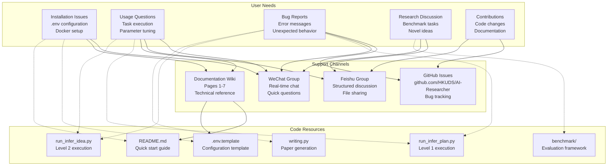
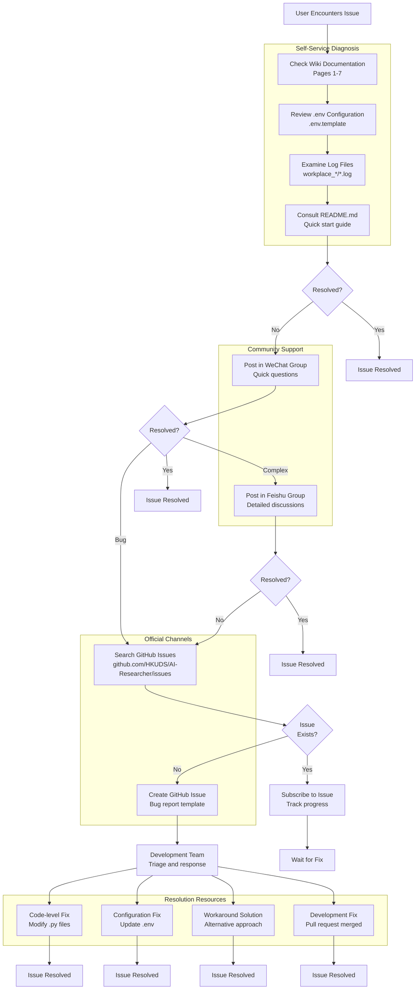
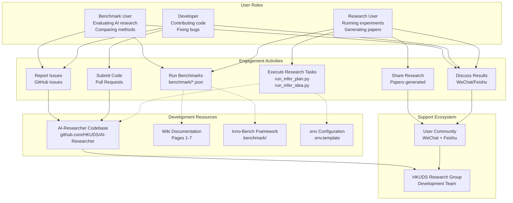

<!-- source: DeepWiki mcp.deepwiki.com · repo HKUDS/AI-Researcher · page 7 Community & Support · fetched 2026-11-09 -->

# Community & Support

<details>
<summary>Relevant source files</summary>

The following files were used as context for generating this wiki page:

- [Communication.md](Communication.md)

</details>


This page provides information about community resources, support channels, and how to engage with the HKUDS research group for assistance with the AI-Researcher system. For technical documentation about system usage, see [Usage Guide](#6). For installation procedures, see [Installation & Setup](#6.1).

## Overview

The AI-Researcher project maintains multiple communication channels for users to seek help, discuss research ideas, and collaborate with the development team. The primary support infrastructure is maintained by the HKUDS (Hong Kong University Data Science) research group.

## Communication Channels

### Official Discussion Groups

The HKUDS research group provides two primary communication platforms for real-time discussion and support:

| Platform | Purpose | Access Method |
|----------|---------|---------------|
| WeChat | Chinese-language community discussions, quick help, announcements | QR code in Communication.md |
| Feishu (Lark) | Team collaboration, structured discussions, file sharing | QR code in Communication.md |

Both platforms offer direct access to the development team and the broader research community. Users can join by scanning QR codes provided in [Communication.md:1-7]().

**Sources:** Communication.md

### GitHub Repository

The primary codebase and issue tracking system is hosted at:
```
https://github.com/HKUDS/AI-Researcher
```

The GitHub repository serves as the authoritative source for:
- Source code and documentation
- Issue reporting and bug tracking
- Feature requests and enhancement proposals
- Release notes and version history
- Community contributions via pull requests

## Support Resource Topology



**Sources:** Communication.md, README.md (inferred from system architecture)

## Getting Help

### Documentation Resources

The system provides comprehensive documentation across multiple wiki pages:

| Topic | Wiki Page | Purpose |
|-------|-----------|---------|
| System Overview | [Overview](#1) | High-level capabilities and architecture |
| Installation | [Installation & Setup](#6.1) | Docker setup, API configuration |
| Configuration | [Environment Configuration](#4.1) | `.env` parameters, LLM settings |
| Level 1 Tasks | [Level 1 Tasks](#6.2) | Running tasks with given ideas |
| Level 2 Tasks | [Level 2 Tasks](#6.3) | Reference-based idea generation |
| Web Interface | [Web Interface](#6.4) | GUI-based operation |
| Benchmarks | [Benchmark System](#3.3) | Evaluation framework usage |

### Common Support Scenarios

#### Installation and Configuration Issues

For problems related to environment setup:

1. Review [.env.template:1-end]() for complete configuration options
2. Check Docker container status and logs
3. Verify API keys for OpenRouter or GitHub AI
4. Consult [Environment Configuration](#4.1) for detailed parameter descriptions
5. Post in WeChat/Feishu group for quick assistance

#### Execution Errors

For errors during research task execution:

1. Check log files generated in the workspace directory
2. Verify task configuration parameters in `.env`
3. Review [Research Agent](#3.1) documentation for expected behavior
4. For Level 1 tasks, examine [run_infer_plan.py:1-end]() execution flow
5. For Level 2 tasks, examine [run_infer_idea.py:1-end]() execution flow
6. Report persistent issues on GitHub with error logs

#### Benchmark Evaluation Questions

For questions about benchmark tasks or evaluation:

1. Review [Benchmark System](#3.3) for framework overview
2. Check specific task documentation:
   - [Diffusion & Flow Matching](#5.1) for generative model tasks
   - [Graph Neural Networks](#5.2) for GNN tasks
   - [Reasoning](#5.3) for LLM reasoning tasks
3. Examine benchmark JSON files in `benchmark/` directory
4. Discuss novel research directions in Feishu group

**Sources:** README.md, .env.template, Communication.md

## Issue Resolution Workflow



**Sources:** Communication.md, README.md

## Contributing to AI-Researcher

The AI-Researcher project welcomes contributions from the research community. Contributions can take several forms:

### Types of Contributions

| Contribution Type | Description | Process |
|------------------|-------------|---------|
| Bug Fixes | Correct errors in existing code | GitHub pull request |
| Feature Enhancements | Add new capabilities to existing components | Discuss in Feishu → GitHub PR |
| New Benchmarks | Add evaluation tasks to `benchmark/` | Feishu discussion → JSON file |
| Documentation | Improve wiki pages or README | GitHub pull request |
| Research Extensions | Novel research ideas or implementations | Feishu research discussion |

### Contribution Workflow

For code contributions:

1. **Fork** the repository at `https://github.com/HKUDS/AI-Researcher`
2. **Set up** development environment following [Installation & Setup](#6.1)
3. **Discuss** major changes in Feishu group before implementation
4. **Implement** changes with clear code comments
5. **Test** modifications using existing benchmarks
6. **Submit** pull request with detailed description
7. **Respond** to code review feedback

For new benchmark tasks:

1. Study existing benchmark JSON files in `benchmark/` directory
2. Define task following structure of similar benchmarks
3. Create ground truth implementation with documentation
4. Discuss benchmark design in Feishu group
5. Submit JSON file and supporting materials via GitHub

**Sources:** README.md, Communication.md

## Community Engagement Model



**Sources:** Communication.md, README.md

## Research Group Information

### HKUDS (Hong Kong University Data Science)

The AI-Researcher project is developed and maintained by the HKUDS research group. The group focuses on:

- **Autonomous Research Systems**: AI agents for scientific discovery
- **Graph Neural Networks**: Advanced architectures and learning paradigms
- **Generative Modeling**: Diffusion models and flow-based generation
- **Large Language Models**: Reasoning enhancement and instruction tuning

### Academic Context

The AI-Researcher system is part of ongoing research into autonomous scientific innovation. The Inno-Bench evaluation framework represents a significant contribution to measuring AI research capabilities across multiple domains (see [Benchmark System](#3.3)).

Publications and research outputs generated using AI-Researcher should acknowledge the HKUDS research group and cite relevant benchmark tasks from [Benchmark Tasks & Domains](#5).

### Joining the Research Community

To engage with the HKUDS research community:

1. **Join Discussion Groups**: Scan QR codes in [Communication.md:5]() to access WeChat and Feishu groups
2. **Follow GitHub Repository**: Star and watch the repository for updates
3. **Participate in Discussions**: Share research ideas and results in Feishu
4. **Contribute Benchmarks**: Propose new evaluation tasks for Inno-Bench
5. **Collaborate on Research**: Discuss potential research collaborations with the team

**Sources:** Communication.md, README.md

## Quick Reference: Support Contact Matrix

| Issue Type | Primary Channel | Secondary Channel | Response Time |
|------------|----------------|-------------------|---------------|
| Installation Help | WeChat Group | [Installation & Setup](#6.1) | < 24 hours |
| Configuration Questions | WeChat Group | [Environment Configuration](#4.1) | < 24 hours |
| Usage Questions | Feishu Group | [Usage Guide](#6) | < 48 hours |
| Bug Reports | GitHub Issues | WeChat Group | Varies |
| Feature Requests | Feishu Group | GitHub Issues | Discussion-based |
| Research Collaboration | Feishu Group | HKUDS Team | Discussion-based |
| Benchmark Questions | Feishu Group | [Benchmark System](#3.3) | < 48 hours |

**Note**: Response times are approximate and depend on community activity and issue complexity. Critical bugs affecting system stability receive priority attention.

**Sources:** Communication.md

## Additional Resources

### External Links

- **GitHub Repository**: https://github.com/HKUDS/AI-Researcher
- **HKUDS Profile**: https://github.com/HKUDS/.github/blob/main/profile/QR.png (QR codes)
- **Docker Image**: tjbtech1/airesearcher:v1

### Related Documentation

- [Overview](#1) - System introduction and capabilities
- [System Architecture](#2) - Technical architecture overview
- [Usage Guide](#6) - Practical usage instructions
- [Benchmark Tasks & Domains](#5) - Research domain coverage

**Sources:** Communication.md, README.md, .env.template