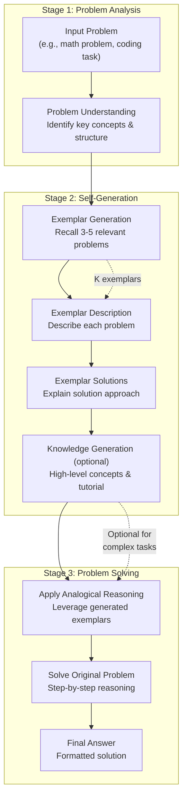
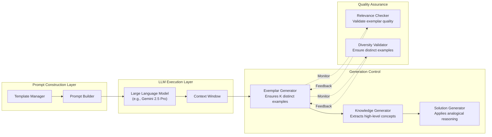
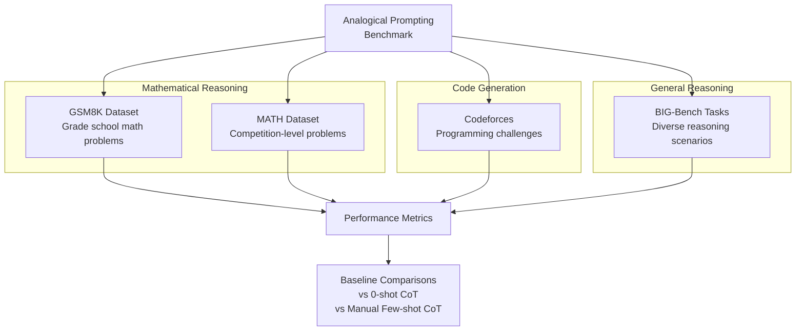
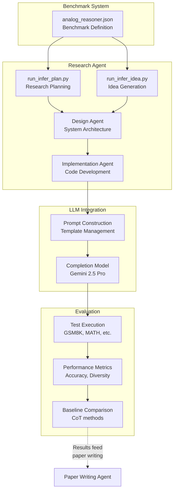

<!-- source: DeepWiki mcp.deepwiki.com · repo HKUDS/AI-Researcher · extra page Analogical Prompting · fetched 2026-11-09 -->

# Analogical Prompting

<details>
<summary>Relevant source files</summary>

The following files were used as context for generating this wiki page:

- [benchmark/final/reasoning/analog_reasoner.json](benchmark/final/reasoning/analog_reasoner.json)

</details>


## Purpose and Scope

This document details the **Analogical Prompting** benchmark within the AI-Researcher evaluation framework. This benchmark evaluates the system's ability to replicate research on enhancing large language model (LLM) reasoning through self-generated exemplars, as introduced by Yasunaga et al. (2023). The approach enables LLMs to autonomously generate relevant past problem examples before solving new problems, eliminating the need for manually labeled demonstrations.

For information about other reasoning benchmarks, see [Reasoning](#5.3). For the broader benchmark evaluation framework, see [Benchmark System (Inno-Bench)](#3.3).

**Sources:** [benchmark/final/reasoning/analog_reasoner.json:1-81]()

---

## Overview

Analogical prompting is a prompting technique inspired by human analogical reasoning, where individuals draw upon relevant past experiences to tackle novel problems. Unlike traditional chain-of-thought (CoT) prompting that requires labeled exemplars, or zero-shot CoT that uses generic prompts like "Let's think step by step", analogical prompting instructs the LLM to **self-generate** relevant problem examples and knowledge before proceeding with the solution.

The benchmark evaluates AI-Researcher's capability to reproduce this research methodology, including the prompt engineering strategy, experimental validation across multiple reasoning tasks (mathematical problem solving, code generation, logical reasoning), and comparative analysis against baseline approaches.

### Key Research Contributions

The paper addressed by this benchmark introduces several innovations:

| Contribution | Description |
|-------------|-------------|
| **Autonomous Exemplar Generation** | LLMs generate their own relevant examples instead of requiring manual curation |
| **Problem-Adaptive Knowledge** | Generated exemplars are tailored to each specific problem |
| **Multi-Domain Validation** | Demonstrated across GSM8K, MATH, Codeforces, and BIG-Bench tasks |
| **Superior Performance** | Outperforms both 0-shot CoT and manual few-shot CoT methods |

**Sources:** [benchmark/final/reasoning/analog_reasoner.json:15-41]()

---

## Benchmark Specification

The analogical prompting benchmark is defined in the Inno-Bench framework under the `reasoning` category with instance identifier `analog_reasoner`.

### Metadata Structure

```mermaid
graph TB
    subgraph "Benchmark File Structure"
        JSON["analog_reasoner.json"]
        META["Metadata Section"]
        SOURCE["Source Papers Section"]
        TASKS["Task Definitions"]
    end
    
    subgraph "Metadata Fields"
        AUTHORS["authors<br/>(8 researchers)"]
        VENUE["venue: ICLR 2023"]
        URL["url: arxiv.org/abs/2310.01714v3"]
        CITATIONS["citations: 50"]
        ABSTRACT["abstract"]
    end
    
    subgraph "Source Paper Analysis"
        REF1["Few-shot learners<br/>rank: 1, methodological"]
        REF2["Chain of thought prompting<br/>rank: 2, methodological"]
        REF3["Execution-guided synthesis<br/>rank: 3, methodological"]
        REF4["Self-debug<br/>rank: 4, methodological"]
        REF5["Program synthesis<br/>rank: 5, conceptual"]
        REF6["PaLM 2<br/>rank: 6, methodological"]
    end
    
    subgraph "Task Definitions"
        TASK1["task1: Implementation Details<br/>Step-by-step implementation guide"]
        TASK2["task2: Research Context<br/>Problem domain & limitations"]
    end
    
    JSON --> META
    JSON --> SOURCE
    JSON --> TASKS
    
    META --> AUTHORS
    META --> VENUE
    META --> URL
    META --> CITATIONS
    META --> ABSTRACT
    
    SOURCE --> REF1
    SOURCE --> REF2
    SOURCE --> REF3
    SOURCE --> REF4
    SOURCE --> REF5
    SOURCE --> REF6
    
    TASKS --> TASK1
    TASKS --> TASK2
```



**Benchmark Identification:**
- **instance_id:** `analog_reasoner`
- **category:** `reasoning`
- **File path:** `benchmark/final/reasoning/analog_reasoner.json`

**Sources:** [benchmark/final/reasoning/analog_reasoner.json:1-22]()

---

## Research Context and Motivation

### Problem Domain

The benchmark addresses the challenge of **enhancing LLM reasoning capabilities** through improved prompting strategies. Traditional approaches face significant limitations:

| Approach | Limitation |
|----------|-----------|
| **Few-shot CoT** | Requires costly manual labeling of reasoning exemplars |
| **Zero-shot CoT** | Uses generic prompts that lack problem-specific guidance |
| **Retrieved Examples** | Depends on external retrieval systems and example databases |

### Core Research Challenges

The researchers aimed to overcome four key challenges:

1. **Automated Exemplar Generation:** Eliminate the need for manual labeling while maintaining exemplar quality
2. **Problem Adaptation:** Ensure generated exemplars are specifically relevant to each input problem
3. **Diversity in Examples:** Generate distinct, non-repetitive exemplars that cover different reasoning strategies
4. **Cross-Domain Effectiveness:** Demonstrate effectiveness across mathematical reasoning, code generation, and logical tasks

**Sources:** [benchmark/final/reasoning/analog_reasoner.json:80]()

---

## Technical Approach

### Analogical Prompting Workflow

The analogical prompting method follows a structured three-stage process:



### Prompt Structure Components

The method constructs prompts with the following structured sections:

**1. Problem Statement Section**
```
# Problem: [insert specific problem]
```

**2. Exemplar Generation Section**
```
# Relevant Problems: Recall three relevant and distinct problems. For each problem, describe the problem and explain the solution.
```

**3. Knowledge Generation Section (Optional)**
```
# Provide a tutorial: Identify core concepts in the problem and provide a tutorial.
```

**4. Solution Section**
```
# Solve the initial problem: [restate problem]
```

**Sources:** [benchmark/final/reasoning/analog_reasoner.json:79]()

---

## Implementation Specifications

### Parameter Configuration

The benchmark implementation requires specific parameter settings for optimal performance:

| Parameter | Value | Justification |
|-----------|-------|---------------|
| **K (exemplars)** | 3-5 | Empirical observations show this range yields best performance |
| **Temperature** | ~0.7 | Balances creativity in exemplar generation with solution accuracy |
| **Exemplar Diversity** | Required | Prevents repetitive patterns that mislead problem-solving |
| **Model Strength** | Stronger preferred | Larger, more capable models perform better with analogical prompting |

### Input/Output Specifications

**Input Format:**
- Well-structured prompt following the template above
- Clear problem statement with all necessary context
- Instructions for exemplar generation (number, diversity requirement)

**Output Format:**
- Generated exemplars with descriptions and solutions
- Rationale for solving the original problem
- Final answer in standardized format: `The answer is \boxed{x}`

### Component Interactions

The implementation involves several interacting components:



**Sources:** [benchmark/final/reasoning/analog_reasoner.json:79]()

---

## Implementation in AI-Researcher

### Benchmark Task Definitions

The analogical prompting benchmark defines two evaluation tasks that AI-Researcher must reproduce:

#### Task 1: Implementation Reproduction

**Objective:** Implement the complete analogical prompting methodology with all technical specifications.

**Key Implementation Steps:**

1. **Task Specification:** Define problem type (math, code, logic)
2. **Prompt Construction:** Build structured prompts with all required sections
3. **Parameter Configuration:** Set K=3-5 exemplars, temperature~0.7
4. **Execution:** Process through LLM with proper context management
5. **Validation:** Ensure exemplar quality, diversity, and solution accuracy

The system must demonstrate proper interaction between:
- Problem analysis → Exemplar generation → Knowledge extraction → Solution derivation
- Quality monitoring throughout the generation pipeline
- Alignment of generated knowledge with exemplar content

#### Task 2: Research Contextualization

**Objective:** Understand and document the research problem, limitations in prior work, challenges addressed, and key contributions.

**Required Analysis:**

| Component | Description |
|-----------|-------------|
| **Problem Domain** | Enhancing LLM reasoning via self-generated exemplars for problem-solving |
| **Prior Limitations** | Costly labeled exemplars (few-shot CoT), generic prompts (zero-shot CoT) |
| **Core Challenges** | Automatic tailored exemplar generation without manual labeling |
| **Key Contributions** | Autonomous exemplar creation, problem-adaptive knowledge, multi-domain validation |

**Sources:** [benchmark/final/reasoning/analog_reasoner.json:79-80]()

---

## Evaluation Methodology

### Benchmark Testing Domains

The analogical prompting benchmark evaluates performance across multiple reasoning-intensive domains:



### Baseline Comparisons

The benchmark requires comparing analogical prompting against established baselines:

| Baseline | Description | Expected Relationship |
|----------|-------------|----------------------|
| **0-shot CoT** | Generic "Let's think step by step" prompting | Analogical prompting should outperform |
| **Manual Few-shot CoT** | Hand-crafted exemplars with reasoning chains | Analogical prompting should match or exceed |

### Quality Dimensions

AI-Researcher's implementation is evaluated on:

1. **Exemplar Relevance:** Generated examples must be contextually appropriate to the input problem
2. **Exemplar Diversity:** K generated exemplars must be distinct in approach and structure
3. **Knowledge Quality:** Optional tutorial content must accurately identify core concepts
4. **Solution Accuracy:** Final answers must be correct across test domains
5. **Reasoning Clarity:** Step-by-step rationale must be logically coherent

**Sources:** [benchmark/final/reasoning/analog_reasoner.json:15-41]()

---

## Reference Papers and Context

The benchmark is grounded in a structured analysis of foundational and related work:

### Primary Source Paper

**"Large Language Models as Analogical Reasoners"**
- **Authors:** Yasunaga, Chen, Li, Pasupat, Leskovec, Liang, Chi, Zhou
- **Venue:** International Conference on Learning Representations (ICLR) 2023
- **Citations:** 50
- **URL:** http://arxiv.org/abs/2310.01714v3

### Foundational References

The benchmark incorporates insights from six key reference papers, ranked by influence:

1. **"Language models are few-shot learners"** (Rank 1, Methodological)
   - Establishes foundation for few-shot learning in LLMs
   - Informs understanding of prompting strategy optimization

2. **"Chain of thought prompting elicits reasoning in large language models"** (Rank 2, Methodological)
   - Identifies limitations in existing CoT methods
   - Motivates need for automated exemplar generation

3. **"Execution-guided neural program synthesis"** (Rank 3, Methodological)
   - Explores in-context learning in neural architectures
   - Inspires self-guided reasoning processes

4. **"Teaching large language models to self-debug"** (Rank 4, Methodological)
   - Demonstrates self-generation techniques
   - Influences integration of adaptive response generation

5. **"Program synthesis with large language models"** (Rank 5, Conceptual)
   - Highlights reasoning processes for program tasks
   - Conceptualizes analogical reasoning applications

6. **"PaLM 2 technical report"** (Rank 6, Methodological)
   - Provides empirical evaluation metrics
   - Enables benchmarking against established techniques

**Sources:** [benchmark/final/reasoning/analog_reasoner.json:23-78]()

---

## Integration with AI-Researcher Framework

### Benchmark File Location

```
benchmark/
└── final/
    └── reasoning/
        └── analog_reasoner.json  ← Benchmark specification
```

### Execution Context

When AI-Researcher processes this benchmark, it:

1. **Loads Benchmark Definition:** Reads `analog_reasoner.json` to understand task requirements
2. **Analyzes Research Context:** Studies the abstract, source papers, and task definitions
3. **Plans Implementation:** Designs the analogical prompting system based on task1 specifications
4. **Implements Solution:** Develops code to construct prompts and execute the methodology
5. **Validates Approach:** Tests implementation against specified domains (GSM8K, MATH, etc.)
6. **Documents Research:** Generates paper explaining the approach, experiments, and results

### Cross-System Dependencies

The analogical prompting benchmark interacts with other AI-Researcher components:



**Sources:** [benchmark/final/reasoning/analog_reasoner.json:1-81]()

---

## Summary

The Analogical Prompting benchmark evaluates AI-Researcher's capability to reproduce cutting-edge research in LLM reasoning enhancement. The benchmark requires implementing a novel prompting methodology that enables autonomous exemplar generation, demonstrating the approach across multiple reasoning domains, and comparing against established baselines. Success on this benchmark validates the system's ability to understand, implement, and document sophisticated prompting strategies that advance the state-of-the-art in AI reasoning capabilities.

For related benchmarks in the reasoning category, see [Reasoning](#5.3). For the complete benchmark taxonomy, see [Benchmark System (Inno-Bench)](#3.3).

**Sources:** [benchmark/final/reasoning/analog_reasoner.json:1-81]()

---

