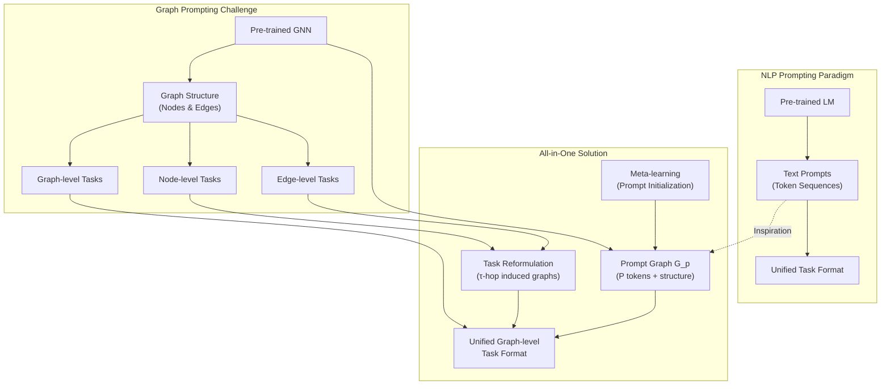
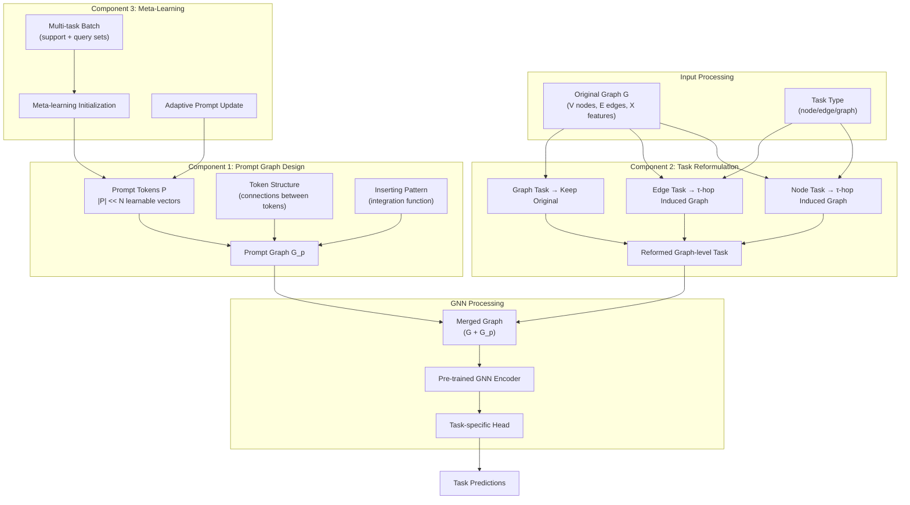
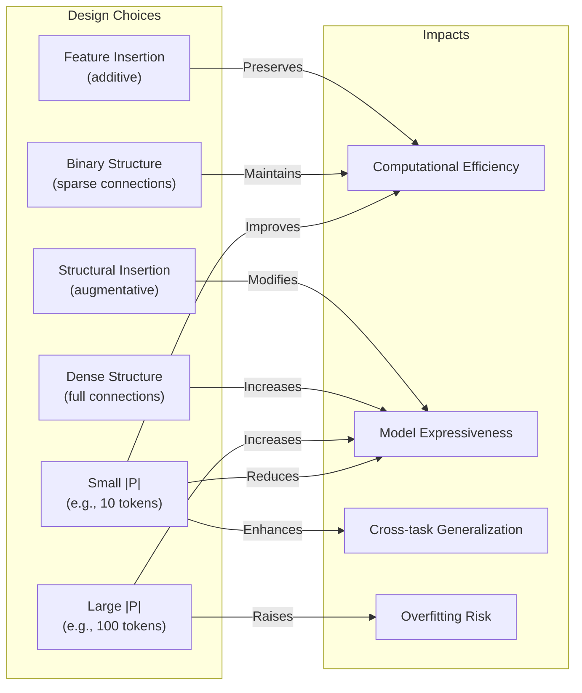
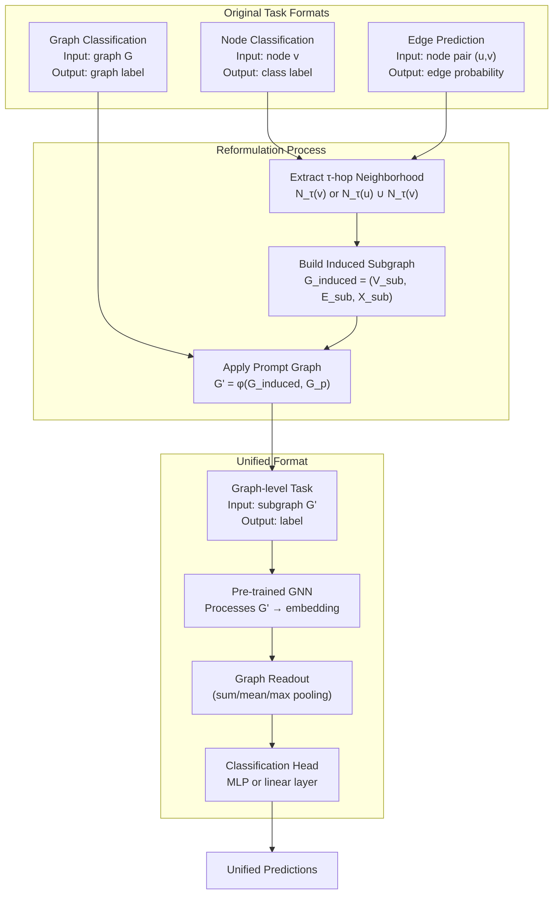
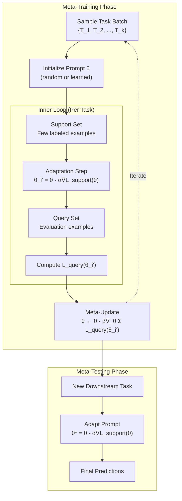
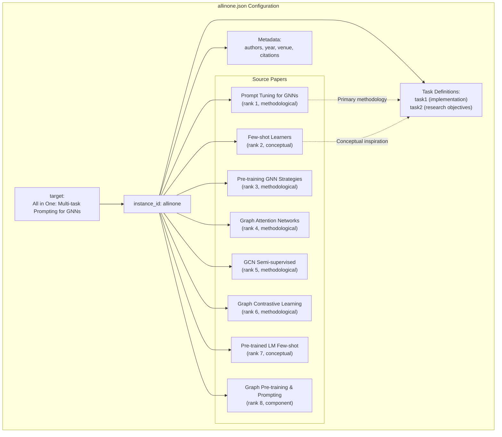

<!-- source: DeepWiki mcp.deepwiki.com · repo HKUDS/AI-Researcher · extra page Multi-task Prompting (All-in-One) · fetched 2026-11-09 -->

# Multi-task Prompting (All-in-One)

<details>
<summary>Relevant source files</summary>

The following files were used as context for generating this wiki page:

- [benchmark/final/gnn/allinone.json](benchmark/final/gnn/allinone.json)

</details>


## Purpose and Scope

This document details the **All-in-One** benchmark task within the AI-Researcher evaluation framework, which assesses the system's capability to develop multi-task prompting methods for Graph Neural Networks (GNNs). The benchmark evaluates approaches that bridge the gap between pre-trained GNN models and diverse downstream graph tasks (node-level, edge-level, and graph-level) through unified prompting strategies inspired by natural language processing techniques.

For other GNN-related benchmarks, see [Graph Neural Networks](#5.2). For the overall benchmark evaluation framework, see [Benchmark System (Inno-Bench)](#3.3).

**Sources:** [benchmark/final/gnn/allinone.json:1-96]()

## Research Problem Overview

### Problem Domain

The All-in-One benchmark addresses a fundamental challenge in graph neural network research: the incompatibility between pre-training objectives and diverse downstream graph tasks. Traditional "pre-training and fine-tuning" workflows often result in **negative transfer**, where the pre-trained model performs poorly on target tasks due to misalignment between pretext tasks and application requirements.

The research tackles three primary challenges:

1. **Task Diversity Gap**: GNN tasks span node classification, edge prediction, and graph classification—each requiring different model outputs and optimization objectives
2. **Pre-training Incompatibility**: Binary edge prediction (common pre-training task) is structurally incompatible with node-level or graph-level downstream tasks
3. **Prompt Design Complexity**: Unlike text-based prompting in NLP, graph prompting must account for complex structural relationships and variable graph topologies

**Sources:** [benchmark/final/gnn/allinone.json:88-96]()

### Theoretical Foundation



**Diagram: Conceptual Bridge from NLP Prompting to Graph Multi-task Framework**

The methodology adapts three key concepts from NLP prompting:
- **Prompt Tokens**: Learnable token sequences inserted into the input
- **Token Structure**: Relationships between prompt tokens
- **Inserting Patterns**: Methods for integrating prompts with original data

**Sources:** [benchmark/final/gnn/allinone.json:4-76]()

## Methodology Architecture

### Three-Component Framework



**Diagram: All-in-One Multi-task Prompting Pipeline**

**Sources:** [benchmark/final/gnn/allinone.json:94-95]()

## Prompt Graph Design

### Component Structure

The prompt graph `G_p = (P, E_p, X_p)` consists of three learnable components that modify the original graph without altering the pre-trained GNN architecture.

#### Prompt Tokens

Prompt tokens are learnable node feature vectors added to the graph:

| Parameter | Description | Typical Value | Constraint |
|-----------|-------------|---------------|------------|
| `P` | Set of prompt tokens | 10 tokens | \|P\| << N (much smaller than node count) |
| `X_p` | Token feature vectors | Same dimension as node features | Initialized randomly or via meta-learning |
| Optimization | Updated via backpropagation | Adam optimizer | Learning rate: 0.001 |

The small size of the prompt set ensures computational efficiency and prevents overfitting to specific graph structures.

**Sources:** [benchmark/final/gnn/allinone.json:94]()

#### Token Structure

Token structure defines connections `E_p` between prompt tokens, enabling information flow within the prompt graph:

**Method 1: Tunable Binary Connections**
```
E_p = {(p_i, p_j) | A_ij = 1, where A is learnable adjacency matrix}
```

**Method 2: Dot-Product Threshold**
```
E_p = {(p_i, p_j) | x_i^T · x_j > θ, where θ is threshold}
```

The second method reduces parameters by computing connections dynamically from token features, pruning weak relationships to maintain sparsity.

**Sources:** [benchmark/final/gnn/allinone.json:94]()

#### Inserting Patterns

The inserting function `φ: G × G_p → G'` merges prompt tokens into the original graph:

**Pattern 1: Feature Addition**
```
For each node v ∈ V:
  x_v' = x_v + Σ_{p∈P} α_vp · x_p
  where α_vp is learned attention weight
```

**Pattern 2: Structural Augmentation**
```
G' = (V ∪ P, E ∪ E_p ∪ E_cross, X ∪ X_p)
where E_cross connects original nodes to prompt tokens
```

The choice of pattern depends on whether the downstream task requires explicit structural modifications or feature-space adjustments.

**Sources:** [benchmark/final/gnn/allinone.json:94]()

### Prompt Design Trade-offs



**Diagram: Prompt Design Trade-off Analysis**

**Sources:** [benchmark/final/gnn/allinone.json:94]()

## Task Reformulation Strategy

### Induced Graph Construction

To unify diverse graph tasks into a single graph-level format, the methodology constructs τ-hop induced subgraphs centered on target entities:

**Node-level Task Reformulation:**
```
For node classification on node v:
  1. Extract τ-hop neighborhood: N_τ(v) = {u | dist(u,v) ≤ τ}
  2. Create induced subgraph: G_v = (N_τ(v), E_v, X_v)
  3. Apply graph-level classification head to G_v
```

**Edge-level Task Reformulation:**
```
For edge prediction on edge (u,v):
  1. Extract τ-hop neighborhoods: N_τ(u) ∪ N_τ(v)
  2. Create induced subgraph: G_uv connecting both neighborhoods
  3. Apply graph-level classification head to G_uv
```

**Graph-level Tasks:**
Maintain original graph structure without modification.

### Parameter Configuration

| Parameter | Description | Typical Values | Impact |
|-----------|-------------|----------------|--------|
| `τ` | Neighborhood hop distance | 1-3 | Controls subgraph size and receptive field |
| Subgraph size | Number of nodes in induced graph | 10-100 | Affects computational cost |
| Overlap handling | How to manage overlapping subgraphs | Batch independently | Enables parallel processing |

Setting `τ = 1` captures immediate neighbors (first-order connections), while `τ = 2` includes second-order relationships. Larger values increase computational cost but may capture more relevant context.

**Sources:** [benchmark/final/gnn/allinone.json:94]()

### Task Reformulation Pipeline



**Diagram: Task Reformulation to Unified Graph-level Format**

**Sources:** [benchmark/final/gnn/allinone.json:94-95]()

## Meta-Learning Integration

### Objective and Strategy

The meta-learning component addresses the challenge of finding effective prompt initializations that generalize across multiple graph tasks. Unlike task-specific fine-tuning, meta-learning discovers initialization parameters that enable rapid adaptation to new tasks with minimal examples.

**Meta-Learning Objective:**
```
min_θ Σ_T∈Tasks L_T(θ')
where θ' = θ - α∇_θ L_T^support(θ)
```

The objective optimizes for prompt parameters `θ` that, after one or few gradient steps on a task's support set, perform well on the task's query set.

### Meta-Learning Algorithm Structure



**Diagram: Meta-Learning Training and Deployment Pipeline**

### Hyperparameter Configuration

| Parameter | Description | Typical Value | Purpose |
|-----------|-------------|---------------|---------|
| `α` | Inner loop learning rate | 0.01 | Controls task-specific adaptation speed |
| `β` | Meta learning rate | 0.001 | Controls meta-parameter update magnitude |
| Support set size | Training examples per task | 5-20 samples | Determines few-shot capability |
| Query set size | Evaluation examples per task | 15-50 samples | Measures generalization |
| Task batch size `k` | Number of tasks per meta-batch | 4-16 tasks | Balances diversity and efficiency |

**Sources:** [benchmark/final/gnn/allinone.json:94]()

## Implementation Specifications

### Core Algorithm Flow

The complete implementation follows this sequence:

**Step 1: Graph Preprocessing**
```
Input: Original graph G = (V, E, X), task type
Process:
  - Normalize node features X
  - Apply task reformulation (if node/edge task)
  - Extract induced subgraphs with τ-hop neighborhoods
Output: Reformed graph G_reformed
```

**Step 2: Prompt Graph Construction**
```
Initialize:
  - Prompt tokens P with |P| = 10
  - Token features X_p ∈ R^{|P| × d} (d = feature dimension)
  - Token structure E_p (binary or threshold-based)
Process:
  - If meta-learned: Load θ_meta as initialization
  - Else: Random initialization with Xavier/Kaiming
Output: Prompt graph G_p = (P, E_p, X_p)
```

**Step 3: Graph Merging**
```
Input: G_reformed, G_p, inserting pattern φ
Process:
  - Apply φ to merge graphs: G' = φ(G_reformed, G_p)
  - Maintain node feature dimensions
  - Create cross-connections between original and prompt nodes
Output: Augmented graph G'
```

**Step 4: GNN Forward Pass**
```
Input: G', pre-trained GNN encoder
Process:
  - Pass G' through L-layer GNN
  - Apply message passing: h^(l+1) = σ(Â h^(l) W^(l))
  - Readout graph representation: h_G = READOUT({h_v | v ∈ V})
Output: Graph embedding h_G
```

**Step 5: Task Prediction**
```
Input: h_G, task-specific head
Process:
  - Apply classifier: y_pred = softmax(W_task h_G + b_task)
Output: Predictions y_pred
```

### Critical Implementation Details

**1. Computational Efficiency**
- Prompt token count must satisfy `|P| << |V|` to avoid memory overhead
- Use sparse attention mechanisms for token structure computation
- Batch multiple induced subgraphs for parallel processing

**2. Initialization Strategies**
- Poor prompt initialization significantly degrades performance
- Meta-learning provides robust initialization across tasks
- Alternative: Pre-train prompts on auxiliary graph tasks

**3. Integration with Pre-trained Models**
- Freeze pre-trained GNN parameters during prompt tuning
- Only update prompt parameters `θ = {X_p, E_p, φ_params}`
- Prevents catastrophic forgetting of pre-trained knowledge

**Sources:** [benchmark/final/gnn/allinone.json:94]()

### Input/Output Specifications

| Component | Input Format | Output Format | Dimensions |
|-----------|--------------|---------------|------------|
| **Original Graph** | Node features: `X ∈ R^{N×d}`<br/>Adjacency: `A ∈ {0,1}^{N×N}` | - | N nodes, d features |
| **Prompt Tokens** | Learned vectors: `X_p ∈ R^{|P|×d}` | - | |P| tokens (e.g., 10) |
| **Reformed Graph** | Induced subgraphs: `{G_1, G_2, ...}` | - | Variable size per task |
| **GNN Encoder** | Augmented graph `G'` | Node embeddings: `H ∈ R^{N×h}` | h = hidden dimension |
| **Readout Layer** | Node embeddings `H` | Graph embedding: `h_G ∈ R^h` | Single vector |
| **Classifier** | Graph embedding `h_G` | Probabilities: `y ∈ R^C` | C classes |

**Sources:** [benchmark/final/gnn/allinone.json:94]()

## Benchmark Configuration

### Task Definition Structure

The benchmark is defined in the configuration file with the following structure:



**Diagram: Benchmark Configuration Structure in allinone.json**

### Reference Paper Hierarchy

The benchmark defines 8 source papers ranked by relevance:

| Rank | Reference | Type | Role |
|------|-----------|------|------|
| 1 | Prompt Tuning for Graph Neural Networks | Methodological | Foundational prompt tuning principles for GNNs |
| 2 | Language models are few-shot learners | Conceptual | Inspiration for few-shot learning adaptation |
| 3 | Strategies For Pre-training GNNs | Methodological | Pre-training strategies integration |
| 4 | Graph Attention Networks | Methodological | Graph learning mechanisms |
| 5 | Semi-supervised classification with GCN | Methodological | Semi-supervised learning foundation |
| 6 | Graph contrastive learning with augmentations | Methodological | Contrastive learning methods |
| 7 | Making Pre-trained LMs Better Few-shot Learners | Conceptual | Few-shot prompting strategies |
| 8 | Graph pre-training and prompt tuning | Component | Direct integration strategy |

**Sources:** [benchmark/final/gnn/allinone.json:4-76]()

### Task Level Definitions

The benchmark specifies two task levels for AI-Researcher evaluation:

**Task 1: Implementation Focus (Level 1)**
- **Objective**: Implement the complete multi-task prompting methodology
- **Requirements**:
  - Prompt graph design with learnable tokens, structure, and inserting patterns
  - Task reformulation to graph-level format using τ-hop neighborhoods
  - Meta-learning integration for adaptive prompt initialization
- **Key Parameters**:
  - Prompt token count: `|P| = 10`
  - Neighborhood size: `τ = 1` (immediate neighbors)
  - Learning rate: `0.001` with Adam optimizer
- **Expected Outputs**: Model predictions for node/edge/graph classification tasks

**Task 2: Research Objectives (Level 2)**
- **Problem Domain**: Multi-task learning for diverse graph tasks
- **Core Challenges**:
  - Bridging gap between pre-training and downstream tasks
  - Designing effective graph prompting mechanisms
  - Learning robust prompt initializations
- **Intended Contributions**:
  - Unified prompting framework for graph tasks
  - Task reformulation strategy for compatibility
  - Meta-learning for multi-task generalization

**Sources:** [benchmark/final/gnn/allinone.json:94-96]()

## Evaluation Framework

### Publication Metadata

| Attribute | Value |
|-----------|-------|
| **Authors** | Xiangguo Sun, Hong Cheng, Jia Li, Bo Liu, Jihong Guan |
| **Year** | 2023 |
| **Venue** | Knowledge Discovery and Data Mining (KDD) |
| **Citations** | 86 |
| **URL** | http://arxiv.org/abs/2307.01504v2 |
| **Field** | Graph Neural Networks |
| **Topic** | Graph Neural Networks for NLP |

**Sources:** [benchmark/final/gnn/allinone.json:78-93]()

### Evaluation Dimensions

The AI-Researcher system evaluates generated research against expert-level implementations across five dimensions:

1. **Novelty**: Innovation in prompt design and multi-task adaptation strategies
2. **Experimental Rigor**: Comprehensiveness of task reformulation and meta-learning evaluation
3. **Theoretical Foundation**: Mathematical grounding of prompt graphs and meta-optimization
4. **Result Analysis**: Quality of performance analysis across diverse graph tasks
5. **Writing Quality**: Clarity and structure of technical exposition

For detailed information about the evaluation framework, see [Benchmark System (Inno-Bench)](#3.3).

**Sources:** [benchmark/final/gnn/allinone.json:1-96]()

### Key Innovation Assessment Criteria

The benchmark specifically evaluates AI-Researcher's ability to:

- **Unify Task Formats**: Successfully reformulate node/edge/graph tasks into unified format
- **Design Effective Prompts**: Create prompt graphs that enhance pre-trained model performance
- **Implement Meta-Learning**: Apply meta-learning for robust cross-task generalization
- **Bridge NLP Concepts**: Adapt NLP prompting principles to graph-structured data
- **Maintain Efficiency**: Keep computational overhead minimal (|P| << N constraint)

**Sources:** [benchmark/final/gnn/allinone.json:88-96]()

---

