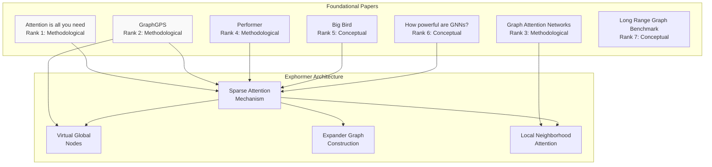
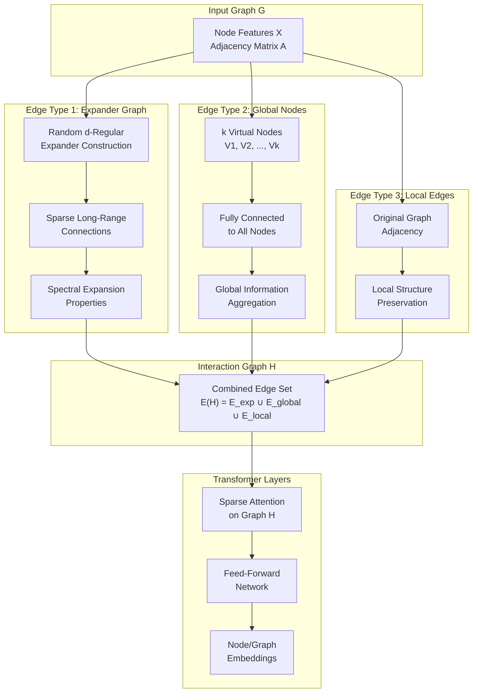
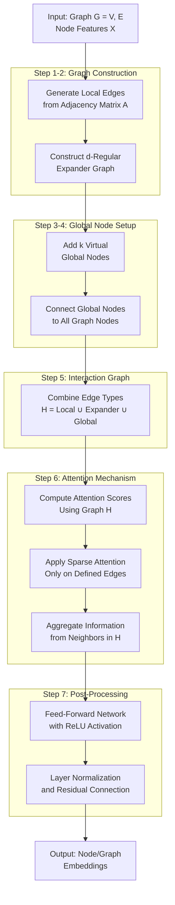

<!-- source: DeepWiki mcp.deepwiki.com · repo HKUDS/AI-Researcher · extra page Sparse Transformers (Exphormer) · fetched 2026-11-09 -->

# Sparse Transformers (Exphormer)

<details>
<summary>Relevant source files</summary>

The following files were used as context for generating this wiki page:

- [benchmark/final/gnn/exphormer.json](benchmark/final/gnn/exphormer.json)

</details>


## Purpose and Scope

This page documents the **Exphormer** benchmark task within the AI-Researcher system's Graph Neural Networks evaluation suite. Exphormer ("Expander + Transformer") is a scalable sparse graph transformer architecture that achieves linear computational complexity while maintaining competitive accuracy with traditional message-passing networks. This benchmark evaluates the system's ability to reproduce and understand sparse attention mechanisms for graph learning tasks.

For other GNN benchmarks, see [Graph Neural Networks](#5.2). For structure learning approaches, see [Structure Learning (NodeFormer)](#5.2.6).

**Sources:** [benchmark/final/gnn/exphormer.json:1-87]()

---

## Overview

Exphormer addresses a fundamental scalability challenge in graph transformers: traditional transformer architectures have quadratic complexity in the number of nodes, making them impractical for large graphs. The architecture introduces a sparse attention framework based on three key mechanisms:

1. **Expander Graph Edges**: Provide sparse but effective long-range connectivity
2. **Virtual Global Nodes**: Enable global information aggregation with linear complexity
3. **Local Neighborhood Edges**: Preserve local graph structure

This sparse attention design achieves **O(n)** complexity (linear in graph size) while allowing the model to capture both local and global graph properties.

**Key Innovation**: The use of expander graphs—mathematical structures with provable spectral expansion, pseudorandomness, and sparsity properties—ensures efficient information propagation across the entire graph with minimal edges.

**Sources:** [benchmark/final/gnn/exphormer.json:78-87]()

---

## Benchmark Configuration

### Task Metadata

The Exphormer benchmark is defined in the AI-Researcher system with the following configuration:

| Property | Value |
|----------|-------|
| **Instance ID** | `exphormer` |
| **Category** | Graph Neural Networks (`gnn`) |
| **Target Paper** | "Exphormer: Sparse Transformers for Graphs" |
| **Authors** | Hamed Shirzad, Ameya Velingker, Balaji Venkatachalam, Danica J. Sutherland, Ali Kemal Sinop |
| **Year** | 2023 |
| **Venue** | International Conference on Machine Learning (ICML) |
| **Citations** | 70 |
| **Topic** | Graph Transformers |
| **Field** | Graph Neural Networks |

**Sources:** [benchmark/final/gnn/exphormer.json:2-84]()

### Foundational References

The benchmark tracks seven key reference papers that inform the Exphormer architecture:



**Sources:** [benchmark/final/gnn/exphormer.json:4-67]()

---

## Technical Architecture

### Three-Component Sparse Attention

Exphormer constructs an interaction graph **H** that combines three types of edges to achieve sparse yet effective attention:



**Sources:** [benchmark/final/gnn/exphormer.json:85-86]()

### Expander Graph Construction

Expander graphs are the mathematical foundation of Exphormer's scalability. The construction process:

1. **d-Regular Graph Generation**: Create a random d-regular graph using permutation-based methods
2. **Degree Parameter d**: Typically ranges from 6 to 22, tuned via linear search
3. **Mathematical Properties**:
   - **Spectral Expansion**: Eigenvalue gap ensures rapid information mixing
   - **Pseudorandomness**: Uniform-like connectivity despite sparsity
   - **Linear Sparsity**: Only O(nd) edges for n nodes

The expander graph provides long-range connectivity with provably good mixing properties, allowing distant nodes to exchange information through short paths without dense all-to-all attention.

**Sources:** [benchmark/final/gnn/exphormer.json:85-86]()

### Virtual Global Nodes

Virtual global nodes serve as information hubs:

- **Quantity**: 1 to 6 nodes (k parameter)
- **Connectivity**: Each virtual node connects to all n graph nodes
- **Function**: 
  - Aggregate global graph information
  - Serve as universal function approximators
  - Enable O(nk) global attention instead of O(n²)
- **Complexity**: With k << n, maintains linear overall complexity

**Sources:** [benchmark/final/gnn/exphormer.json:85-86]()

---

## Implementation Specifications

### Task Definition

The benchmark defines two task levels based on the AI-Researcher framework:

#### Task 1: Implementation Details

**Primary Task**: Implement the Exphormer sparse graph transformer for:
- Node classification
- Graph classification
- Representation learning on large graphs

**Core Algorithms**:
1. Sparse attention mechanism using expander graphs and global nodes
2. Graph construction combining three edge types
3. Linear complexity attention calculations

**Sources:** [benchmark/final/gnn/exphormer.json:85]()

#### Task 2: Research Problem

**Problem Domain**: Scalability and effectiveness of graph transformers for large-scale graph learning tasks.

**Current Limitations**:
- Existing graph transformers have quadratic complexity O(n²) in node count
- Limited applicability to large datasets due to computational constraints
- Often fail to match message-passing network accuracy

**Research Objectives**:
- Develop sparse attention framework with O(n) complexity
- Maintain competitive accuracy with message-passing networks
- Enable transformer application to graphs larger than previously feasible

**Sources:** [benchmark/final/gnn/exphormer.json:86]()

---

## Key Parameters and Hyperparameters

### Model Configuration

The implementation requires careful tuning of the following parameters:

| Parameter | Typical Range | Purpose |
|-----------|---------------|---------|
| **Number of Layers** | 3-7 | Depth of transformer stack |
| **Hidden Dimension** | 32-128 | Node representation size |
| **Number of Heads** | 4-8 | Multi-head attention parallelism |
| **Dropout Rate** | 0.1-0.3 | Regularization to prevent overfitting |
| **Expander Degree (d)** | 6-22 | Edges per node in expander graph |
| **Virtual Nodes (k)** | 1-6 | Number of global attention hubs |

### Input/Output Specifications

**Input Format**:
- Node feature matrix **X** ∈ ℝ^(n×d_in)
- Adjacency matrix **A** ∈ {0,1}^(n×n) (can be sparse)

**Output Format**:
- Node embeddings for node-level tasks
- Graph embeddings for graph-level tasks

**Sources:** [benchmark/final/gnn/exphormer.json:85]()

---

## Processing Pipeline

The following diagram illustrates the step-by-step execution flow of Exphormer:



**Sources:** [benchmark/final/gnn/exphormer.json:85]()

---

## Critical Implementation Considerations

### Memory Management

1. **Batch Size Constraints**: Must fit within GPU memory limits
2. **Sparse Representation**: Use sparse tensor formats for adjacency matrices
3. **Edge Feature Handling**: Efficiently manage edge attributes for local neighborhood edges

### Parameter Tuning

1. **Number of Heads and Hidden Dimension**: Significantly affect performance; require careful tuning
2. **Expander Degree**: Determined through linear search based on dataset characteristics
3. **Virtual Node Count**: Balance between global information capacity and computational cost

### Structural Considerations

1. **Positional Encodings**: Essential for maintaining node order and graph structure
2. **Edge Feature Integration**: Enhance expressivity by incorporating edge attributes
3. **d-Regular Graph Quality**: Ensure proper expander graph construction using validated methods

**Sources:** [benchmark/final/gnn/exphormer.json:85]()

---

## Integration with GraphGPS Framework

Exphormer is designed to integrate with the **GraphGPS** (Graph GPS: A General Framework for Scalable Graph Transformers) framework, which provides:

- **Modular Architecture**: Combines local message passing with global attention
- **Scalable Design**: Support for different attention mechanisms
- **Hybrid Approach**: Integrates GNN layers with transformer layers

The integration allows Exphormer's sparse attention to replace dense attention in GraphGPS while maintaining compatibility with the framework's other components.

**Sources:** [benchmark/final/gnn/exphormer.json:15-22]()

---

## Theoretical Properties

### Complexity Analysis

| Component | Complexity | Explanation |
|-----------|------------|-------------|
| **Expander Edges** | O(nd) | d-regular graph with n nodes |
| **Global Nodes** | O(nk) | k global nodes × n regular nodes |
| **Local Edges** | O(m) | m edges in original graph |
| **Total Complexity** | **O(n + m)** | Linear in graph size |

This contrasts with dense transformers which require O(n²) complexity.

### Provable Properties

1. **Spectral Expansion**: Guarantees rapid information propagation across the graph
2. **Universal Approximation**: Virtual global nodes provide universal approximation capability
3. **Expressivity**: Maintains expressive power competitive with message-passing networks

**Sources:** [benchmark/final/gnn/exphormer.json:78-86]()

---

## Benchmark Task Files

The Exphormer benchmark is configured through the following file structure in the AI-Researcher system:

```
benchmark/final/gnn/
└── exphormer.json          # Complete benchmark configuration
    ├── target              # Paper title and identifier
    ├── source_papers[]     # Foundational references with rankings
    ├── authors[]           # Paper authors
    ├── abstract            # Research problem description
    ├── task1              # Implementation specifications
    └── task2              # Research objectives and motivations
```

**Benchmark Instance ID**: `exphormer`  
**Category**: `gnn` (Graph Neural Networks)

This configuration file is processed by the AI-Researcher system to:
1. Extract research objectives from `task2`
2. Implement the methodology described in `task1`
3. Evaluate results against expert-level implementations
4. Generate research papers documenting the approach

**Sources:** [benchmark/final/gnn/exphormer.json:1-87]()

---

## Related Benchmarks

Within the Graph Neural Networks category, Exphormer complements other scalability-focused benchmarks:

- **[NodeFormer](#5.2.6)**: Alternative approach to structure learning without expander graphs
- **[Universal Learning Principles](#5.2.8)**: Theoretical foundations for infinite-depth GNNs
- **[DIFFormer](#5.2.3)**: Energy-constrained diffusion for non-IID data

All share the goal of improving GNN scalability while addressing different aspects of the problem (structure learning, theoretical convergence, data distribution).

**Sources:** [benchmark/final/gnn/exphormer.json:1-87]()

---

