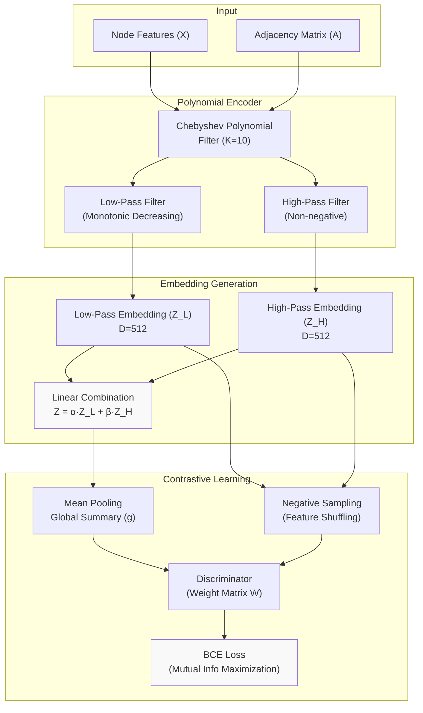
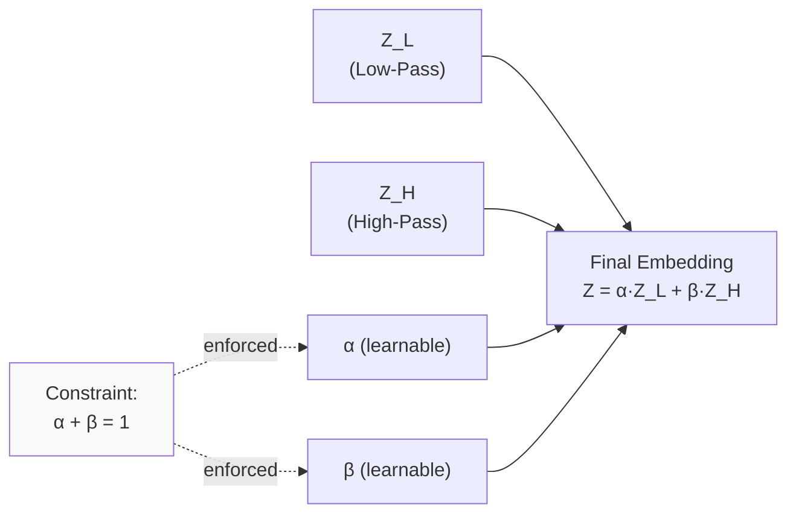
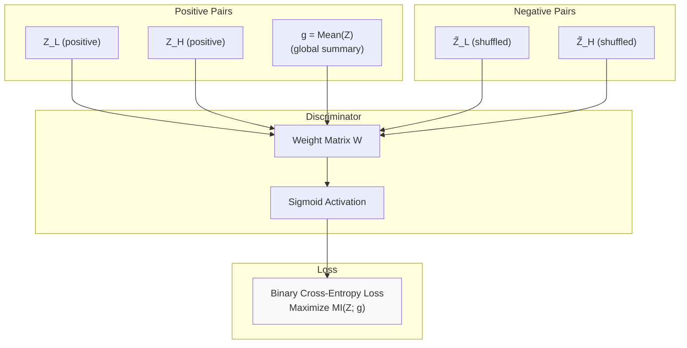
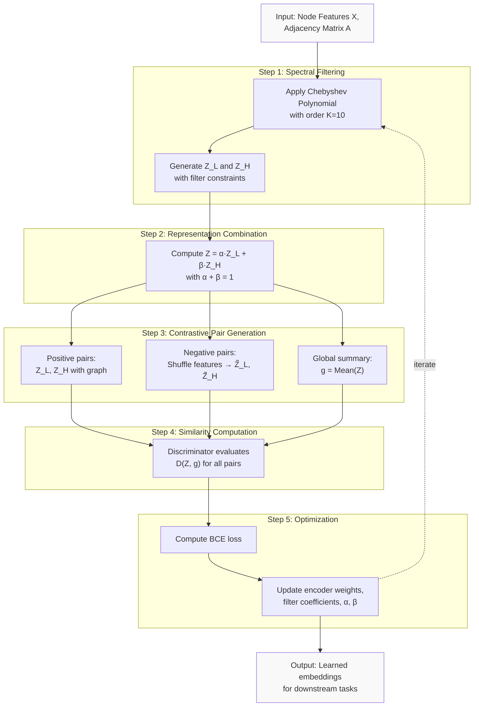
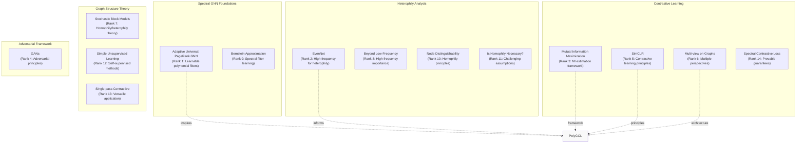

<!-- source: DeepWiki mcp.deepwiki.com · repo HKUDS/AI-Researcher · extra page Spectral Polynomial Filtering (PolyGCL) · fetched 2026-11-09 -->

# Spectral Polynomial Filtering (PolyGCL)

<details>
<summary>Relevant source files</summary>

The following files were used as context for generating this wiki page:

- [benchmark/final/gnn/gnn_poly_gcl.json](benchmark/final/gnn/gnn_poly_gcl.json)

</details>


## Purpose and Scope

This page documents the **PolyGCL** benchmark task within the AI-Researcher evaluation framework. PolyGCL addresses Graph Contrastive Learning (GCL) using learnable spectral polynomial filters to enable effective self-supervised representation learning on both homophilic and heterophilic graphs. The benchmark evaluates AI-Researcher's ability to design contrastive learning systems that adaptively capture low-frequency and high-frequency spectral information through polynomial filter approximation.

For other GNN benchmarks focused on different aspects:
- For multi-task adaptation, see [Multi-task Prompting (All-in-One)](#5.2.1)
- For sparse attention mechanisms, see [Sparse Transformers (Exphormer)](#5.2.2)
- For non-Markovian dynamics, see [Energy Constrained Diffusion (DIFFormer)](#5.2.3)
- For long-term dependencies, see [Fractional-Order Dynamics (FROND)](#5.2.4)
- For theoretical foundations, see [Universal Learning Principles](#5.2.8)

---

## Research Problem Context

### Motivation and Limitations of Existing Approaches

Traditional Graph Contrastive Learning methods exhibit inherent smoothness characteristics due to:

1. **Low-pass GNN encoders**: Standard message-passing architectures perform implicit low-pass filtering
2. **Homophily assumption**: Learning objectives assume connected nodes share similar representations
3. **Heterophilic failure**: Methods underperform when connected nodes belong to different classes

The research challenges the assumption that homophily is necessary for effective graph learning and investigates whether spectral polynomial filters—which excel in supervised settings—can be adapted for unsupervised contrastive learning.

### Core Research Objectives

| Objective | Description |
|-----------|-------------|
| **Spectral Integration** | Incorporate learnable polynomial filters into contrastive learning framework |
| **Heterophily Support** | Introduce high-pass information to capture heterophilic graph characteristics |
| **Theoretical Foundation** | Prove necessity of high-frequency information for heterophilic settings |
| **Unified Framework** | Achieve superior performance across varying homophily levels |

**Sources:** [benchmark/final/gnn/gnn_poly_gcl.json:1-143]()

---

## Benchmark Task Configuration

### Task Metadata

```
Instance ID: gnn_poly_gcl
Category: gnn
Target Paper: PolyGCL GRAPH CONTRASTIVE LEARNING via Learnable Spectral Polynomial Filters
Authors: Jingyu Chen, Runlin Lei, Zhewei Wei (2024)
Citations: 11
URL: https://openreview.net/forum?id=y21ZO6M86t
```

### Evaluation Dimensions

The benchmark assesses AI-generated research across:
- **Novelty**: Innovation in combining spectral filtering with contrastive learning
- **Theoretical Rigor**: Mathematical foundation for high-pass/low-pass decomposition
- **Experimental Comprehensiveness**: Validation on both homophilic and heterophilic graphs
- **Implementation Quality**: Polynomial filter constraints and optimization strategies

**Sources:** [benchmark/final/gnn/gnn_poly_gcl.json:132-141]()

---

## Technical Architecture

### System Overview



**Diagram: PolyGCL Architecture from Input to Loss Computation**

The architecture implements a dual-view spectral filtering approach where polynomial filters decompose graph signals into low-frequency (homophilic) and high-frequency (heterophilic) components, which are then combined and optimized through contrastive learning.

**Sources:** [benchmark/final/gnn/gnn_poly_gcl.json:141-142]()

---

## Core Components

### 1. Polynomial Encoder

The polynomial encoder generates spectral views using Chebyshev polynomial approximation of graph filters.

#### Functional Specification

| Parameter | Value | Purpose |
|-----------|-------|---------|
| `K` (polynomial order) | 10 | Controls filter expressiveness and computational cost |
| `D` (output dimension) | 512 | Embedding dimensionality |
| Input | `X` (features), `A` (adjacency) | Raw graph data |
| Output | `Z_L`, `Z_H` | Low-pass and high-pass embeddings |

#### Filter Constraints

```
Low-Pass Filter (Z_L):
  - Constraint: Monotonically decreasing with frequency
  - Purpose: Captures smooth homophilic patterns
  - Spectral response: Passes low frequencies, attenuates high frequencies

High-Pass Filter (Z_H):
  - Constraint: Non-negative coefficients
  - Purpose: Captures heterophilic distinctions
  - Spectral response: Attenuates low frequencies, passes high frequencies
```

**Implementation Critical**: The constraints ensure physically meaningful filters—low-pass must decrease monotonically to prevent amplifying high-frequency noise, while high-pass must remain non-negative to avoid destructive interference in heterophilic signal capture.

**Sources:** [benchmark/final/gnn/gnn_poly_gcl.json:141]()

---

### 2. Linear Combination Module

Adaptively mixes low-pass and high-pass representations to produce final node embeddings.



**Diagram: Linear Combination with Learnable Coefficients**

#### Mathematical Formulation

```
Z = α · Z_L + β · Z_H

where:
  α, β ∈ ℝ (learnable parameters)
  α + β = 1 (normalization constraint)
```

The learnable coefficients enable the model to adapt to different graph homophily levels:
- **High α**: Emphasizes low-pass view (homophilic graphs)
- **High β**: Emphasizes high-pass view (heterophilic graphs)
- **Balanced**: Equal contribution for mixed homophily

**Sources:** [benchmark/final/gnn/gnn_poly_gcl.json:141]()

---

### 3. Discriminator and Contrastive Loss

The discriminator evaluates similarity between node embeddings and graph-level summaries to enable contrastive learning.

#### Architecture



**Diagram: Discriminator Architecture for Contrastive Learning**

#### Negative Sampling Strategy

```
Negative Generation:
  1. Shuffle node features to break graph structure
  2. Generate corrupted embeddings Z̃_L and Z̃_H
  3. Preserve spectral filtering but destroy node-graph correspondence

Critical Constraint:
  - Avoid excessive perturbations to maintain meaningful spectral information
  - Shuffling provides structural corruption without losing frequency characteristics
```

#### Loss Function

The Binary Cross-Entropy loss maximizes mutual information between node embeddings and the graph summary:

```
L_BCE = -E[(log D(Z_L, g) + log D(Z_H, g))] 
        -E[(log(1 - D(Z̃_L, g)) + log(1 - D(Z̃_H, g)))]

where:
  D(·,·) is the discriminator output (similarity score)
  Z_L, Z_H are positive embeddings
  Z̃_L, Z̃_H are negative embeddings
  g is the mean-pooled graph summary
```

**Sources:** [benchmark/final/gnn/gnn_poly_gcl.json:141]()

---

## Implementation Pipeline

### End-to-End Execution Flow



**Diagram: Complete Execution Pipeline from Input to Learned Embeddings**

### Critical Implementation Details

| Aspect | Specification | Rationale |
|--------|---------------|-----------|
| **Polynomial Order** | K = 10 | Balance between filter expressiveness and computational efficiency |
| **Coefficient Initialization** | α, β near 0.5 | Start with balanced contribution; adapt during training |
| **Early Stopping** | Validation-based | Prevent overfitting while ensuring convergence |
| **Constraint Enforcement** | Projection after each update | Maintain monotonicity (low-pass) and non-negativity (high-pass) |
| **Perturbation Control** | Feature shuffling only | Preserve spectral structure while breaking node-graph correlation |

**Sources:** [benchmark/final/gnn/gnn_poly_gcl.json:141]()

---

## Theoretical Foundation

### Spectral Perspective on Homophily and Heterophily

The research provides theoretical justification for incorporating high-frequency information:

#### Homophilic Graphs

```
Characteristic: Connected nodes share similar labels
Spectral signature: Energy concentrated in low frequencies
Optimal filter: Low-pass (attenuate high frequencies)
GCL paradigm: Traditional methods work well
```

#### Heterophilic Graphs

```
Characteristic: Connected nodes have different labels
Spectral signature: Energy distributed across frequencies, including high bands
Optimal filter: Combination of low-pass and high-pass
GCL paradigm: Traditional methods fail; high-pass information necessary
```

### Theoretical Proof Outline

The benchmark includes proof that PolyGCL outperforms traditional GCL paradigms:

1. **Low-pass limitation**: Pure low-pass filtering cannot distinguish heterophilic patterns
2. **High-pass necessity**: High-frequency components capture class boundaries in heterophilic settings
3. **Adaptive combination**: Linear combination with learned α, β optimally balances frequency content
4. **Performance guarantee**: Theoretical bound on representation quality across homophily spectrum

**Sources:** [benchmark/final/gnn/gnn_poly_gcl.json:142]()

---

## Source Paper References

### Foundational Works

The benchmark builds on 14 key research papers spanning multiple areas:



**Diagram: Key Research Influences on PolyGCL Design**

### Reference Usage Patterns

| Reference Type | Count | Purpose |
|----------------|-------|---------|
| **Methodological** | 8 | Direct technical contributions (polynomial filters, contrastive learning, MI) |
| **Conceptual** | 6 | Theoretical foundations (homophily, heterophily, graph structure) |

**Sources:** [benchmark/final/gnn/gnn_poly_gcl.json:4-131]()

---

## Evaluation Methodology

### Experimental Validation Strategy

The benchmark evaluates AI-generated research on:

#### 1. Synthetic Datasets

```
Purpose: Controlled validation of theoretical predictions
Variables: Homophily ratio (0.0 to 1.0)
Metrics: Representation quality across homophily spectrum
Expected outcome: Consistent performance across all homophily levels
```

#### 2. Real-World Datasets

```
Categories:
  - Homophilic graphs (citation networks, social networks)
  - Heterophilic graphs (webpage networks, Wikipedia networks)
  
Metrics:
  - Node classification accuracy
  - Clustering quality
  - Embedding discriminability
```

#### 3. Ablation Studies

| Component | Ablation | Expected Impact |
|-----------|----------|-----------------|
| **High-pass filter** | Remove (α=1, β=0) | Degradation on heterophilic graphs |
| **Low-pass filter** | Remove (α=0, β=1) | Degradation on homophilic graphs |
| **Polynomial order K** | Vary K ∈ {2,5,10,15} | Performance vs. complexity tradeoff |
| **Filter constraints** | Remove constraints | Unstable training, degraded performance |

**Sources:** [benchmark/final/gnn/gnn_poly_gcl.json:141-142]()

---

## Performance Considerations

### Computational Complexity

```
Polynomial Filtering:
  - Time: O(K · |E| · D) per layer
    where K = polynomial order
          |E| = number of edges
          D = embedding dimension
  
  - Space: O(|V| · D) for embeddings
    where |V| = number of nodes

Contrastive Learning:
  - Time: O(|V| · D) for discriminator
  - Space: O(|V| · D) for positive/negative pairs

Overall:
  - Linear in graph size |E|
  - Linear in embedding dimension D
  - Linear in polynomial order K
```

### Optimization Best Practices

| Practice | Recommendation | Rationale |
|----------|----------------|-----------|
| **Learning rate** | Start conservative (1e-4) | Polynomial coefficients sensitive to updates |
| **Batch size** | Graph-dependent | Full-batch for small graphs, mini-batch for large |
| **Epochs** | 200-500 with early stopping | Allow convergence without overfitting |
| **Warmup** | 10-20 epochs for α, β | Stabilize filter coefficient learning |
| **Regularization** | L2 on encoder weights | Prevent overfitting to training graph |

### Hyperparameter Sensitivity

```
High sensitivity:
  - Polynomial order K (directly affects expressiveness)
  - Coefficient initialization (influences convergence)

Medium sensitivity:
  - Learning rate (standard tuning needed)
  - Embedding dimension D (performance vs. efficiency)

Low sensitivity:
  - Batch size (for reasonably-sized graphs)
  - Negative sampling strategy (shuffling is robust)
```

**Sources:** [benchmark/final/gnn/gnn_poly_gcl.json:141]()

---

## Integration with AI-Researcher

### Task Configuration

When AI-Researcher evaluates this benchmark, it uses the configuration:

```json
{
  "instance_id": "gnn_poly_gcl",
  "category": "gnn",
  "target": "PolyGCL GRAPH CONTRASTIVE LEARNING via Learnable Spectral Polynomial Filters"
}
```

The system must generate research that addresses the core objectives specified in `task1` and `task2` fields of the benchmark specification.

### Evaluation Criteria

AI-Researcher's output is compared against expert ground truth across:

1. **Novelty**: Does the approach introduce learnable spectral filters for contrastive learning?
2. **Theoretical Foundation**: Is the necessity of high-frequency information proven?
3. **Implementation Correctness**: Are polynomial filters and constraints properly implemented?
4. **Experimental Rigor**: Are both homophilic and heterophilic graphs evaluated?
5. **Result Interpretation**: Are performance differences explained through spectral lens?

**Sources:** [benchmark/final/gnn/gnn_poly_gcl.json:1-143]()

---

## Summary

PolyGCL represents a significant advancement in graph contrastive learning by:

- **Addressing Heterophily**: Introducing high-pass spectral filters to capture heterophilic patterns
- **Theoretical Rigor**: Proving necessity of high-frequency information through spectral analysis
- **Unified Framework**: Achieving strong performance across varying homophily levels
- **Learnable Adaptation**: Using polynomial filters with learnable coefficients to adapt to graph characteristics

The benchmark challenges AI-Researcher to synthesize insights from spectral graph theory, contrastive learning, and graph structure analysis to design a unified self-supervised learning framework that works across diverse graph types.

**Sources:** [benchmark/final/gnn/gnn_poly_gcl.json:1-143]()

---

