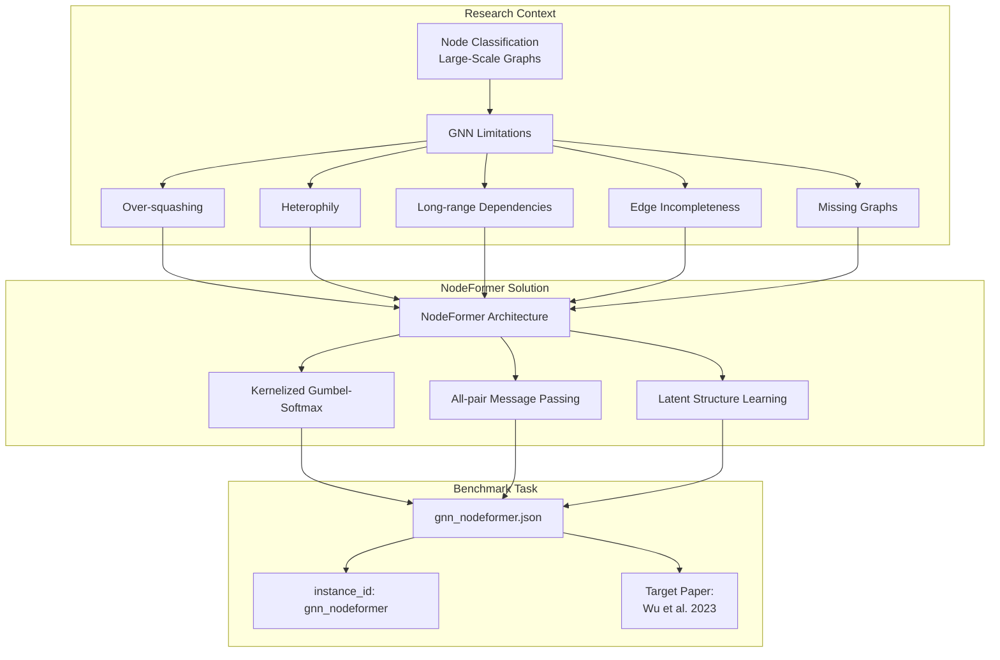
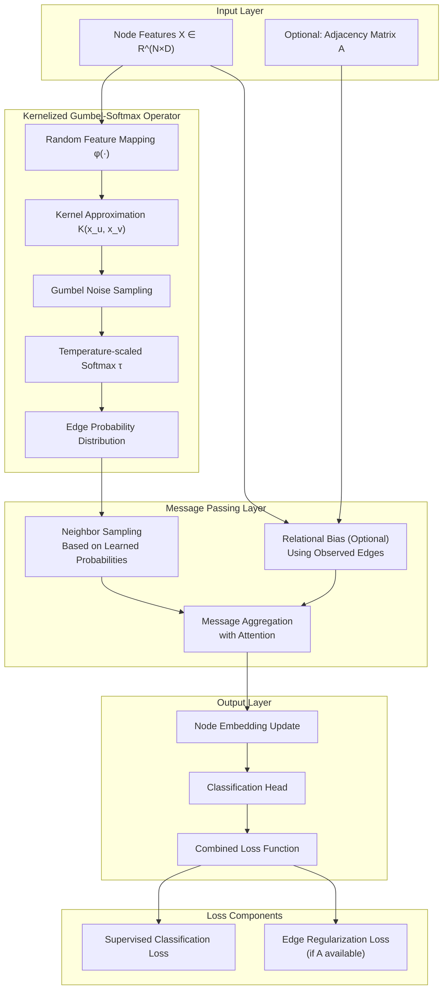
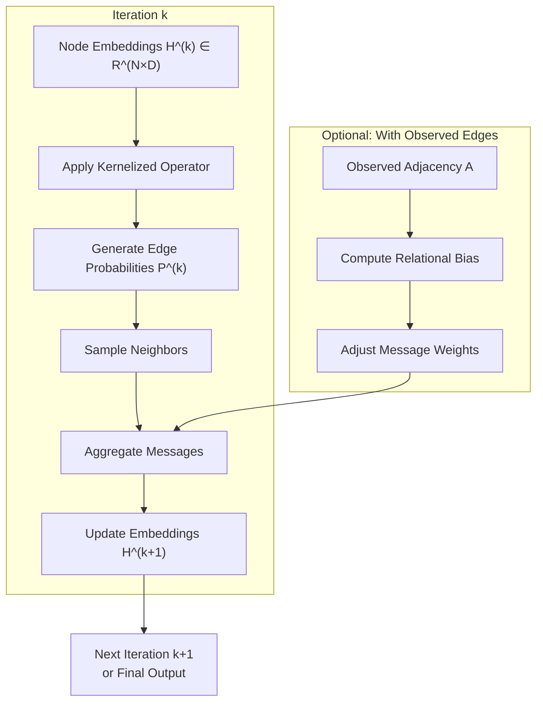
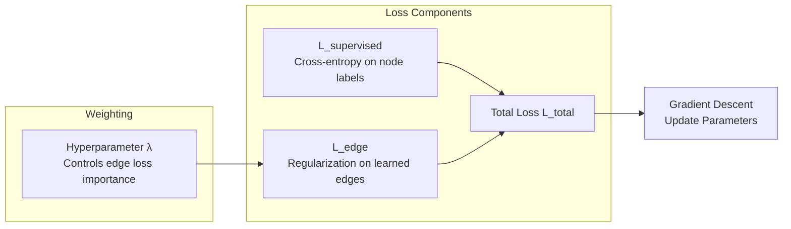
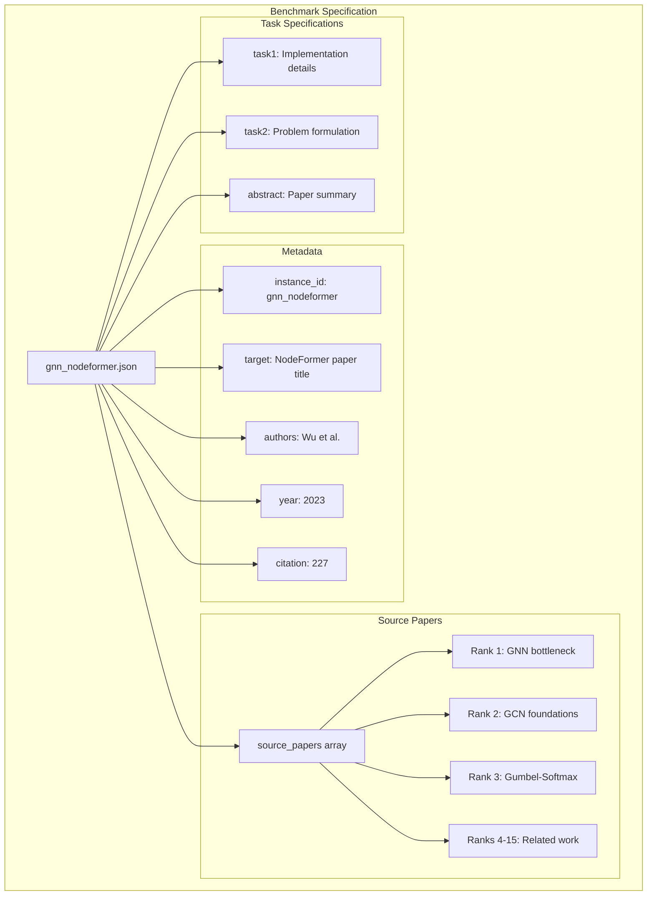
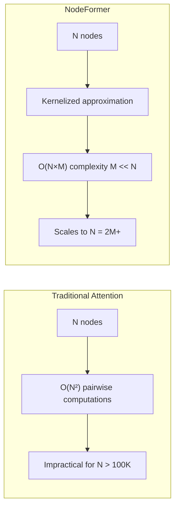

<!-- source: DeepWiki mcp.deepwiki.com · repo HKUDS/AI-Researcher · extra page Structure Learning (NodeFormer) · fetched 2026-11-09 -->

# Structure Learning (NodeFormer)

Relevant source files

The following files were used as context for generating this wiki page:

- [benchmark/final/gnn/gnn_nodeformer.json](benchmark/final/gnn/gnn_nodeformer.json)

## Purpose and Scope

This document describes the **NodeFormer benchmark task** within the AI-Researcher evaluation framework, which focuses on scalable graph structure learning for node classification. NodeFormer addresses fundamental limitations in Graph Neural Networks (GNNs) by introducing a kernelized Gumbel-Softmax operator that enables efficient all-pair message passing with linear computational complexity.

This benchmark evaluates the AI-Researcher system's ability to understand and implement novel graph structure learning techniques that overcome traditional GNN bottlenecks including over-squashing, heterophily, long-range dependencies, and edge incompleteness. For other GNN benchmarks, see [Multi-task Prompting](#5.2.1), [Sparse Transformers](#5.2.2), or [Fractional-Order Dynamics](#5.2.4).

**Sources:** [benchmark/final/gnn/gnn_nodeformer.json:1-155]()

## Overview

NodeFormer is a Transformer-style network designed for node classification on large graphs (up to 2M nodes). Unlike traditional GNNs that rely on fixed graph topology, NodeFormer learns latent graph structures in a differentiable manner, enabling it to handle scenarios where input graphs are incomplete or entirely absent.

### Key Innovation

The core contribution is an **all-pair message passing scheme** that propagates node signals between arbitrary node pairs with **O(N) complexity** rather than the typical O(N²) complexity of attention mechanisms. This is achieved through a kernelized approximation of the Gumbel-Softmax operator.

### Target Research Domain

**Sources:** [benchmark/final/gnn/gnn_nodeformer.json:2-3](), [benchmark/final/gnn/gnn_nodeformer.json:151-155]()

## Problem Formulation

### Challenges Addressed

NodeFormer tackles several interconnected challenges that limit traditional GNN performance:

| Challenge | Description | Impact on GNNs |
|-----------|-------------|----------------|
| **Over-squashing** | Information bottleneck when aggregating long-range dependencies | Poor propagation of distant node information |
| **Heterophily** | Nodes with different labels are connected | Violates homophily assumption of standard GNNs |
| **Long-range Dependencies** | Inability to capture relationships beyond k-hop neighborhoods | Limited receptive field |
| **Edge Incompleteness** | Missing or noisy edges in observed graph | Suboptimal message passing topology |
| **Absent Graphs** | No input graph structure available | Traditional GNNs cannot operate |

### Limitations of Existing Approaches

Traditional graph structure learning methods face a fundamental scalability barrier: learning adaptive topology for message passing requires computing relationships between all node pairs, resulting in **O(N²) complexity**. This makes them impractical for graphs with millions of nodes.

**Sources:** [benchmark/final/gnn/gnn_nodeformer.json:151-155]()

## Technical Architecture

### Core Components

**Sources:** [benchmark/final/gnn/gnn_nodeformer.json:153-154]()

### Kernelized Gumbel-Softmax Operator

The kernelized Gumbel-Softmax operator is the key innovation enabling scalable structure learning. It consists of three main mechanisms:

#### 1. Kernel Approximation

Rather than computing exact attention weights between all node pairs, NodeFormer uses random feature mapping to approximate the kernel function:

- Maps node features to a higher-dimensional random feature space using φ(·)
- Approximates similarity K(x_u, x_v) ≈ φ(x_u)^T φ(x_v)
- Reduces complexity from O(N²) to O(N×M) where M is the random feature dimension

#### 2. Gumbel-Softmax Differentiability

The Gumbel-Softmax trick enables gradient-based learning of discrete graph structures:

- Samples Gumbel noise to introduce stochasticity in edge selection
- Applies temperature-controlled softmax to maintain differentiability
- Allows end-to-end training while approximating categorical distributions

#### 3. Temperature Parameter τ

The temperature parameter controls the trade-off between discrete and continuous edge distributions:

- Typical range: **τ ∈ [0.25, 0.4]** during training
- Lower temperatures produce sharper, more discrete distributions
- Higher temperatures enable smoother gradients during early training

**Sources:** [benchmark/final/gnn/gnn_nodeformer.json:153-154]()

## Implementation Details

### Component Configuration

The following table summarizes the critical hyperparameters and their roles:

| Component | Parameter | Value Range | Purpose |
|-----------|-----------|-------------|---------|
| **Gumbel-Softmax** | Temperature τ | 0.25 - 0.4 | Controls discreteness of learned edges |
| **Node Features** | Dimension D | Problem-specific | Input feature vector size |
| **Random Features** | Dimension M | Tunable | Kernel approximation quality |
| **Neighbor Sampling** | K iterations | Configurable | Number of message passing rounds |
| **Relational Bias** | Activation | Sigmoid | Weight adjustment for observed edges |

### Message Passing Workflow

**Sources:** [benchmark/final/gnn/gnn_nodeformer.json:153-154]()

### Step-by-Step Execution

1. **Initialization**
   - Input: Node embedding matrix X ∈ R^(N×D)
   - Optional: Adjacency matrix A for relational bias

2. **Structure Learning (per layer)**
   - Apply kernelized Gumbel-Softmax to current embeddings
   - Generate probability distribution over potential edges
   - Sample neighbors for each node based on probabilities

3. **Message Passing**
   - For each node, aggregate information from sampled neighbors
   - Apply attention mechanism to weight neighbor contributions
   - Optionally incorporate relational bias from observed edges

4. **Embedding Update**
   - Update node representations using aggregated messages
   - Apply non-linear transformation (typically MLP)
   - Prepare for next iteration or final classification

5. **Loss Computation**
   - Compute supervised classification loss on node labels
   - If edges available: Add edge regularization loss
   - Backpropagate gradients through differentiable structure

**Sources:** [benchmark/final/gnn/gnn_nodeformer.json:153-154]()

## Loss Functions

### Combined Objective

NodeFormer optimizes a combined loss function that balances classification accuracy with structure learning quality:

### Supervised Classification Loss

Standard cross-entropy loss on labeled nodes:
- Measures prediction accuracy on training nodes
- Primary optimization objective for node classification task

### Edge Regularization Loss

When observed edges are available:
- Encourages learned edge probabilities to align with observed structure
- Prevents the model from deviating too far from known connectivity
- Combines categorical edge probabilities with supervision signal

**Sources:** [benchmark/final/gnn/gnn_nodeformer.json:153-154]()

## Critical Implementation Considerations

### Performance Factors

Several implementation details significantly affect NodeFormer's performance:

1. **Temperature Tuning**
   - Most critical hyperparameter for balancing discrete structure learning
   - Too low: Training instability, gradient issues
   - Too high: Overly smooth distributions, poor discrete approximation

2. **Batch Size for Large Graphs**
   - Must balance memory constraints with computational efficiency
   - Large-scale graphs (2M nodes) require careful memory management
   - Mini-batch sampling strategies may be necessary

3. **Random Feature Dimensionality**
   - Controls quality of kernel approximation
   - Higher dimensions: Better approximation, more computation
   - Lower dimensions: Faster computation, potential accuracy loss

4. **Regularization Techniques**
   - Dropout prevents overfitting on node features
   - Edge-level regularization improves generalization
   - Critical for handling graphs with varying structures

**Sources:** [benchmark/final/gnn/gnn_nodeformer.json:153-154]()

## Benchmark Task Structure

### JSON Configuration

**Sources:** [benchmark/final/gnn/gnn_nodeformer.json:1-155]()

### Source Paper Dependencies

NodeFormer builds on 15 key reference papers, ranked by importance:

| Rank | Paper | Type | Role |
|------|-------|------|------|
| 1 | GNN Bottleneck | Methodological, Conceptual | Establishes foundational constraints to overcome |
| 2 | Semi-supervised GCN | Methodological | Informs network architecture design |
| 3 | Gumbel-Softmax | Methodological | Core technique for discrete optimization |
| 4 | Learning Discrete Structures | Methodological | Structure learning component development |
| 5 | MixHop | Component | Higher-order message passing techniques |
| 6 | Graph Attention Networks | Component | Attention mechanism foundations |
| 7-15 | Various | Mixed | Geometric learning, robustness, non-homophily |

**Sources:** [benchmark/final/gnn/gnn_nodeformer.json:4-141]()

## Task Levels

### Task 1: Implementation Details

The `task1` field provides concrete implementation guidance for reproducing NodeFormer:

**Scope:**
- Detailed component specifications (operator parameters, architectures)
- Input/output formats for each module
- Step-by-step algorithmic workflow
- Critical hyperparameters affecting performance

**Key Focus Areas:**
1. Kernelized Gumbel-Softmax operator configuration
2. Node feature representation requirements
3. Message passing with optional relational bias
4. Loss function composition and weighting

**Sources:** [benchmark/final/gnn/gnn_nodeformer.json:153-154]()

### Task 2: Problem Formulation

The `task2` field articulates the research motivation and contributions:

**Primary Task:**
- Node classification in large-scale graphs (up to 2M nodes)
- Efficient graph structure learning with message passing

**Motivating Limitations:**
- Over-squashing in standard GNNs
- Heterophily handling difficulties
- Long-range dependency challenges
- Incomplete or absent graph structures
- Quadratic complexity barriers

**Core Objectives:**
- Achieve linear O(N) complexity for structure learning
- Enable message passing across arbitrary node pairs
- Support scenarios without pre-specified input graphs
- Improve node-level prediction performance
- Address fundamental GNN architectural limitations

**Sources:** [benchmark/final/gnn/gnn_nodeformer.json:153-155]()

## Scalability Characteristics

### Computational Complexity

NodeFormer's efficiency derives from its linear complexity profile:

### Memory Requirements

- **Node embeddings:** O(N×D) for feature dimension D
- **Random features:** O(N×M) for kernel approximation dimension M
- **Edge probabilities:** Sparse representation, O(N×k) for k sampled neighbors
- **Total:** Linear in number of nodes, enabling large-scale deployment

**Sources:** [benchmark/final/gnn/gnn_nodeformer.json:151-155]()

## Evaluation Context

### Within Inno-Bench

NodeFormer represents one of nine GNN benchmarks in the AI-Researcher evaluation framework. It specifically tests:

1. **Structure Learning Capability**
   - Can the AI system understand and implement learnable graph topology?
   - Does it grasp the kernelized approximation technique?

2. **Scalability Awareness**
   - Does the implementation achieve linear complexity?
   - Are memory-efficient data structures used?

3. **Theoretical Grounding**
   - Understanding of Gumbel-Softmax for discrete optimization
   - Kernel approximation theory for efficient computation

4. **Practical Implementation**
   - Correct hyperparameter ranges (especially temperature)
   - Proper loss function composition
   - Handling of optional relational bias

### Comparison with Other GNN Benchmarks

NodeFormer complements other GNN tasks in the benchmark suite:
- Unlike [Exphormer](#5.2.2), which uses sparse attention with fixed topology
- Unlike [FROND](#5.2.4), which focuses on temporal dynamics
- Unlike [GraphGPT](#5.2.9), which integrates with LLMs for instruction tuning

**Sources:** [benchmark/final/gnn/gnn_nodeformer.json:1-155]()

## Summary

NodeFormer addresses critical scalability and flexibility limitations in graph neural networks through a novel kernelized Gumbel-Softmax operator. By reducing computational complexity from quadratic to linear while maintaining differentiable structure learning, it enables practical deployment on graphs with millions of nodes.

The benchmark task evaluates whether AI-Researcher can:
1. Understand the theoretical foundations (kernel approximation, Gumbel-Softmax)
2. Implement the core algorithmic components correctly
3. Configure critical hyperparameters appropriately
4. Handle both complete and incomplete graph scenarios

This represents a significant challenge in automated research, as it requires synthesizing insights from differentiable discrete optimization, kernel methods, and graph neural network design.

**Sources:** [benchmark/final/gnn/gnn_nodeformer.json:1-155]()

---

