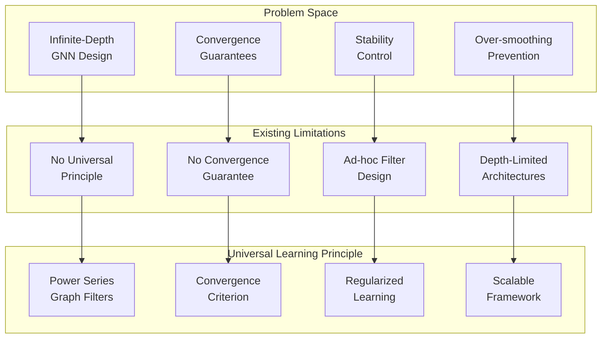
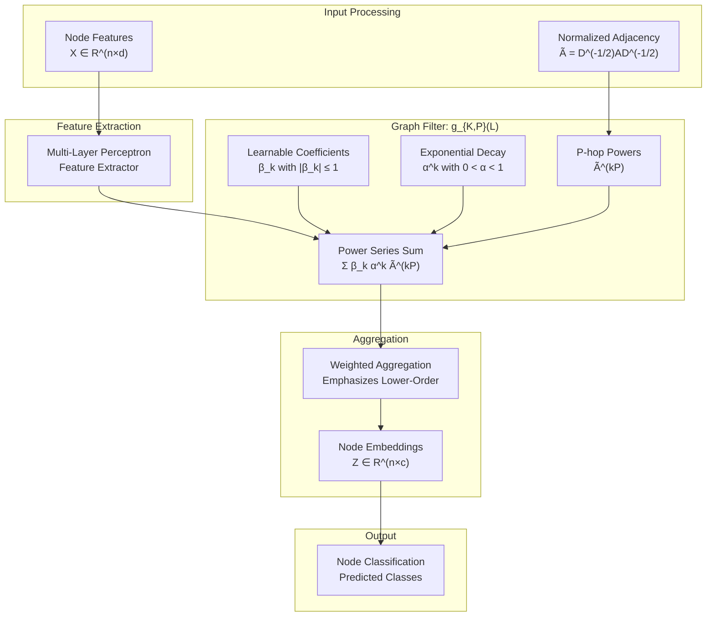
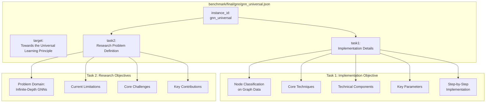
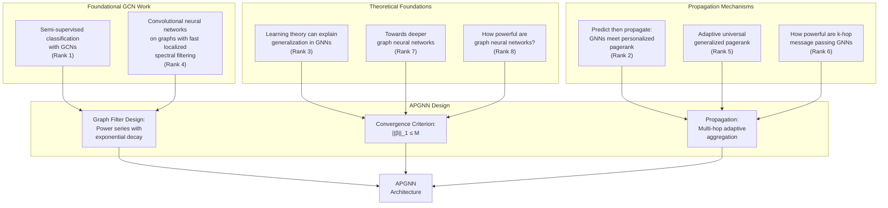

<!-- source: DeepWiki mcp.deepwiki.com · repo HKUDS/AI-Researcher · extra page Universal Learning Principles · fetched 2026-11-09 -->

# Universal Learning Principles

Relevant source files

The following files were used as context for generating this wiki page:

- [benchmark/final/gnn/gnn_universal.json](benchmark/final/gnn/gnn_universal.json)

## Purpose and Scope

This document describes the Universal Learning Principle benchmark task (`gnn_universal`) which evaluates AI-generated research on achieving convergence and stability in infinite-depth Graph Neural Networks (GNNs). The benchmark is based on the paper "Towards the Universal Learning Principle for Graph Neural Networks" and focuses on establishing theoretical criteria for graph filters formed by power series that can guide the design of arbitrarily deep GNNs.

For other GNN benchmarks focusing on different aspects, see [Multi-task Prompting](#5.2.1), [Sparse Transformers](#5.2.2), [Spectral Polynomial Filtering](#5.2.7), or [Graph Instruction Tuning](#5.2.9).

**Sources:** [benchmark/final/gnn/gnn_universal.json:1-146]()

## Universal Learning Principle Overview

The Universal Learning Principle addresses a fundamental challenge in GNN design: how to construct graph filters that remain convergent and stable as network depth approaches infinity. While existing GNNs employ various propagation mechanisms (message passing, spectral filtering, personalized PageRank), few provide theoretical guarantees about their behavior in infinite-depth scenarios.

The principle establishes a scalable regularized learning framework that:
- Provides theoretical criteria for convergence of power series graph filters
- Enables seamless extension to infinite-depth networks
- Maintains stability through controlled coefficient decay
- Prevents over-smoothing through Lipschitz continuity constraints

### Research Problem Domain

**Diagram: Universal Learning Principle Problem Formulation**

**Sources:** [benchmark/final/gnn/gnn_universal.json:142-146]()

## Theoretical Framework

### Power Series Graph Filters

The core mathematical foundation defines graph filters as power series expansions over the normalized adjacency matrix. Given a graph with adjacency matrix $A$ and degree matrix $D$, the normalized adjacency matrix is:

$$\tilde{A} = D^{-1/2}AD^{-1/2}$$

The graph filter is specified as a power series:

$$g_{K,P}(L) = \sum_{k=0}^{K} \beta_k \alpha^k \tilde{A}^{kP}$$

where:
- $K$ is the polynomial order (typically set to 10)
- $P$ is the hop order for neighbor aggregation
- $\beta_k$ are learnable coefficients with $|\beta_k| \leq 1$
- $\alpha$ is the decay rate with $0 < \alpha < 1$

### Convergence Criteria

For the graph filter to converge as $K \to \infty$, the following criterion must be satisfied:

$$\sum_{k=0}^{\infty} |\beta_k| \leq M$$

where $M$ is a finite bound. This ensures that the series converges absolutely. The regularization constraint:

$$\|\beta\|_1 \leq M$$

is enforced during training to maintain convergence properties.

### Stability Through Lipschitz Continuity

The framework guarantees stability by ensuring Lipschitz continuity of the graph filter. The decay rate $\alpha$ controls the exponential decrease in coefficient magnitude, emphasizing lower-order neighbors while preventing instability from high-order propagation.

**Sources:** [benchmark/final/gnn/gnn_universal.json:145:1-58]()

## APGNN Model Architecture

The Adaptive Power GNN (APGNN) instantiates the universal learning principle as a concrete deep learning architecture capable of infinite-depth extension.

### Architectural Components

**Diagram: APGNN Architecture Pipeline**

### Filter Design Mechanism

The graph filter design follows these key principles:

| Component | Specification | Purpose |
|-----------|--------------|---------|
| **Polynomial Order K** | Typically 10 | Controls depth of neighbor aggregation |
| **Hop Order P** | Tunable (≥1) | Balances performance and stability |
| **Decay Rate α** | Range [0.1, 0.9], optimal ~0.7 | Ensures convergence, emphasizes local neighbors |
| **Coefficient Bound** | $\|\beta_k\| \leq 1$ | Prevents divergence |
| **Norm Constraint** | $\|\beta\|_1 \leq M$ | Guarantees absolute convergence |

### Feature Extraction and Processing

The feature extraction mechanism employs an MLP to process raw node features before applying the graph filter:

1. **Input**: Node feature matrix $X \in \mathbb{R}^{n \times d}$ where $n$ is number of nodes and $d$ is feature dimensionality
2. **MLP Processing**: Transforms features into intermediate representation
3. **Graph Filtering**: Applies power series filter with adaptive weights
4. **Aggregation**: Combines multi-order neighbor information with exponential decay
5. **Output**: Node embeddings $Z \in \mathbb{R}^{n \times c}$ where $c$ is number of classes

**Sources:** [benchmark/final/gnn/gnn_universal.json:145:7-58]()

## Benchmark Task Specification

The `gnn_universal` benchmark evaluates AI-generated research on implementing and extending the universal learning principle for GNNs.

### Task Instance Configuration

**Diagram: Benchmark Task Structure**

### Task 1: Implementation Requirements

The implementation task (`task1`) requires researchers to develop a node classification system following these specifications:

**Core Techniques:**
- **Model Type**: Graph neural network with adaptive power series filters
- **Optimization Method**: Regularized learning with Lipschitz continuity constraints
- **Data Processing**: Normalized adjacency matrix construction and feature representation

**Technical Components:**
- **Graph Filter**: $g_{K,P}(L) = \sum_{k=0}^{K} \beta_k \alpha^k \tilde{A}^{kP}$ with constrained coefficients
- **Feature Extractor**: Multi-layer perceptron for node feature processing
- **Aggregation**: Exponentially weighted combination of multi-hop neighbor information

**Critical Parameters:**

| Parameter | Range | Default/Optimal | Constraint |
|-----------|-------|----------------|------------|
| K (polynomial order) | 5-20 | 10 | Balances depth vs. computation |
| P (hop order) | 1-5 | 1+ | Higher P requires stability tuning |
| α (decay rate) | 0.1-0.9 | ~0.7 | Must satisfy 0 < α < 1 |
| M (norm bound) | Positive real | Task-dependent | Controls convergence rate |

**Implementation Steps:**

1. **Adjacency Normalization**: Construct $\tilde{A} = D^{-1/2}AD^{-1/2}$ from graph adjacency matrix
2. **Filter Construction**: Implement power series expansion with learnable coefficients
3. **Feature Processing**: Pass node features through MLP feature extractor
4. **Graph Convolution**: Apply filter to extract multi-hop neighbor information
5. **Weighted Aggregation**: Combine results using exponential decay weights
6. **Classification**: Generate node-level predictions
7. **Constraint Enforcement**: Ensure $\|\beta\|_1 \leq M$ during training

**Sources:** [benchmark/final/gnn/gnn_universal.json:145:1-145]()

### Task 2: Research Problem Definition

The research task (`task2`) establishes the problem domain and objectives:

**Primary Task Domain:**
Design of graph neural networks with guaranteed convergence and stability under infinite-depth scenarios.

**Current Limitations:**
- Inability of existing graph filters to guarantee convergence as depth approaches infinity
- Lack of general principle for constructing stable deep GNN architectures
- Ad-hoc filter designs without theoretical foundations

**Core Challenges:**
1. Ensuring graph filters maintain stability in infinitely deep architectures
2. Devising robust framework for filter design guidance
3. Preventing over-smoothing while enabling deep propagation
4. Providing theoretical guarantees for generalization

**Key Objectives and Contributions:**

| Objective | Description |
|-----------|-------------|
| **Universal Principle** | Theoretical guidance for constructing deep GNNs |
| **Adaptive Framework** | New GNN architecture with adaptive filtering |
| **Generalization Analysis** | Theoretical foundations via uniform convergence |
| **Infinite-Depth Extension** | Seamless extension to arbitrary depth |

**Sources:** [benchmark/final/gnn/gnn_universal.json:146:1-4]()

## Source Paper Context

### Reference Papers and Influences

The benchmark draws on 14 foundational papers spanning GNN architectures, spectral methods, and theoretical foundations:

**Key Methodological Influences:**

**Diagram: Source Paper Influence on APGNN Design**

**Methodological Papers:**
1. **GCN Framework** (Rank 1): Established foundational convolutional operations on graphs
2. **Personalized PageRank** (Rank 2): Introduced flexible propagation with edge weighting
3. **Spectral Filtering** (Rank 4): Provided polynomial graph filter theoretical underpinnings
4. **Generalized PageRank** (Rank 5): Informed adaptive learnable filter design

**Conceptual Papers:**
1. **Generalization Theory** (Rank 3): Guided convergence property establishment
2. **K-hop Message Passing** (Rank 6): Shaped understanding of neighbor information impact
3. **Deeper GNNs** (Rank 7): Addressed convergence and stability concerns
4. **GNN Power** (Rank 8): Influenced depth and propagation design strategy

**Sources:** [benchmark/final/gnn/gnn_universal.json:4-130]()

## Evaluation Context

### Paper Metadata

| Field | Value |
|-------|-------|
| **Authors** | Foping Chen, Junhong Zhang, Guangfei Liang, Richard Yi Da Xu, Zhihui Lai |
| **Year** | 2024 |
| **URL** | https://openreview.net/pdf?id=Aarj9MrG8Y |
| **Citations** | 0 (as of benchmark creation) |
| **Topic** | low_rate |
| **Field** | low_rate |

### Abstract Summary

The paper establishes a criterion for graph filters formed by power series and develops a scalable regularized learning principle to guide infinite-depth GNN design. The APGNN model employs exponentially decaying weights to aggregate multi-order graph information, enabling seamless extension to infinite depth. Generalization analysis via uniform convergence provides theoretical upper bounds, and experimental results demonstrate superior performance against state-of-the-art GNNs.

**Sources:** [benchmark/final/gnn/gnn_universal.json:132-145]()

## Related Benchmarks

The `gnn_universal` benchmark complements other GNN evaluation tasks:

| Benchmark | Focus | Relationship |
|-----------|-------|--------------|
| [Spectral Polynomial Filtering](#5.2.7) | Learnable spectral filters | Alternative filtering approach |
| [Sparse Transformers](#5.2.2) | Scalability via sparsity | Different scalability strategy |
| [Energy Constrained Diffusion](#5.2.3) | Non-Markovian processes | Complementary temporal modeling |
| [Fractional-Order Dynamics](#5.2.4) | Long-term dependencies | Related theoretical framework |
| [Generalization Study](#5.2.5) | GNN vs MLP comparison | Theoretical generalization focus |

The universal learning principle provides a theoretical foundation that can potentially inform design choices across all these architectural variations.

**Sources:** [benchmark/final/gnn/gnn_universal.json:1-146]()

---

