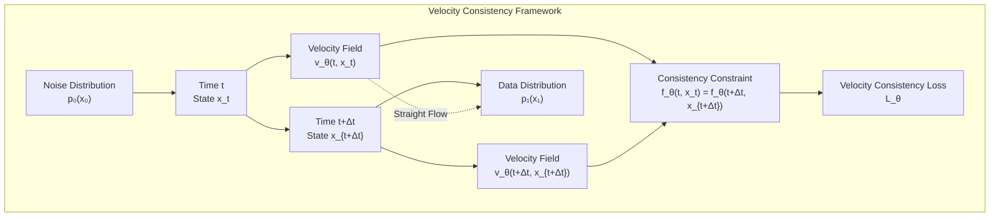
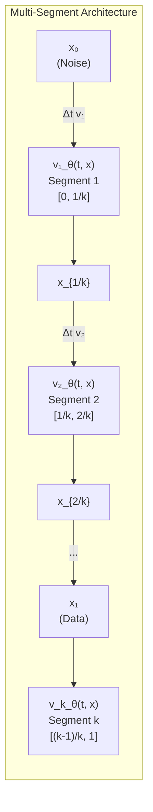
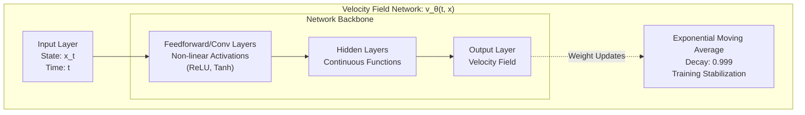
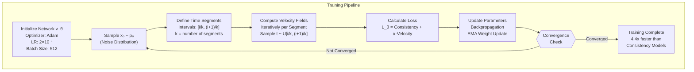
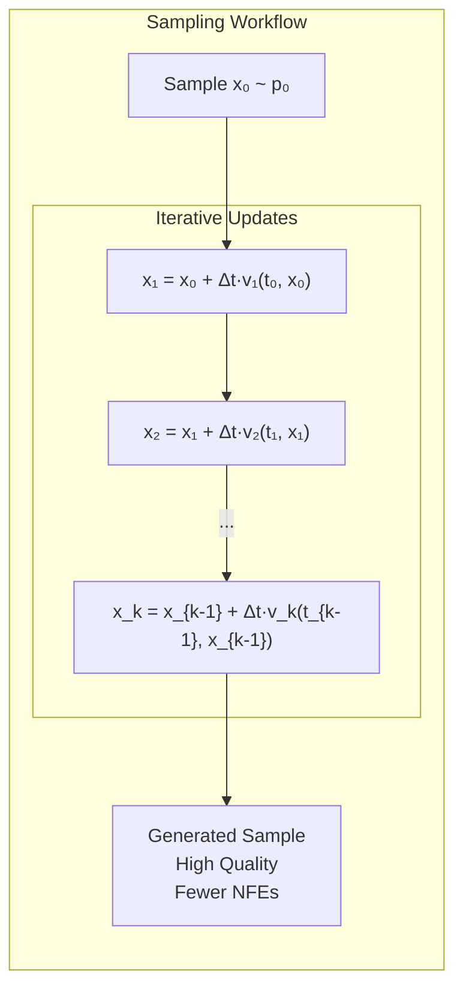
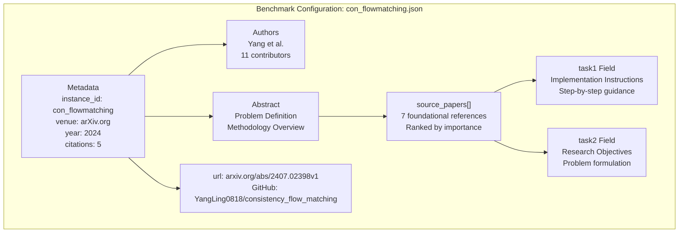
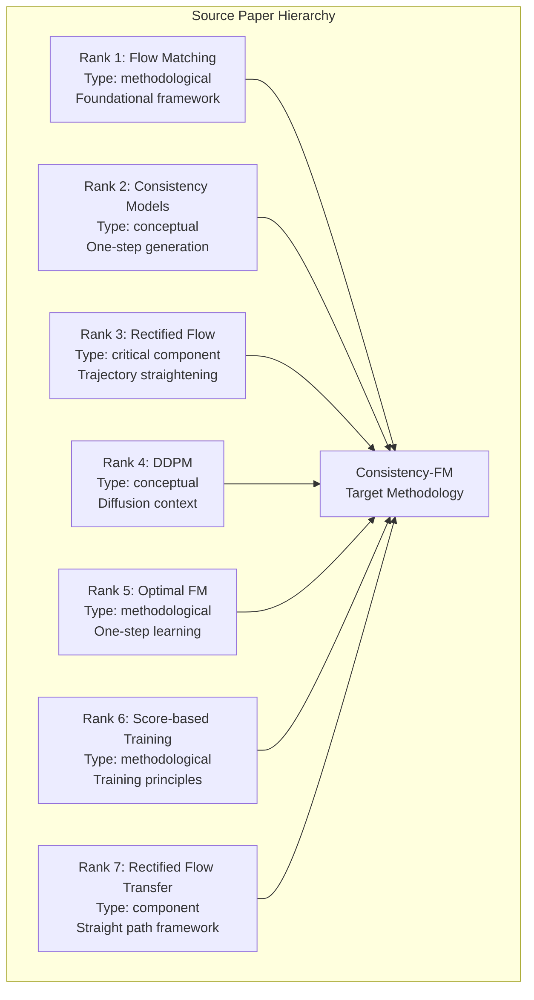
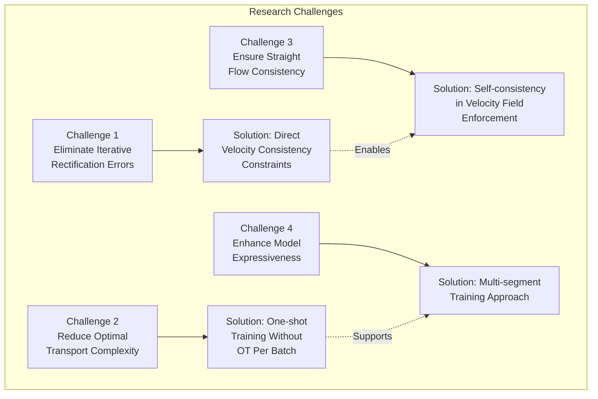

<!-- source: DeepWiki mcp.deepwiki.com · repo HKUDS/AI-Researcher · extra page Consistency Flow Matching · fetched 2026-11-09 -->

# Consistency Flow Matching

Relevant source files

The following files were used as context for generating this wiki page:

- [benchmark/final/diffu_flow/con_flowmatching.json](benchmark/final/diffu_flow/con_flowmatching.json)

## Purpose and Scope

This document details the **Consistency Flow Matching** benchmark task within the AI-Researcher evaluation framework. This task evaluates the system's ability to understand, implement, and advance generative modeling techniques that define straight probability flows between noise and data distributions using velocity consistency constraints.

For other diffusion and flow matching benchmarks, see [Improved Rectified Flows](#5.1.2), [Immiscible Diffusion](#5.1.3), and [MMDiT Transformers](#5.1.4). For the broader context of flow-based generative models, see [Diffusion & Flow Matching](#5.1).

**Sources:** [benchmark/final/diffu_flow/con_flowmatching.json:1-23]()

---

## Overview

Consistency Flow Matching (Consistency-FM) is a novel flow matching methodology introduced by Yang et al. (2024) that explicitly enforces self-consistency in the velocity field of probability flows. The approach addresses key limitations in existing flow matching and rectified flow methods by directly defining straight flows from different time points to the same endpoint, with imposed constraints on velocity values.

### Key Innovation

The fundamental innovation lies in the velocity consistency principle: instead of relying on iterative rectification or computationally expensive optimal transport solutions, Consistency-FM ensures that the learned velocity field produces straight trajectories by enforcing consistency constraints during training.

### Performance Characteristics

According to the benchmark specification, Consistency-FM demonstrates:
- **4.4x faster convergence** compared to consistency models
- **1.7x faster convergence** compared to rectified flow models
- Improved generation quality at equivalent sampling budgets
- Better trade-off between sampling quality and computational efficiency

**Sources:** [benchmark/final/diffu_flow/con_flowmatching.json:16-23]()

---

## Theoretical Foundation

### Flow Matching Framework

Consistency-FM builds upon the foundational Flow Matching (FM) framework, which defines probability paths via Ordinary Differential Equations (ODEs) to transform between noise and data samples. The approach integrates concepts from three primary methodological foundations:

| Foundation | Contribution | Integration in Consistency-FM |
|-----------|--------------|-------------------------------|
| Flow Matching | Core framework for implicit learning of vector fields via conditional probability paths | Primary methodology guiding model development |
| Consistency Models | One-step generation with consistency functions for noise-to-data mapping | Adapted to velocity consistency rather than sample consistency |
| Rectified Flow | Trajectory straightening and rewiring for enhanced expressiveness | Informs multi-segment training approach |

**Sources:** [benchmark/final/diffu_flow/con_flowmatching.json:24-51]()

### Velocity Consistency Principle

The core mathematical formulation enforces self-consistency through a specialized loss function. The velocity field $v_θ(t, x)$ must satisfy consistency constraints such that flows starting from different times converge to the same endpoint with aligned velocity predictions.

**Diagram: Velocity Consistency Enforcement Mechanism**

The consistency function is defined as:

$$f_θ(t, x_t) = x_t + (1 - t) v_θ(t, x_t)$$

This formulation ensures that predictions at different time points along a trajectory agree on the final endpoint, eliminating the need for iterative refinement.

**Sources:** [benchmark/final/diffu_flow/con_flowmatching.json:89-90]()

### Multi-Segment Training Approach

To enhance model expressiveness while maintaining straight flow properties, Consistency-FM employs a multi-segment training strategy. This approach divides the time interval into $k$ segments, allowing the model to capture complex distributions more effectively than single-segment methods.

**Diagram: Multi-Segment Flow Architecture**

Each segment $i$ defines a velocity field $v^i_θ(t, x)$ valid over interval $[i/k, (i+1)/k]$. During sampling, the Euler method performs iterative updates:

$$x_{t + Δt} = x_t + Δt \cdot v^i(t, x_t)$$

where $t ∈ [i/k, (i+1)/k - Δt]$.

**Sources:** [benchmark/final/diffu_flow/con_flowmatching.json:89-90]()

---

## Implementation Specification

### Architecture Configuration

The neural network architecture for parameterizing the velocity field follows these specifications:

**Diagram: Neural Network Architecture for Velocity Field Parameterization**

**Network Specifications:**
- **Architecture Types:** Feedforward networks or convolutional networks suitable for continuous function approximation
- **Activation Functions:** ReLU, Tanh for non-linearity
- **Normalization:** Exponential Moving Average (EMA) with decay rate ~0.999 for training stability

**Sources:** [benchmark/final/diffu_flow/con_flowmatching.json:89-90]()

### Loss Function Definition

The implementation employs a composite loss function with two components:

| Loss Component | Mathematical Form | Purpose | Weight |
|---------------|-------------------|---------|---------|
| Consistency Loss | $\|\| f_θ(t, x_t) - f_θ(t+Δt, x_{t+Δt}) \|\|^2_2$ | Endpoint alignment | 1.0 |
| Velocity Consistency | $\|\| v_θ(t, x_t) - v_θ(t+Δt, x_{t+Δt}) \|\|^2_2$ | Velocity field smoothness | α (tunable) |

**Complete Loss Formulation:**

$$L_θ = E_{t \sim U} E_{x_t, x_{t+Δt}} \left[ \|\| f_θ(t, x_t) - f_θ(t+Δt, x_{t+Δt}) \|\|^2_2 + α \|\| v_θ(t, x_t) - v_θ(t+Δt, x_{t+Δt}) \|\|^2_2 \right]$$

where:
- $t$ is sampled from uniform distribution $U$
- $α$ is determined through cross-validation
- $f_θ(t, x_t) = x_t + (1 - t) v_θ(t, x_t)$

**Sources:** [benchmark/final/diffu_flow/con_flowmatching.json:89-90]()

### Training Procedure

**Diagram: Training Procedure Flow**

**Key Implementation Details:**
1. **Optimizer Configuration:**
   - Algorithm: Adam
   - Learning rate: $2 \times 10^{-4}$
   - Batch size: 512 (for CIFAR-10 baseline)

2. **Time Sampling:**
   - Distribution: Uniform over segment intervals
   - Ensures balanced training across trajectory

3. **Segment Configuration:**
   - Start with fewer segments (k=1)
   - Gradually increase to capture complex distributions
   - Empirically validate through experiments

4. **Stability Mechanisms:**
   - EMA decay rate: 0.999
   - Monitor convergence rates
   - Adjust based on stability observations

**Sources:** [benchmark/final/diffu_flow/con_flowmatching.json:89-90]()

### Sampling Process

The sampling process supports both single-step and multi-step generation:

**Single-Step Generation:**
$$x_{1/k} = x_0 + \frac{1}{k} v^1_θ(0, x_0)$$

**Multi-Step Generation (Euler Method):**
$$x_{i/k} = x_{(i-1)/k} + \frac{1}{k} v^i_θ\left(\frac{i-1}{k}, x_{(i-1)/k}\right)$$

**Diagram: Sampling Process with Euler Integration**

**ODE Solver Selection:**
- Primary method: Euler's method for computational efficiency
- Update rule applied during both training and sampling
- Trade-off analysis between sampling efficiency and quality

**Sources:** [benchmark/final/diffu_flow/con_flowmatching.json:89-90]()

---

## Benchmark Task Configuration

### Task Structure in Codebase

**Diagram: JSON Structure for Benchmark Task con_flowmatching**

### Task Definitions

The benchmark includes two evaluation levels:

| Task Level | Field | Purpose | Content Type |
|-----------|-------|---------|--------------|
| **Task 1** | `task1` | Implementation guidance | Detailed step-by-step instructions for reproducing methodology |
| **Task 2** | `task2` | Research objectives | Problem formulation, limitations, challenges, and contributions |

**Sources:** [benchmark/final/diffu_flow/con_flowmatching.json:89-91]()

### Source Paper Dependencies

The benchmark specifies 7 foundational references ranked by methodological importance:

**Diagram: Dependency Graph of Source Papers**

**Key Dependencies:**
1. **Flow Matching for Generative Modeling** (Rank 1): Core methodology framework
2. **Consistency Models** (Rank 2): Velocity consistency adaptation
3. **Rectified Flow** (Rank 3): Multi-segment training approach
4. **Denoising Diffusion Probabilistic Models** (Rank 4): Generative model context
5. **Optimal Flow Matching** (Rank 5): One-step learning insights
6. **Maximum Likelihood Training** (Rank 6): Training methodology
7. **Flow Straight and Fast** (Rank 7): Rectified flow framework

**Sources:** [benchmark/final/diffu_flow/con_flowmatching.json:24-88]()

---

## Research Objectives and Contributions

### Problem Domain

The research addresses generative modeling in the continuous normalizing flows domain, specifically targeting:

1. **Primary Task:** Generating high-quality samples from noise distributions through straight probability flows
2. **Application Domain:** Image synthesis with reduced number of function evaluations (NFEs)
3. **Computational Target:** Efficient one-step or few-step generation

**Sources:** [benchmark/final/diffu_flow/con_flowmatching.json:90-91]()

### Limitations in Existing Approaches

The benchmark identifies four critical limitations that motivated this research:

| Limitation | Description | Impact |
|-----------|-------------|---------|
| **Quality-Efficiency Trade-off** | Existing methods struggle to balance sample quality with computational cost | Suboptimal deployment for real-time applications |
| **Accumulated Errors** | Iterative rectification introduces compounding errors | Degraded sample quality after multiple iterations |
| **Computational Complexity** | Optimal transport requires expensive optimization per training batch | Slow training convergence |
| **Trajectory Straightness** | Flow trajectories deviate from straight paths over time | Increased NFEs required for high-quality generation |

**Sources:** [benchmark/final/diffu_flow/con_flowmatching.json:90-91]()

### Core Research Challenges

**Diagram: Challenges and Solutions Mapping**

**Sources:** [benchmark/final/diffu_flow/con_flowmatching.json:90-91]()

### Key Objectives and Contributions

The benchmark specifies the following evaluation objectives:

1. **Primary Objective:** Propose Consistency-FM method that enforces self-consistency in velocity fields for defining straight flows effectively

2. **Secondary Objective:** Enhance model expressiveness through multi-segment training approach

3. **Theoretical Contribution:** Provide mathematical foundations for velocity consistency principle in flow matching

4. **Practical Contribution:** Demonstrate faster training convergence (4.4x vs consistency models, 1.7x vs rectified flows) with improved sample quality

5. **Methodological Advancement:** Eliminate dependency on iterative processes and batch-wise optimal transport optimization

**Sources:** [benchmark/final/diffu_flow/con_flowmatching.json:90-91]()

---

## Performance Considerations

### Hyperparameter Tuning Guidelines

The implementation specification provides the following tuning recommendations:

| Parameter | Recommended Range | Tuning Strategy |
|-----------|------------------|-----------------|
| Learning Rate | ~$2 \times 10^{-4}$ | Standard for Adam optimizer |
| Batch Size | 512 (CIFAR-10 baseline) | Adjust based on GPU memory |
| EMA Decay | 0.999 | Monitor training stability |
| Segments (k) | Start with 1, increase gradually | Empirical validation per dataset |
| α (velocity weight) | Cross-validation | Balance consistency components |
| Δt (time step) | Dataset-dependent | Trade-off speed vs. quality |

### Convergence Monitoring

**Key Metrics:**
- Training loss convergence rate
- Sample quality at fixed NFE budgets
- Velocity field smoothness measures
- Endpoint prediction consistency

**Optimization Strategy:**
1. Start with fewer segments to establish baseline
2. Gradually increase segment count
3. Monitor quality-speed trade-off
4. Validate through comprehensive experiments
5. Adjust hyperparameters based on empirical results

**Sources:** [benchmark/final/diffu_flow/con_flowmatching.json:89-90]()

---

## Integration with AI-Researcher System

### Benchmark Evaluation Context

Within the AI-Researcher platform, this benchmark task evaluates the system's capability to:

1. **Understand** the theoretical foundations of velocity consistency in flow matching
2. **Implement** the multi-segment training architecture with proper loss formulation
3. **Optimize** hyperparameters for convergence and quality trade-offs
4. **Validate** performance against established baselines (consistency models, rectified flows)
5. **Document** the methodology in publication-quality format

### Task Execution

The benchmark is accessed through:
- **Category:** `diffu_flow` (diffusion and flow matching domain)
- **Instance ID:** `con_flowmatching`
- **Configuration File:** [benchmark/final/diffu_flow/con_flowmatching.json:14]()
- **Reference URL:** http://arxiv.org/abs/2407.02398v1
- **Code Repository:** https://github.com/YangLing0818/consistency_flow_matching

For information on running this benchmark through the AI-Researcher system, see [Level 1 Tasks](#6.2) and [Level 2 Tasks](#6.3).

**Sources:** [benchmark/final/diffu_flow/con_flowmatching.json:1-91]()

---

