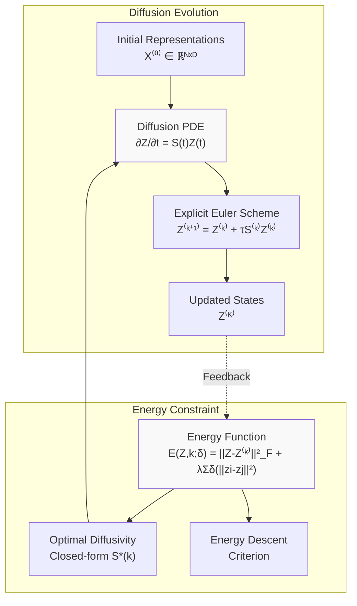
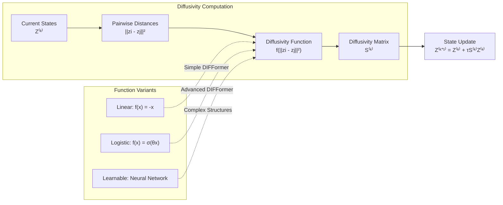
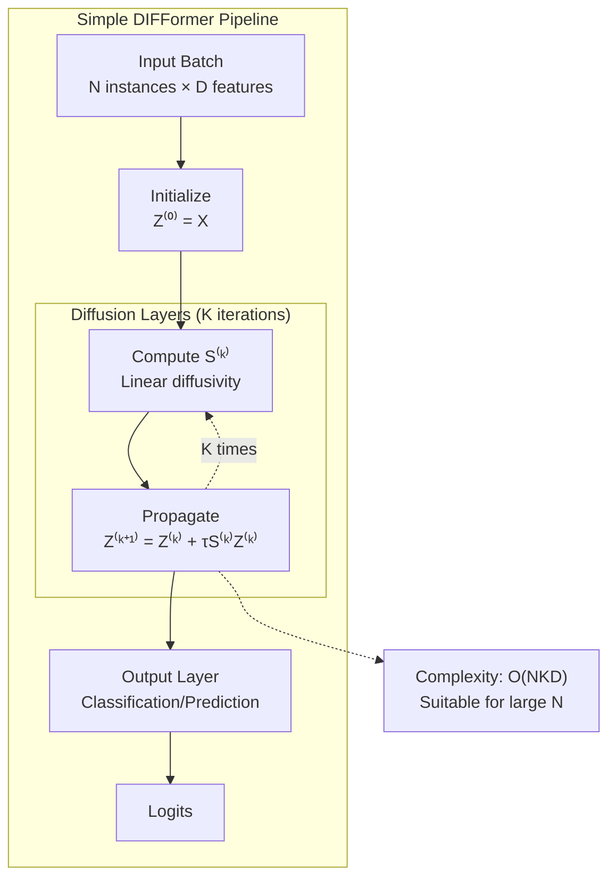
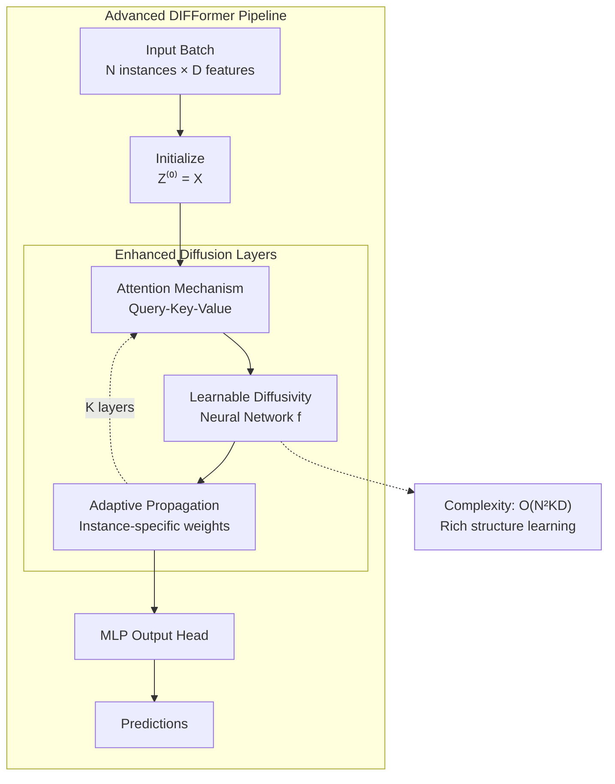
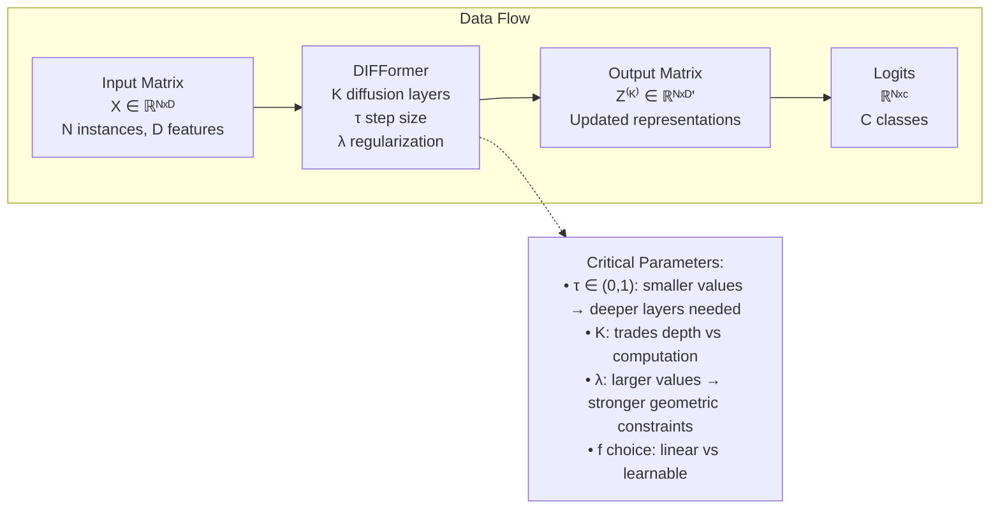
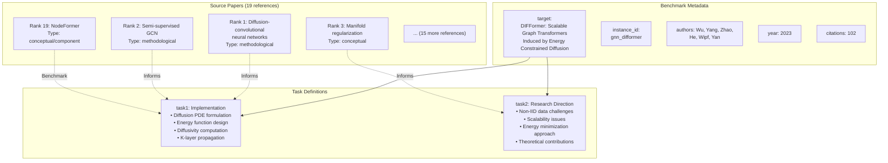
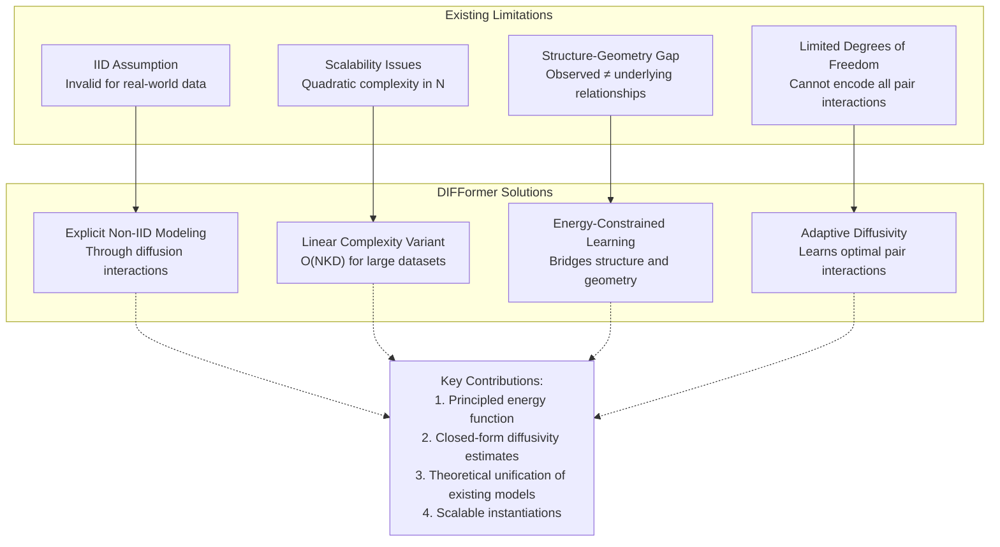

<!-- source: DeepWiki mcp.deepwiki.com · repo HKUDS/AI-Researcher · extra page Energy Constrained Diffusion (DIFFormer) · fetched 2026-11-09 -->

# Energy Constrained Diffusion (DIFFormer)

<details>
<summary>Relevant source files</summary>

The following files were used as context for generating this wiki page:

- [benchmark/final/gnn/gnn_difformer.json](benchmark/final/gnn/gnn_difformer.json)

</details>


## Purpose and Scope

This page documents the DIFFormer benchmark task, which evaluates AI-Researcher's capability to generate research on energy-constrained diffusion models for graph learning. DIFFormer addresses the problem of learning instance representations from non-IID data by modeling complex inter-dependencies through a diffusion process constrained by an energy minimization objective.

The benchmark is located at [benchmark/final/gnn/gnn_difformer.json]() and belongs to the Graph Neural Networks category. For other GNN scalability approaches, see [Sparse Transformers (Exphormer)](#5.2.2) and [Structure Learning (NodeFormer)](#5.2.6). For alternative temporal modeling, see [Fractional-Order Dynamics (FROND)](#5.2.4).

**Sources:** [benchmark/final/gnn/gnn_difformer.json:1-191]()

## Conceptual Overview

DIFFormer introduces a general-purpose encoder that models real-world data generation as a diffusion process over batches of instances. Unlike traditional IID assumptions, this approach explicitly models inter-dependencies by encoding instances into evolutionary states that progressively incorporate information from other instances through their interactions.

The key innovation is constraining the diffusion process with a principled energy function that characterizes global consistency of instance representations over latent structures. This energy-constrained formulation provides closed-form optimal estimates for pairwise diffusion strength, enabling efficient all-pair feature propagation.

### Key Characteristics

| Aspect | Description |
|--------|-------------|
| **Primary Task** | Learning representations from non-IID data with complex inter-dependencies |
| **Core Mechanism** | Energy-constrained diffusion process modeled as PDE |
| **Architecture Type** | Diffusion-based Transformer (DIFFormer) |
| **Complexity** | Linear complexity (simple version) or quadratic (advanced version) |
| **Applications** | Node classification, semi-supervised learning, spatial-temporal prediction |

**Sources:** [benchmark/final/gnn/gnn_difformer.json:187-191]()

## Mathematical Framework

### Diffusion Process Formulation



**Diagram: Energy-Constrained Diffusion Formulation**

The diffusion process evolves instance representations Z through K layers, where each update incorporates information from all other instances weighted by the diffusivity matrix S(k). The energy function constrains this evolution to maintain global consistency.

**Sources:** [benchmark/final/gnn/gnn_difformer.json:189-190]()

## Core Technical Components

### Energy Function Design

The energy function E(Z, k; δ) serves as the regularization mechanism that guides the diffusion process toward geometrically consistent representations:

```
E(Z, k; δ) = ||Z - Z⁽ᵏ⁾||²_F + λ Σᵢⱼ δ(||zi - zj||²_2)
```

| Component | Role | Properties |
|-----------|------|------------|
| **Fidelity Term** `||Z - Z⁽ᵏ⁾||²_F` | Maintains consistency with current states | Frobenius norm ensures stability |
| **Regularization Term** `λ Σ δ(||zi - zj||²)` | Enforces geometric structure | δ is non-decreasing, concave function |
| **λ Parameter** | Balances fidelity vs regularization | Controls strength of structural constraints |

The energy function provides theoretical guarantees for optimal diffusivity estimation through descent criteria, ensuring the diffusion process converges to low-energy embeddings.

**Sources:** [benchmark/final/gnn/gnn_difformer.json:189-190]()

### Diffusivity Function

The diffusivity function f determines the strength of information flow between instance pairs:



**Diagram: Diffusivity Function and State Update Pipeline**

The choice of diffusivity function critically affects the model's capacity:
- **Linear formulation**: Provides simple, efficient computation with O(N) complexity
- **Logistic/Neural formulations**: Enable learning of complex non-linear dependencies

**Sources:** [benchmark/final/gnn/gnn_difformer.json:189-190]()

## Architecture Variants

DIFFormer has two instantiations optimized for different scenarios:

### Simple DIFFormer (Linear Complexity)



**Diagram: Simple DIFFormer Architecture**

**Key Properties:**
- **Complexity**: O(NKD) - linear in number of instances
- **Target**: Prohibitively large instance numbers (N > 100K)
- **Diffusivity**: Simple linear function of pairwise distances
- **Trade-off**: Reduced expressiveness for computational efficiency

### Advanced DIFFormer (Complex Structure Learning)



**Diagram: Advanced DIFFormer Architecture**

**Key Properties:**
- **Complexity**: O(N²KD) - quadratic in number of instances
- **Target**: Complex inter-instance relationships
- **Diffusivity**: Learnable non-linear function (e.g., logistic, neural)
- **Trade-off**: Higher computational cost for better representation capacity

**Sources:** [benchmark/final/gnn/gnn_difformer.json:187-190]()

## Implementation Parameters

The DIFFormer implementation requires careful configuration of the following parameters:

### Core Hyperparameters

| Parameter | Symbol | Type | Typical Range | Role |
|-----------|--------|------|---------------|------|
| **Step Size** | τ | float | (0, 1) | Controls diffusion update magnitude |
| **Layer Number** | K | int | 2-10 | Number of diffusion propagation steps |
| **Regularization Weight** | λ | float | 0.01-1.0 | Balances energy function terms |
| **Input Dimension** | D | int | Dataset-specific | Feature dimension |
| **Batch Size** | N | int | Dataset-specific | Number of instances per batch |

### Input/Output Specifications



**Diagram: DIFFormer Input/Output Pipeline with Parameter Dependencies**

### Performance-Critical Details

The following implementation details significantly affect model performance:

1. **Step Size Selection**: Smaller τ values provide more stable training but require deeper networks (larger K) to achieve sufficient information propagation
2. **Diffusivity Function Choice**: Linear formulations (simple DIFFormer) offer O(N) complexity but limited expressiveness; learnable formulations (advanced DIFFormer) capture complex dependencies at O(N²) cost
3. **Energy Function Parameterization**: The concave function δ must be carefully chosen to ensure theoretical guarantees hold
4. **Optimization**: Learning rate scheduling and early stopping are critical for convergence, especially on large-scale datasets

**Sources:** [benchmark/final/gnn/gnn_difformer.json:189-190]()

## Benchmark Configuration

### Task Structure

The DIFFormer benchmark is configured in [benchmark/final/gnn/gnn_difformer.json]() with the following structure:



**Diagram: DIFFormer Benchmark Task Structure in gnn_difformer.json**

### Evaluation Dimensions

The benchmark evaluates AI-generated research along multiple dimensions:

| Dimension | Focus Area | Key Criteria |
|-----------|------------|--------------|
| **Novelty** | Innovation in energy-constrained diffusion | Originality of energy function design, diffusivity formulation |
| **Theoretical Foundation** | Mathematical rigor | Correctness of PDE formulation, energy descent proofs |
| **Experimental Rigor** | Implementation completeness | Proper hyperparameter selection (τ, K, λ), ablation studies |
| **Result Analysis** | Performance interpretation | Scalability analysis, complexity comparisons |
| **Writing Quality** | Technical communication | Clarity of diffusion process explanation, notation consistency |

**Sources:** [benchmark/final/gnn/gnn_difformer.json:1-191]()

## Research Context

### Foundational References

The DIFFormer benchmark draws from 19 source papers spanning methodological, conceptual, and component-level contributions:

**Top Methodological Papers:**
1. **Diffusion-convolutional neural networks** (Rank 1): Foundational GNN architecture connecting to diffusion processes
2. **Semi-supervised classification with graph convolutional networks** (Rank 2): Framework for graph-based semi-supervised learning
3. **Artificial neural networks for solving ODEs/PDEs** (Rank 5): Techniques for characterizing diffusion processes

**Key Conceptual Papers:**
1. **Manifold regularization** (Rank 3): Geometric framework for learning from unlabeled data
2. **Geometric deep learning** (Rank 4): Importance of geometric priors in model design
3. **Do transformers perform bad for graph representation?** (Rank 14): Validation of transformer efficacy for graphs

**Component Benchmarks:**
1. **NodeFormer** (Rank 19): Scalable graph structure learning baseline
2. **Scaling GNNs with approximate PageRank** (Rank 6): Scalability techniques for large graphs

**Sources:** [benchmark/final/gnn/gnn_difformer.json:4-175]()

### Core Research Challenges

The benchmark addresses fundamental limitations in existing graph learning approaches:



**Diagram: Research Challenges and DIFFormer Contributions**

### Intended Contributions

The DIFFormer paper makes the following key contributions that the benchmark evaluates:

1. **Theoretical Framework**: Principled energy minimization process for uncovering data dependencies with rigorous mathematical guarantees
2. **Optimal Diffusivity**: Closed-form estimates for pairwise diffusion strength that unify existing GNN architectures
3. **Scalable Architecture**: Two instantiations balancing expressiveness and efficiency for diverse dataset sizes
4. **General-Purpose Encoder**: Wide applicability as backbone for node classification, semi-supervised learning, and spatial-temporal prediction

**Sources:** [benchmark/final/gnn/gnn_difformer.json:190-191]()

## Applications and Use Cases

DIFFormer serves as a general-purpose encoder backbone for multiple learning scenarios:

| Application Domain | Task Description | Key Benefit |
|-------------------|------------------|-------------|
| **Node Classification** | Large-scale graph node labeling | Linear complexity enables processing 100K+ nodes |
| **Semi-supervised Image Classification** | Learning from partially labeled images | Energy constraint exploits unlabeled data geometry |
| **Semi-supervised Text Classification** | Document categorization with few labels | Diffusion captures semantic relationships |
| **Spatial-Temporal Dynamics** | Forecasting evolving systems | Progressive information incorporation models temporal evolution |

The energy-constrained diffusion framework naturally handles scenarios where instance relationships are complex, incomplete, or noisy—common characteristics of real-world datasets that violate standard IID assumptions.

**Sources:** [benchmark/final/gnn/gnn_difformer.json:187-191]()

---

