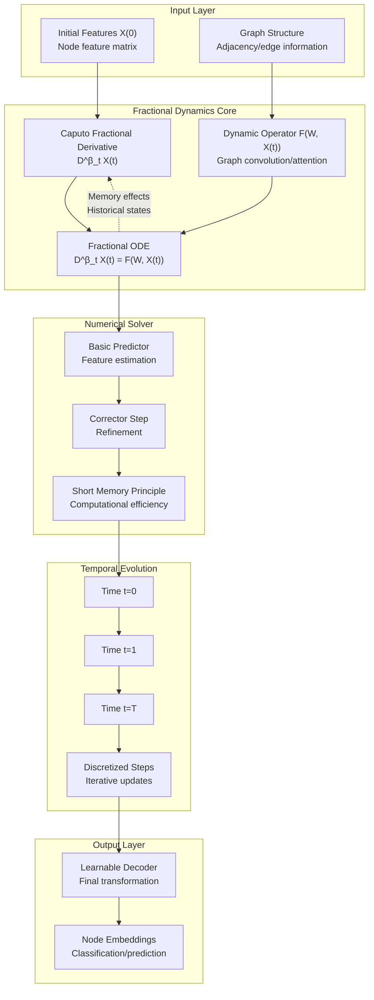
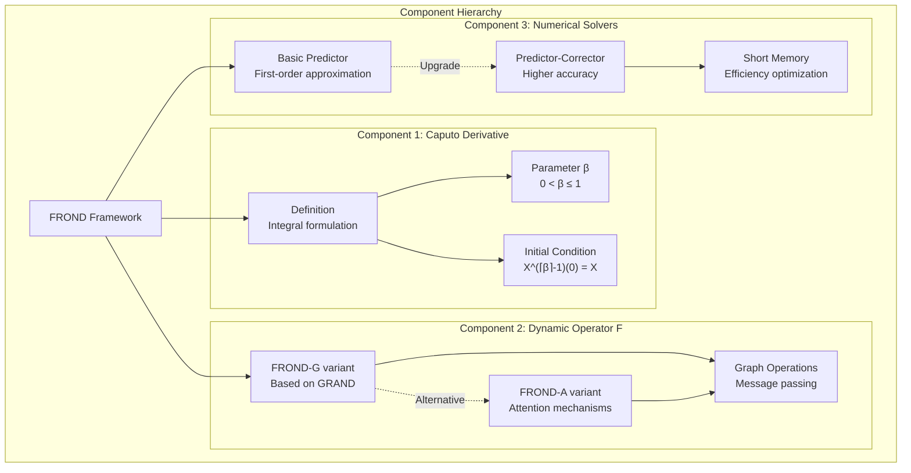
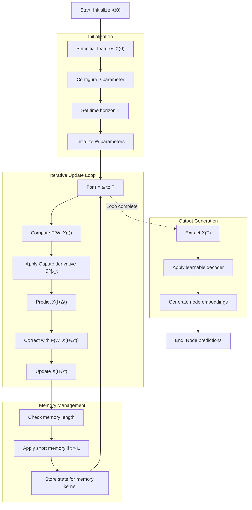
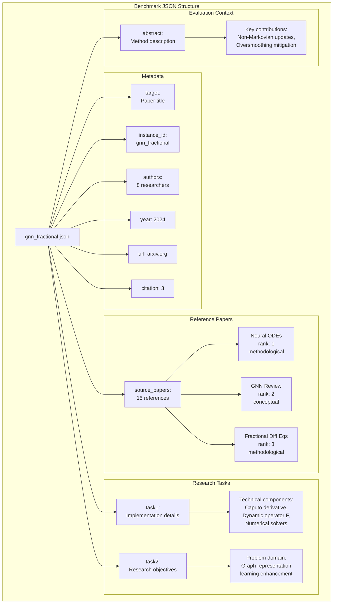
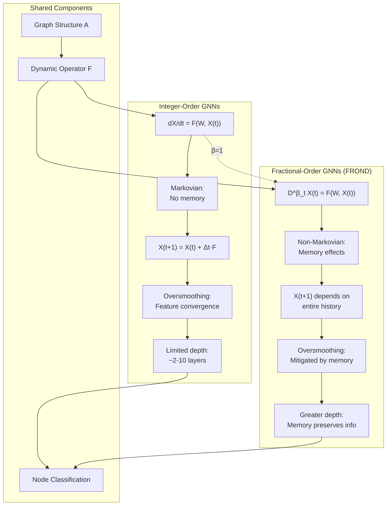

<!-- source: DeepWiki mcp.deepwiki.com · repo HKUDS/AI-Researcher · extra page Fractional-Order Dynamics (FROND) · fetched 2026-11-09 -->

# Fractional-Order Dynamics (FROND)

<details>
<summary>Relevant source files</summary>

The following files were used as context for generating this wiki page:

- [benchmark/final/gnn/gnn_fractional.json](benchmark/final/gnn/gnn_fractional.json)

</details>


## Purpose and Scope

This document describes the FROND (FRactional-Order graph Neural Dynamical network) benchmark task within the AI-Researcher evaluation framework. FROND represents a novel continuous Graph Neural Network (GNN) architecture that employs fractional calculus—specifically Caputo fractional derivatives—to capture long-term dependencies and non-local interactions in graph representation learning. Unlike traditional continuous GNNs that rely on integer-order differential equations with Markovian update mechanisms, FROND leverages the memory effects of fractional-order dynamics to mitigate oversmoothing and enhance node classification performance.

This page covers the theoretical foundations, technical components, implementation specifications, and benchmark configuration for the FROND task. For information about other GNN benchmarks, see [Multi-task Prompting](#5.2.1), [Sparse Transformers](#5.2.2), and [Energy Constrained Diffusion](#5.2.3). For the broader GNN research domain overview, see [Graph Neural Networks](#5.2).

**Sources:** [benchmark/final/gnn/gnn_fractional.json:1-157]()

## Overview

FROND extends continuous GNN frameworks by replacing integer-order ordinary differential equations (ODEs) with fractional-order differential equations (FODEs). The core innovation lies in using the Caputo fractional derivative to enable non-local feature updates that incorporate the entire history of previous states, moving beyond the memoryless Markovian assumptions of conventional GNN architectures.

### Key Characteristics

| Aspect | Traditional Continuous GNNs | FROND Framework |
|--------|---------------------------|-----------------|
| **Differential Equation** | Integer-order ODEs | Fractional-order ODEs (FODEs) |
| **Update Mechanism** | Markovian (memoryless) | Non-Markovian (memory effects) |
| **Derivative Type** | Standard first-order derivative | Caputo fractional derivative |
| **Temporal Dependencies** | Local (current state only) | Long-term (historical states) |
| **Oversmoothing Mitigation** | Limited by architecture depth | Analytically mitigated through memory |
| **Fractional Order (β)** | β = 1 (standard case) | 0 < β ≤ 1 (tunable) |

**Sources:** [benchmark/final/gnn/gnn_fractional.json:1-13](), [benchmark/final/gnn/gnn_fractional.json:152-156]()

## FROND Architecture



**Diagram: FROND Framework Architecture**

This diagram illustrates the complete FROND processing pipeline, from initial node features through fractional-order dynamics to final embeddings.

**Sources:** [benchmark/final/gnn/gnn_fractional.json:155]()

## Technical Foundation

### Fractional Calculus Background

Fractional calculus extends classical calculus to non-integer orders of differentiation and integration. While integer-order derivatives capture local rate of change, fractional derivatives possess non-local properties that encode memory effects across the entire function history.

The Caputo fractional derivative of order β ∈ (0, 1] for a function X(t) is defined mathematically as:

```
D^β_t X(t) = (1/Γ(1-β)) ∫[0 to t] (t-s)^(-β) X'(s) ds
```

Where Γ is the Gamma function. This formulation reveals that the fractional derivative at time t depends on the integral of the first derivative X'(s) weighted by the kernel (t-s)^(-β) over the entire interval [0, t].

**Key Properties:**
- **Non-locality**: The derivative at time t depends on all previous values, not just the current state
- **Memory effects**: Past states contribute to current dynamics with power-law decay
- **Generalization**: When β = 1, the Caputo derivative reduces to the standard first-order derivative
- **Initial conditions**: Requires X^(⌈β⌉-1)(0) = X as the initial condition

**Sources:** [benchmark/final/gnn/gnn_fractional.json:23-30]()

### Caputo Fractional Derivative in FROND

In the FROND framework, the Caputo fractional derivative replaces the standard time derivative in continuous GNN formulations:

**Standard Continuous GNN:**
```
dX(t)/dt = F(W, X(t))
```

**FROND Fractional Formulation:**
```
D^β_t X(t) = F(W, X(t))
```

Where:
- **X(t)**: Node feature matrix at time t
- **β**: Fractional order parameter (0 < β ≤ 1)
- **F(W, X(t))**: Dynamic operator defining graph information propagation
- **W**: Learnable parameters

This formulation enables feature updates that incorporate the entire trajectory of past states, creating a non-Markovian update process that captures long-term dependencies in graph data.

**Sources:** [benchmark/final/gnn/gnn_fractional.json:155]()

### Non-Markovian Random Walk Interpretation

FROND provides a theoretical interpretation of node feature updates from a non-Markovian random walk perspective, particularly when the dynamic operator F governs a diffusion process on the graph. 

In traditional GNNs, message passing follows Markovian random walks where the next state depends only on the current state. FROND's fractional dynamics enable:

1. **Long-range memory**: Nodes retain information about distant historical states
2. **Subdiffusive behavior**: Feature propagation can exhibit anomalous diffusion patterns characterized by power-law waiting times
3. **Oversmoothing mitigation**: Memory effects prevent complete feature homogenization by preserving historical distinctions

The framework analytically demonstrates that oversmoothing can be mitigated through these memory-dependent dynamics, as the fractional order β controls the strength of historical influence.

**Sources:** [benchmark/final/gnn/gnn_fractional.json:152-156]()

## Core Components



**Diagram: FROND Core Component Structure**

**Sources:** [benchmark/final/gnn/gnn_fractional.json:155]()

### Component 1: Caputo Fractional Derivative

The Caputo derivative is the fundamental component enabling memory effects in FROND.

**Implementation Specifications:**

| Parameter | Description | Configuration |
|-----------|-------------|---------------|
| **β (Beta)** | Fractional order | 0 < β ≤ 1, dataset-dependent tuning |
| **Initial Condition** | Starting state | X^(⌈β⌉-1)(0) = X (feature matrix) |
| **Gamma Function** | Normalization | Γ(1-β) in denominator |
| **Integration Kernel** | Weighting function | (t-s)^(-β) for power-law memory |

**Critical Implementation Details:**
- **Smaller β values** enhance memory effects but require more iterations for convergence
- **β = 1** reduces to standard first-order derivative (integer-order GNN)
- **β < 1** introduces subdiffusive dynamics with long-term memory
- Hyperparameter tuning for β is crucial and should be based on graph characteristics (e.g., diameter, clustering coefficient)

**Sources:** [benchmark/final/gnn/gnn_fractional.json:155]()

### Component 2: Dynamic Operator F

The dynamic operator F(W, X(t)) defines how information propagates across the graph at each time step. FROND supports multiple operator variants:

**FROND-G (GRAND-based):**
- Extends GRAND (Graph Random Neural Network) architecture
- Uses graph diffusion operators
- Suitable for homophilic graphs

**FROND-A (Attention-based):**
- Incorporates attention mechanisms
- Enables adaptive neighbor weighting
- Better for heterophilic graphs

**General Form:**
```
F(W, X(t)) = σ(A · X(t) · W)
```

Where:
- **A**: Graph structure (adjacency matrix or learned attention weights)
- **W**: Learnable parameters
- **σ**: Activation function

The operator must be defined with learnable parameters to enable end-to-end training through backpropagation.

**Sources:** [benchmark/final/gnn/gnn_fractional.json:155]()

### Component 3: Numerical Solvers

Since fractional differential equations cannot be solved analytically in most cases, FROND employs numerical methods for time discretization.

**Basic Predictor Method:**
- First-order approximation of the fractional derivative
- Computationally efficient but lower accuracy
- Suitable for initial prototyping

**Predictor-Corrector Method:**
- Two-stage process: prediction followed by correction
- Higher accuracy at the cost of increased computation
- Recommended for production use

**Short Memory Principle:**
- Truncates the memory effect after a fixed window
- Dramatically reduces computational complexity from O(T²) to O(T·L) where L is the memory length
- Essential for large T (many time steps)

**Discretization Process:**
```
Time: 0 = t₀ < t₁ < ... < tₙ = T
At each step tₙ₊₁:
  1. Predict X̃(tₙ₊₁) using previous values
  2. Correct X(tₙ₊₁) using F(W, X̃(tₙ₊₁))
  3. Apply short memory truncation if n > L
```

**Sources:** [benchmark/final/gnn/gnn_fractional.json:155]()

## Implementation Workflow



**Diagram: FROND Operation Flow**

This diagram illustrates the step-by-step execution of FROND, showing how components interact during the feature update process.

**Sources:** [benchmark/final/gnn/gnn_fractional.json:155]()

## Hyperparameters and Configuration

### Critical Hyperparameters

| Hyperparameter | Symbol | Range | Impact | Tuning Strategy |
|----------------|--------|-------|--------|-----------------|
| **Fractional Order** | β | (0, 1] | Controls memory strength; smaller values = stronger long-term effects | Grid search or Bayesian optimization based on validation performance |
| **Time Horizon** | T | Positive real | Total evolution time; larger values = deeper effective layers | Balance between performance and computational cost |
| **Time Step Size** | Δt | Positive real | Discretization granularity; smaller = more accurate but expensive | Set based on T and desired number of steps (e.g., T/100) |
| **Memory Length** | L | Positive integer | Short memory window length | Set to balance accuracy vs. efficiency (typical: 50-200) |
| **Learning Rate** | η | Positive real | Parameter update rate | Standard schedule (e.g., 0.01 with decay) |

### Input Specifications

**Required Inputs:**
- **Node Feature Matrix X**: Shape (N, d) where N = number of nodes, d = feature dimension
- **Graph Structure**: Adjacency matrix A or edge list E
- **Initial Condition**: X(0) = X
- **Fractional Order**: β value selected through hyperparameter search

**Optional Inputs:**
- **Node Labels**: For supervised tasks (node classification)
- **Edge Features**: Can be incorporated into dynamic operator F
- **Train/Validation/Test Split**: For proper evaluation

### Output Specifications

**Primary Outputs:**
- **Node Embeddings**: Refined feature representations X(T) of shape (N, d')
- **Predictions**: Task-specific outputs (e.g., class probabilities for classification)

**Intermediate Outputs (for analysis):**
- **Trajectory**: {X(t₀), X(t₁), ..., X(T)} showing feature evolution
- **Memory Kernels**: Weights showing historical influence at each step

**Sources:** [benchmark/final/gnn/gnn_fractional.json:155]()

## Benchmark Configuration

### Task Definition in Evaluation Framework



**Diagram: Benchmark Configuration Structure**

This diagram maps the JSON structure in `gnn_fractional.json` to show how the benchmark task is defined in the evaluation framework.

**Sources:** [benchmark/final/gnn/gnn_fractional.json:1-157]()

### Benchmark Metadata

The FROND benchmark is configured with the following metadata:

**Paper Information:**
- **Target Paper**: "Unleashing the Potential of Fractional Calculus in Graph Neural Networks with FROND"
- **Authors**: Qiyu Kang, Kai Zhao, Qinxu Ding, Feng Ji, Xuhao Li, Wenfei Liang, Yang Song, Wee Peng Tay
- **Publication Year**: 2024
- **Citation Count**: 3
- **URL**: http://arxiv.org/abs/2404.17099v1
- **Code Repository**: https://github.com/zknus/ICLR2024-FROND

**Sources:** [benchmark/final/gnn/gnn_fractional.json:141-154]()

### Reference Paper Taxonomy

The benchmark references 15 foundational papers categorized by their contribution type:

**Methodological Papers (Direct Technical Influence):**

| Rank | Reference | Type | Key Contribution to FROND |
|------|-----------|------|---------------------------|
| 1 | Neural Ordinary Differential Equations | methodological | Foundational framework for continuous GNN dynamics |
| 3 | Fractional Differential Equations: An Introduction | methodological | Caputo derivative definitions and properties |
| 9 | Graph Convolutional Networks | methodological | Basis for graph convolution operations |
| 10 | Extensions of Neural Networks via Fractional Calculus | methodological | Integration of fractional calculus with neural architectures |

**Conceptual Papers (Problem Motivation):**

| Rank | Reference | Type | Key Contribution to FROND |
|------|-----------|------|---------------------------|
| 2 | Graph Neural Networks: A Review of Methods and Applications | conceptual | Context on existing GNN methodologies |
| 4 | Graph Neural Networks: Challenges and Future Directions | conceptual | Oversmoothing problem identification |
| 5 | Understanding Fractional Dynamics in Networked Systems | conceptual | FROND framework introduction |

**Component Papers (Technical Building Blocks):**

| Rank | Reference | Type | Key Contribution to FROND |
|------|-----------|------|---------------------------|
| 6 | Graph Shift Operators and Deep Learning | component | Mathematical basis for graph operators |
| 8 | Graph Neural Networks for Node Classification | component | Evaluation metrics and performance standards |
| 11 | Graph Neural Diffusion | component | Diffusion process design for feature updates |

**Sources:** [benchmark/final/gnn/gnn_fractional.json:4-140]()

### Task Specifications

**Task 1: Implementation Details**

The benchmark's `task1` field provides comprehensive implementation guidance covering:

1. **Primary Task**: Graph representation learning with focus on node classification and oversmoothing mitigation using fractional-order differential equations

2. **Core Techniques**:
   - Caputo Fractional Derivative for memory effects
   - Dynamic Operator F for graph information propagation
   - Predictor-Corrector Numerical Methods for time discretization

3. **Component Functions**: Detailed role definitions for each technical component

4. **Implementation Specifications**: Hyperparameter settings, initialization procedures, and optimization strategies

5. **Operational Workflow**: Step-by-step interaction between components

6. **Performance-Critical Details**: Choice of β, numerical solver efficiency, and convergence considerations

**Task 2: Research Objectives**

The `task2` field outlines the research context:

1. **Problem Domain**: Enhancing GNN representation learning through fractional calculus integration

2. **Existing Limitations**:
   - Integer-order models lack long-term memory
   - Oversmoothing in deep architectures
   - Inadequate handling of hierarchical/fractal graph structures

3. **Core Challenges**:
   - Memory representation in feature updates
   - Oversmoothing mitigation
   - Long-term dependency modeling

4. **Key Objectives**:
   - Generalize continuous GNNs with non-local fractional derivatives
   - Provide non-Markovian interpretation of feature updates
   - Demonstrate robustness and compatibility with existing GNN architectures

**Sources:** [benchmark/final/gnn/gnn_fractional.json:155-157]()

## Research Contributions and Innovations

### Problems Addressed

FROND tackles several fundamental limitations in existing GNN architectures:

**1. Markovian Update Limitation**
- **Problem**: Traditional GNNs use memoryless update mechanisms where X(t+1) depends only on X(t)
- **Solution**: Fractional derivatives enable non-Markovian updates incorporating entire feature history
- **Impact**: Captures complex temporal patterns and long-range dependencies

**2. Oversmoothing in Deep GNNs**
- **Problem**: Node features become indistinguishable as depth increases
- **Solution**: Memory effects preserve historical distinctions between nodes
- **Impact**: Enables deeper models without feature homogenization

**3. Local Interaction Bias**
- **Problem**: Standard derivatives capture only local rate of change
- **Solution**: Non-local fractional derivatives enable long-range information flow
- **Impact**: Better modeling of global graph structure

**4. Fractal/Hierarchical Structure Representation**
- **Problem**: Integer-order models struggle with self-similar or hierarchical data
- **Solution**: Fractional dynamics naturally model power-law behaviors
- **Impact**: Enhanced performance on complex graph topologies

**Sources:** [benchmark/final/gnn/gnn_fractional.json:157]()

### Key Innovations

**1. Fractional-Order GNN Framework**
- First systematic integration of fractional calculus into continuous GNN architectures
- Generalizes existing continuous GNN models (GRAND, GraphCON, etc.)
- Provides theoretical foundation for non-Markovian graph learning

**2. Non-Markovian Random Walk Interpretation**
- Novel perspective connecting fractional dynamics to graph random walks
- Analytical demonstration of oversmoothing mitigation
- Theoretical grounding for empirical performance improvements

**3. Flexible Architecture Compatibility**
- Framework works as an extension to existing integer-order continuous GNNs
- Compatible with various dynamic operators (diffusion, attention, etc.)
- Enables fractional adaptations of established models

**4. Computational Efficiency Techniques**
- Short memory principle for tractable computation
- Efficient numerical solvers balancing accuracy and speed
- Scalable to large graphs with appropriate hyperparameter selection

**Sources:** [benchmark/final/gnn/gnn_fractional.json:152-157]()

## Comparison: Integer-Order vs. Fractional-Order GNNs



**Diagram: Comparison of Integer-Order and Fractional-Order GNN Dynamics**

**Sources:** [benchmark/final/gnn/gnn_fractional.json:152-157]()

## Performance Implications

### Critical Implementation Factors

**1. Fractional Order (β) Selection**
- **Small β (0.3-0.6)**: Strong memory effects, suitable for graphs with long-range dependencies
- **Medium β (0.6-0.8)**: Balanced memory, general-purpose choice
- **Large β (0.8-1.0)**: Weak memory, approaches integer-order behavior
- **Tuning method**: Grid search or Bayesian optimization on validation set

**2. Numerical Solver Efficiency**
- **Basic predictor**: Fast but lower accuracy, O(N·d·T)
- **Predictor-corrector**: Higher accuracy but 2x computation
- **Short memory**: Essential for large T; reduces complexity from O(T²) to O(T·L)
- **Memory length L**: Typical values 50-200; larger L = better accuracy but slower

**3. Time Discretization**
- **Number of steps**: More steps = better approximation but slower
- **Convergence**: Requires sufficient steps for features to stabilize
- **Computational budget**: Trade-off between accuracy and runtime
- **Recommended**: Start with T=10, Δt=0.1 (100 steps) and adjust based on convergence

**4. Initial Conditions**
- **Feature initialization**: Standard techniques (Xavier, He initialization)
- **Fractional condition**: X^(⌈β⌉-1)(0) = X must be satisfied
- **Impact**: Poor initialization can slow convergence or cause instability

**Sources:** [benchmark/final/gnn/gnn_fractional.json:155]()

### Computational Complexity

| Component | Complexity | Notes |
|-----------|------------|-------|
| **Caputo Derivative (per step)** | O(T) | Without short memory optimization |
| **Caputo Derivative (optimized)** | O(L) | With short memory window L |
| **Dynamic Operator F** | O(N·d·k) | N nodes, d features, k neighbors |
| **Numerical Solver (basic)** | O(N·d·T) | T time steps |
| **Numerical Solver (P-C)** | O(2·N·d·T) | Predictor + corrector |
| **Total Training (per epoch)** | O(N·d·T·L) | Dominated by memory effects |
| **Memory Usage** | O(N·d·L) | Store L previous states |

**Sources:** [benchmark/final/gnn/gnn_fractional.json:155]()

## Evaluation Context

Within the AI-Researcher benchmark system, the FROND task evaluates the system's ability to:

1. **Understand advanced mathematical concepts**: Fractional calculus, non-local operators, memory effects
2. **Integrate interdisciplinary knowledge**: Combining differential equations with graph learning
3. **Design novel architectures**: Creating frameworks that generalize existing methods
4. **Implement complex algorithms**: Numerical methods for fractional ODEs
5. **Optimize hyperparameters**: Balancing accuracy, efficiency, and performance
6. **Conduct rigorous experimentation**: Comparing fractional adaptations across multiple base models
7. **Write clear technical documentation**: Explaining sophisticated mathematical frameworks

The benchmark compares AI-generated research against the expert-level FROND paper across dimensions including novelty, experimental rigor, theoretical foundation, result analysis, and writing quality.

**Sources:** [benchmark/final/gnn/gnn_fractional.json:1-157]()

---

**Document Summary**: This page documented the FROND benchmark task, covering its theoretical foundations in fractional calculus, core technical components (Caputo derivative, dynamic operator, numerical solvers), implementation specifications, benchmark configuration, and research contributions. The framework extends continuous GNNs by replacing integer-order ODEs with fractional-order ODEs to enable non-Markovian updates with memory effects, addressing oversmoothing and capturing long-term dependencies in graph representation learning.

---

