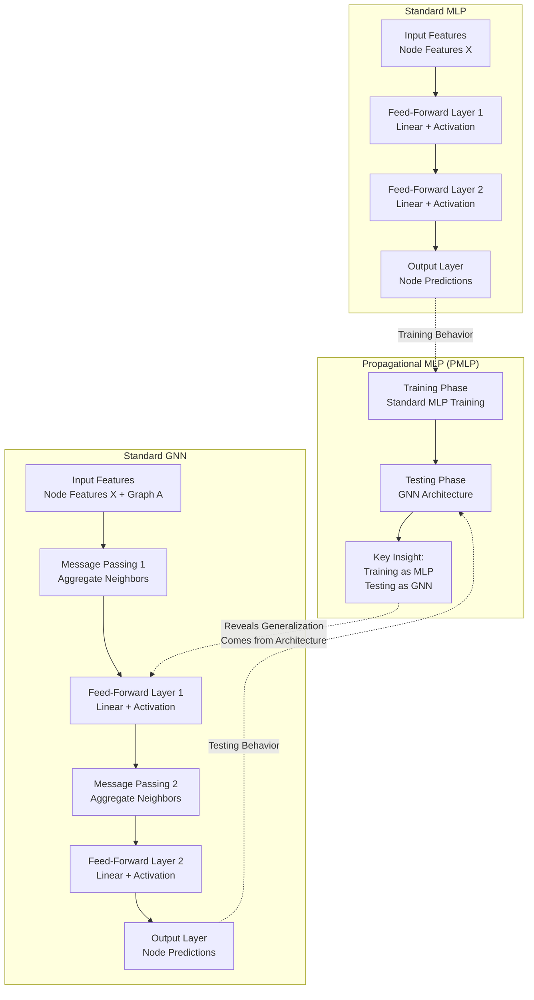
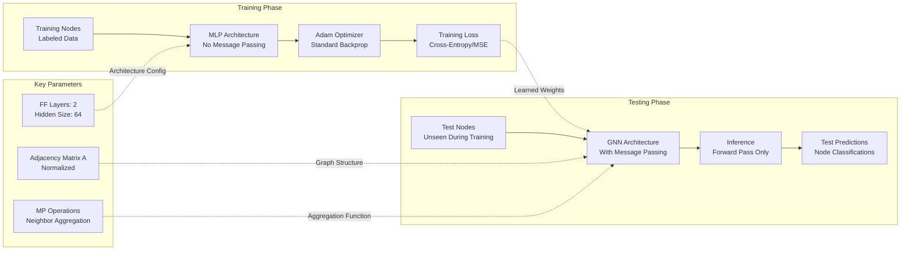
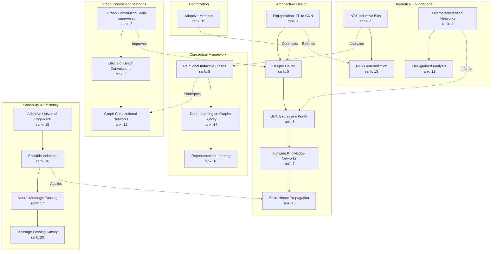
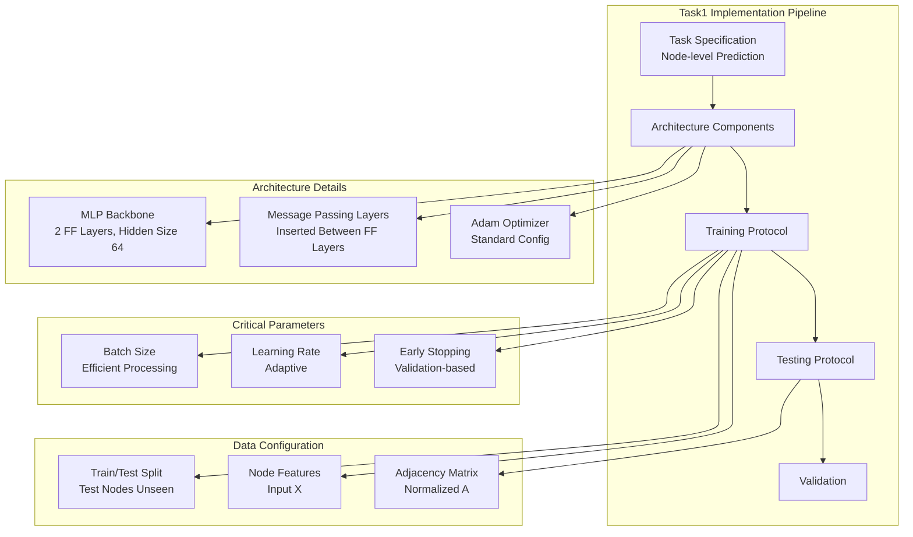
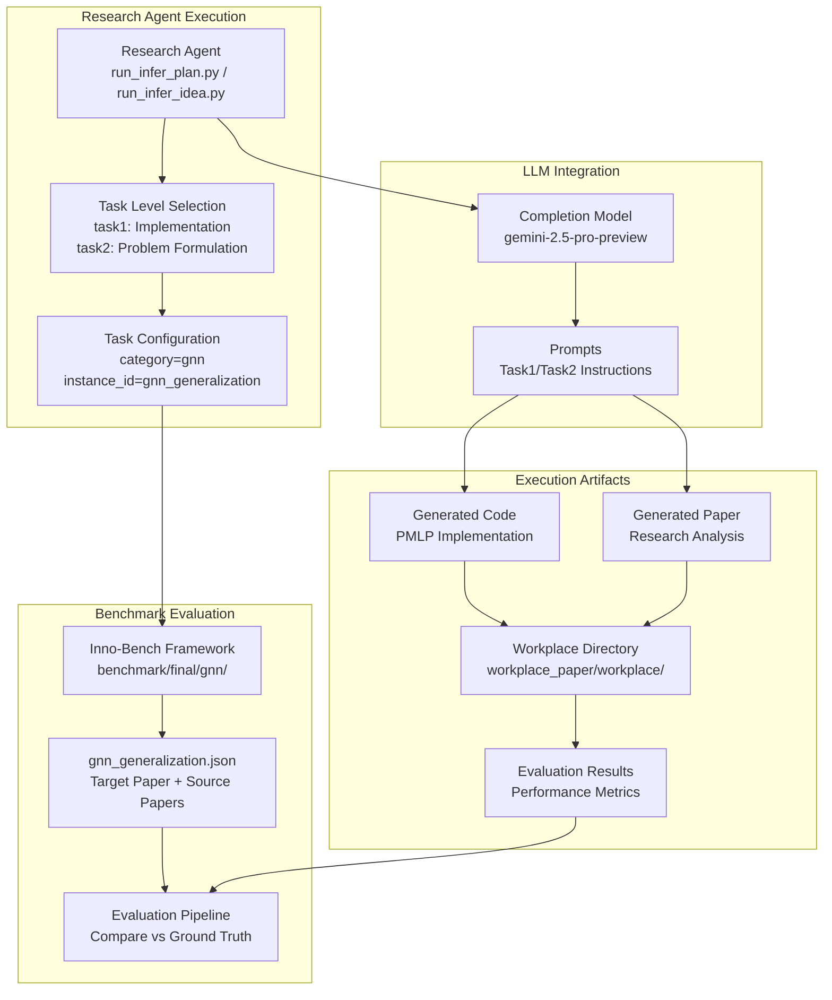

<!-- source: DeepWiki mcp.deepwiki.com · repo HKUDS/AI-Researcher · extra page Generalization Study · fetched 2026-11-09 -->

# Generalization Study

Relevant source files

The following files were used as context for generating this wiki page:

- [benchmark/final/gnn/gnn_generalization.json](benchmark/final/gnn/gnn_generalization.json)

## Purpose and Scope

This page documents the **Generalization Study** benchmark task within the Graph Neural Networks domain of the Inno-Bench evaluation framework. This benchmark evaluates AI-Researcher's ability to reproduce research investigating why Graph Neural Networks (GNNs) exhibit superior generalization capabilities compared to Multi-Layer Perceptrons (MLPs) in node-level prediction tasks.

The benchmark is based on the paper "Graph Neural Networks are Inherently Good Generalizers: Insights by Bridging GNNs and Multi-Layer Perceptrons" (Yang et al., 2023), which introduces the Propagational MLP (PMLP) architecture as an analytical tool to isolate and understand the intrinsic generalization properties of GNN architectures.

For information about other GNN benchmarks, see:
- Multi-task adaptation: [Multi-task Prompting](#5.2.1)
- Scalability approaches: [Sparse Transformers](#5.2.2) and [Structure Learning](#5.2.6)
- Theoretical foundations: [Fractional-Order Dynamics](#5.2.4) and [Universal Learning Principles](#5.2.8)
- Learning paradigms: [Spectral Polynomial Filtering](#5.2.7)
- LLM integration: [Graph Instruction Tuning](#5.2.9)

For the overall benchmark system architecture, see [Benchmark System (Inno-Bench)](#3.3).

**Sources:** [benchmark/final/gnn/gnn_generalization.json:1-198]()

## Benchmark Overview

The `gnn_generalization` benchmark task challenges the conventional wisdom that GNNs' superiority stems primarily from their advanced expressivity. Instead, this research pinpoints the major source of GNNs' performance gains to their **intrinsic generalization capability** rather than representational power alone.

### Target Research Paper

| Property | Value |
|----------|-------|
| **Instance ID** | `gnn_generalization` |
| **Target Paper** | Graph Neural Networks are Inherently Good Generalizers: Insights by Bridging GNNs and Multi-Layer Perceptrons |
| **Authors** | Chenxiao Yang, Qitian Wu, Jiahua Wang, Junchi Yan |
| **Year** | 2023 |
| **Citation Count** | 70 |
| **URL** | https://arxiv.org/abs/2212.09034 |
| **Primary Domain** | Graph Neural Networks (node-level prediction) |

### Key Research Contribution

The research introduces an intermediate model class called **Propagational MLP (PMLP)**, which is identical to standard MLP during training but adopts GNN's message-passing architecture during testing. The surprising finding is that PMLPs consistently perform on par with (or even exceed) their GNN counterparts while being significantly more efficient in training.

**Sources:** [benchmark/final/gnn/gnn_generalization.json:1-7, 186-198]()

## Core Methodology: PMLP Architecture

### Architectural Comparison

The PMLP architecture reveals the essential difference between MLPs and GNNs by decoupling training dynamics from inference behavior. The following diagram illustrates the architectural relationships:

**Sources:** [benchmark/final/gnn/gnn_generalization.json:192-198]()

### Training vs Testing Phase Differences

The PMLP methodology exploits a critical distinction between training and testing phases:

**Sources:** [benchmark/final/gnn/gnn_generalization.json:196-197]()

## Theoretical Framework

### Neural Tangent Kernel Analysis

The research employs Neural Tangent Kernel (NTK) theory to analyze the generalization behavior at the infinite-width limit. The essential difference between MLP and PMLP lies in the **NTK feature map in the post-training stage**.

| Theoretical Component | Description | Role in Analysis |
|-----------------------|-------------|------------------|
| **NTK Feature Map** | Kernel representation at infinite width | Captures generalization differences between MLP and PMLP |
| **Inductive Bias** | Implicit architectural preferences | GNN architecture provides relational inductive bias |
| **Overparameterization** | Network width approaching infinity | Enables NTK-based theoretical analysis |
| **Extrapolation Behavior** | Out-of-distribution generalization | Tests architectural advantages on OOD samples |

### Generalization Capabilities

The benchmark evaluates two key aspects of generalization:

1. **In-Distribution Generalization**: Performance on test nodes within the training data distribution
2. **Extrapolation Capability**: Behavior on extremely out-of-distribution samples

The research finds that while GNNs/PMLPs struggle with non-linear function extrapolation for extremely OOD samples, they demonstrate **greater potential to generalize to testing samples near the training data range** as natural advantages of GNN architectures.

**Sources:** [benchmark/final/gnn/gnn_generalization.json:24-30, 96-121]()

## Source Papers and Knowledge Graph

The benchmark task synthesizes insights from 20 foundational papers spanning multiple research areas. The following diagram maps the knowledge dependencies:

### Source Paper Categories

The 20 source papers are organized into six categories based on their primary contribution:

| Category | Paper Count | Example Papers | Research Focus |
|----------|-------------|----------------|----------------|
| **Methodological** | 6 | Overparameterized learning (rank 1), GCN (rank 12) | Foundational methods and training techniques |
| **Conceptual** | 6 | Relational inductive biases (rank 8), Survey (rank 14) | Theoretical frameworks and broad perspectives |
| **Component** | 7 | Graph convolution (rank 2), Jumping knowledge (rank 7) | Specific architectural components and techniques |
| **Critical Components** | 1 | Effects of graph convolutions (rank 9) | Essential building blocks |

**Sources:** [benchmark/final/gnn/gnn_generalization.json:4-184]()

## Task Specifications

### Task 1: Implementation Task

The Level 1 task requires implementing the PMLP architecture with the following specifications:

#### Core Algorithm Components

#### Implementation Steps

| Step | Phase | Action | Key Parameters |
|------|-------|--------|----------------|
| 1 | Data Preparation | Structure data as graph with nodes and edges | Graph structure, node features |
| 2 | MLP Training | Train MLP using standard methods | Batch size, learning rate, early stopping |
| 3 | Architecture Switch | Define message passing schema for testing | Normalized adjacency matrix |
| 4 | Testing with GNN | Insert MP operations before FF layers | Neighbor aggregation function |
| 5 | Prediction | Apply linear classifier/softmax | Output node predictions |

#### Critical Implementation Details

- **Scalability**: Ensure efficient batching during training for larger datasets
- **Validation**: Test on multiple benchmark datasets to ensure robustness
- **Over-smoothing**: Models deeper than 2 layers may require residual connections
- **Adjacency Matrix**: Use normalized adjacency for stable message passing

**Sources:** [benchmark/final/gnn/gnn_generalization.json:196-197]()

### Task 2: Research Problem Formulation

The Level 2 task focuses on understanding and formulating the research problem:

#### Primary Research Task

Understanding the generalization capabilities of GNNs compared to MLPs in node-level prediction tasks within graph structures.

#### Existing Gaps

| Gap Area | Description | Research Need |
|----------|-------------|---------------|
| **Generalization vs Expressivity** | Prior work focused on representational power | Need to isolate generalization properties |
| **Architectural Comparison** | Limited understanding of MLP vs GNN differences | Systematic analysis of intrinsic capabilities |
| **Theoretical Foundation** | Unclear why GNNs generalize better | Formal theoretical framework (NTK analysis) |

#### Core Research Challenges

1. **Elucidating Generalization Sources**: Identify underlying reasons for GNNs' superior generalization
2. **Architectural Analysis**: Pinpoint key architectural features that facilitate better performance
3. **MLP Limitations**: Address why MLPs underperform on graph-structured data

#### Key Objectives

| Objective | Contribution Type | Impact |
|-----------|-------------------|--------|
| **Bridge GNN-MLP Gap** | Intermediate model class (PMLP) | Analytical tool for dissecting GNN properties |
| **Theoretical Insights** | NTK-based analysis at infinite width | Formal understanding of generalization |
| **Practical Implications** | Efficient training strategies | More robust graph representation learning |

**Sources:** [benchmark/final/gnn/gnn_generalization.json:198]()

## Evaluation Dimensions

The Inno-Bench framework evaluates AI-generated research on this task across multiple dimensions:

### Performance Metrics

| Dimension | Evaluation Criteria | Expected Outcomes |
|-----------|---------------------|-------------------|
| **Novelty** | Introduction of PMLP as analytical tool | Novel architectural insight |
| **Experimental Rigor** | Comprehensive benchmarking across datasets | Validation on multiple graph types |
| **Theoretical Foundation** | NTK-based analysis at infinite width | Formal mathematical framework |
| **Result Analysis** | Generalization vs expressivity insights | Clear interpretation of findings |
| **Writing Quality** | Clarity in presenting architectural differences | Accessible technical exposition |

### Benchmark Comparison

The evaluation compares AI-generated implementations and analyses against the expert-level ground truth from the original 2023 paper (70 citations). Key comparison points include:

1. **Architectural Correctness**: Proper implementation of PMLP training/testing distinction
2. **Theoretical Depth**: Use of NTK theory for generalization analysis
3. **Experimental Coverage**: Testing across diverse graph datasets and node prediction tasks
4. **Insight Quality**: Clear articulation of why generalization matters more than expressivity

**Sources:** [benchmark/final/gnn/gnn_generalization.json:1-7, 192-198]()

## Integration with AI-Researcher System

The `gnn_generalization` benchmark task integrates with the broader AI-Researcher system as follows:

### Configuration Parameters

To run this benchmark task, configure the following parameters in the `.env` file:

| Parameter | Value | Purpose |
|-----------|-------|---------|
| `CATEGORY` | `gnn` | Specifies Graph Neural Network domain |
| `INSTANCE_ID` | `gnn_generalization` | Selects this specific benchmark |
| `TASK_LEVEL` | `task1` or `task2` | Chooses implementation vs formulation |
| `MAX_ITER` | `0` or positive integer | Controls refinement iterations |

**Sources:** [benchmark/final/gnn/gnn_generalization.json:1-7]()

---

