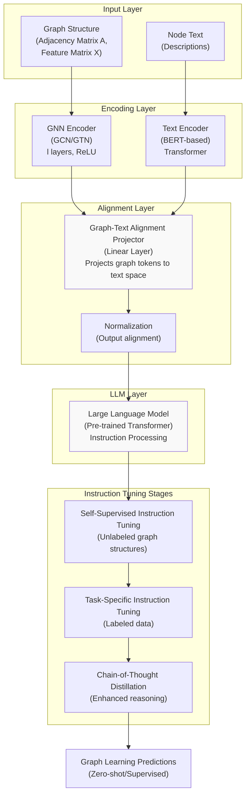
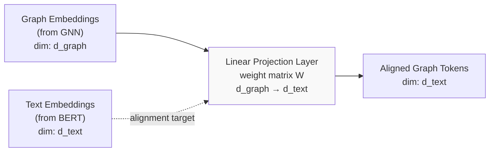
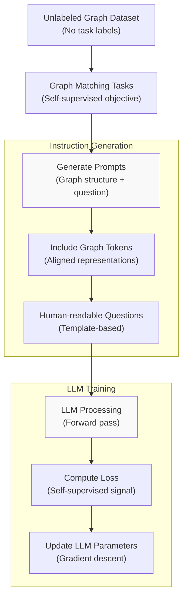
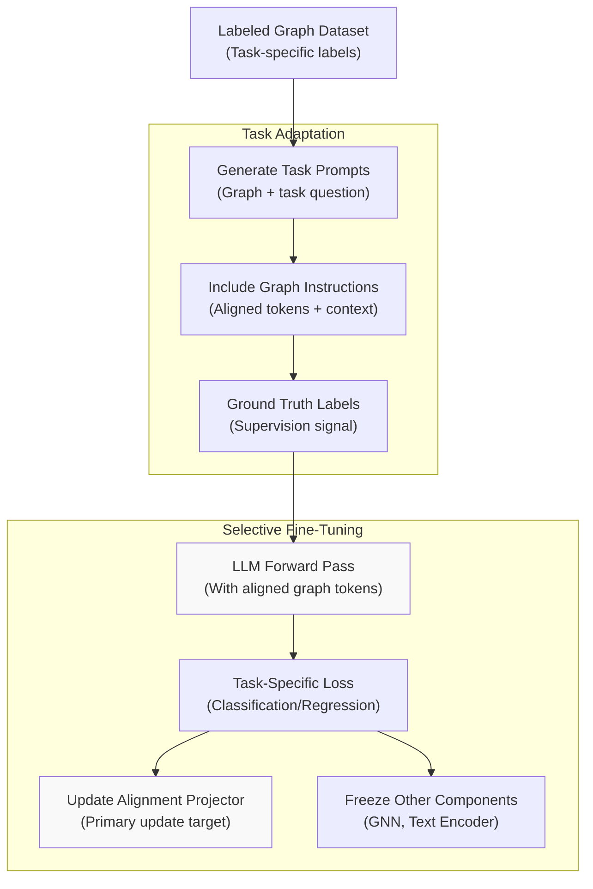
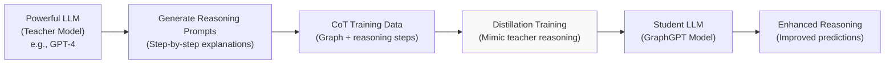
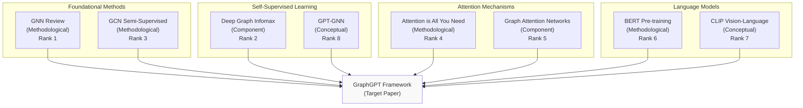

<!-- source: DeepWiki mcp.deepwiki.com · repo HKUDS/AI-Researcher · extra page Graph Instruction Tuning (GraphGPT) · fetched 2026-11-09 -->

# Graph Instruction Tuning (GraphGPT)

<details>
<summary>Relevant source files</summary>

The following files were used as context for generating this wiki page:

- [benchmark/final/gnn/graphgpt.json](benchmark/final/gnn/graphgpt.json)

</details>


## Purpose and Scope

This document describes the GraphGPT benchmark task within the AI-Researcher evaluation framework. GraphGPT represents a frontier approach for integrating Large Language Models (LLMs) with graph structural knowledge through instruction tuning, enabling zero-shot generalization across diverse graph learning tasks. This benchmark evaluates the AI-Researcher system's capability to understand and reproduce complex multi-modal architectures that bridge graph neural networks and language models.

For other GNN-related benchmarks, see [Graph Neural Networks](#5.2). For general instruction tuning and reasoning approaches, see [Reasoning](#5.3).

**Sources:** [benchmark/final/gnn/graphgpt.json:1-99]()

---

## Overview

GraphGPT addresses a fundamental challenge in graph learning: achieving effective generalization in zero-shot scenarios without relying on task-specific labeled data. Traditional Graph Neural Networks (GNNs) with self-supervised learning require fine-tuning on downstream tasks, limiting their adaptability when labeled data is scarce. GraphGPT overcomes this by creating a graph-oriented LLM capable of understanding complex graph structures through a dual-stage instruction tuning paradigm.

The framework integrates three key innovations:
1. **Text-Graph Grounding**: Links textual information with graph structural representations
2. **Dual-Stage Instruction Tuning**: Self-supervised pre-training followed by task-specific adaptation
3. **Lightweight Alignment Projector**: Bridges graph tokens with text tokens in the LLM's embedding space

**Primary Research Objectives:**
- Improve generalization capabilities of graph models in zero-shot learning scenarios
- Achieve effective alignment between graph structural information and language representations
- Guide LLMs to understand complex graph structures
- Enhance step-by-step reasoning abilities for complex graph learning tasks

**Sources:** [benchmark/final/gnn/graphgpt.json:88-98]()

---

## Framework Architecture

### High-Level System Design



**Architecture Overview:**

The GraphGPT framework processes graph data through a multi-stage pipeline. The encoding layer independently processes graph structure (via GNN) and node text (via BERT), producing rich representations. The alignment layer uses a lightweight linear projector to map graph representations into the LLM's text embedding space, enabling the language model to "understand" graph structure as if it were text. The instruction tuning stages progressively enhance the model's capabilities, starting with self-supervised learning on unlabeled graphs, advancing to task-specific adaptation, and culminating in chain-of-thought reasoning enhancement.

**Sources:** [benchmark/final/gnn/graphgpt.json:1-99]()

---

### Component Interaction Flow

```mermaid
graph LR
    subgraph "Graph Processing Pipeline"
        A_MATRIX["adjacency_matrix"]
        X_MATRIX["feature_matrix"]
        GNN_ENCODE["gnn_encoder.forward()"]
        GRAPH_REPR["graph_representations"]
    end
    
    subgraph "Text Processing Pipeline"
        NODE_TEXT["node_text_descriptions"]
        TEXT_ENCODE["text_encoder.encode()"]
        TEXT_REPR["text_representations"]
    end
    
    subgraph "Alignment & Fusion"
        LINEAR_PROJ["alignment_projector.linear()"]
        NORM_LAYER["normalize_outputs()"]
        GRAPH_TOKENS["aligned_graph_tokens"]
    end
    
    subgraph "Instruction Construction"
        PROMPT_GEN["generate_prompts()"]
        GRAPH_INST["graph_instructions"]
        HUMAN_Q["human_questions"]
    end
    
    subgraph "LLM Processing"
        LLM_FORWARD["llm.forward()"]
        PARAM_UPDATE["update_parameters()"]
        PREDICTIONS["task_predictions"]
    end
    
    A_MATRIX --> GNN_ENCODE
    X_MATRIX --> GNN_ENCODE
    GNN_ENCODE --> GRAPH_REPR
    
    NODE_TEXT --> TEXT_ENCODE
    TEXT_ENCODE --> TEXT_REPR
    
    GRAPH_REPR --> LINEAR_PROJ
    TEXT_REPR --> LINEAR_PROJ
    LINEAR_PROJ --> NORM_LAYER
    NORM_LAYER --> GRAPH_TOKENS
    
    GRAPH_TOKENS --> PROMPT_GEN
    PROMPT_GEN --> GRAPH_INST
    GRAPH_INST --> HUMAN_Q
    
    HUMAN_Q --> LLM_FORWARD
    LLM_FORWARD --> PARAM_UPDATE
    PARAM_UPDATE --> PREDICTIONS
    
    style LINEAR_PROJ fill:#f9f9f9
    style LLM_FORWARD fill:#f9f9f9
```



**Component Interaction:**

This diagram illustrates the concrete data flow and function calls within the GraphGPT framework. Graph structure (adjacency and feature matrices) flows through the GNN encoder, while node text descriptions are processed by the text encoder. Both streams converge at the alignment projector, which performs a linear transformation and normalization to produce aligned graph tokens. These tokens are integrated into instruction prompts with human-readable questions, which are then processed by the LLM to generate predictions. During training, the system selectively updates parameters based on the tuning stage.

**Sources:** [benchmark/final/gnn/graphgpt.json:97]()

---

## Core Components

### GNN Encoder

The GNN encoder extracts structural features from graph data using message-passing architectures. The encoder supports multiple backbone architectures:

| Component | Specification |
|-----------|---------------|
| **Architecture Options** | Graph Convolutional Network (GCN) or Graph Transformer Networks (GTN) |
| **Number of Layers** | Variable (parameter: `l`) |
| **Learning Rate** | 2e-3 (typical) |
| **Activation Function** | ReLU |
| **Input** | Adjacency matrix `A` and feature matrix `X` |
| **Output** | Encoded graph representation (node embeddings) |

**Functionality:**

The GNN encoder performs recursive message passing and aggregation to capture graph topology and node features. Each layer aggregates information from neighboring nodes, allowing the model to learn representations that encode both local neighborhood structure and global graph properties. The choice between GCN and GTN depends on the complexity of the graph structure and the need for attention-based aggregation.

**Key Parameters:**
- **Number of layers (`l`)**: Controls the receptive field; deeper networks capture longer-range dependencies
- **Hidden dimensions**: Typically aligned with the text encoder's output dimension to facilitate alignment
- **Dropout rate**: Regularization to prevent overfitting during training

**Sources:** [benchmark/final/gnn/graphgpt.json:97]()

---

### Text Encoder

The text encoder processes node-associated textual information using pre-trained transformer models:

| Component | Specification |
|-----------|---------------|
| **Base Model** | BERT or similar transformer architecture |
| **Input** | Text descriptions associated with graph nodes |
| **Processing** | Bidirectional self-attention over token sequences |
| **Output** | Normalized text representations (embeddings) |
| **Parameter Handling** | Typically frozen during graph-specific training |

**Integration with Graph Structure:**

Each node in the graph has associated textual attributes (e.g., paper titles, node descriptions). The text encoder transforms these descriptions into dense vector representations that capture semantic meaning. These representations are crucial for grounding graph structure in natural language space, enabling the LLM to understand graph data through linguistic context.

**Implementation Considerations:**
- Text representations must be normalized to match the scale of graph representations
- Pre-trained weights from BERT provide strong semantic understanding without graph-specific training
- Token-level embeddings can be aggregated (e.g., using [CLS] token or mean pooling) to obtain node-level representations

**Sources:** [benchmark/final/gnn/graphgpt.json:51-57]()

---

### Lightweight Graph-Text Alignment Projector

The alignment projector bridges the modality gap between graph structural representations and text embeddings:



**Technical Specifications:**

| Aspect | Details |
|--------|---------|
| **Architecture** | Single linear layer (simple and lightweight) |
| **Input Dimension** | Graph embedding dimension from GNN encoder |
| **Output Dimension** | Text embedding dimension (matches LLM input) |
| **Training Strategy** | Updated during task-specific tuning, frozen in self-supervised stage |
| **Parameter Count** | Minimal compared to GNN and LLM parameters |

**Purpose and Design Rationale:**

The lightweight design ensures computational efficiency while achieving effective alignment. A simple linear transformation is sufficient because:
1. Both GNN and text encoders produce semantically rich representations
2. The alignment task is primarily about scaling and rotation in embedding space
3. More complex projectors (e.g., MLPs) risk overfitting and increase computational cost

The projector's output consists of "graph tokens" that can be seamlessly integrated into the LLM's input sequence alongside text tokens, enabling the language model to process graph structure as naturally as it processes text.

**Sources:** [benchmark/final/gnn/graphgpt.json:97]()

---

## Dual-Stage Instruction Tuning

### Self-Supervised Instruction Tuning Stage

The first stage leverages unlabeled graph structures to create instructions for the LLM:



**Self-Supervised Objectives:**

The framework generates instruction tuning tasks from unlabeled graphs without requiring explicit labels. Common self-supervised tasks include:

1. **Graph Matching**: Given two graph representations, determine if they correspond to the same graph (with/without augmentations)
2. **Structural Prediction**: Predict missing edges or node properties based on graph context
3. **Subgraph Reasoning**: Answer questions about subgraph properties using structural information

**Training Configuration:**

| Parameter | Specification |
|-----------|---------------|
| **Parameters Updated** | LLM parameters (full or LoRA), alignment projector frozen |
| **Data Source** | Unlabeled graphs across diverse domains |
| **Objective** | Cross-entropy loss on self-supervised tasks |
| **Benefit** | General graph understanding without task-specific bias |

**Sources:** [benchmark/final/gnn/graphgpt.json:97-98]()

---

### Task-Specific Instruction Tuning Stage

The second stage fine-tunes the model on labeled data for specific graph learning tasks:



**Task-Specific Adaptation Strategy:**

During this stage, the model learns to apply its general graph understanding to specific downstream tasks. Key characteristics:

| Aspect | Strategy |
|--------|----------|
| **Primary Update Target** | Alignment projector parameters |
| **LLM Parameters** | Typically frozen or updated with very small learning rate |
| **GNN & Text Encoder** | Frozen to preserve learned representations |
| **Batch Size Management** | Carefully controlled to avoid memory overflow |
| **Learning Rate** | Smaller than self-supervised stage to prevent catastrophic forgetting |
| **Warmup Ratio** | Applied to stabilize training |

**Supported Task Types:**
- Node classification (e.g., paper categorization)
- Link prediction (e.g., citation prediction)
- Graph-level classification (e.g., molecular property prediction)
- Zero-shot generalization to unseen task types

**Sources:** [benchmark/final/gnn/graphgpt.json:97]()

---

### Chain-of-Thought (CoT) Distillation

The final enhancement incorporates step-by-step reasoning capabilities:



**CoT Integration:**

Chain-of-Thought distillation enhances the model's logical reasoning for complex graph tasks by:

1. **Generating CoT Exemplars**: Using a powerful teacher LLM to generate step-by-step reasoning for graph problems
2. **Creating Reasoning Prompts**: Structuring prompts that include intermediate reasoning steps, not just final answers
3. **Distillation Training**: Training the student model (GraphGPT) to reproduce the teacher's reasoning patterns
4. **Improved Logical Flow**: Enhancing the model's ability to explain predictions and handle multi-step reasoning tasks

**Benefits:**
- Better interpretability of model predictions
- Improved performance on complex reasoning tasks
- Enhanced zero-shot generalization through learned reasoning patterns
- Ability to generate explanations for graph predictions

**Sources:** [benchmark/final/gnn/graphgpt.json:97]()

---

## Benchmark Integration

### Evaluation within AI-Researcher

GraphGPT serves as a benchmark task within the Inno-Bench evaluation framework, testing the AI-Researcher system's ability to understand and reproduce complex multi-modal architectures:

| Benchmark Attribute | Value |
|---------------------|-------|
| **Instance ID** | `graphgpt` |
| **Category** | `gnn` (Graph Neural Networks) |
| **Target Paper** | "GraphGPT: Graph Instruction Tuning for Large Language Models" |
| **Authors** | Jiabin Tang, Yuhao Yang, Wei Wei, Lei Shi, Lixin Su, Suqi Cheng, Dawei Yin, Chao Huang |
| **Publication Year** | 2023 |
| **Venue** | ACM SIGIR Conference |
| **Citations** | 0 (as of benchmark creation) |
| **Field** | `preselected` |

**Evaluation Dimensions:**

The AI-Researcher system is evaluated on its ability to:
1. **Understand Multi-Modal Integration**: Comprehend how graph and text modalities are bridged
2. **Implement Dual-Stage Training**: Reproduce the self-supervised and task-specific tuning paradigm
3. **Design Alignment Mechanisms**: Create appropriate projector architectures
4. **Apply CoT Techniques**: Integrate reasoning enhancement strategies
5. **Achieve Generalization**: Demonstrate zero-shot capabilities across diverse graph tasks

**Sources:** [benchmark/final/gnn/graphgpt.json:1-99]()

---

### Reference Paper Dependencies

GraphGPT builds upon foundational work across multiple research areas:



**Reference Paper Roles:**

The benchmark includes 8 source papers that inform different aspects of the GraphGPT framework:

1. **GNN Review (Rank 1)**: Provides foundational GNN concepts and methodologies
2. **Deep Graph Infomax (Rank 2)**: Self-supervised learning technique incorporated into instruction tuning
3. **GCN Semi-Supervised (Rank 3)**: Feature representation concepts adapted for zero-shot learning
4. **Attention is All You Need (Rank 4)**: Self-attention mechanisms for capturing graph dependencies
5. **Graph Attention Networks (Rank 5)**: Graph-specific attention for information aggregation
6. **BERT Pre-training (Rank 6)**: Text encoding architecture for text-graph alignment
7. **CLIP Vision-Language (Rank 7)**: Inspiration for self-supervised instruction tuning design
8. **GPT-GNN (Rank 8)**: Conceptual basis for integrating generative aspects

These papers are classified by type:
- **Methodological**: Core techniques directly used in the framework
- **Component**: Specific algorithmic components integrated into the system
- **Conceptual**: High-level ideas that inspired design decisions

**Sources:** [benchmark/final/gnn/graphgpt.json:4-76]()

---

## Implementation Guidelines

### Critical Implementation Details

Based on the benchmark task specifications, implementing GraphGPT requires attention to several critical details:

| Implementation Aspect | Specification |
|----------------------|---------------|
| **Parameter Initialization** | GNN and text encoder parameters must be properly initialized; representations normalized |
| **Batch Size Management** | Careful control needed to avoid memory overflow during LLM tuning |
| **Learning Rate Strategy** | Monitor learning rates and warmup ratios for training stability, especially for alignment projector |
| **Component Freezing** | Selective parameter updates based on tuning stage (self-supervised vs. task-specific) |
| **Memory Optimization** | Consider gradient checkpointing for large graphs and LLMs |
| **Evaluation Protocol** | Assess both accuracy and generalization across different datasets and tasks |

**Training Workflow:**

1. **Pre-process Graph Data**: Convert graphs into adjacency and feature matrices; prepare node text descriptions
2. **Initialize Encoders**: Load pre-trained GNN and BERT weights; initialize alignment projector
3. **Self-Supervised Stage**: Train on unlabeled graphs with graph matching tasks; update LLM parameters
4. **Task-Specific Stage**: Fine-tune on labeled data; primarily update alignment projector
5. **CoT Enhancement**: Generate reasoning data using teacher model; distill into student model
6. **Evaluation**: Test on zero-shot tasks and measure generalization capabilities

**Sources:** [benchmark/final/gnn/graphgpt.json:97]()

---

## Research Objectives and Challenges

### Primary Research Goals

The GraphGPT benchmark evaluates the AI-Researcher system's understanding of four key research objectives:

1. **Generalization in Zero-Shot Scenarios**: Ability to perform graph learning tasks without task-specific training data
2. **Graph-Language Alignment**: Effective bridging of graph structural information with language representations
3. **Complex Structure Understanding**: Guiding LLMs to comprehend intricate graph topologies and relationships
4. **Enhanced Reasoning**: Incorporating step-by-step reasoning capabilities for complex graph learning tasks

**Challenges Addressed:**

| Challenge | Approach in GraphGPT |
|-----------|---------------------|
| **Limited Labeled Data** | Self-supervised instruction tuning on unlabeled graphs |
| **Modality Gap** | Lightweight alignment projector for graph-text bridging |
| **Task Specificity** | Dual-stage tuning: general pre-training + task adaptation |
| **Reasoning Complexity** | Chain-of-thought distillation from powerful teacher models |
| **Scalability** | Lightweight projector minimizes additional parameters |

**Expected Outcomes:**

The benchmark expects AI-generated research to:
- Demonstrate superior generalization in both supervised and zero-shot graph learning tasks
- Surpass existing benchmarks in graph-language integration
- Provide clear implementation methodology for reproducibility
- Show theoretical understanding of why instruction tuning enhances graph model capabilities

**Sources:** [benchmark/final/gnn/graphgpt.json:98]()

---

## Benchmark Configuration

### Task Execution Parameters

When the AI-Researcher system processes the GraphGPT benchmark, it uses the following configuration:

```
Instance ID: graphgpt
Category: gnn
Field: preselected
Task Level: Available for both task1 (implementation) and task2 (ideation)
```

**Task 1 (Implementation)**: The system must implement the core methodology, including GNN encoder, text encoder, alignment projector, dual-stage instruction tuning, and CoT distillation.

**Task 2 (Ideation)**: The system must understand the research objectives, identify limitations of existing approaches, articulate core challenges, and propose novel extensions or improvements.

**Evaluation Criteria**: The generated research is compared against the expert-level ground truth paper across multiple dimensions including novelty, experimental rigor, theoretical foundation, result analysis, and writing quality.

**Sources:** [benchmark/final/gnn/graphgpt.json:1-99]()

---

