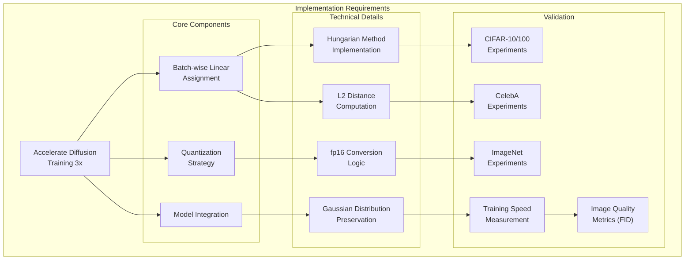
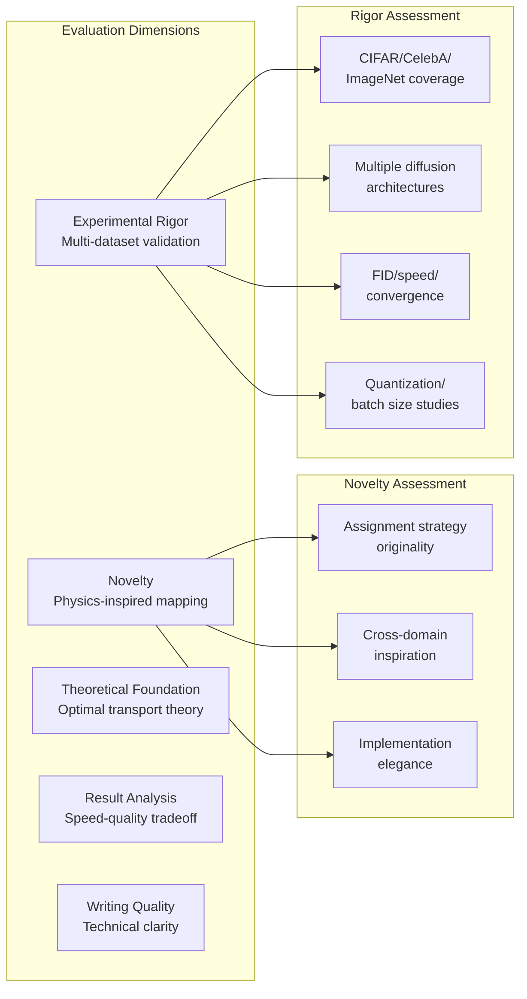
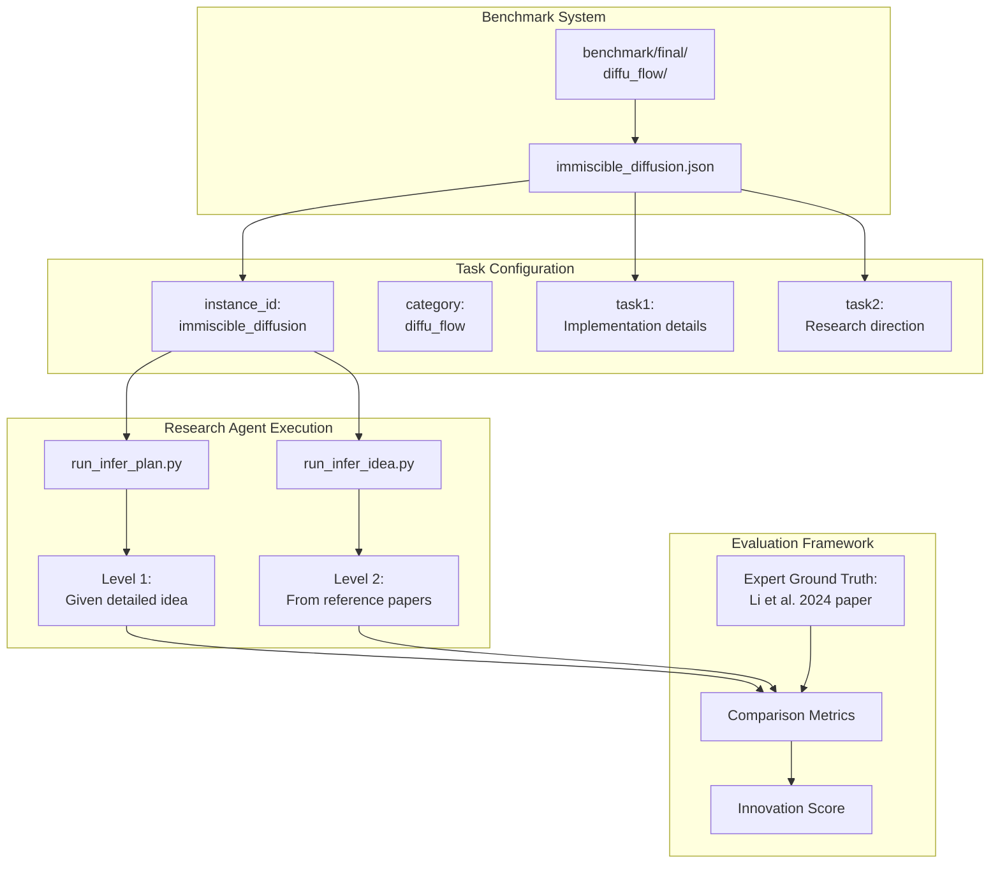

<!-- source: DeepWiki mcp.deepwiki.com · repo HKUDS/AI-Researcher · extra page Immiscible Diffusion · fetched 2026-11-09 -->

# Immiscible Diffusion

<details>
<summary>Relevant source files</summary>

The following files were used as context for generating this wiki page:

- [benchmark/final/diffu_flow/immiscible_diffusion.json](benchmark/final/diffu_flow/immiscible_diffusion.json)

</details>


## Purpose and Scope

This page documents the Immiscible Diffusion benchmark task within the AI-Researcher evaluation framework. Immiscible Diffusion addresses the problem of suboptimal noise-data mapping in diffusion model training by employing a physics-inspired assignment strategy that makes noise-image pairs distinguishable, analogous to immiscibility in molecular physics. The benchmark evaluates the AI-Researcher system's ability to implement and optimize this acceleration technique, which achieves up to 3x faster training for diffusion models including Consistency Models, DDIM, and Stable Diffusion.

For other diffusion and flow matching benchmarks, see [Consistency Flow Matching](#5.1.1), [Improved Rectified Flows](#5.1.2), and [MMDiT Transformers](#5.1.4). For the broader diffusion benchmark category, see [Diffusion & Flow Matching](#5.1).

**Sources:** [benchmark/final/diffu_flow/immiscible_diffusion.json:1-79]()

## Problem Formulation

Current diffusion model training methods diffuse each image across the entire noise space, creating a mixture of all images at every point in the noise layer. This random mixture complicates the optimization of the denoising function, leading to slow training convergence and requiring extensive computational resources.

### Training Bottleneck

The core inefficiency stems from the **miscibility issue** in noisy diffusion steps:

| Issue | Description | Impact |
|-------|-------------|--------|
| Random noise-data mapping | Each image can be paired with any noise vector | Optimization difficulty |
| Complete mixture | All images mixed at every noise layer point | Slow convergence |
| Undifferentiated assignment | No preference for nearby noise assignments | Suboptimal training efficiency |

The Immiscible Diffusion approach draws inspiration from physics, where immiscibility means that mixing of molecular sources remains distinguishable due to intermolecular forces. By applying this concept, the method aims to make image-noise mappings more structured and distinguishable.

**Sources:** [benchmark/final/diffu_flow/immiscible_diffusion.json:13-79]()

## Core Methodology: Assignment-then-Diffusion

Immiscible Diffusion introduces an **assignment-then-diffusion training strategy** that enforces structure on noise-data mappings before diffusion occurs. The approach consists of two sequential stages executed within each training mini-batch.

```mermaid
graph TB
    subgraph "Standard Diffusion Training"
        STD_IMG["Image Batch<br/>x_b"]
        STD_NOISE["Random Noise<br/>n_rand_b"]
        STD_PAIR["Random Pairing<br/>(miscible)"]
        STD_DIFFUSE["Diffusion Process<br/>x_t = √α x + √(1-α) n"]
        STD_TRAIN["Train Denoising<br/>Network"]
        
        STD_IMG --> STD_PAIR
        STD_NOISE --> STD_PAIR
        STD_PAIR --> STD_DIFFUSE
        STD_DIFFUSE --> STD_TRAIN
    end
    
    subgraph "Immiscible Diffusion Training"
        IMM_IMG["Image Batch<br/>x_b"]
        IMM_NOISE["Random Noise<br/>n_rand_b"]
        IMM_QUANT["Quantization<br/>fp32 → fp16"]
        IMM_DIST["L2 Distance<br/>Computation"]
        IMM_ASSIGN["Linear Assignment<br/>(Hungarian Method)"]
        IMM_REORDER["Noise Reordering<br/>(immiscible)"]
        IMM_DIFFUSE["Diffusion Process<br/>x_t = √α x + √(1-α) n_assigned"]
        IMM_TRAIN["Train Denoising<br/>Network"]
        
        IMM_IMG --> IMM_QUANT
        IMM_NOISE --> IMM_QUANT
        IMM_QUANT --> IMM_DIST
        IMM_DIST --> IMM_ASSIGN
        IMM_ASSIGN --> IMM_REORDER
        IMM_REORDER --> IMM_DIFFUSE
        IMM_DIFFUSE --> IMM_TRAIN
    end
```



**Diagram: Standard vs. Immiscible Diffusion Training Pipeline**

The assignment step acts analogously to external forces in physics, expelling the diffuse-able areas of images and mitigating inherent training difficulties. Each image is preferably projected to nearby noise vectors, while preserving the overall Gaussian distribution of noise.

**Sources:** [benchmark/final/diffu_flow/immiscible_diffusion.json:13-79]()

## Technical Implementation

### Batch-wise Linear Assignment Algorithm

The core innovation uses the **Hungarian method** to solve the linear assignment problem within each mini-batch, minimizing total image-noise pair distance.

#### Algorithm Parameters

| Parameter | Type | Description |
|-----------|------|-------------|
| `x_b` | Tensor | Batch of images, shape `[batch_size, channels, height, width]` |
| `n_rand_b` | Tensor | Batch of random Gaussian noise, same shape as `x_b` |
| `t_b` | Tensor | Sampled diffusion timesteps, shape `[batch_size]` |
| `α` | Schedule | Diffusion schedule (noise level at each timestep) |
| Distance metric | L2 | Euclidean distance for image-noise pairing |

#### Assignment Process

```mermaid
graph LR
    subgraph "Input Preparation"
        BATCH_IMG["x_b<br/>[B, C, H, W]"]
        BATCH_NOISE["n_rand_b<br/>[B, C, H, W]"]
    end
    
    subgraph "Quantization Stage"
        QUANT_OP["torch.float16<br/>conversion"]
        BATCH_IMG_Q["x_b_fp16"]
        BATCH_NOISE_Q["n_rand_b_fp16"]
    end
    
    subgraph "Distance Computation"
        FLATTEN["Flatten to<br/>[B, C*H*W]"]
        PAIRWISE["Pairwise L2<br/>Distance Matrix"]
        DIST_MAT["D[i,j] = ||x_i - n_j||_2"]
    end
    
    subgraph "Linear Assignment"
        HUNGARIAN["Hungarian<br/>Algorithm"]
        ASSIGN_MAT["Assignment<br/>Matrix A"]
        MINIMIZE["argmin Σ D[i,j] * A[i,j]"]
    end
    
    subgraph "Noise Reordering"
        PERMUTE["Reorder noise<br/>n_assigned"]
        RESTORE["Restore to<br/>fp32"]
    end
    
    BATCH_IMG --> QUANT_OP
    BATCH_NOISE --> QUANT_OP
    QUANT_OP --> BATCH_IMG_Q
    QUANT_OP --> BATCH_NOISE_Q
    
    BATCH_IMG_Q --> FLATTEN
    BATCH_NOISE_Q --> FLATTEN
    FLATTEN --> PAIRWISE
    PAIRWISE --> DIST_MAT
    
    DIST_MAT --> HUNGARIAN
    HUNGARIAN --> ASSIGN_MAT
    ASSIGN_MAT --> MINIMIZE
    
    MINIMIZE --> PERMUTE
    PERMUTE --> RESTORE
    RESTORE --> OUTPUT["x_t,b<br/>Diffused Images"]
```



**Diagram: Batch-wise Linear Assignment Pipeline**

The assignment operation takes approximately **22.8 ms** for a batch size of 1024, which is negligible compared to the overall training time. The optimization problem solved is:

```
min Σ_(i,j) D[i,j] * A[i,j]
subject to: Σ_j A[i,j] = 1 for all i
            Σ_i A[i,j] = 1 for all j
            A[i,j] ∈ {0, 1}
```

Where `D[i,j]` is the L2 distance between image `i` and noise `j`, and `A[i,j]` is the binary assignment matrix.

**Sources:** [benchmark/final/diffu_flow/immiscible_diffusion.json:77-78]()

### Quantization for Efficiency

Quantization reduces computational overhead without compromising the Gaussian distribution of noise:

| Aspect | Implementation | Benefit |
|--------|----------------|---------|
| Precision reduction | fp32 → fp16 | 2x memory reduction |
| Application scope | Input representations only | Minimal accuracy impact |
| Network training | Remains in fp32 | No learning interference |
| Distribution preservation | Gaussian properties maintained | Mathematical validity |

The quantization is applied specifically before distance computation and assignment, then restored to fp32 for the actual diffusion and training steps. This ensures efficiency during the assignment operation while maintaining precision where it matters most.

**Sources:** [benchmark/final/diffu_flow/immiscible_diffusion.json:77-78]()

## Benchmark Specification

### Task Definition

The Immiscible Diffusion benchmark is identified as `instance_id: "immiscible_diffusion"` within the `diffu_flow` category. The benchmark evaluates two task levels:

#### Task 1: Implementation Task

Task 1 requires implementing the complete assignment-then-diffusion methodology for accelerating diffusion model training. The task specification includes:



**Diagram: Task 1 Implementation Requirements**

The implementation must support multiple diffusion model architectures:
- Unconditional Consistency Models
- DDIM (Denoising Diffusion Implicit Models)
- Stable Diffusion
- Class-conditional training
- Fine-tuning scenarios

**Critical implementation requirements:**
1. Single-line code modification for existing diffusion training loops
2. Batch size scalability (benchmarked at 1024)
3. Minimal overhead (<25ms per batch for assignment)
4. Compatibility with standard diffusion schedules
5. Preservation of Gaussian noise distribution

**Sources:** [benchmark/final/diffu_flow/immiscible_diffusion.json:77-78]()

#### Task 2: Research Direction Task

Task 2 focuses on the conceptual understanding and novel research directions:

| Research Objective | Description |
|-------------------|-------------|
| Problem domain | Enhancing training efficiency of diffusion models for image generation |
| Current limitations | Suboptimal noise-data mapping causing slow convergence |
| Core challenges | Miscibility issue making image-noise mixtures indistinguishable |
| Key contributions | Physics-inspired assignment strategy, minimal code changes, 3x speedup |

The task requires identifying:
1. Why current noise-data mapping is suboptimal
2. How immiscibility concepts from physics can be applied
3. What computational optimizations enable practical deployment
4. How to maintain mathematical properties (Gaussian distribution) while improving efficiency

**Sources:** [benchmark/final/diffu_flow/immiscible_diffusion.json:78-79]()

### Source Papers and References

The benchmark is based on the paper "Immiscible Diffusion: Accelerating Diffusion Training with Noise Assignment" (2024) by Yiheng Li et al., published on arXiv with 2 citations as of the benchmark creation date.

#### Key Reference Papers

| Reference | Type | Role in Research |
|-----------|------|------------------|
| Denoising diffusion probabilistic models | Methodological | Foundational denoising processes and architecture |
| Generative adversarial nets | Methodological | Generative modeling concepts for model design |
| Image-noise Optimal Transport in Generative Models | Methodological | Optimal transport framework for immiscibility concept |
| Improving consistency models with generator-induced coupling | Component | Generator behavior insights for efficacy enhancements |
| Conditional Wasserstein distances with applications in Bayesian OT flow matching | Component | Distance evaluation framework for image-noise mapping |
| ImageNet: A large-scale hierarchical image database | Conceptual | Benchmark dataset for result comparison |

**Sources:** [benchmark/final/diffu_flow/immiscible_diffusion.json:21-76]()

## Evaluation Dimensions

The Immiscible Diffusion benchmark evaluates AI-Researcher outputs across multiple dimensions consistent with the Inno-Bench framework:



**Diagram: Benchmark Evaluation Dimensions**

### Performance Expectations

| Metric | Target | Baseline |
|--------|--------|----------|
| Training speedup | 3x | 1x (standard diffusion) |
| FID score | Maintained or improved | Baseline model performance |
| Assignment overhead | <25ms per batch (1024 images) | N/A |
| Memory overhead | Minimal (quantization used) | N/A |
| Code modification | Single line | Multiple module changes |

The benchmark evaluates whether the AI-Researcher can:
1. Identify the miscibility problem in current diffusion training
2. Devise an assignment strategy inspired by physics principles
3. Implement efficient linear assignment using Hungarian algorithm
4. Apply quantization optimizations without compromising results
5. Validate across multiple datasets and model architectures
6. Analyze the speed-quality tradeoff comprehensively

**Sources:** [benchmark/final/diffu_flow/immiscible_diffusion.json:1-79]()

## Integration with AI-Researcher System

The Immiscible Diffusion benchmark integrates into the AI-Researcher evaluation framework through the benchmark system architecture:



**Diagram: Benchmark Integration Architecture**

The benchmark JSON file specifies:
- **Instance ID**: Unique identifier for task selection
- **Source papers**: Reference papers with rank and justification
- **Task specifications**: Detailed implementation and research direction requirements
- **Metadata**: Authors, venue, citations, abstract, URL

When the AI-Researcher system executes this benchmark, it reads the JSON specification and generates research outputs that are compared against the expert ground truth (the original Li et al. 2024 paper) across the evaluation dimensions defined by Inno-Bench.

**Sources:** [benchmark/final/diffu_flow/immiscible_diffusion.json:1-79]()

## Key Implementation Insights

### Critical Success Factors

The benchmark highlights several critical factors for successful implementation:

1. **Minimal Invasiveness**: The approach requires only one line of code change to existing diffusion training loops, making it highly practical for adoption.

2. **Computational Efficiency**: The 22.8ms overhead for batch size 1024 is negligible relative to the 3x speedup achieved in overall training time.

3. **Distribution Preservation**: Despite the assignment strategy, the method maintains Gaussian noise distribution properties, ensuring mathematical validity.

4. **Scalability**: The approach has been validated across multiple scales:
   - Datasets: CIFAR-10/100, CelebA, ImageNet
   - Models: Consistency Models, DDIM, Stable Diffusion
   - Tasks: Unconditional, class-conditional, fine-tuning

5. **Physics-Inspired Design**: The cross-domain inspiration from molecular immiscibility provides both intuitive understanding and theoretical grounding.

### Implementation Challenges

The benchmark implicitly tests the AI-Researcher's ability to address:

| Challenge | Solution Required |
|-----------|-------------------|
| High-dimensional assignment | Quantization to reduce complexity |
| Batch size scalability | Efficient Hungarian algorithm implementation |
| Gaussian preservation | Careful noise reordering that maintains statistics |
| Multiple model support | Generic implementation independent of architecture |
| Computational overhead | Optimized distance computation and assignment |

**Sources:** [benchmark/final/diffu_flow/immiscible_diffusion.json:77-79]()

---

