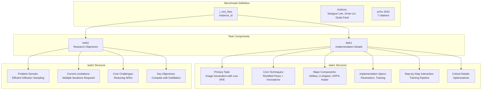
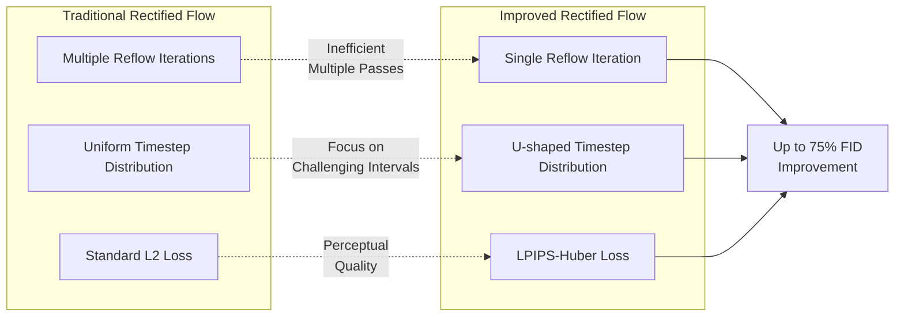
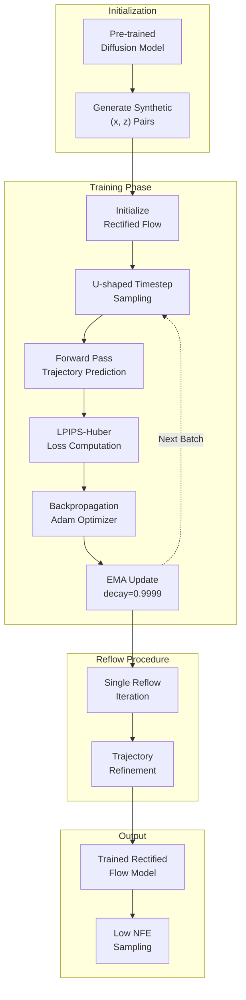
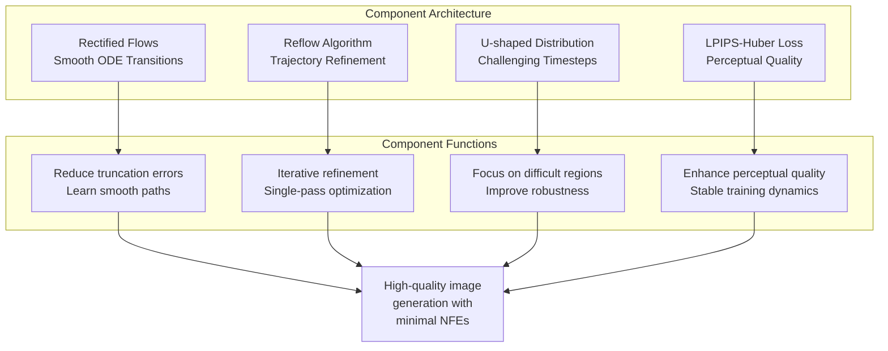
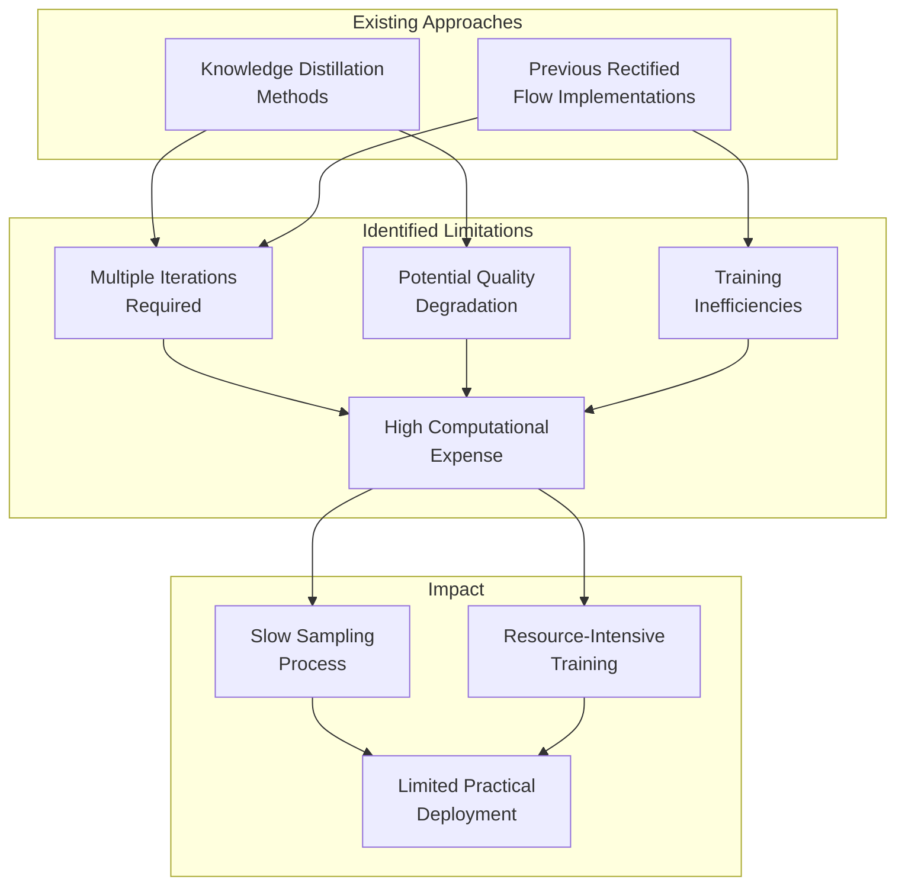
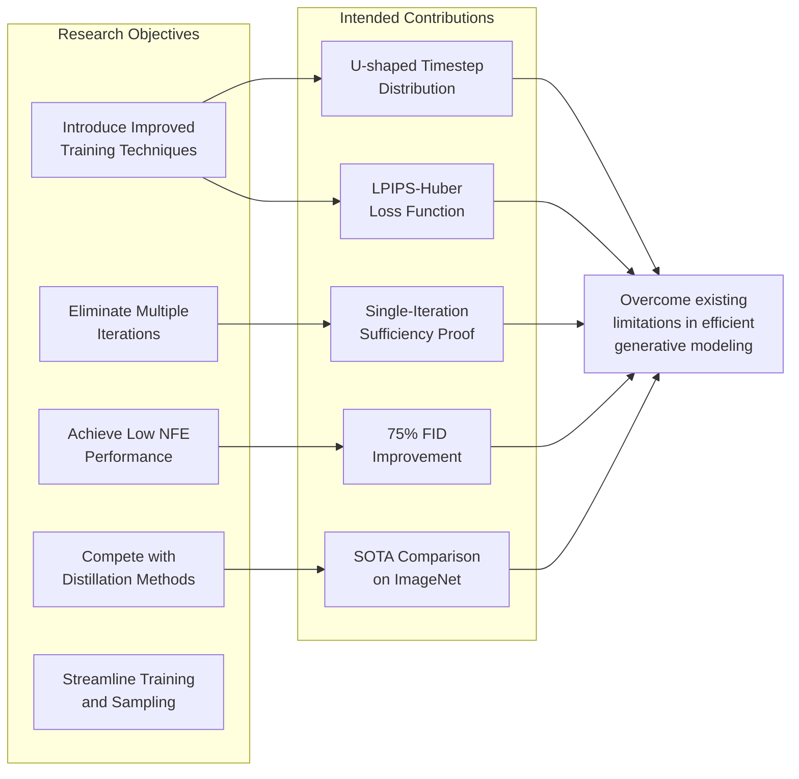

<!-- source: DeepWiki mcp.deepwiki.com · repo HKUDS/AI-Researcher · extra page Improved Rectified Flows · fetched 2026-11-09 -->

# Improved Rectified Flows

<details>
<summary>Relevant source files</summary>

The following files were used as context for generating this wiki page:

- [benchmark/final/diffu_flow/i_rect_flow.json](benchmark/final/diffu_flow/i_rect_flow.json)

</details>


## Purpose and Scope

This page documents the **Improved Rectified Flows** benchmark task within the AI-Researcher evaluation framework. This benchmark evaluates the system's ability to understand and implement advanced training techniques for rectified flow models, specifically focusing on achieving competitive performance with minimal function evaluations (NFEs). The benchmark is based on research that demonstrates single-iteration Reflow training can achieve near-straight trajectories, eliminating the need for multiple refinement iterations.

For information about other diffusion/flow benchmarks, see [Consistency Flow Matching](#5.1.1), [Immiscible Diffusion](#5.1.3), and [MMDiT Transformers](#5.1.4). For the broader context of diffusion model benchmarks, see [Diffusion & Flow Matching](#5.1).

**Sources:** [benchmark/final/diffu_flow/i_rect_flow.json:1-17]()

---

## Research Context

### Problem Statement

Diffusion models require expensive numerical integration of generative ODEs for sampling. While rectified flows iteratively learn smooth ODE paths less susceptible to truncation error, they still require relatively large numbers of function evaluations. The benchmark evaluates whether AI-Researcher can identify and implement improved training techniques that allow rectified flows to compete with knowledge distillation methods even in low NFE settings.

### Key Research Insight

The central insight is that under realistic settings, **a single iteration of the Reflow algorithm is sufficient to learn nearly straight trajectories**. This contradicts the current practice of using multiple Reflow iterations, enabling significant computational savings.

### Performance Targets

The benchmark expects implementations to achieve:
- Up to 75% FID improvement over 2-rectified flow in 1 NFE setting on CIFAR-10
- Performance exceeding consistency distillation and progressive distillation in both one-step and two-step settings on ImageNet 64×64
- Competitive performance with improved consistency training (iCT) in FID metrics

**Sources:** [benchmark/final/diffu_flow/i_rect_flow.json:10-17]()

---

## Benchmark Task Structure



**Benchmark Task Organization**

The benchmark is structured in two complementary tasks that evaluate different aspects of research capability:

| Task | Purpose | Evaluation Focus |
|------|---------|------------------|
| **task1** | Implementation proficiency | Technical execution, algorithmic understanding, parameter tuning |
| **task2** | Research insight | Problem formulation, innovation recognition, objective clarity |

**Sources:** [benchmark/final/diffu_flow/i_rect_flow.json:101-103]()

---

## Core Technical Innovations

### Innovation Overview

The benchmark evaluates understanding of two key innovations that enable one-round rectified flow training:



**Sources:** [benchmark/final/diffu_flow/i_rect_flow.json:101]()

### U-Shaped Timestep Distribution

The U-shaped timestep distribution emphasizes training on challenging intervals where model performance is typically lower, improving robustness across the entire trajectory.

**Mathematical Specification:**

The distribution is defined as:

```
p_t(u) ∝ exp(au) + exp(-au)  for u ∈ [0, 1]
```

With the parameter `a = 4`, this creates emphasis on both ends of the timestep range (near 0 and near 1), where diffusion models typically struggle.

**Implementation Requirements:**
- Sample timesteps from U-shaped distribution during training
- Focus computational resources on difficult timestep regions
- Maintain smooth interpolation across the trajectory

**Sources:** [benchmark/final/diffu_flow/i_rect_flow.json:101]()

### LPIPS-Huber Loss Function

The LPIPS-Huber loss combines perceptual similarity metrics with robust regression to enhance image quality.

**Component Functions:**

| Loss Component | Purpose | Mathematical Form |
|----------------|---------|-------------------|
| **LPIPS** | Perceptual similarity | Learned feature distance in pretrained networks |
| **Pseudo-Huber** | Robust regression | Smoothly handles outliers, stable gradients |

**Purpose:** The LPIPS component captures perceptual quality that correlates better with human perception than pixel-wise losses, while the Huber component provides robust training dynamics.

**Critical Implementation Detail:** The loss function must be implemented according to the specific forms provided in the research paper, as variations significantly impact training stability and output quality.

**Sources:** [benchmark/final/diffu_flow/i_rect_flow.json:101]()

---

## Training Methodology

### Rectified Flow Training Pipeline



**Training Pipeline Components**

**Sources:** [benchmark/final/diffu_flow/i_rect_flow.json:101]()

### Training Hyperparameters

The benchmark specifies critical hyperparameters that must be correctly implemented:

| Parameter | Value | Purpose |
|-----------|-------|---------|
| **Learning Rate** | 0.0002 | CIFAR-10 optimization rate |
| **Batch Size** | 512 | Training batch size |
| **Optimizer** | Adam | State-of-the-art adaptive learning |
| **EMA Decay** | 0.9999 | Exponential moving average stabilization |
| **Timestep Distribution** | U-shaped (a=4) | Focus on challenging intervals |

**Critical Implementation Note:** The learning rate and batch size significantly affect convergence rates. The EMA strategy with high decay (0.9999) is essential for training stability.

**Sources:** [benchmark/final/diffu_flow/i_rect_flow.json:101]()

---

## Component Interactions

### Step-by-Step Training Flow

```mermaid
sequenceDiagram
    participant PM as "Pre-trained<br/>Model"
    participant DG as "Data<br/>Generator"
    participant RF as "Rectified<br/>Flow"
    participant TS as "U-shaped<br/>Sampler"
    participant LF as "LPIPS-Huber<br/>Loss"
    participant OPT as "Adam<br/>Optimizer"
    participant EMA as "EMA<br/>Module"
    
    PM->>DG: Generate initial pairs
    DG->>RF: Synthetic (x, z) data
    
    loop Training Iteration
        RF->>TS: Request timestep
        TS->>RF: Sample from U-shaped
        RF->>RF: Forward pass prediction
        RF->>LF: Compute loss
        LF->>OPT: Gradient signal
        OPT->>RF: Update parameters
        RF->>EMA: Current weights
        EMA->>RF: Stabilized weights
    end
    
    RF->>RF: Single Reflow iteration
    RF->>PM: Refined model
```

**Interaction Sequence**

1. **Initialization:** Pre-trained diffusion model generates synthetic (x, z) pairs representing data and noise
2. **Training Loop:** 
   - Rectified flow requests timesteps from U-shaped sampler
   - Forward pass predicts trajectories
   - LPIPS-Huber loss computes perceptual quality
   - Adam optimizer updates parameters
   - EMA module stabilizes training
3. **Refinement:** Single Reflow iteration refines trajectories based on first-round training
4. **Output:** Trained model ready for low NFE sampling

**Sources:** [benchmark/final/diffu_flow/i_rect_flow.json:101]()

---

## Task 1: Implementation Requirements

### Primary Task Specification

**Task:** Generate high-quality images using a generative model optimized for low function evaluation settings.

The benchmark evaluates whether the AI-Researcher system can correctly implement:
- Rectified flow model architecture
- Reflow training algorithm
- U-shaped timestep distribution sampling
- LPIPS-Huber loss computation
- Proper training loop with EMA

**Sources:** [benchmark/final/diffu_flow/i_rect_flow.json:101]()

### Major Component Functions



**Component Purpose Table**

| Component | Purpose | Function |
|-----------|---------|----------|
| **Rectified Flows** | Base generative framework | Smoothly transition between distributions via learned ODEs, reducing truncation errors |
| **Reflow Algorithm** | Trajectory optimization | Recursively improve output quality by refining trajectories based on pre-trained flows |
| **U-shaped Timestep Distribution** | Training focus | Emphasize timesteps with expected lower performance, improving overall robustness |
| **LPIPS-Huber Loss** | Quality metric | Focus on perceptual similarity to enhance generated image quality vs. traditional metrics |

**Sources:** [benchmark/final/diffu_flow/i_rect_flow.json:101]()

### Input/Output Specifications

**Model Input:**
- Pairs of images `(x, z)` where:
  - `x`: Sample from target data distribution
  - `z`: Associated noise sample
- Timestep `t` sampled from U-shaped distribution

**Model Output:**
- Generated image samples from learned distribution
- Trajectory predictions for ODE integration

**Data Flow:**
```
Pre-trained model → (x, z) pairs → Rectified flow training → 
Reflow refinement → Low NFE sampling → Generated images
```

**Sources:** [benchmark/final/diffu_flow/i_rect_flow.json:101]()

### Critical Implementation Details

The benchmark emphasizes several critical implementation aspects:

1. **Learning Rate Configuration:** Must be set to 0.0002 for CIFAR-10, with appropriate adjustments for other datasets affecting convergence rates

2. **Batch Size Optimization:** 512-batch training provides optimal convergence, balancing memory and gradient quality

3. **Pre-trained Initialization:** Initialization with pre-trained diffusion models significantly affects downstream performance; proper weight transfer is essential

4. **Computational Trade-offs:** Preprocessing overhead for synthetic pair generation is offset by gains in output quality; this upfront cost is acceptable

5. **EMA Stabilization:** Adam optimizer with EMA (decay=0.9999) is crucial for stable training dynamics

6. **Single-Iteration Emphasis:** Unlike traditional approaches requiring multiple Reflow iterations, the improved method requires only one refinement pass

**Sources:** [benchmark/final/diffu_flow/i_rect_flow.json:101]()

---

## Task 2: Research Objectives

### Problem Domain

**Primary Domain:** Efficient sampling from diffusion models for high-quality image and video generation while minimizing computational costs.

The benchmark evaluates whether AI-Researcher can articulate:
- The computational challenges in diffusion model sampling
- Trade-offs between quality and efficiency
- The role of rectified flows in addressing these challenges

**Sources:** [benchmark/final/diffu_flow/i_rect_flow.json:102-103]()

### Current Limitations Analysis



**Limitation Categories**

| Limitation Type | Description | Impact |
|-----------------|-------------|--------|
| **Multiple Iterations** | Both distillation and previous rectified flows require multiple passes to achieve satisfactory performance | Increased computational time and resources |
| **Computational Expense** | Extensive iterations lead to high computational costs | Limits scalability and practical deployment |
| **Quality Degradation** | Some fast sampling methods sacrifice sample quality | Trade-off between speed and output fidelity |
| **Training Inefficiencies** | Traditional techniques require extensive computational resources and time | Slows research iteration and deployment |

**Sources:** [benchmark/final/diffu_flow/i_rect_flow.json:102-103]()

### Core Research Challenges

The benchmark evaluates understanding of three core challenges:

1. **Reducing Function Evaluations:** Minimize the number of NFEs required for effective sampling while maintaining quality standards

2. **Training Efficiency:** Address inefficiencies in rectified flow training that necessitate extensive computational resources and time

3. **Competitive Performance:** Achieve performance comparable to or exceeding knowledge distillation methods without their computational overhead

**Challenge Resolution Strategy:**
- Demonstrate that single-iteration Reflow is sufficient for nearly straight trajectories
- Introduce U-shaped timestep distribution for focused training
- Leverage LPIPS-Huber loss for perceptual quality enhancement
- Prove competitive performance in low NFE settings

**Sources:** [benchmark/final/diffu_flow/i_rect_flow.json:102-103]()

### Key Objectives and Contributions



**Primary Objectives:**

1. **Improved Training Techniques:** Introduce novel techniques enabling rectified flows to compete with state-of-the-art distillation methods, particularly in low NFE scenarios

2. **Performance Without Excessive Iterations:** Demonstrate significant performance improvements without requiring multiple Reflow iterations, streamlining training and sampling processes

3. **Computational Efficiency:** Achieve competitive results with reduced computational overhead compared to traditional approaches

4. **Practical Deployment:** Enable practical deployment of high-quality generative models in resource-constrained settings

**Expected Contributions:**

- **Theoretical:** Proof that single-iteration Reflow is sufficient for nearly straight trajectories
- **Methodological:** U-shaped timestep distribution and LPIPS-Huber loss as reusable techniques
- **Empirical:** Demonstrated 75% FID improvement and competitive performance against distillation methods

**Sources:** [benchmark/final/diffu_flow/i_rect_flow.json:102-103]()

---

## Source Paper References

### Foundational Works

The benchmark references nine key source papers that informed the research:

| Rank | Reference | Type | Role |
|------|-----------|------|------|
| 1 | Denoising diffusion probabilistic models | Conceptual | Foundational insights into diffusion for generative tasks, low NFE benchmarks |
| 2 | Rectified flow: A marginal preserving approach to optimal transport | Methodological | Core methodological foundation for rectified flows |
| 3 | Improved techniques for training consistency models | Conceptual | Critiques on efficiency, informed single-iteration argument |
| 4 | Fast sampling of diffusion models with exponential integrator | Component | Efficiency standards for comparative validation |
| 5 | Neural ordinary differential equations | Methodological | ODE principles for smoothing and learning in neural frameworks |

**Sources:** [benchmark/final/diffu_flow/i_rect_flow.json:18-99]()

### Comparative Works

| Rank | Reference | Type | Role |
|------|-----------|------|------|
| 6 | Progressive distillation for fast sampling | Component | Distillation context for competitive analysis |
| 7 | Score-based generative modeling through SDEs | Conceptual | Gradient estimation for theoretical grounding |
| 8 | Flow Straight and Fast | Component | Trajectory straightening, direct predecessor |
| 9 | Consistency models | Conceptual | Knowledge distillation methodologies backdrop |

These references establish the research context and competitive landscape against which the improved rectified flow techniques are evaluated.

**Sources:** [benchmark/final/diffu_flow/i_rect_flow.json:18-99]()

---

## Evaluation Criteria

### Benchmark Assessment Dimensions

The AI-Researcher system's performance on this benchmark is evaluated across multiple dimensions:

| Dimension | Assessment Focus |
|-----------|-----------------|
| **Technical Accuracy** | Correct implementation of U-shaped distribution, LPIPS-Huber loss, single-iteration Reflow |
| **Algorithmic Understanding** | Grasp of why single iteration suffices, role of each component |
| **Parameter Tuning** | Appropriate learning rates, batch sizes, EMA decay settings |
| **Research Insight** | Identification of core problem, limitations, and innovation rationale |
| **Performance Claims** | Accurate representation of expected improvements (75% FID gain, etc.) |
| **Efficiency Analysis** | Understanding of NFE reduction and computational trade-offs |

### Success Metrics

**Implementation Quality (Task 1):**
- Correct mathematical specification of U-shaped distribution
- Proper LPIPS-Huber loss formulation
- Accurate training pipeline implementation
- Appropriate hyperparameter selection

**Research Comprehension (Task 2):**
- Clear problem formulation
- Accurate limitation identification
- Coherent challenge description
- Well-articulated objectives and contributions

**Sources:** [benchmark/final/diffu_flow/i_rect_flow.json:1-103]()

---

## Metadata and Attribution

**Benchmark Instance ID:** `i_rect_flow`

**Source Publication:**
- **Authors:** Sangyun Lee, Zinan Lin, Giulia Fanti
- **Year:** 2024
- **Venue:** arXiv.org
- **Citations:** 7 (as of evaluation)
- **URL:** http://arxiv.org/abs/2405.20320v2
- **Code:** https://github.com/sangyun884/rfpp

**Research Classification:**
- **Topic:** selected
- **Field:** selected
- **Target:** Improving the Training of Rectified Flows

**Sources:** [benchmark/final/diffu_flow/i_rect_flow.json:1-17]()

---

