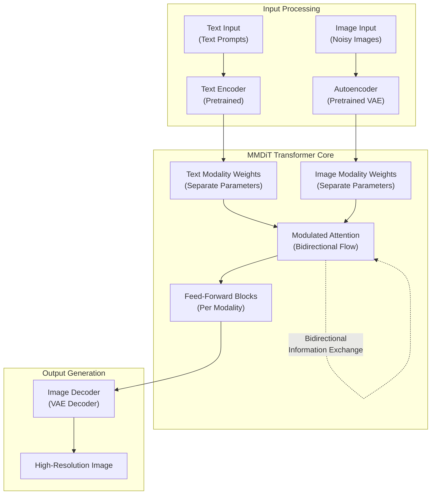
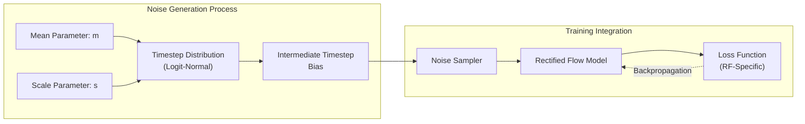
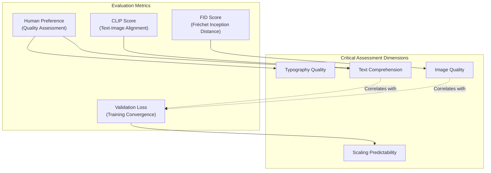
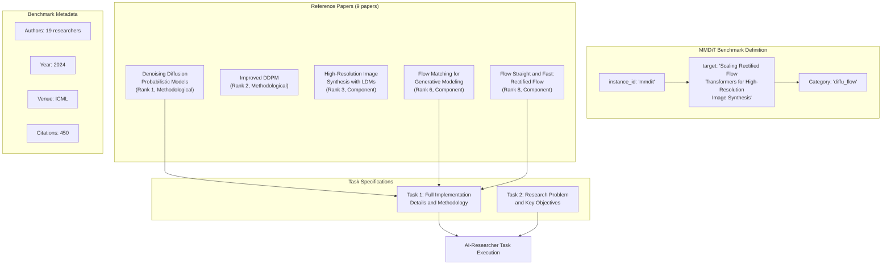

<!-- source: DeepWiki mcp.deepwiki.com · repo HKUDS/AI-Researcher · extra page MMDiT Transformers · fetched 2026-11-09 -->

# MMDiT Transformers

Relevant source files

The following files were used as context for generating this wiki page:

- [benchmark/final/diffu_flow/mmdit.json](benchmark/final/diffu_flow/mmdit.json)

## Purpose and Scope

This document details the MMDiT (Multimodal Diffusion Transformer) benchmark task within the AI-Researcher evaluation framework. The benchmark evaluates techniques for scaling rectified flow transformers to achieve high-resolution text-to-image synthesis. This task focuses on architectural innovations that enable separate modality-specific processing and bidirectional information flow between text and image representations.

For other diffusion/flow benchmarks, see [Consistency Flow Matching](#5.1.1), [Improved Rectified Flows](#5.1.2), and [Immiscible Diffusion](#5.1.3). For the overall benchmark framework, see [Benchmark System (Inno-Bench)](#3.3).

**Sources:** [benchmark/final/diffu_flow/mmdit.json:1-117]()

---

## Research Problem Overview

The MMDiT benchmark addresses the challenge of scaling generative models for high-resolution image synthesis while maintaining computational efficiency and output quality. The core research problems include:

| Challenge | Description | Proposed Solution |
|-----------|-------------|-------------------|
| **Computational Inefficiency** | Slow sampling processes during inference limit practical deployment | Rectified flow framework with straight-path trajectories |
| **Sampling Artifacts** | Suboptimal forward processes connecting data to noise produce visual artifacts | Improved noise sampling techniques biased toward perceptually relevant scales |
| **Multimodal Integration** | Difficulty effectively combining text and image information | Transformer architecture with separate modality weights and bidirectional flow |
| **Scalability** | Unpredictable performance as model size increases | Predictable scaling trends correlating validation loss to generation quality |

The research demonstrates that architectures with modality-specific parameters and improved noise samplers can achieve state-of-the-art text-to-image synthesis performance while following predictable scaling laws.

**Sources:** [benchmark/final/diffu_flow/mmdit.json:116]()

---

## Core Methodological Components

### Rectified Flow Framework

The MMDiT approach builds on **rectified flow**, a generative modeling framework that connects data distribution and noise using straight-line trajectories rather than curved diffusion paths. This formulation simplifies the generation process by learning a direct mapping between noise and data points.

Key properties:
- **Straight-path trajectories**: Reduces error accumulation during sampling
- **Continuous time representation**: Model parameters optimized via rectified flow-specific loss functions
- **Efficient inference**: Fewer function evaluations (NFEs) required compared to traditional diffusion models

### Transformer Architecture with Modality Separation

The core architectural innovation introduces **separate weights for text and image modalities** within the transformer, enabling specialized processing for each domain:

**Diagram: MMDiT Architecture with Modality-Specific Processing**

The architecture uses:
- **Hidden size**: `64 * depth` where `depth` is the model depth parameter
- **Attention heads**: Equal to `depth`
- **Masked attention**: Applied during training for efficiency
- **Modulated attention mechanism**: Enables bidirectional information flow between text and image tokens

**Sources:** [benchmark/final/diffu_flow/mmdit.json:115]()

---

## Noise Sampling Strategy

A critical innovation in the MMDiT approach is the development of improved noise samplers tailored for rectified flow training. These samplers bias the sampling distribution toward perceptually relevant scales to maximize learning efficacy.

### Sampling Techniques

The benchmark evaluates two primary noise sampling strategies:

1. **Logit-Normal Sampling**
   - Uses a logit-normal distribution to weight timesteps
   - Parameters: mean `m` and scale `s`
   - Prioritizes intermediate timesteps over endpoints
   - Concentrates training on perceptually important noise scales

2. **Mode Sampling**
   - Discrete sampling strategy focusing on specific modes
   - Complements logit-normal for improved coverage

### Implementation

**Diagram: Noise Sampling Pipeline for Rectified Flow Training**

The noise sampling process generates training data by:
1. Sampling timesteps from the configured distribution (logit-normal)
2. Applying bias toward intermediate scales
3. Generating noise-data pairs for rectified flow training
4. Computing loss to optimize the straight-path mapping

**Sources:** [benchmark/final/diffu_flow/mmdit.json:115]()

---

## Training Configuration

### Hyperparameters

The benchmark specifies standard training configurations for reproducibility:

| Parameter | Value | Purpose |
|-----------|-------|---------|
| **Batch Size** | 1024 | Large batches for stable gradient estimates |
| **Learning Rate** | 0.0001 | Conservative rate for large-scale training |
| **Hidden Size** | `64 * depth` | Scales with model depth |
| **Attention Heads** | Equal to `depth` | Matches architectural depth |
| **Precision** | Mixed-precision | Efficiency without sacrificing quality |

### Training Procedure

The training workflow follows these stages:

1. **Data Preprocessing**
   - Clean and encode images using pretrained autoencoder
   - Encode text prompts with pretrained text encoders

2. **Noise Sampler Implementation**
   - Configure logit-normal sampler with efficient marker parameters
   - Generate intermediate training data for rectified flow

3. **Rectified Flow Training**
   - Learn straight-path mapping from noise to data
   - Optimize using rectified flow-specific loss function

4. **Joint Transformer Training**
   - Refine joint representations of text and image data
   - Enable bidirectional information flow through modulated attention

5. **Inference**
   - Sample initial noise
   - Apply trained transformer model
   - Generate high-resolution images from text prompts

**Sources:** [benchmark/final/diffu_flow/mmdit.json:115]()

---

## Evaluation Framework

### Metrics and Validation

The benchmark employs multiple evaluation dimensions to assess model performance:

**Diagram: Evaluation Framework for MMDiT Performance**

### Implementation Details for Replication

Critical implementation considerations for achieving reported results:

1. **Strict Evaluation Procedure**
   - Monitor FID and CLIP scores during training
   - Track validation loss to assess convergence
   - Refine training loop based on metric trends

2. **Mixed-Precision Training**
   - Enable efficiency without quality degradation
   - Essential for large-scale model training

3. **Augmentation Strategies**
   - Use clustered sample precomputation
   - Minimize computational overhead

4. **Dynamic Hyperparameter Adjustment**
   - Adjust batch sizes based on transformer depth
   - Scale learning rates to maintain training integrity
   - Essential for large-scale settings

**Sources:** [benchmark/final/diffu_flow/mmdit.json:115]()

---

## Benchmark Task Structure

### Task Levels

The MMDiT benchmark in AI-Researcher supports two execution levels:

**Task 1: Implementation from Detailed Concept**
- Input: Detailed research idea describing the MMDiT approach
- Output: Working implementation of the scaled rectified flow transformer
- Focus: Algorithm implementation, transformer architecture, noise sampling

**Task 2: Idea Generation from References**
- Input: Reference papers on diffusion models, rectified flows, and transformers
- Output: Novel research directions for improving scalable text-to-image synthesis
- Focus: Identifying limitations and proposing architectural/training innovations

### Benchmark Data Structure

The benchmark task is defined in the configuration file with the following structure:

**Diagram: MMDiT Benchmark Structure in Inno-Bench Framework**

### Key Source Papers

The benchmark references 9 foundational papers organized by importance:

| Rank | Paper | Type | Role |
|------|-------|------|------|
| 1 | Denoising Diffusion Probabilistic Models | Methodological | Core diffusion framework foundation |
| 2 | Improved Denoising Diffusion Probabilistic Models | Methodological | Enhanced diffusion techniques |
| 3 | High-Resolution Image Synthesis with Latent Diffusion Models | Component | Latent space + transformer architecture |
| 4 | Align Your Latents: High-Resolution Video Synthesis | Component | Enhanced noise sampling techniques |
| 5 | Improving Image Generation with Better Captions | Component | Text conditioning improvements |
| 6 | Flow Matching for Generative Modeling | Component | Flow matching objectives |
| 7 | Scaling Laws for Neural Language Models | Conceptual | Model scaling principles |
| 8 | Flow Straight and Fast: Learning with Rectified Flow | Component | Rectified flow framework |
| 9 | Direct Preference Optimization | Component | Human feedback optimization |

**Sources:** [benchmark/final/diffu_flow/mmdit.json:32-114]()

---

## Publication Metadata

The benchmark is based on the paper "Scaling Rectified Flow Transformers for High-Resolution Image Synthesis" published at ICML 2024:

- **Authors**: 19 researchers (Patrick Esser, Sumith Kulal, Andreas Blattmann, et al.)
- **Year**: 2024
- **Venue**: International Conference on Machine Learning
- **Citations**: 450 (as of evaluation)
- **URL**: http://arxiv.org/abs/2403.03206v1

The paper demonstrates that rectified flow transformers with modality-specific weights can outperform state-of-the-art models while following predictable scaling trends. The authors committed to making experimental data, code, and model weights publicly available.

**Sources:** [benchmark/final/diffu_flow/mmdit.json:1-31]()

---

## Integration with AI-Researcher

The MMDiT benchmark integrates with the AI-Researcher system through the standard benchmark evaluation framework. When executed, the system:

1. Loads task definition from `benchmark/final/diffu_flow/mmdit.json`
2. Provides reference papers and task descriptions to research agents
3. Evaluates generated implementations against expert ground truth
4. Assesses outputs across multiple dimensions (novelty, experimental rigor, theoretical foundation)

For details on running this benchmark, see [Level 1 Tasks](#6.2) and [Level 2 Tasks](#6.3). For the broader context of diffusion/flow benchmarks, see [Diffusion & Flow Matching](#5.1).

**Sources:** [benchmark/final/diffu_flow/mmdit.json:1-117]()

---

