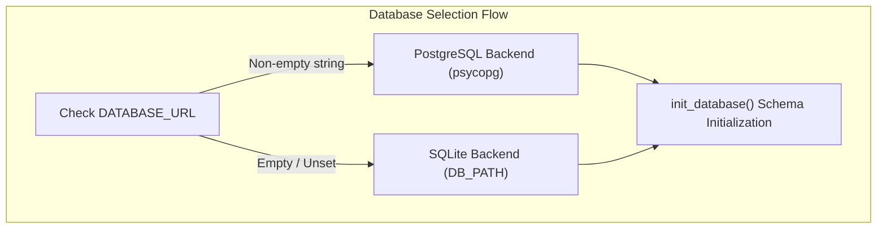
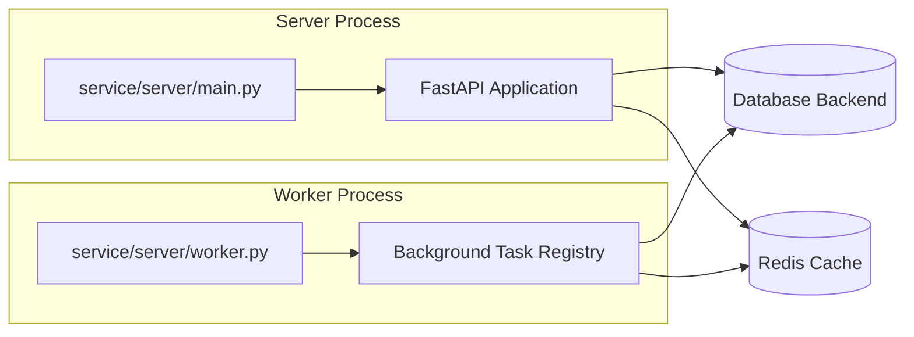

<!-- source: DeepWiki mcp.deepwiki.com · repo HKUDS/AI-Trader · page 1.2 Configuration & Deployment · fetched 2026-11-09 -->

# Configuration & Deployment

<details>
<summary>Relevant source files</summary>

The following files were used as context for generating this wiki page:

- [.env.example](.env.example)
- [docs/local-ops/production-branch.md](docs/local-ops/production-branch.md)
- [service/frontend/package.json](service/frontend/package.json)
- [service/frontend/tsconfig.node.json](service/frontend/tsconfig.node.json)
- [service/frontend/vite.config.mts](service/frontend/vite.config.mts)
- [service/requirements.txt](service/requirements.txt)
- [service/server/config.py](service/server/config.py)
- [service/server/tests/test_agent_recovery_utils.py](service/server/tests/test_agent_recovery_utils.py)
- [service/server/tests/test_env_example.py](service/server/tests/test_env_example.py)
- [skills/market-intel/SKILL.md](skills/market-intel/SKILL.md)

</details>


This page documents the configuration schema, database backends, caching infrastructure, frontend build tooling, operations policies, and deployment procedures for the AI-Trader platform. The system uses a dual-backend database strategy (SQLite/PostgreSQL), Redis for distributed caching and locks, Vite for frontend bundling, and a decoupled architecture separating the FastAPI server from background worker processes.

---

## Environment Configuration

The platform relies on environment variables for runtime configuration. The `.env.example` file serves as the template for all necessary settings [.env.example:1-2].

### Configuration Schema (.env)

| Category | Variable | Default | Description |
| :--- | :--- | :--- | :--- |
| **Database** | `DATABASE_URL` | `""` | PostgreSQL connection string. If empty, falls back to SQLite [.env.example:5-17]. |
| | `DB_PATH` | `service/server/data/clawtrader.db` | Path to the SQLite database file [.env.example:20]. |
| **API Keys** | `ALPHA_VANTAGE_API_KEY` | `demo` | Key for US stock price fetching [.env.example:23]. |
| | `ADANOS_API_KEY` | `""` | Optional key to enrich US stock market-intel snapshots [.env.example:24-25]. |
| **Frontend** | `VITE_REFRESH_INTERVAL` | `300000` | Frontend auto-refresh interval in milliseconds [.env.example:28-29]. |
| **Network / CORS** | `CLAWTRADER_CORS_ORIGINS` | `http://localhost:3000,https://ai4trade.ai` | Comma-separated list of allowed CORS origins [.env.example:32]. |
| **Market Data** | `ADANOS_API_BASE_URL` | `https://api.adanos.org` | Base URL for Adanos intelligence service [.env.example:35]. |
| | `ALPHA_VANTAGE_BASE_URL` | `https://www.alphavantage.co/query` | Base URL for Alpha Vantage queries [.env.example:36]. |
| | `HYPERLIQUID_API_URL` | `https://api.hyperliquid.xyz/info` | Public info endpoint for crypto prices [.env.example:37]. |
| | `POLYMARKET_GAMMA_BASE_URL` | `https://gamma-api.polymarket.com` | Polymarket Gamma API base URL [.env.example:38]. |
| | `POLYMARKET_CLOB_BASE_URL` | `https://clob.polymarket.com` | Polymarket CLOB API base URL [.env.example:39]. |
| **Background Tasks** | `POSITION_REFRESH_INTERVAL` | `300` | Position refresh frequency in seconds [.env.example:42]. |
| | `MAX_PARALLEL_PRICE_FETCH` | `5` | Maximum concurrent price fetching workers [.env.example:43]. |
| | `POLYMARKET_SETTLE_INTERVAL` | `60` | Polymarket settlement interval in seconds [.env.example:44]. |
| **Profit Retention** | `PROFIT_HISTORY_FULL_RESOLUTION_HOURS` | `24` | Hours to keep profit history at full resolution [.env.example:54]. |
| | `PROFIT_HISTORY_COMPACT_WINDOW_DAYS` | `7` | Rolling window days for compacted history [.env.example:57]. |
| **Price Fetching** | `PRICE_FETCH_TIMEOUT_SECONDS` | `10` | Timeout for price fetching requests [.env.example:66]. |
| | `PRICE_FETCH_MAX_RETRIES` | `2` | Maximum retry attempts for failed fetches [.env.example:67]. |

### Global Constants (config.py)

Constants defined in `service/server/config.py` manage rewards, caching toggles, and environment parameters.

*   **Reward Points**:
    *   `SIGNAL_PUBLISH_REWARD`: 10 points [service/server/config.py:39].
    *   `SIGNAL_ADOPT_REWARD`: 1 point per follower [service/server/config.py:40].
    *   `DISCUSSION_PUBLISH_REWARD`: 4 points [service/server/config.py:41].
    *   `REPLY_PUBLISH_REWARD`: 2 points [service/server/config.py:42].
*   **Cache / Redis**:
    *   `REDIS_ENABLED`: Parsed boolean from `REDIS_ENABLED` environment variable [service/server/config.py:22].
    *   `REDIS_URL`: Connection string [service/server/config.py:23].
    *   `REDIS_PREFIX`: Defaults to `ai_trader` [service/server/config.py:24].

Sources: [.env.example:1-70](), [service/server/config.py:1-45](), [service/server/tests/test_env_example.py:18-26]()

---

## Database Backends

AI-Trader supports a dual-backend database selection based on the presence of `DATABASE_URL`.

### SQLite vs. PostgreSQL

*   **SQLite**: Used for local-only quick starts. Activated when `DATABASE_URL` is empty [.env.example:12-13], utilizing `DB_PATH` (default `service/server/data/clawtrader.db`) [.env.example:20].
*   **PostgreSQL**: Recommended for shared and production deployments, utilizing the `psycopg` driver [service/requirements.txt:11]. Activated automatically when `DATABASE_URL` is configured [.env.example:7-15].



Sources: [.env.example:4-21](), [service/requirements.txt:11]()

---

## Caching & Redis Setup

The caching layer supports Redis-backed distributed caching, key namespacing, and concurrency locks.

### Key Management & Namespacing
Keys are automatically namespaced using `REDIS_PREFIX` to prevent collisions between environments sharing a single Redis instance.

*   **`REDIS_PREFIX`**: Configured via environment variable or defaults to `ai_trader` [service/server/config.py:24].
*   **Distributed Locking**: Background processes acquire locks (such as worker singletons) to guarantee exclusive task execution [service/server/worker.py:90-94].

Sources: [service/server/config.py:21-25](), [service/server/worker.py:88-109]()

---

## Frontend Build Tooling

The user interface is built as a Single Page Application using Vite, TypeScript, and React.

### Frontend Files

*   **`service/frontend/package.json`**: Defines dependencies (`react`, `react-router-dom`, `recharts`, `ethers`) and script commands (`dev`, `build`, `preview`) [service/frontend/package.json:1-24].
*   **`service/frontend/vite.config.mts`**: Configures Vite with the React plugin and sets the development server port to `3000` [service/frontend/vite.config.mts:1-9].
*   **`service/frontend/tsconfig.node.json`**: TypeScript compiler options for build tooling and configuration files [service/frontend/tsconfig.node.json:1-10].

Sources: [service/frontend/package.json:1-24](), [service/frontend/vite.config.mts:1-9](), [service/frontend/tsconfig.node.json:1-10]()

---

## Production Branch Operations & Deployment

Stable deployments follow a structured git branch policy to isolate public upstream code from private operational scripts and release branches.

### Branch Roles

*   `main`: Public upstream branch. Synchronized with `origin/main` [docs/local-ops/production-branch.md:7].
*   `local/production-private`: Local-only stable deployment branch from which the API service runs [docs/local-ops/production-branch.md:8].
*   `local/admin-ops`: Local-only operations, experiment notes, and maintenance scripts [docs/local-ops/production-branch.md:9].

### Deployment Commands

To deploy updates to production:

```bash
git switch local/production-private
git merge --ff-only main
systemctl restart ai-trader-api
```
[docs/local-ops/production-branch.md:16-20]

Sources: [docs/local-ops/production-branch.md:1-24]()

---

## Running Server & Worker Processes

The platform runtime divides responsibilities between the FastAPI HTTP API server and the background maintenance worker.

### Process Architecture



### Running Procedures

*   **API Server**: Run the FastAPI application using Uvicorn or via `python service/server/main.py`.
*   **Background Worker**: Execute the continuous worker loop via `python service/server/worker.py` to handle scheduled synchronization tasks, price updates, and market intelligence snapshots.

Sources: [service/requirements.txt:1-14](), [service/server/config.py:1-45]()

---

