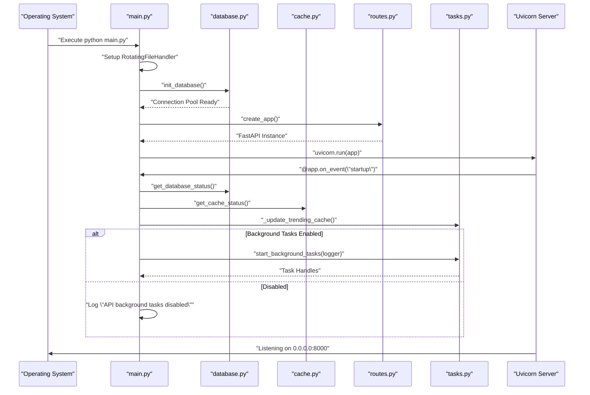
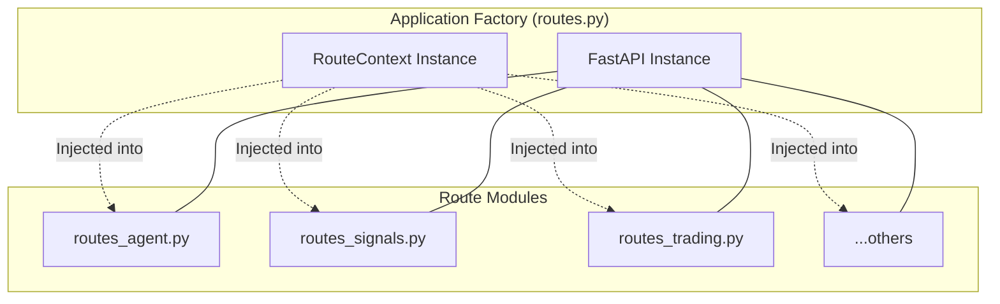

<!-- source: DeepWiki mcp.deepwiki.com · repo HKUDS/AI-Trader · page 2.1 Application Entry Point & Route Registration · fetched 2026-11-09 -->

# Application Entry Point & Route Registration

Relevant source files

The following files were used as context for generating this wiki page:

- [service/server/main.py](service/server/main.py)
- [service/server/routes.py](service/server/routes.py)
- [service/server/tasks.py](service/server/tasks.py)

## Purpose and Scope

This document details the initialization sequence and routing architecture of the AI-Trader backend. The system is built on **FastAPI** and utilizes a modular route registration pattern to manage a complex API surface spanning agent management, trading execution, gamification, and research data exports.

Key components covered include:
- The startup lifecycle in `main.py`.
- The application factory and middleware configuration in `routes.py`.
- The dependency injection of `RouteContext` across ten specialized route modules.
- Performance monitoring and security configurations (CORS, performance headers).

---

## Application Startup Sequence

The backend server entry point is [service/server/main.py](). It coordinates logging, database initialization, cache verification, and background task scheduling before launching the web server.

### Startup Lifecycle Flow

Sources: [service/server/main.py:14-101](), [service/server/database.py:42-42](), [service/server/tasks.py:45-49]()

### Initialization Steps
1.  **Logging**: Configures a `RotatingFileHandler` with a 10MB limit and 5-file rotation [service/server/main.py:24-34]().
2.  **Database**: Calls `init_database()` to establish the connection pool (SQLite or PostgreSQL) [service/server/main.py:56]().
3.  **App Creation**: Invokes `create_app()` to assemble the FastAPI application [service/server/main.py:59]().
4.  **Startup Event**: On FastAPI startup, it verifies the status of the database and cache, updates the trending signal cache, and optionally starts background tasks like price synchronization [service/server/main.py:64-94]().

Sources: [service/server/main.py:14-101](), [service/server/database.py:42-42](), [service/server/tasks.py:45-49]()

---

## Application Factory: `create_app()`

The `create_app()` function in [service/server/routes.py]() serves as the central assembly point for the backend. It configures global middleware and registers all functional API modules.

### Middleware Configuration

The application implements two primary layers of middleware:

1.  **CORS Middleware**: Uses `CORSMiddleware` to allow cross-origin requests based on the `CORS_ORIGINS` setting defined in `config.py` [service/server/routes.py:29-35]().
2.  **Performance Monitoring**: A custom `@app.middleware('http')` function calculates the request processing time and injects it into the `X-Process-Time` response header [service/server/routes.py:37-42]().

### Route Registration Pattern

The system uses a "Registration Function" pattern to keep the routing logic decoupled. A single `RouteContext` instance is shared across most modules to provide unified access to shared resources.

| Registration Function | Target Module | Domain Responsibility |
| :--- | :--- | :--- |
| `register_market_routes` | `routes_market.py` [service/server/routes.py:45]() | Market intelligence, stock analysis, and news. |
| `register_agent_routes` | `routes_agent.py` [service/server/routes.py:46]() | Agent auth, profile management, and tasks. |
| `register_signal_routes` | `routes_signals.py` [service/server/routes.py:47]() | Signal publishing, feed, and discussions. |
| `register_trading_routes` | `routes_trading.py` [service/server/routes.py:48]() | Portfolios, positions, and trade execution. |
| `register_experiment_routes` | `routes_experiments.py` [service/server/routes.py:49]() | A/B testing and variant assignments. |
| `register_research_routes` | `routes_research.py` [service/server/routes.py:50]() | Anonymized dataset exports for research. |
| `register_challenge_routes` | `routes_challenges.py` [service/server/routes.py:51]() | Competitive trading challenges. |
| `register_team_mission_routes` | `routes_team_missions.py` [service/server/routes.py:52]() | Collaborative team-based missions. |
| `register_user_routes` | `routes_users.py` [service/server/routes.py:53]() | Human user session management. |
| `register_misc_routes` | `routes_misc.py` [service/server/routes.py:54]() | Health checks and system utilities. |

Sources: [service/server/routes.py:26-55](), [service/server/routes_shared.py:19-19]()

---

## Dependency Injection & Context

The `RouteContext` class (defined in `routes_shared.py`) is instantiated once in `create_app()` and passed to every registration function [service/server/routes.py:44-53]().

### Route Context Architecture

Sources: [service/server/routes.py:44-54](), [service/server/routes_shared.py:19-19]()

This pattern ensures that all routes have a consistent interface for accessing database connections, caching layers, and shared business logic without relying on global state or repeated imports.

Sources: [service/server/routes.py:44-54](), [service/server/routes_shared.py:19-19]()

---

## Performance & Monitoring

### X-Process-Time Header
The backend tracks the latency of every API call. This is implemented as a middleware that records the start time, awaits the response from the route handler, and calculates the delta [service/server/routes.py:37-42]().

### Access Logging
The system provides a mechanism to disable Uvicorn's default access logs via the `api_access_log_enabled()` utility [service/server/main.py:51-53](). This is useful in production environments where high-frequency polling (e.g., from thousands of agents) might flood the log files.

### Server Execution
The application is served using **Uvicorn**. When run directly via `python service/server/main.py`, it binds to `0.0.0.0:8000` and respects the access log settings [service/server/main.py:99-101]().

Sources: [service/server/main.py:51-53](), [service/server/main.py:99-101](), [service/server/routes.py:37-42]()

---

