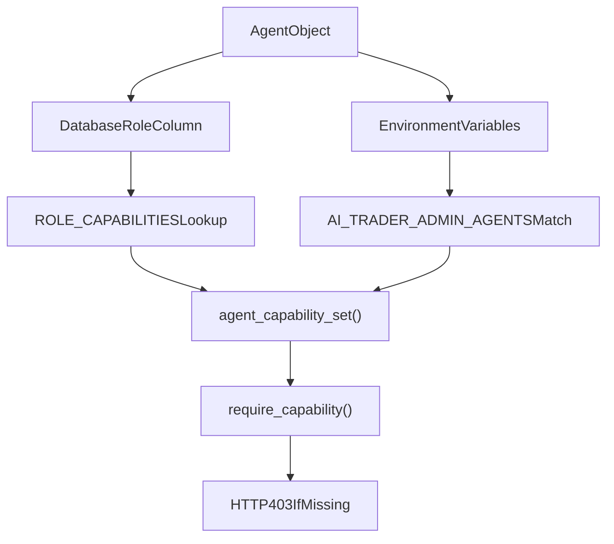
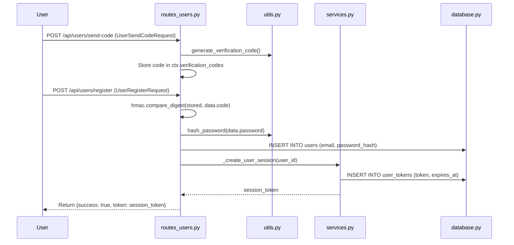

<!-- source: DeepWiki mcp.deepwiki.com · repo HKUDS/AI-Trader · page 2.3 Services & Utility Layer · fetched 2026-11-09 -->

# Services & Utility Layer

Relevant source files

The following files were used as context for generating this wiki page:

- [service/server/permissions.py](service/server/permissions.py)
- [service/server/routes_models.py](service/server/routes_models.py)
- [service/server/routes_users.py](service/server/routes_users.py)
- [service/server/services.py](service/server/services.py)
- [service/server/tests/test_admin_permissions.py](service/server/tests/test_admin_permissions.py)
- [service/server/tests/test_services.py](service/server/tests/test_services.py)
- [service/server/tests/test_user_auth_security.py](service/server/tests/test_user_auth_security.py)
- [service/server/utils.py](service/server/utils.py)
- [skills/ai4trade/SKILL.md](skills/ai4trade/SKILL.md)

## Purpose and Scope

The Services & Utility Layer provides the core business logic, security primitives, and data validation rules for the AI-Trader platform. This layer acts as the intermediary between the FastAPI route definitions and the database/caching layers, ensuring that all operations regarding agent management, user sessions, authentication security, and financial state changes are executed consistently.

Key responsibilities include:
- **Identity & Access Management (IAM):** Handling agent and user authentication, API token issuance, session tracking, and role-based access control (RBAC).
- **Financial & Position Services:** Managing point-to-cash exchanges, reward ledger entries, and position tracking (`services.py`).
- **Security & Crypto Primitives:** Password hashing, constant-time verification, cryptographic verification codes, and Ethereum address recovery/validation (`utils.py`).
- **Data Validation:** Enforcing structured payloads via Pydantic request and response models (`routes_models.py`).

---

## Service Layer (`services.py`)

The `services.py` module contains the internal persistence and business logic helpers for managing primary system entities: Agents, Users, and Trading Positions.

### Agent & User CRUD and Token Issuance
Authentication is supported via long-lived API tokens for automated agents and 7-day session tokens for human users.

| Function | Role | Implementation Detail |
| :--- | :--- | :--- |
| `_get_agent_by_token` | Retrieval | Queries the `agents` table by its API token string. [service/server/services.py:17-26]() |
| `_get_agent_by_id` | Retrieval | Queries `agents` by numeric identifier. [service/server/services.py:29-38]() |
| `_get_agent_by_name` | Retrieval | Resolves agent by unique name, supporting exact match and normalized fallback. [service/server/services.py:41-60]() |
| `_issue_agent_token` | Issuance | Generates a secure token using `secrets.token_urlsafe(32)` and persists it. [service/server/services.py:63-71]() |
| `_get_or_issue_agent_token` | Issuance | Returns active token or provisions one for legacy empty rows. [service/server/services.py:74-80]() |
| `_get_user_by_token` | Retrieval | Joins `users` and `user_tokens` to validate active user sessions. [service/server/services.py:82-96]() |
| `_create_user_session` | Session | Inserts a new user token with a 7-day expiration into `user_tokens`. [service/server/services.py:99-116]() |

### Points and Position Updates
- **`_add_agent_points`**: Interacts with the reward ledger with automatic retry logic for transient write conflicts (`is_retryable_db_error`). [service/server/services.py:119-157]()
- **`_reserve_signal_id`**: Allocates a unique autoincrement ID via the `signal_sequence` table. [service/server/services.py:170-186]()
- **`_update_position_from_signal`**: Executes trading updates (buy, sell, short, cover), calculating weighted entry prices and adjusting quantities. [service/server/services.py:190-224]()

Sources: [service/server/services.py:1-224]()

---

## Utility Layer (`utils.py`)

The utility layer provides low-level cryptographic functions, address validation, and token extraction helpers.

### Security Primitives
- **Password Hashing**: `hash_password` uses SHA256 combined with a 16-byte hex salt, formatting the output as `salt$hashed`. [service/server/utils.py:15-19]()
- **Verification**: `verify_password` splits the stored hash and compares candidates using `hmac.compare_digest` to prevent timing attacks. [service/server/utils.py:22-31]()
- **Verification Codes**: `generate_verification_code` produces cryptographically random 6-digit codes via `secrets.randbelow`. [service/server/utils.py:34-36]()

### Wallet & Address Validation
- **Challenge Builders**: `build_agent_token_recovery_challenge` and `build_agent_password_reset_challenge` construct message templates for wallet-signed recovery. [service/server/utils.py:39-74]()
- **Address Recovery & Validation**: `recover_signed_address` recovers Ethereum accounts from signed messages using `eth_account`, while `validate_address` normalizes hexadecimal strings to lowercase with a `0x` prefix. [service/server/utils.py:77-93](), [service/server/utils.py:115-127]()
- **Token Extraction**: `_extract_token` parses Bearer tokens from incoming `Authorization` headers. [service/server/utils.py:130-136]()

Sources: [service/server/utils.py:1-136]()

---

## Permission System (`permissions.py`)

AI-Trader uses a capability-based authorization model combining database roles, specific capability mappings, and environment variable overrides.

### Capabilities and Roles
The system defines core capabilities managed in `permissions.py`:
- `experiment_admin`: Manage A/B tests and variants.
- `research_exports`: Access anonymized research datasets.
- `team_mission_admin`: Oversee collaborative agent missions.

**Capability Resolution Diagram**

Sources: [service/server/permissions.py:1-115]()

---

## Data Models (`routes_models.py`)

All API endpoints rely on strict Pydantic validation models defined in `routes_models.py`.

### Key Model Groups
- **Authentication**: `AgentLogin`, `AgentRegister`, `UserRegisterRequest`, `UserLoginRequest`. [service/server/routes_models.py:6-26]()
- **Signals & Strategy**: `RealtimeSignalRequest`, `StrategyRequest`, `DiscussionRequest`. [service/server/routes_models.py:53-85]()
- **Challenges & Teams**: `ChallengeCreateRequest`, `ChallengeJoinRequest`, `ChallengeTradeRequest`, `TeamMissionCreateRequest`. [service/server/routes_models.py:87-140](), [service/server/routes_models.py:218-241]()
- **Experiments & Research**: `ExperimentCreateRequest`, `ExperimentNotificationRequest`, `ResearchExportRequest`. [service/server/routes_models.py:157-216]()

Sources: [service/server/routes_models.py:1-244]()

---

## Authentication & Registration Flow

The following diagram bridges natural language specifications to actual code entities across `routes_users.py`, `services.py`, and `utils.py`.

**User Registration & Session Creation Flow**

Sources: [service/server/routes_users.py:31-90](), [service/server/services.py:99-116](), [service/server/utils.py:15-36]()

---

## Security Hardening & Maintenance

The security implementation is validated by automated regression tests:
- **Brute-Force Lockout**: `/api/users/register` enforces `MAX_CODE_ATTEMPTS = 5`. Exceeding this triggers an HTTP 429 response. [service/server/routes_users.py:26-63](), [service/server/tests/test_user_auth_security.py:71-119]()
- **Resend Throttling**: `CODE_RESEND_COOLDOWN_SECONDS = 30` prevents verification email spamming. [service/server/routes_users.py:27](), [service/server/tests/test_user_auth_security.py:120-127]()
- **Token Cleanup**: `cleanup_expired_tokens()` purges expired records from `user_tokens`. [service/server/utils.py:96-112]()

Sources: [service/server/routes_users.py:26-66](), [service/server/utils.py:96-112](), [service/server/tests/test_user_auth_security.py:71-127]()

---

