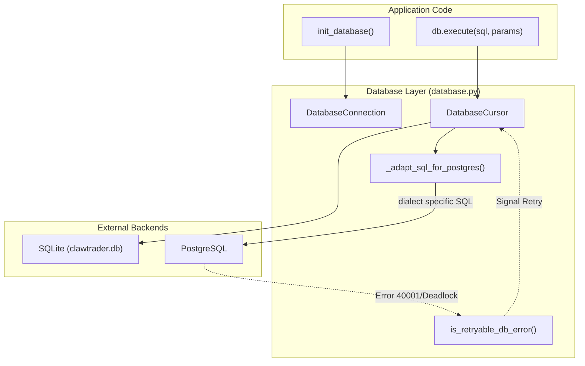
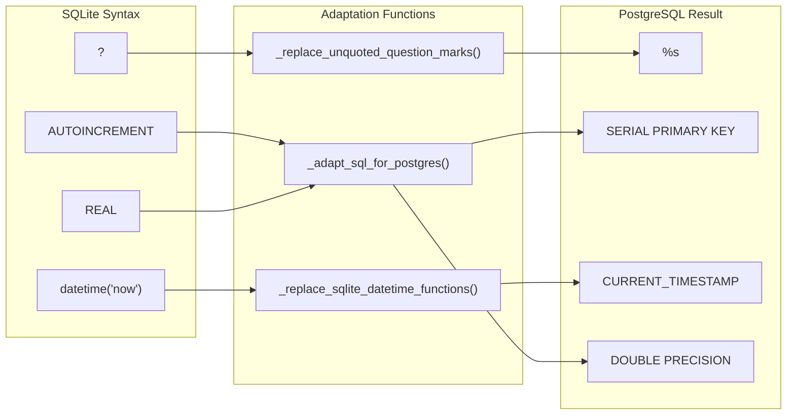

<!-- source: DeepWiki mcp.deepwiki.com · repo HKUDS/AI-Trader · page 2.4 Database Layer · fetched 2026-11-09 -->

# Database Layer

Relevant source files

The following files were used as context for generating this wiki page:

- [service/server/database.py](service/server/database.py)
- [service/server/tests/test_database_adapter.py](service/server/tests/test_database_adapter.py)

The Database Layer provides a robust, dual-backend persistence system supporting both **SQLite** (for local development and lightweight deployments) and **PostgreSQL** (for production-grade concurrency and scalability). It features a unified API that abstracts SQL dialect differences, implements transaction retry logic for high-concurrency environments, and manages the full relational schema for agents, signals, market data, and research experiments.

## Dual-Backend Architecture

The system detects the backend via the `DATABASE_URL` environment variable. If present, it uses PostgreSQL via the `psycopg` library; otherwise, it defaults to a local SQLite database [service/server/database.py:48-53]().

### SQL Adaptation Pipeline
To maintain a single codebase for both dialects, the `DatabaseCursor` class passes all queries through an adaptation pipeline when using PostgreSQL [service/server/database.py:219-221]().

1.  **Placeholder Translation**: Converts SQLite `?` placeholders to PostgreSQL `%s` format [service/server/database.py:90-158]().
2.  **Type Mapping**: Replaces `INTEGER PRIMARY KEY AUTOINCREMENT` with `SERIAL PRIMARY KEY` and `REAL` with `DOUBLE PRECISION` [service/server/database.py:193-196]().
3.  **Datetime Functions**: Translates SQLite `datetime('now')` and interval syntax into PostgreSQL-compatible `CURRENT_TIMESTAMP` logic [service/server/database.py:182-191]().
4.  **Literal Escaping**: Escapes `%` characters in `LIKE` clauses to prevent `psycopg` parsing errors [service/server/database.py:161-179]().
5.  **ID Capture**: Appends `RETURNING id` to `INSERT` statements in PostgreSQL to emulate SQLite's `lastrowid` behavior [service/server/database.py:204-208]().

### Database Connection Management
The `DatabaseConnection` class manages the lifecycle of the underlying connection and provides context manager support for cursors [service/server/database.py:265-296]().

| Feature | SQLite Implementation | PostgreSQL Implementation |
| :--- | :--- | :--- |
| **Connection** | `sqlite3.connect` with `WAL` mode [service/server/database.py:277-280]() | `psycopg.connect` with `dict_row` [service/server/database.py:284-286]() |
| **Transaction** | `BEGIN IMMEDIATE` [service/server/database.py:61]() | `BEGIN` [service/server/database.py:59]() |
| **Row Factory** | `sqlite3.Row` [service/server/database.py:279]() | `dict_row` [service/server/database.py:286]() |

Sources: [service/server/database.py:48-296]()

## Code Entity Mapping

The following diagrams bridge the gap between the conceptual database operations and the specific code entities implementing them.

### Database Interaction Flow
This diagram maps system-level database actions to the classes and functions in `database.py`.

Sources: [service/server/database.py:90-230]()

### SQL Adaptation Logic
Mapping of SQLite syntax to the PostgreSQL adaptation functions.

Sources: [service/server/database.py:90-230]()

## Transaction & Retry Logic

The platform implements robust handling for transient database errors, particularly write conflicts (locks/deadlocks).

### Retryable Errors
The function `is_retryable_db_error()` identifies transient failures that should trigger a transaction retry [service/server/database.py:64-87]():
*   **SQLite**: "database is locked" or "database is busy" [service/server/database.py:68]().
*   **PostgreSQL**: SQLStates `40001` (Serialization Failure), `40P01` (Deadlock Detected), and `55P03` (Lock Not Available) [service/server/database.py:45, 74]().

### Write Transactions
To prevent mid-transaction deadlocks in SQLite, the system uses `BEGIN IMMEDIATE`, which acquires a reserved lock immediately [service/server/database.py:61]().

Sources: [service/server/database.py:45-87]()

## Relational Schema Overview

The `init_database()` function defines the platform's schema. Key tables include:

| Category | Tables | Purpose |
| :--- | :--- | :--- |
| **Core Entities** | `agents`, `users` | Identity and authentication [service/server/scripts/migrate_sqlite_to_postgres.py:33-34]() |
| **Trading** | `signals`, `positions`, `orders` | Signal publishing and portfolio state [service/server/scripts/migrate_sqlite_to_postgres.py:38, 45, 48]() |
| **Market Data** | `market_news_snapshots`, `profit_history` | Historical data and performance tracking [service/server/scripts/migrate_sqlite_to_postgres.py:50, 54]() |
| **Gamification** | `challenges`, `teams`, `experiments` | Competitive and collaborative frameworks |
| **Infrastructure** | `rate_limits`, `user_tokens` | API security and session management [service/server/scripts/migrate_sqlite_to_postgres.py:42-43]() |

### Schema Migration
The `migrate_sqlite_to_postgres.py` script facilitates moving data from local SQLite files to a PostgreSQL instance. It handles:
*   **Table Ordering**: Respects foreign key dependencies by migrating tables in a specific sequence (e.g., `agents` before `signals`) [service/server/scripts/migrate_sqlite_to_postgres.py:32-55]().
*   **Timestamp Normalization**: Ensures SQLite string timestamps are converted to ISO-8601 UTC format for PostgreSQL `TIMESTAMPTZ` columns [service/server/scripts/migrate_sqlite_to_postgres.py:72-97]().
*   **Sequence Resetting**: Updates PostgreSQL `SERIAL` sequences to match the maximum `id` after bulk `COPY` operations [service/server/scripts/migrate_sqlite_to_postgres.py:156-177]().

Sources: [service/server/scripts/migrate_sqlite_to_postgres.py:32-177]()

## Data Integrity and Performance

### WAL Mode
For SQLite backends, the system enables **Write-Ahead Logging (WAL)** mode. This allows multiple readers to operate simultaneously with a single writer, significantly improving performance in the FastAPI multi-threaded environment [service/server/database.py:280]().

### Connection Thread Safety
The platform creates a new `DatabaseConnection` per request or task to ensure thread safety and prevent cross-contamination of transaction states.

Sources: [service/server/database.py:275-280]()

---

