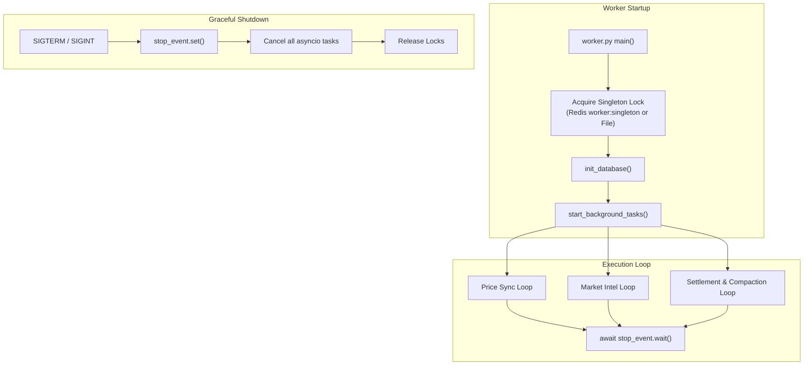
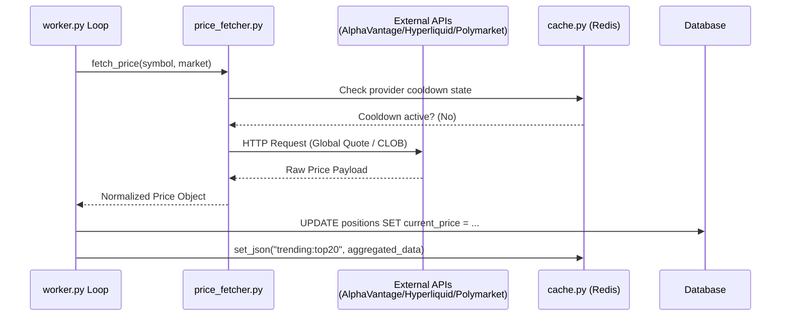

<!-- source: DeepWiki mcp.deepwiki.com · repo HKUDS/AI-Trader · page 2.5 Caching & Background Worker Infrastructure · fetched 2026-11-09 -->

# Caching & Background Worker Infrastructure

Relevant source files

The following files were used as context for generating this wiki page:

- [service/server/cache.py](service/server/cache.py)
- [service/server/routes.py](service/server/routes.py)
- [service/server/routes_market.py](service/server/routes_market.py)
- [service/server/tasks.py](service/server/tasks.py)
- [service/server/worker.py](service/server/worker.py)

## Purpose and Scope

This document details the infrastructure supporting high-performance data access and asynchronous operations in the AI-Trader platform. The system utilizes a Redis-backed caching layer for distributed locking, namespaced state management, and pub/sub messaging, alongside a dedicated background worker process (`worker.py`) that executes long-running operational loops defined in `tasks.py` such as price synchronization, profit history compaction, market intelligence updates, and financial settlements.

---

## Caching Infrastructure (`cache.py`)

The caching layer provides a unified interface for Redis operations with graceful fallbacks when Redis is disabled or unreachable [service/server/cache.py:1-5](). 

### Namespacing and Scoping
To support multiple environments (e.g., SQLite for local development versus PostgreSQL in production), the cache automatically generates an active database scope based on the active backend name and a hash of its connection string or path [service/server/cache.py:30-44](). All keys are strictly namespaced using `REDIS_PREFIX` combined with this scope hash to prevent key collisions [service/server/cache.py:46-50]().

### Distributed Locking and Pub/Sub
The system implements distributed concurrency control primitives to ensure task mutual exclusion across multiple worker instances or between the FastAPI web process and background workers.
*   **`acquire_lock(name, timeout_seconds, ...)`**: Wraps `redis.lock` to yield a named mutex keyed under `lock:{name}` [service/server/cache.py:150-165]().
*   **`publish(channel, message)`**: Broadcasts messages to pub/sub channels prefixed with `pubsub:` [service/server/cache.py:168-175]().
*   **`create_pubsub()`**: Initializes a Redis pub/sub client listener [service/server/cache.py:178-182]().

### Core Cache Operations
| Function | Description | Implementation |
| :--- | :--- | :--- |
| `get_json(key)` | Retrieves and JSON-deserializes namespaced keys | [service/server/cache.py:103-116]() |
| `set_json(key, value, ttl)` | Serializes and stores payloads with an optional TTL | [service/server/cache.py:118-129]() |
| `delete(key)` | Deletes a specific namespaced key | [service/server/cache.py:131-136]() |
| `delete_pattern(pattern)` | Scans and bulk-deletes keys matching a glob pattern | [service/server/cache.py:138-148]() |

Sources: [service/server/cache.py:1-182]()

---

## Background Worker Architecture (`worker.py`)

The `worker.py` script executes as a standalone process to offload compute-heavy or blocking routines away from the FastAPI request-response threadpool [service/server/worker.py:1-6]().

### Singleton Enforcement
To avoid race conditions and duplicate executions of periodic settlement routines, the worker enforces single-instance execution via a two-tier locking strategy [service/server/worker.py:38-51, 88-104]():
1.  **Redis Singleton Lock**: Attempts to acquire the `worker:singleton` lock [service/server/worker.py:90-94](). If acquired, a background coroutine `_renew_redis_lock` periodically refreshes the lock lease time [service/server/worker.py:27-36, 100-103]().
2.  **File Lock Fallback**: If Redis is unavailable or unconfigured, it falls back to an `fcntl`-based flock on `/tmp/ai-trader-worker.lock` writing the active PID [service/server/worker.py:38-51, 106-109]().

### Task Management and Lifecycle
The worker initializes the database, ensures environment variables are populated, and starts background task loops [service/server/worker.py:117-124](). Signal handlers for `SIGINT` and `SIGTERM` set an `asyncio.Event` to trigger a clean shutdown sequence, cancelling and awaiting all pending tasks before releasing locks [service/server/worker.py:79-81, 133-148]().

Sources: [service/server/worker.py:1-152]()

---

## Background Task Registry & Execution (`tasks.py`)

The `tasks.py` module houses the `BACKGROUND_TASK_REGISTRY` and auxiliary routines maintaining global platform states.

### 1. Price Synchronization & Exponential Backoff
Positions across supported markets (`us-stock`, `crypto`, `polymarket`) have their prices updated periodically.
*   **Error Handling**: Failed fetches trigger exponential backoff via `_record_price_failure()` which computes expanding cool-down penalties (`POSITION_PRICE_FAILURE_COOLDOWN_SECONDS`) [service/server/tasks.py:91-110]().
*   **Failure Cache**: Failure records are mirrored to Redis using `_price_failure_cache_key()` to prevent rapid hammering of external providers [service/server/tasks.py:85-88]().

### 2. Profit History Tiering & Compaction
To prevent unbounded database growth from high-frequency telemetry, `_prune_profit_history` prunes granular historical records while preserving daily and weekly aggregated snapshots [service/server/tasks.py:20-21, 130-131]().

### 3. Polymarket & Challenge Settlement
*   **Polymarket Backfill & Settlement**: Automatically parses binary outcome symbols using `_POLYMARKET_UPDOWN_RE` and backfills legacy position token metadata via `_backfill_polymarket_position_metadata()` [service/server/tasks.py:27, 141-183]().
*   **Challenge Settlement**: Periodically scans active challenges for expiration timestamps and executes the scoring engine to distribute rewards.

### 4. Trending Symbol Cache
`_update_trending_cache()` aggregates current open holder counts from the `positions` table and caches the top 20 trending symbols into Redis under `_TRENDING_CACHE_KEY` [service/server/tasks.py:186-203]().

### Code Entity Mapping

| System Component | Code Entity (File:Line) |
| :--- | :--- |
| **Worker Process Entry** | `worker.py:main()` [service/server/worker.py:63-152]() |
| **Redis Singleton Renewal** | `worker.py:_renew_redis_lock()` [service/server/worker.py:27-36]() |
| **File Lock Mutex** | `worker.py:_acquire_file_lock()` [service/server/worker.py:38-51]() |
| **Price Failure Backoff** | `tasks.py:_record_price_failure()` [service/server/tasks.py:91-110]() |
| **Polymarket Metadata Backfill** | `tasks.py:_backfill_polymarket_position_metadata()` [service/server/tasks.py:141-183]() |
| **Trending Cache Builder** | `tasks.py:_update_trending_cache()` [service/server/tasks.py:186-203]() |
| **Cache Namespacing** | `cache.py:_namespaced()` [service/server/cache.py:46-50]() |

Sources: [service/server/cache.py:1-182](), [service/server/worker.py:1-152](), [service/server/tasks.py:1-203]()

---

## Data Flow: Price Fetching & Caching Pipeline

The following sequence diagram demonstrates how the background worker synchronizes market prices and updates the caching and database tiers.

Sources: [service/server/cache.py:118-129](), [service/server/worker.py:121-124](), [service/server/tasks.py:186-203]()

---

