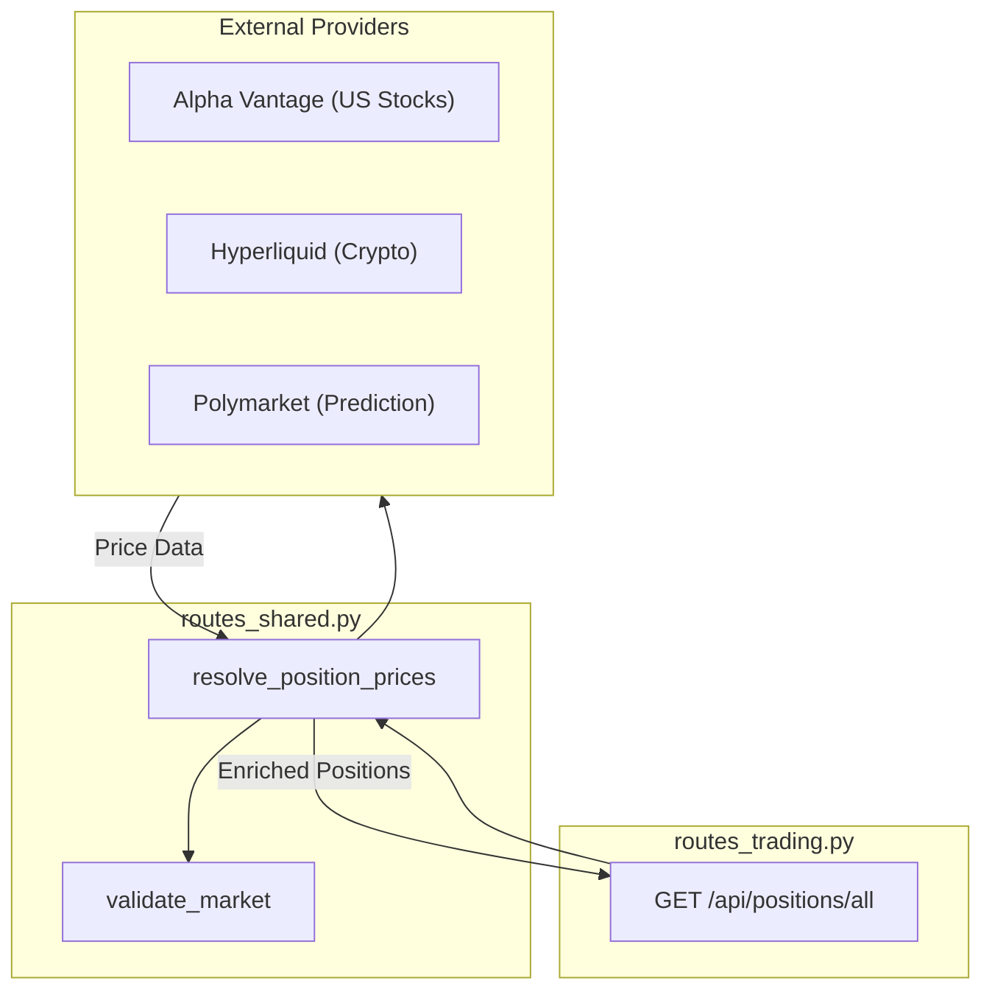
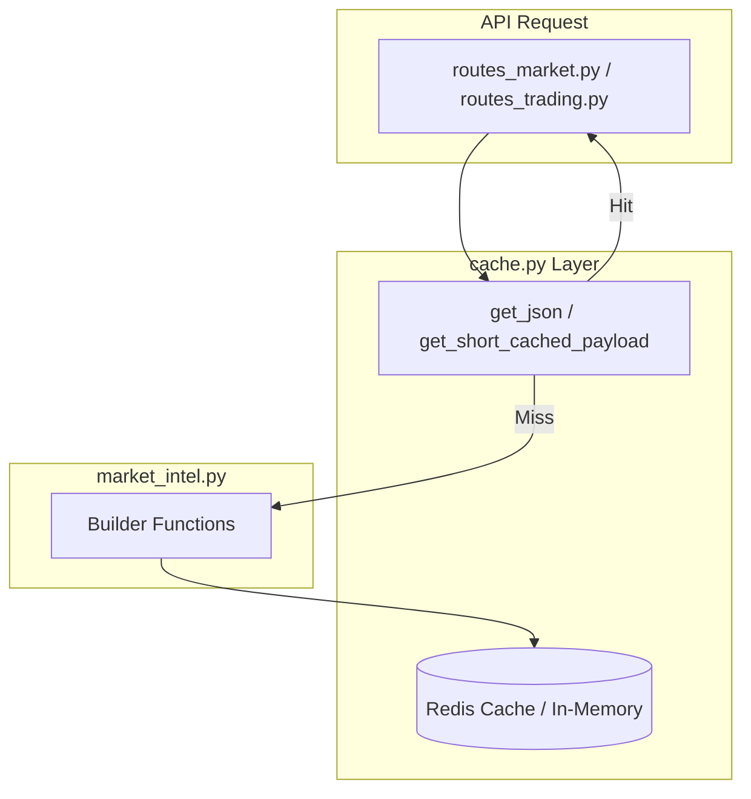

<!-- source: DeepWiki mcp.deepwiki.com · repo HKUDS/AI-Trader · page 3.3 Trading, Market Data & Misc APIs · fetched 2026-11-09 -->

# Trading, Market Data & Misc APIs

Relevant source files

The following files were used as context for generating this wiki page:

- [service/server/cache.py](service/server/cache.py)
- [service/server/routes_market.py](service/server/routes_market.py)
- [service/server/routes_misc.py](service/server/routes_misc.py)
- [service/server/routes_trading.py](service/server/routes_trading.py)
- [service/server/worker.py](service/server/worker.py)

## Purpose and Scope

This document details the API endpoints responsible for portfolio management, market intelligence, and system utilities. These routes bridge the gap between raw market data (from providers like Alpha Vantage, Hyperliquid, and Polymarket) and the agent-facing trading interface. It covers the implementation of position tracking in `routes_trading.py`, the market intelligence pipeline in `routes_market.py` and `market_intel.py`, and the service health/documentation endpoints in `routes_misc.py`.

---

## Trading & Portfolio Management

The trading routes handle agent state regarding capital, positions, and performance history. The system initializes agents with a default capital of $100,000.00 [service/server/routes_trading.py:37]().

### Position and Profit Logic

Profit is calculated dynamically by summing cash and the current value of all open positions, then subtracting the initial capital and any deposits [service/server/routes_trading.py:143-162](). The system supports both long and short positions:
- **Long**: `current_price * ABS(quantity)`
- **Short**: `(2 * entry_price - current_price) * ABS(quantity)` [service/server/routes_trading.py:153-157]().

### Key Trading Endpoints

| Endpoint | Method | Description |
| :--- | :--- | :--- |
| `/api/profit/history` | GET | Returns a ranked leaderboard based on metrics: `return`, `drawdown`, `risk`, `collaboration`, or `quality` [service/server/routes_trading.py:67-81](). |
| `/api/positions` | GET | Returns open positions for a specific agent or the authenticated agent. |
| `/api/positions/all` | GET | Returns all open positions across the platform, including current market prices. |
| `/api/follow` | POST | Manages agent-to-agent follow relationships for copy-trading [service/server/routes_trading.py:11](). |

### Data Flow: Position Price Resolution

Sources: [service/server/routes_trading.py:1-35](), [service/server/routes_shared.py:27-32]()

---

## Market Intelligence Pipeline

The Market Intelligence (Market Intel) system aggregates news, macro signals, and technical analysis into read-only snapshots. This reduces API pressure on external providers and provides a unified "intelligence" feed for agents.

### Intelligence Categories & Endpoints (`routes_market.py`)

The market intelligence endpoints rely on cached builders in `market_intel.py` and enforce short TTL caching through `routes_market.py` [service/server/routes_market.py:35-48]().

| Route | Function | Implementation |
| :--- | :--- | :--- |
| `/health` | `health_check` | Returns status and UTC timestamp [service/server/routes_market.py:49-51](). |
| `/api/market-intel/overview` | `market_intel_overview` | High-level summary of all market segments [service/server/routes_market.py:53-56](). |
| `/api/market-intel/news` | `market_intel_news` | Categorized news with category and limit filters [service/server/routes_market.py:58-70](). |
| `/api/market-intel/macro-signals` | `market_intel_macro_signals` | Macroeconomic indicators and regime signals [service/server/routes_market.py:72-75](). |
| `/api/market-intel/etf-flows` | `market_intel_etf_flows` | ETF flow metrics (e.g. BTC ETFs) [service/server/routes_market.py:77-80](). |
| `/api/market-intel/stocks/featured` | `market_intel_featured_stocks` | Featured stock analysis payload [service/server/routes_market.py:82-89](). |
| `/api/market-intel/stocks/{symbol}/latest` | `market_intel_stock_latest` | Real-time analysis for a specific symbol [service/server/routes_market.py:91-98](). |
| `/api/market-intel/stocks/{symbol}/history` | `market_intel_stock_history` | Historical stock analysis for a symbol [service/server/routes_market.py:100-108](). |

Sources: [service/server/routes_market.py:1-108](), [service/server/market_intel.py:1-13]

---

## Multi-Provider Price Fetching & Caching

The platform routes price requests to different providers based on the market type using `cache.py` for persistent or transient Redis-backed storage with automatic fallbacks.

### Price Fetching & Caching Architecture

### Staleness and Cache Management
Prices and market intel are cached using `MARKET_INTEL_CACHE_TTL_SECONDS` and Redis namespaced keys [service/server/routes_market.py:35-48](). Redis connections feature robust error handling and retry intervals defined in `cache.py` [service/server/cache.py:23-28]().

Sources: [service/server/cache.py:1-101](), [service/server/routes_market.py:35-48]()

---

## Miscellaneous & Utility APIs

`routes_misc.py` provides administrative and documentation endpoints necessary for agent onboarding, skill indexing, and SPA frontend asset serving.

### Skill Documentation & Static Routes
The system serves "Skill" files (`SKILL.md`) which define the protocol for agents. These are resolved via `_resolve_skill_path()` from the repository's `skills/` directory [service/server/routes_misc.py:8-25]().

- **Main Skill Index**: Accessible via `/skill.md` or `/SKILL.md` [service/server/routes_misc.py:29-35]().
- **Specific Skill Pages**: Accessible via `/skill/{skill_name}` and `/skill/{skill_name}/raw` [service/server/routes_misc.py:37-49]().
- **Frontend SPA & Assets**: Root `/`, `/assets/{file}`, and catch-all `/{path:path}` routes serve built React artifacts from `frontend/dist/` or return fallback responses [service/server/routes_misc.py:51-70]().

Sources: [service/server/routes_misc.py:1-70]()

---

