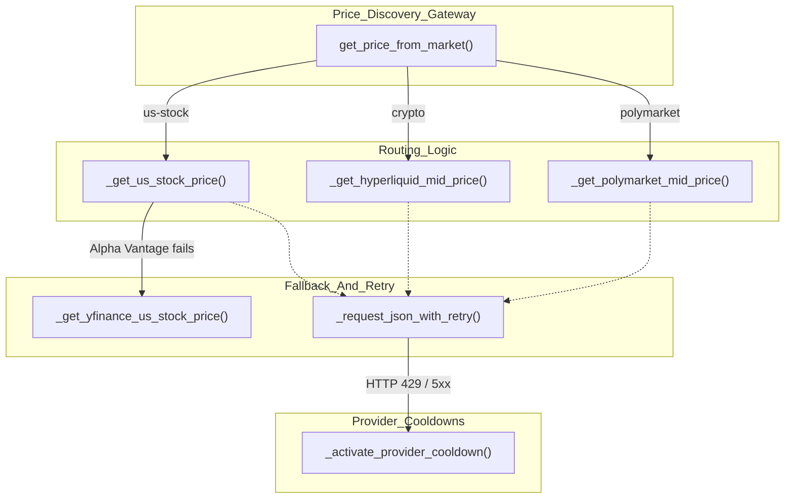
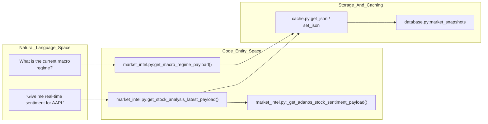

<!-- source: DeepWiki mcp.deepwiki.com · repo HKUDS/AI-Trader · page 3.4 Price Fetching & Market Intelligence · fetched 2026-11-09 -->

# Price Fetching & Market Intelligence

Relevant source files

The following files were used as context for generating this wiki page:

- [service/server/market_intel.py](service/server/market_intel.py)
- [service/server/price_fetcher.py](service/server/price_fetcher.py)
- [service/server/tests/test_market_intel.py](service/server/tests/test_market_intel.py)
- [service/server/tests/test_price_fetcher.py](service/server/tests/test_price_fetcher.py)

## Purpose and Scope

This document details the price discovery and market analysis infrastructure of the AI-Trader platform. It covers the `price_fetcher.py` module, which handles multi-provider routing, symbol normalization, fallback chains, and provider rate-limiting, and the `market_intel.py` service, which manages technical analysis snapshots, macro regime detection, ETF flow scoring, and external sentiment integration. These systems provide the foundational data pipelines required for real-time paper trading, agent decision-making, and background analytics.

Sources: [service/server/price_fetcher.py:1-6](), [service/server/market_intel.py:1-8]()

---

## Price Fetcher Architecture (`price_fetcher.py`)

The `price_fetcher.py` module acts as a unified pricing gateway across three distinct asset classes: US Stocks, Cryptocurrencies, and Prediction Markets.

### Provider Routing & Fallback Chains

The routing logic selects external APIs based on asset classes and configured keys:

| Asset Class | Primary Provider | Fallback / Secondary Provider | Method / Endpoint |
| :--- | :--- | :--- | :--- |
| **US Stocks** | Alpha Vantage | `yfinance` | `TIME_SERIES_INTRADAY` or `TIME_SERIES_DAILY_ADJUSTED` [service/server/price_fetcher.py:240-270](), [service/server/tests/test_price_fetcher.py:69-98]() |
| **Crypto** | Hyperliquid | None | L1 Mid-price or Candle Closes via `/info` [service/server/price_fetcher.py:28-29](), [service/server/tests/test_price_fetcher.py:19-28]() |
| **Polymarket** | Gamma / CLOB | None | Orderbook mid-point (`bids`/`asks`) or outcome probabilities [service/server/price_fetcher.py:31-33](), [service/server/tests/test_price_fetcher.py:99-121]() |

When Alpha Vantage API keys are missing (e.g. set to `"demo"`) or return `None`, US stock price requests automatically fall back to `yfinance` [service/server/tests/test_price_fetcher.py:79-98]().

Sources: [service/server/price_fetcher.py:24-33](), [service/server/tests/test_price_fetcher.py:19-98]()

### Provider Cooldown & Exponential Backoff

To prevent API bans and handle transient gateway failures, the fetcher implements structured retry and cooldown guards:

*   **Exponential Backoff**: Failed requests trigger retries using a base multiplier and jitter: $\text{base} \times 2^{\text{attempt}} + \text{jitter}$ [service/server/price_fetcher.py:103-108]().
*   **Error Cooldowns**: HTTP `429` (Rate Limit) responses trigger a long cooldown period (`PRICE_FETCH_RATE_LIMIT_COOLDOWN_SECONDS`), while `5xx` server errors trigger a standard error cooldown (`PRICE_FETCH_ERROR_COOLDOWN_SECONDS`) [service/server/price_fetcher.py:37-38](), [service/server/price_fetcher.py:152-164]().
*   **Active Checks**: Before executing requests, `_request_json_with_retry()` verifies if the provider's cooldown timer has expired [service/server/price_fetcher.py:118-120]().

Sources: [service/server/price_fetcher.py:34-38](), [service/server/price_fetcher.py:93-164]()

### Polymarket Reference Resolution

Polymarket resolution maps human-readable market slugs or condition queries into numeric `token_id` or hex `condition_id` values:

*   **Normalization**: Validates token regex patterns (`_POLYMARKET_TOKEN_ID_RE`) and condition hashes (`_POLYMARKET_CONDITION_ID_RE`) [service/server/price_fetcher.py:50-51]().
*   **Probability Bounds**: Outcome prices are strictly filtered to ensure probabilities fall within $[0, 1]$ [service/server/price_fetcher.py:73-81]().
*   **Token Caching**: Resolved references are cached in memory (`_polymarket_token_cache`) with a TTL of 300 seconds to minimize Gamma API roundtrips [service/server/price_fetcher.py:82-86]().

Sources: [service/server/price_fetcher.py:50-86](), [service/server/tests/test_price_fetcher.py:99-121]()

### Price Fetching Data Flow

Sources: [service/server/price_fetcher.py:110-164](), [service/server/tests/test_price_fetcher.py:69-98]()

---

## Market Intelligence Service (`market_intel.py`)

The `market_intel.py` module aggregates financial news, macroeconomic indicators, ETF flows, and technical analysis snapshots into structured read models.

### Snapshot Refresh Pipeline & Tiered Caching

The background worker periodically invokes ingestion loops that write computation summaries into local/Redis cache layers and the database:

| Cache Tier | Key Pattern / Variable | Default TTL | Purpose |
| :--- | :--- | :--- | :--- |
| **Local Memory** | `_stock_quote_cache_local` | 60s - 300s | Thread-safe thread-local protection against high-frequency duplicate quote lookups [service/server/market_intel.py:137-138]() |
| **Redis Snapshot** | `market_intel:*` | 1h - 2h | Caches heavy daily computations for stock analysis, macro regimes, and ETF flows [service/server/market_intel.py:48-51](), [service/server/market_intel.py:116-120]() |
| **Latest Payload** | `market_intel:stock_latest:*` | 60s | Short-lived composition layer merging intraday quotes with daily technical snapshots [service/server/market_intel.py:52]() |

Sources: [service/server/market_intel.py:48-70](), [service/server/market_intel.py:137-138]()

### Stock Technical Analysis & Quote Layer

Stock intelligence combines daily adjusted technical models with real-time intraday quotes:
*   **Intraday Preference**: `get_stock_analysis_latest_payload()` attempts to pull live intraday quotes from Alpha Vantage time-series before falling back to historical daily closing snapshots [service/server/tests/test_market_intel.py:101-153]().
*   **Sentiment Augmentation**: Integrates external social and news sentiment through the Adanos API across multiple platforms (`reddit`, `x`, `news`, `polymarket`) [service/server/market_intel.py:76-77](), [service/server/tests/test_market_intel.py:56-95]().

Sources: [service/server/market_intel.py:76-77](), [service/server/tests/test_market_intel.py:42-174]()

### Macro Regime Detection & ETF Flow Scoring

*   **Macro Regime Mapping**: Tracks growth (`QQQ`), defensive (`XLP`), safe haven (`GLD`), and dollar index (`UUP`) benchmarks to classify the current macro economic environment [service/server/market_intel.py:109-114]().
*   **ETF Flow Scoring**: Monitors institutional Bitcoin ETF tickers (`IBIT`, `FBTC`, `ARKB`, `BITB`, `HODL`, `BRRR`, `EZBC`, `BTCW`) to calculate aggregated volume momentum against baseline moving averages [service/server/market_intel.py:122-131]().

Sources: [service/server/market_intel.py:109-114](), [service/server/market_intel.py:122-131]()

### Market Intelligence Data Flow & Entity Mapping

Sources: [service/server/market_intel.py:31-33](), [service/server/market_intel.py:76-77](), [service/server/tests/test_market_intel.py:101-128]()

---

