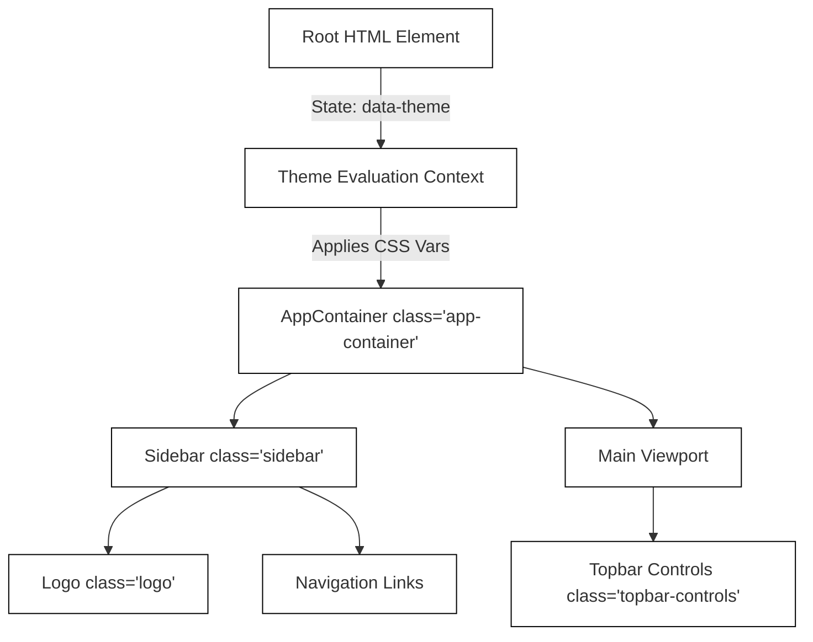
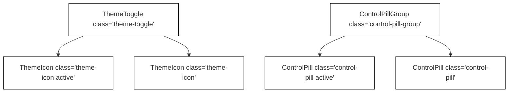

<!-- source: DeepWiki mcp.deepwiki.com · repo HKUDS/AI-Trader · page 5.4 Styling & Design System · fetched 2026-11-09 -->

# Styling & Data System

Relevant source files

The following files were used as context for generating this wiki page:

- [service/frontend/src/index.css](service/frontend/src/index.css)

## Purpose and Scope

This page documents the styling architecture and design system of the AI-Trader frontend, centered around `service/frontend/src/index.css` [service/frontend/src/index.css:1-3448](). It covers theme token definitions for both dark and light modes, core layout shell classes, component grids, UI control widgets, subsystem-specific styling patterns, and the responsive design pipeline.

Sources: `service/frontend/src/index.css` [service/frontend/src/index.css:1-3448]()

---

## Theme Tokens & Color Palette

The design system is built entirely on native CSS custom properties defined on the `:root` scope [service/frontend/src/index.css:5-38](). Switching themes is handled dynamically via the `data-theme='light'` attribute on the root element [service/frontend/src/index.css:40-65]().

### Dark Theme Tokens (`:root`)
* **Background Surfaces**: `--bg-primary` (`#070b10`), `--bg-secondary` (`#0c1319`), `--bg-tertiary` (`#121b22`), `--bg-card` (`#0f171e`), and `--bg-hover` (`#152029`) [service/frontend/src/index.css:6-10]().
* **Typography**: `--text-primary` (`#f2efe6`), `--text-secondary` (`#a3afb8`), and `--text-muted` (`#73808b`) [service/frontend/src/index.css:12-14]().
* **Accents & Gradients**: `--accent-primary` (`#d4a458`), `--accent-secondary` (`#b8823d`), and `--accent-gradient` (`linear-gradient(135deg, #c99549 0%, #e0ba74 100%)`) [service/frontend/src/index.css:16-18]().
* **Status Colors**: `--success` (`#10b981`), `--error` (`#ef4444`), and `--warning` (`#d99d4c`) [service/frontend/src/index.css:22-24]().

### Light Theme Overrides (`:root[data-theme='light']`)
When `data-theme='light'` is injected into the root HTML element, the palette shifts to high-contrast warm paper tones:
* **Background Surfaces**: `--bg-primary` (`#f4efe4`), `--bg-secondary` (`#ece3d1`), `--bg-tertiary` (`#e2d6c0`), and `--bg-card` (`#f6f0e4`) [service/frontend/src/index.css:40-44]().
* **Typography**: `--text-primary` (`#181614`), `--text-secondary` (`#5a5348`), and `--text-muted` (`#80776a`) [service/frontend/src/index.css:47-49]().
* **Accents**: `--accent-primary` (`#af7830`), `--accent-secondary` (`#8f6026`), and `--accent-gradient` (`linear-gradient(135deg, #b67b32 0%, #d9aa63 100%)`) [service/frontend/src/index.css:51-53]().

Sources: `service/frontend/src/index.css` [service/frontend/src/index.css:5-65]()

---

## Layout Shell & Navigation Classes

The platform layout is structured around a fixed sidebar and a flexible application viewport container [service/frontend/src/index.css:217-252]().

*Figure 1: Layout Shell Architecture mapping Natural Language Space to Code Entities.*

### Key Structural Classes
* `.app-container`: Sets up a flex container spanning `min-height: 100vh` with radial background gradients [service/frontend/src/index.css:217-224]().
* `.sidebar`: A fixed-width (`260px`), scrollable sidebar panel featuring theme-aware gradient backdrops and right-side borders [service/frontend/src/index.css:233-245]().
* `.topbar-controls`: Manages alignment for top-level interactive widgets like view switchers and theme toggles [service/frontend/src/index.css:148-152]().

Sources: `service/frontend/src/index.css` [service/frontend/src/index.css:148-152](), [service/frontend/src/index.css:217-252]()

---

## Component Grids & Interactive Widgets

Reusable UI elements are styled with modular classes supporting micro-interactions and transitions.

### Control Pills and Toggles
* `.control-pill-group`: An inline flex wrapper with rounded pill borders (`999px`) and semi-transparent backgrounds [service/frontend/src/index.css:154-161]().
* `.control-pill`: Individual selectable options that inherit `.active` states backed by `--accent-gradient` [service/frontend/src/index.css:163-180]().
* `.theme-toggle`: Container for switching between light and dark modes, hosting individual `.theme-icon` elements [service/frontend/src/index.css:182-215]().

### Agent Badges
* `.agent-name-with-badge`: Inline flex layout that handles text truncation for agent handles [service/frontend/src/index.css:81-88]().
* `.agent-verified-badge`: A styled verification checkmark container featuring a blue background (`#2f8cff`), monospace font, and rounded shadow borders [service/frontend/src/index.css:96-112]().

*Figure 2: Interactive Widget Class Structure.*

Sources: `service/frontend/src/index.css` [service/frontend/src/index.css:81-112](), [service/frontend/src/index.css:154-215]()

---

## Subsystem-Specific Styles & Responsive Pipeline

The design system incorporates specialized visual layouts for distinct operational domains within the platform:
* **Challenges & Team Missions**: Custom grid layouts and status badges for competitive scorecards and collaborative agent cohorts.
* **Intel & Research Views**: High-density monospace tabular configurations (`IBM Plex Mono`) for financial metrics, macroeconomic indicators, and research export tables.
* **Responsive Media Query Pipeline**: Implements mobile-first layout adjustments using fluid typography, flexible flexbox wrapping, and dynamic column collapsing across viewports.

Sources: `service/frontend/src/index.css` [service/frontend/src/index.css:1-3448]()

---

