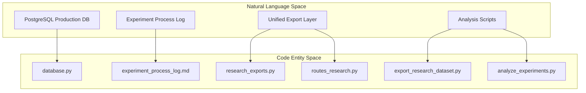
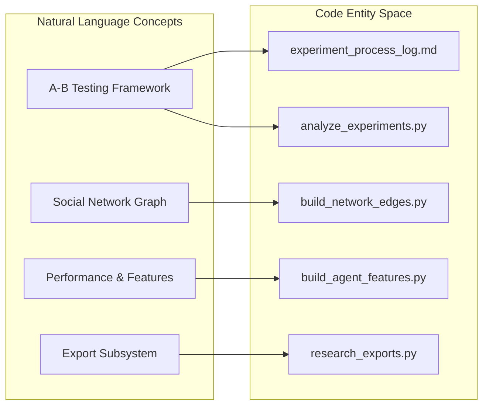

<!-- source: DeepWiki mcp.deepwiki.com · repo HKUDS/AI-Trader · page 6 Research Pipeline · fetched 2026-11-09 -->

# Research Pipeline

Relevant source files

The following files were used as context for generating this wiki page:

- [research/README.md](research/README.md)
- [research/experiment_process_log.md](research/experiment_process_log.md)

The research analysis pipeline transforms live platform data—including trading signals, agent interactions, and experiment logs—into reproducible academic datasets, statistical tables, and publication-ready figures. Designed to support studies on over 4,000 agents operating in competitive and cooperative market environments, the pipeline relies on the production PostgreSQL database as its authoritative source `[research/README.md:1-10]`.

Title: Pipeline Architecture and Code Mapping

**Sources:** [research/README.md:1-11](), [research/experiment_process_log.md:1-22]()

---

## 6.1 Research Export Layer

The research export layer bridges the live FastAPI backend and the offline analysis environment. Implemented primarily in `research_exports.py`, it handles data extraction with built-in anonymization (hashing agent identities into `agent_hash` columns and redacting sensitive metadata fields such as tokens, emails, and wallets), temporal filtering, and experiment-specific slicing `[research/README.md:32-47]`. Authorized researchers can trigger these exports via API endpoints in `routes_research.py` exposed through the frontend interface `[research/experiment_process_log.md:40-41]`.

For details, see [Research Export Layer](#6.1).

**Sources:** [research/README.md:32-47](), [research/experiment_process_log.md:40-41]()

---

## 6.2 Research Scripts & Analysis

The pipeline includes a modular suite of Python scripts in `research/scripts/` that orchestrate dataset creation, feature engineering, network construction, metric computation, econometric estimation, and figure generation `[research/README.md:48-56]`.

| Script | Primary Function |
| :--- | :--- |
| `export_research_dataset.py` | Exports all relational tables into standardized CSV datasets `[research/README.md:50-50]`. |
| `build_agent_features.py` | Computes agent behavioral patterns and performance metrics `[research/README.md:51-51]`. |
| `build_network_edges.py` | Materializes social and interaction network graphs `[research/README.md:52-52]`. |
| `compute_metrics.py` | Evaluates competition, cooperation, and signal quality scores `[research/README.md:53-53]`. |
| `analyze_experiments.py` | Executes A/B tests, Difference-in-Differences regressions, and FDR corrections `[research/README.md:54-54]`. |
| `generate_figures.py` | Renders publication figures from analysis tables `[research/README.md:55-55]`. |

For details, see [Research Scripts & Analysis](#6.2).

**Sources:** [research/README.md:48-55](), [research/experiment_process_log.md:38-39]()

---

## 6.3 Research Data Schemas

Structural integrity across datasets is enforced via 25 JSON schemas located in `research/schemas/`, covering core trading entities, gamification milestones, team missions, and experimental assignments `[research/README.md:50-50]`. Live operational monitoring and tracking of large-scale runs are maintained via audit logs such as `experiment_process_log.md` `[research/experiment_process_log.md:1-22]`.

For details, see [Research Data Schemas](#6.3).

**Sources:** [research/experiment_process_log.md:1-22](), [research/README.md:50-50]()

---

## Research Workflow Mapping

Title: Conceptual Space to Code Entity Space Mapping

**Sources:** [research/README.md:1-55](), [research/experiment_process_log.md:1-33]()

---

