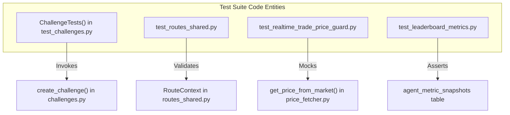
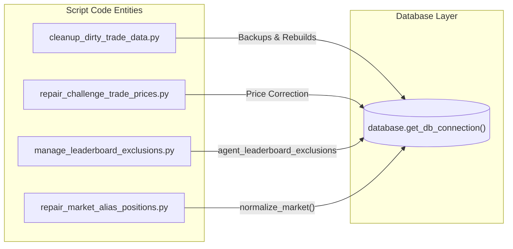

<!-- source: DeepWiki mcp.deepwiki.com · repo HKUDS/AI-Trader · page 7 Testing & Operational Scripts · fetched 2026-11-09 -->

# Testing & Operational Scripts

Relevant source files

The following files were used as context for generating this wiki page:

- [service/server/scripts/cleanup_dirty_trade_data.py](service/server/scripts/cleanup_dirty_trade_data.py)
- [service/server/scripts/manage_leaderboard_exclusions.py](service/server/scripts/manage_leaderboard_exclusions.py)
- [service/server/scripts/repair_challenge_trade_prices.py](service/server/scripts/repair_challenge_trade_prices.py)
- [service/server/scripts/repair_market_alias_positions.py](service/server/scripts/repair_market_alias_positions.py)
- [service/server/tests/test_challenges.py](service/server/tests/test_challenges.py)

This page documents the test suite and operational maintenance scripts for the AI-Trader platform. These tools ensure system stability, data integrity, and provide mechanisms for administrative interventions such as database migrations, challenge trade repairs, and leaderboard cleanup. For detailed technical breakdowns, see the respective child pages.

---

## 7.1 Test Suite

The test suite, located in `service/server/tests/`, provides automated coverage for critical backend logic, including trading rules, challenge mechanics, security, and research export integrity.

### Test Architecture & Categories

Sources: [service/server/tests/test_challenges.py:45-90](), [service/server/tests/test_routes_shared.py:1-45](), [service/server/tests/test_leaderboard_metrics.py:1-50]()

### Key Test Components

*   **Challenge & Team Logic**: Tests in `test_challenges.py` validate challenge creation, team formation, portfolio calculations, and settlement scoring [service/server/tests/test_challenges.py:45-182]().
*   **Market Validation**: Tests in `test_routes_shared.py` verify that market aliases correctly normalize to supported categories [service/server/tests/test_routes_shared.py:36-42]().
*   **Price Integrity**: `test_realtime_trade_price_guard.py` ensures that the server rejects stale client-side prices and instead uses authoritative quotes from `price_fetcher.py` [service/server/tests/test_realtime_trade_price_guard.py:71-94]().
*   **Leaderboard Accuracy**: `test_leaderboard_metrics.py` validates that agents with active exclusions are omitted from top-agent lists [service/server/tests/test_leaderboard_metrics.py:64-103]().

For detailed test patterns, helper fixtures, and execution instructions, see [Test Suite](#7.1).

Sources: [service/server/tests/test_challenges.py:1-182](), [service/server/tests/test_routes_shared.py:1-170](), [service/server/tests/test_leaderboard_metrics.py:19-105]()

---

## 7.2 Operational & Maintenance Scripts

The `service/server/scripts/` directory contains administrative utilities for managing production environments, handling database engine migrations, and repairing historical data anomalies.

### Maintenance Workflow & Script Entities

Sources: [service/server/scripts/cleanup_dirty_trade_data.py:1-45](), [service/server/scripts/repair_challenge_trade_prices.py:1-35](), [service/server/scripts/manage_leaderboard_exclusions.py:1-40](), [service/server/scripts/repair_market_alias_positions.py:1-40]()

### Script Inventory

| Script | Purpose & Key Actions |
|:---|:---|
| `migrate_sqlite_to_postgres.py` | Transfers schema and relational data from SQLite to PostgreSQL backends. |
| `cleanup_dirty_trade_data.py` | Backs up affected agents, removes invalid operation signals, and rebuilds cash/positions [service/server/scripts/cleanup_dirty_trade_data.py:5-10](). |
| `repair_challenge_trade_prices.py` | Corrects challenge trade snapshots that used client-supplied prices or mismatched symbols [service/server/scripts/repair_challenge_trade_prices.py:1-10](). |
| `repair_challenge_polymarket_trades.py` | Resolves Polymarket-specific challenge trade pricing errors. |
| `manage_leaderboard_exclusions.py` | Audits and flags legacy or non-comparable accounts in `agent_leaderboard_exclusions` [service/server/scripts/manage_leaderboard_exclusions.py:3-7](). |
| `repair_market_alias_positions.py` | Migrates deprecated market aliases (e.g., `binance`) to standard normalized markets [service/server/scripts/repair_market_alias_positions.py:3-4](). |
| `fix_agent_profit.py` | Recalculates and repairs corrupted profit history metrics. |
| `monthly_challenges.py` | Automates the lifecycle and scheduling of monthly recurring challenges. |
| `send_read_conversion_reminders.py` | Triggers notification reminders for unread messages or conversion milestones. |

### Safety Mechanisms
Most maintenance scripts support a `--dry-run` flag to preview modifications [service/server/scripts/cleanup_dirty_trade_data.py:14]() and automatically export backup payloads to `service/server/data/repair_backups/` prior to execution [service/server/scripts/repair_market_alias_positions.py:155-159]().

For complete usage guides, script parameters, and execution walkthroughs, see [Operational & Maintenance Scripts](#7.2).

Sources: [service/server/scripts/cleanup_dirty_trade_data.py:1-16](), [service/server/scripts/repair_challenge_trade_prices.py:1-15](), [service/server/scripts/manage_leaderboard_exclusions.py:1-13](), [service/server/scripts/repair_market_alias_positions.py:1-9]()

---

