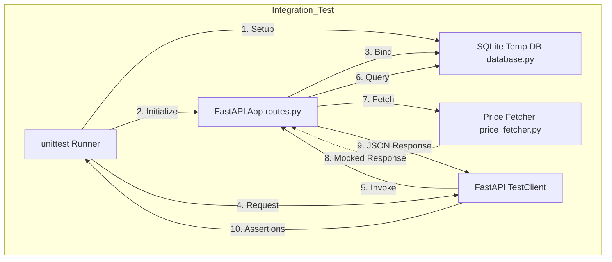

<!-- source: DeepWiki mcp.deepwiki.com · repo HKUDS/AI-Trader · page 7.1 Test Suite · fetched 2026-11-09 -->

# Test Suite

<details>
<summary>Relevant source files</summary>

The following files were used as context for generating this wiki page:

- [service/server/market_intel.py](service/server/market_intel.py)
- [service/server/price_fetcher.py](service/server/price_fetcher.py)
- [service/server/routes_users.py](service/server/routes_users.py)
- [service/server/tests/test_challenges.py](service/server/tests/test_challenges.py)
- [service/server/tests/test_database_adapter.py](service/server/tests/test_database_adapter.py)
- [service/server/tests/test_market_intel.py](service/server/tests/test_market_intel.py)
- [service/server/tests/test_price_fetcher.py](service/server/tests/test_price_fetcher.py)
- [service/server/tests/test_user_auth_security.py](service/server/tests/test_user_auth_security.py)
- [service/server/utils.py](service/server/utils.py)

</details>


The AI-Trader test suite is located in `service/server/tests/` and provides comprehensive coverage for backend services, route logic, security mechanisms, gamification systems, and data processing utilities. The suite relies on the standard Python `unittest` framework, `fastapi.testclient` for integration testing, and ephemeral database fixtures.

## Test Categories and Implementation

The test suite is organized into specialized modules targeting specific subsystems of the platform.

### User Auth Security & Verification (`test_user_auth_security.py`)
*   **Verification Code Randomness**: Validates that `generate_verification_code()` utilizes a cryptographic pseudorandom number generator (CSPRNG) rather than Python's standard `random` module, preventing predictable verification tokens [service/server/tests/test_user_auth_security.py:16-39]().
*   **Timing-Safe Password Verification**: Asserts that `verify_password()` uses `hmac.compare_digest` for constant-time comparison and correctly handles malformed or legacy hash shapes without raising unhandled exceptions [service/server/tests/test_user_auth_security.py:42-69]().
*   **Registration Brute-Force Lockout**: Tests that `/api/users/register` enforces `MAX_CODE_ATTEMPTS` (locking out after excessive invalid code guesses with HTTP 429) and respects resend throttling [service/server/tests/test_user_auth_security.py:71-127]().

Sources: [service/server/tests/test_user_auth_security.py:1-130]()

### Database Adapter & SQL Translation (`test_database_adapter.py`)
*   **PostgreSQL Adapter**: Tests `_adapt_sql_for_postgres()` to ensure LIKE percentage literals are properly escaped (e.g., transforming `%` to `%%` in pattern strings) while preserving existing escaped percent literals and converting SQLite `?` placeholders to `%s` [service/server/tests/test_database_adapter.py:12-25]().

Sources: [service/server/tests/test_database_adapter.py:1-25]()

### Challenges, Monthly Challenges & Team Missions (`test_challenges.py`)
*   **Challenge Lifecycle**: Validates challenge creation, idempotent participation via `join_challenge()`, and rule enforcement [service/server/tests/test_challenges.py:114-131]().
*   **Team Portfolios and Scoring**: Verifies team creation (`create_challenge_team`), team join workflows (`join_challenge_team`), multi-agent trade execution (`create_challenge_team_trade`), portfolio mark-to-market calculations, and team leaderboard generation [service/server/tests/test_challenges.py:132-182]().

Sources: [service/server/tests/test_challenges.py:1-182]()

### Price Fetching & Timezone Handling (`test_price_fetcher.py`)
*   **Market Routing**: Validates that market aliases correctly route to provider implementations (e.g., Hyperliquid for crypto assets) [service/server/tests/test_price_fetcher.py:19-28]().
*   **Timezone Logic**: Tests UTC-to-Eastern Time (EST/EDT) conversions for Alpha Vantage stock lookups across seasonal transitions and month boundaries [service/server/tests/test_price_fetcher.py:29-68]().
*   **Provider Fallbacks**: Verifies fallback mechanics between Alpha Vantage and `yfinance` for US stock pricing [service/server/tests/test_price_fetcher.py:69-98]().

Sources: [service/server/tests/test_price_fetcher.py:1-124]()

### Market Intelligence Read Models (`test_market_intel.py`)
*   **Sentiment Integration**: Tests Adanos sentiment payload collection, checking graceful degradation when `ADANOS_API_KEY` is omitted [service/server/tests/test_market_intel.py:42-51]() or aggregating valid multi-source payloads [service/server/tests/test_market_intel.py:56-95]().
*   **Quote vs Snapshot Resolution**: Verifies that stock analysis latest payloads prefer intraday quotes when fresh, falling back to daily snapshots when necessary [service/server/tests/test_market_intel.py:101-153]().

Sources: [service/server/tests/test_market_intel.py:1-174]()

---

## Data Flow: Test Execution

The following diagram illustrates how the test suite interacts with system components during execution.



Sources: [service/server/tests/test_leaderboard_metrics.py:20-28](), [service/server/tests/test_realtime_trade_price_guard.py:21-30](), [service/server/tests/test_routes_shared.py:50-58]()

---

## Test Patterns & Implementation

The suite follows distinct architectural patterns to guarantee isolation and reproducibility:

### 1. Ephemeral Database Pattern
Tests requiring database interaction instantiate a `tempfile.TemporaryDirectory` and rebind `database._SQLITE_DB_PATH`, running `init_database()` to build a clean relational schema.

```python
def setUp(self) -> None:
    self.tmp = tempfile.TemporaryDirectory()
    database.DATABASE_URL = ""
    database._SQLITE_DB_PATH = os.path.join(self.tmp.name, "test.db")
    database.init_database()
```
Sources: [service/server/tests/test_challenges.py:46-50](), [service/server/tests/test_routes_shared.py:50-54]()

### 2. Natural Language to Code Entity Mapping
The mapping between external market identifiers and internal subsystem logic is verified across core routing and price modules:

Diagram: Natural Language Space to Code Entity Space

```mermaid
graph LR
    NL[""binance" / "NASDAQ" / "US Stock""]
    Func[""normalize_market()" / "validate_market()" / "_adapt_sql_for_postgres()""]
    Code[""crypto" / "us-stock" / SQL Placeholder Translation"]

    NL --> Func
    Func --> Code
```

Sources: [service/server/tests/test_routes_shared.py:36-43](), [service/server/tests/test_price_fetcher.py:19-28](), [service/server/tests/test_database_adapter.py:12-20]()

### 3. Price Guard & Security Verification Pattern
Validation layers enforce that client data is untrusted by default.

| Subsystem | Code Entity | Responsibility |
| :--- | :--- | :--- |
| **Auth Security** | `utils.verify_password()` / `utils.generate_verification_code()` | Constant-time comparison & CSPRNG tokens |
| **Trade Guard** | `POST /api/signals/realtime` / `price_fetcher.get_price_from_market()` | Stale client price rejection & server-side quote enforcement |
| **Database Adapter**| `database._adapt_sql_for_postgres()` | Dialect translation and literal escaping |

Sources: [service/server/tests/test_user_auth_security.py:16-59](), [service/server/tests/test_database_adapter.py:12-20](), [service/server/tests/test_realtime_trade_price_guard.py:71-116]()

---

## Running the Suite

Execute tests from the `service/server` directory using standard python unit discovery:

```bash
# Run the complete test suite
python3 -m unittest discover tests

# Run a specific subsystem test file
python3 -m unittest tests/test_challenges.py
python3 -m unittest tests/test_user_auth_security.py

# Run an individual test class
python3 -m unittest tests.test_price_fetcher.UsStockPriceTimezoneTests
```

Sources: [service/server/tests/test_price_fetcher.py:70-71](), [service/server/tests/test_challenges.py:114-118]()

---

