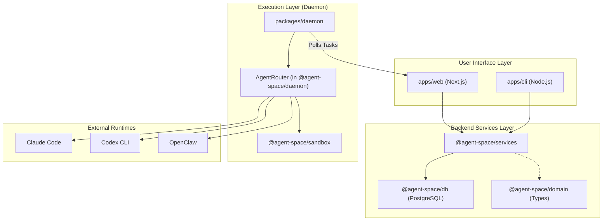
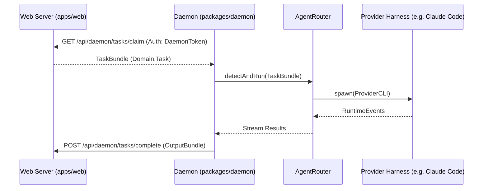

<!-- source: DeepWiki mcp.deepwiki.com · repo HKUDS/AgentSpace · page 1 AgentSpace Overview · fetched 2026-11-09 -->

# AgentSpace Overview

Relevant source files

The following files were used as context for generating this wiki page:

- [.gitignore](.gitignore)
- [LICENSE](LICENSE)
- [README.md](README.md)
- [README_ZH.md](README_ZH.md)
- [Target.md](Target.md)

AgentSpace is an agent-native collaborative workspace designed for **human + agent teams**. Unlike traditional agent frameworks that focus on individual chat sessions, AgentSpace treats agents as first-class teammates ("Digital Employees") with defined roles, owners, and organizational responsibilities [README.md:31-34]().

It provides a unified environment where work is managed through shared workspaces, channels, and tasks, governed by a robust permission and approval system [README.md:107-113]().

### Core Value Proposition

AgentSpace addresses the fragmentation of modern agent workflows by providing:
*   **Scheduling via AgentRouter**: Decouples agent identity from execution. The same agent can be routed to different runtimes (Claude Code, Codex, OpenClaw, Hermes) based on the task requirements [README.md:115-122]().
*   **Capability Sharing**: Transforms private agents into shared organizational assets that can be recruited or borrowed by other team members [README.md:127-133]().
*   **Structured Collaboration**: Moves work beyond chat into tasks, documents, and shared files, with human-in-the-loop checkpoints for high-stakes actions [README.md:137-145]().
*   **Governance & Audit**: Centralized control over credentials, document access, and tool execution with full audit trails [README.md:149-156]().

### High-Level Architecture

AgentSpace is built as a TypeScript monorepo using Turbo. It separates the presentation layer (Web/CLI) from the execution layer (Daemon) and the business logic (Services).

#### System Context Diagram
This diagram illustrates how the various components of the AgentSpace ecosystem interact, bridging the user-facing "Natural Language Space" with the underlying "Code Entity Space".

Sources: [README.md:72-78](), [README.md:202-218]()

### Monorepo Structure

The codebase is organized into `apps` and `packages` to ensure separation of concerns and reusability across the Web and CLI interfaces.

| Category | Path | Description |
| :--- | :--- | :--- |
| **Apps** | `apps/web` | The Next.js web application providing the workspace UI and Daemon API [README.md:63](). |
| | `apps/cli` | Command-line interface for managing workspaces and running agents locally [README.md:207](). |
| **Packages** | `packages/daemon` | The background process that executes agent tasks via `AgentRouter` [README.md:208](). |
| | `packages/services` | Core business logic: workspace management, permissions, and task lifecycle. |
| | `packages/db` | Database schema and repository layer for PostgreSQL [README.md:14](). |
| | `packages/domain` | Shared TypeScript types and interfaces used across the monorepo. |
| | `packages/sandbox` | Isolation layer for executing agent code safely. |

For a detailed breakdown of each package and its dependencies, see **[Monorepo Package Structure](#1.2)**.

### Execution Workflow

AgentSpace utilizes a "Pull-based" execution model. The web server acts as the coordinator, while one or more Daemons poll for work.

#### Task Execution Sequence
This diagram shows the relationship between the `Task` entity in the database and the execution flow within the `Daemon`.

Sources: [README.md:115-123](), [README.md:137-145]()

### Getting Started

AgentSpace can be deployed in two modes:
1.  **Platform (Cloud)**: Hosted version for immediate use [README.md:74]().
2.  **Self-hosted**: Full control over infrastructure, runtimes, and data [README.md:75]().

To begin development or local deployment, see **[Getting Started & Configuration](#1.1)**.

---
**Child Pages:**
*   **[Getting Started & Configuration](#1.1)**: Environment setup, database initialization, and deployment modes.
*   **[Monorepo Package Structure](#1.2)**: In-depth guide to the `apps/` and `packages/` directories.

---

