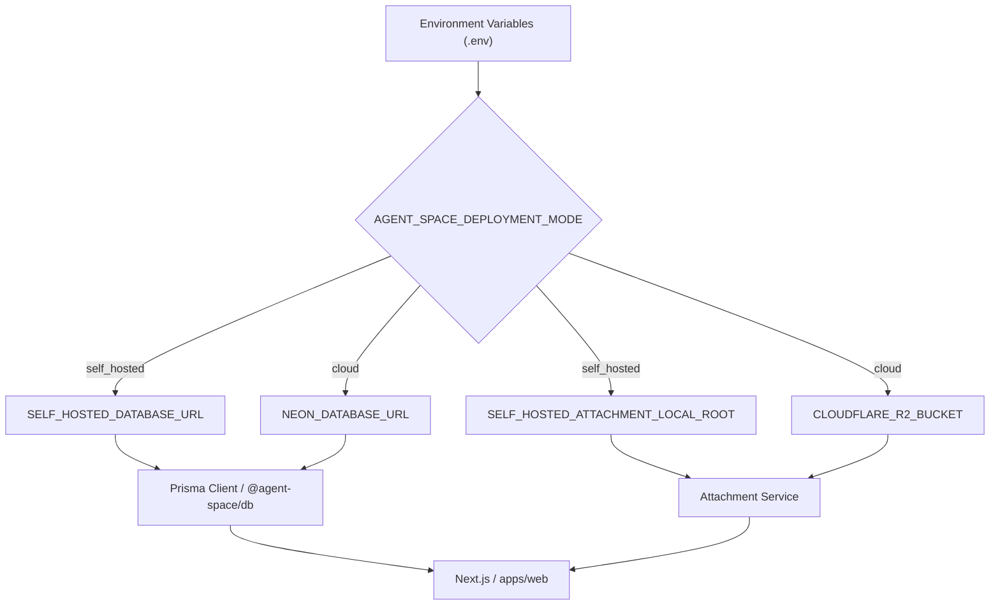
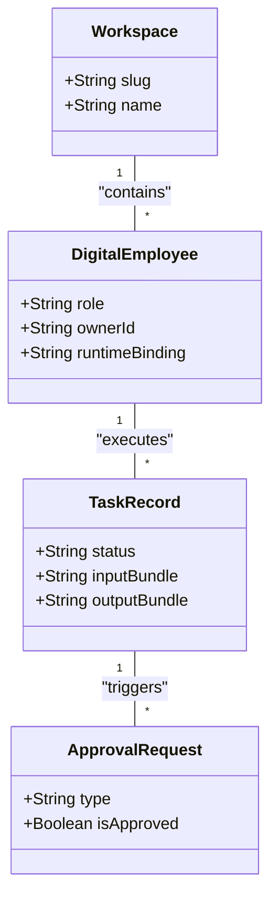
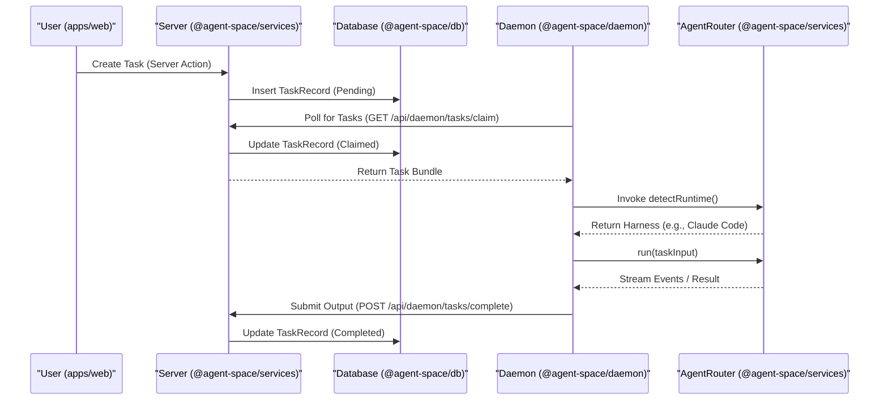

<!-- source: DeepWiki mcp.deepwiki.com · repo HKUDS/AgentSpace · page 1.1 Getting Started & Configuration · fetched 2026-11-09 -->

# Getting Started & Configuration

<details>
<summary>Relevant source files</summary>

The following files were used as context for generating this wiki page:

- [.env.example](.env.example)
- [README.md](README.md)
- [README_ZH.md](README_ZH.md)

</details>


AgentSpace is a collaborative workspace designed for human-agent teams. This page provides technical instructions for setting up the environment, configuring deployment modes, and initializing the system for first-run execution.

## Deployment Modes

AgentSpace supports two primary deployment modes, controlled by the `AGENT_SPACE_DEPLOYMENT_MODE` environment variable [.env.example:4-4](). The application resolves database and attachment storage settings based on this selection [.env.example:42-44]().

| Mode | Database | Attachment Storage | Use Case |
| :--- | :--- | :--- | :--- |
| `self_hosted` | Local PostgreSQL | Local Filesystem | Local development, private infrastructure. |
| `cloud` | Neon PostgreSQL | Cloudflare R2 | Production-scale, serverless deployments. |

### Configuration Flow Diagram
The following diagram illustrates how the system initializes its core resources based on the environment configuration.

"Configuration and Resource Initialization"

**Sources:** [.env.example:1-44]()

---

## Environment Variables

A `.env` file must be created in the root directory. Use `.env.example` as a template [.env.example:1-82]().

### Core System Settings
*   `AGENT_SPACE_APP_URL`: The base URL for the web application (e.g., `http://127.0.0.1:1455`) [.env.example:56-56]().
*   `NEXT_SERVER_ACTIONS_ENCRYPTION_KEY`: A base64 encoded 32-byte key required for Next.js Server Actions in production [.env.example:58-62]().
*   `AGENT_SPACE_OAUTH_STATE_SECRET`: A long random string used to sign OAuth state cookies [.env.example:65-65]().

### Database Configuration
*   **Self-Hosted**: Requires `SELF_HOSTED_DATABASE_URL` and `SELF_HOSTED_DATABASE_DIRECT_URL` (typically the same for local Postgres) [.env.example:7-8]().
*   **Cloud**: Requires Neon-specific variables including `NEON_DATABASE_URL`, `NEON_DATABASE_USER`, and `NEON_DATABASE_POOLER_HOST` [.env.example:16-21]().

### Storage Configuration
*   **Self-Hosted**: `SELF_HOSTED_ATTACHMENT_LOCAL_ROOT` defines the directory where workspace files are stored [.env.example:11-11]().
*   **Cloud**: Requires Cloudflare R2 credentials including `CLOUDFLARE_R2_ACCESS_KEY_ID`, `CLOUDFLARE_R2_SECRET_ACCESS_KEY`, and `CLOUDFLARE_R2_BUCKET` [.env.example:32-40]().
*   `ATTACHMENT_SIGNED_URL_TTL_SECONDS`: Expiry time for generated download/upload links (default: 300) [.env.example:47-47]().

### Authentication & Integrations
*   **Google Login**: Set `AGENT_SPACE_GOOGLE_CLIENT_ID` and `SECRET` to enable user authentication via Google [.env.example:68-70]().
*   **Google Workspace**: To allow agents to access Sheets/Docs, configure `AGENT_SPACE_GOOGLE_WORKSPACE_CLIENT_ID` and the `TOKEN_ENCRYPTION_KEY` [.env.example:74-79]().

**Sources:** [.env.example:1-82]()

---

## Database Initialization

AgentSpace requires PostgreSQL 16 or higher [README.md:14-14](). The initialization process involves installing dependencies, generating the Prisma client, and running migrations.

### Setup Steps
1.  **Install Dependencies**: Use `npm install` at the root.
2.  **Initialize**: Run the setup script which prepares the environment and database [README.md:63-63]().
    ```bash
    npm run setup
    ```
3.  **Start Development Server**:
    ```bash
    npm run dev:web
    ```

### Data Model Mapping
This diagram bridges the "Natural Language Space" of workspace concepts to the "Code Entity Space" found in `@agent-space/db`.

"Workspace Entity Mapping"

**Sources:** [README.md:55-60](), [README.md:115-158]()

---

## First-Run Steps & Daemon Connectivity

Once the web application is running, the system requires an execution environment (the Daemon) to process agent tasks.

### Path A: Local Execution
The simplest way to start is running the web app and daemon locally. The web app serves the UI and API, while the daemon polls for tasks.
*   **Web**: `npm run dev:web` [README.md:63-63]()
*   **Daemon**: `npm run dev:daemon` (run in a separate terminal)

### Path B: Remote Daemon Setup
For production or distributed execution, a daemon can be installed on a remote host.
1.  Navigate to **Settings > Daemons** in the Web UI.
2.  Generate a **Daemon Token**.
3.  Run the provided installation script on the remote machine to register the daemon with the server [README.md:208-208]().

### Task Execution Flow
The following diagram maps the lifecycle of a task from the web UI to the code entities in the daemon.

"Task Lifecycle and Daemon Interaction"

**Sources:** [README.md:115-123](), [README.md:142-145](), [.env.example:56-56]()

**Sources:**
*   [.env.example:1-82]()
*   [README.md:1-228]()
*   [README_ZH.md:1-228]()

---

