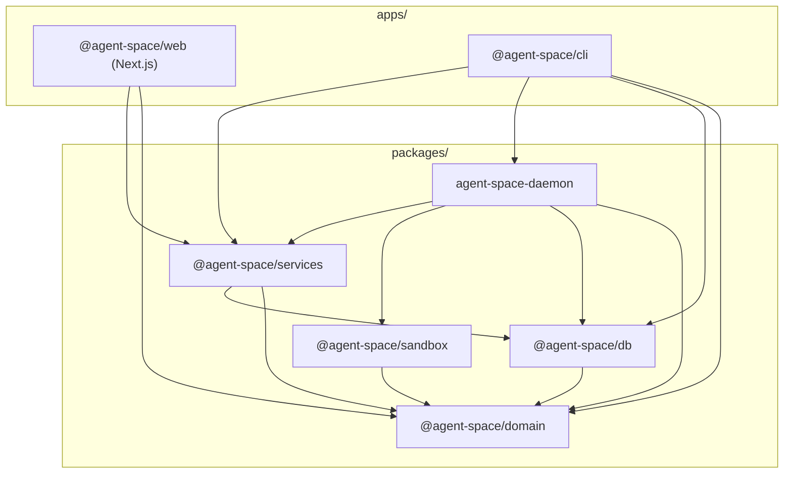
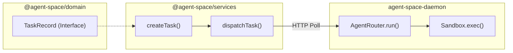
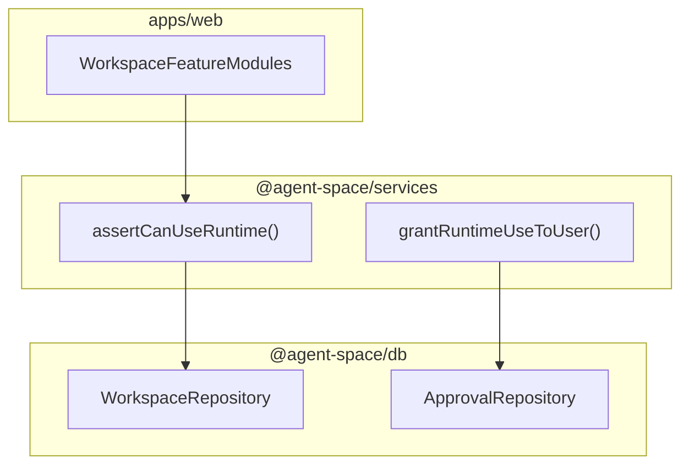

<!-- source: DeepWiki mcp.deepwiki.com · repo HKUDS/AgentSpace · page 1.2 Monorepo Package Structure · fetched 2026-11-09 -->

# Monorepo Package Structure

Relevant source files

The following files were used as context for generating this wiki page:

- [README.md](README.md)
- [apps/cli/package-lock.json](apps/cli/package-lock.json)
- [apps/cli/package.json](apps/cli/package.json)
- [apps/cli/tsconfig.json](apps/cli/tsconfig.json)

This page provides a detailed technical map of the AgentSpace monorepo. AgentSpace is organized as a TypeScript monorepo using file-based dependencies to manage relationships between the web application, CLI, and core logic packages.

## Monorepo Overview

The repository is divided into two main categories: `apps/` (end-user entry points) and `packages/` (reusable business logic, data models, and infrastructure abstractions).

### Dependency Graph

The following diagram illustrates the internal dependency flow between packages.

**Internal Package Dependencies**

**Sources:** [apps/cli/package.json:14-19](), [apps/cli/package-lock.json:25-46](), [apps/cli/package-lock.json:66-75]()

---

## Core Packages

### 1. `@agent-space/domain`
The foundational package containing TypeScript interfaces, enums, and constants shared across the entire stack. It defines the "language" of the system.
*   **Role:** Type definitions for Workspaces, Tasks, Digital Employees, and API contracts.
*   **Key Entities:** `WorkspaceState`, `TaskRecord`, `ApprovalRequest`.
*   **Sources:** [apps/cli/tsconfig.json:13-15]()

### 2. `@agent-space/db`
The data access layer. It abstracts PostgreSQL interactions using the `pg` driver.
*   **Role:** Repository functions for 50+ tables, migration management, and synchronous worker-thread query execution.
*   **Implementation:** Provides direct access to the database for the CLI and Daemon, while the Web app typically accesses it via `@agent-space/services`.
*   **Sources:** [apps/cli/package-lock.json:47-60]()

### 3. `@agent-space/services`
The business logic layer.
*   **Role:** Implements complex workflows such as employee lifecycle management, task dispatching, and permission checks (`assertCanUse*`).
*   **Data Flow:** Consumes `@agent-space/db` to persist state and `@agent-space/domain` for type safety. It is the primary dependency for both the Web and CLI apps.
*   **Sources:** [apps/cli/package-lock.json:66-75]()

### 4. `@agent-space/sandbox`
The execution isolation layer.
*   **Role:** Defines the `Sandbox` interface (methods: `readFile`, `writeFile`, `exec`, `snapshot`) to abstract where code runs.
*   **Implementations:** Includes `LocalSandbox` (host filesystem) and `CubeSandbox` (isolated containers).
*   **Sources:** [apps/cli/tsconfig.json:20-20]()

### 5. `agent-space-daemon`
The agent execution engine.
*   **Role:** A background process that polls the server for tasks, manages runtimes via `AgentRouter`, and reports results.
*   **Key Components:** `AgentRouter` (harness normalization for Claude Code, Codex, etc.) and `DaemonClient`.
*   **Sources:** [apps/cli/package-lock.json:25-46](), [apps/cli/tsconfig.json:21-23]()

---

## Application Entry Points

### 1. `apps/web`
A Next.js App Router application providing the collaborative UI.
*   **Workspace Shell:** Renders the multi-module UI at `/w/[workspaceSlug]`.
*   **Daemon API:** Hosts the HTTP endpoints that remote daemons poll (e.g., task claim, runtime approvals).
*   **Sources:** [README.md:144-147]()

### 2. `apps/cli`
The developer and administrative toolset.
*   **Role:** Provides commands for workspace management, database migrations, and local daemon control.
*   **Binary:** Exposed as `agent-space`.
*   **Sources:** [apps/cli/package.json:7-11]()

---

## Mapping Logic to Code Entities

The following diagrams bridge high-level system concepts to specific code structures.

### Task Execution Flow (Logic to Code)
This diagram shows how a "Task" moves from the Domain definition through the Service logic into the Daemon for execution.

**Sources:** [README.md:115-123](), [apps/cli/tsconfig.json:13-23]()

### Workspace Governance (Logic to Code)
This diagram maps the governance concepts to the permission guards and repository functions.

**Sources:** [README.md:130-134](), [apps/cli/package-lock.json:11-14]()

---

