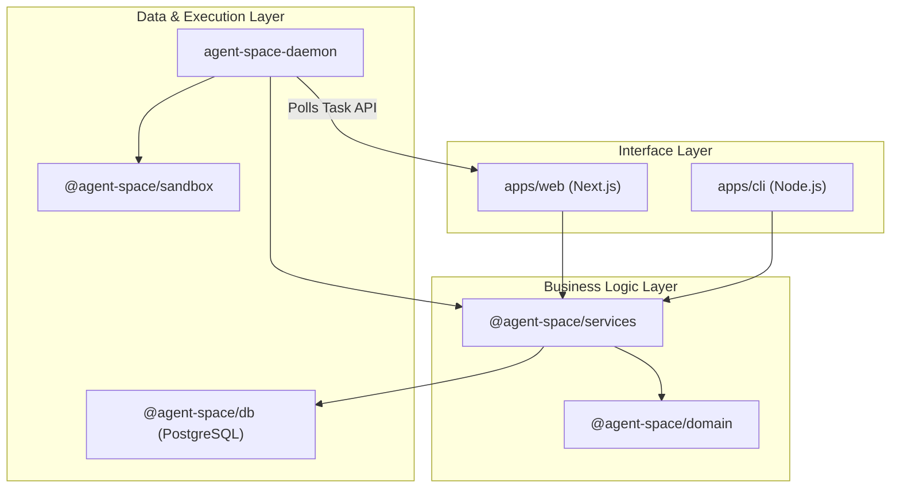
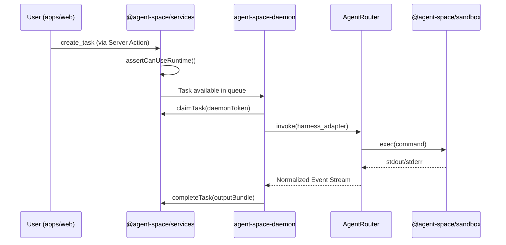

<!-- source: DeepWiki mcp.deepwiki.com · repo HKUDS/AgentSpace · page 2 Core Architecture · fetched 2026-11-09 -->

# Core Architecture

Relevant source files

The following files were used as context for generating this wiki page:

- [README.md](README.md)
- [README_ZH.md](README_ZH.md)
- [apps/cli/package-lock.json](apps/cli/package-lock.json)

AgentSpace is built as a modular monorepo that separates business logic, data persistence, and agent execution into distinct layers. This architecture allows the system to support multiple interfaces (Web and CLI) while maintaining a unified governance and execution model.

## System Overview

The architecture is designed to bridge the gap between human collaboration (Web/CLI) and autonomous agent execution (Daemon).

### High-Level Component Interaction

The diagram below illustrates how the major packages and applications interact. The `services` layer acts as the central orchestrator, utilized by both the Web and CLI apps, while the `daemon` operates as a detached execution worker.

**AgentSpace Component Map**

**Sources:** [apps/cli/package-lock.json:10-15](), [README.md:107-113]()

---

## Layered Subsystems

### Domain & Data Models (`@agent-space/domain`)
The foundation of the system is the `@agent-space/domain` package. It defines the "Language of the System," including shared TypeScript interfaces for workspaces, task records, and agent roles. By centralizing these types, AgentSpace ensures that a "Task" or an "Approval" has the same structure whether it is being rendered in the React UI or processed by the Daemon.

For details, see [Domain & Data Models](#2.1).

**Sources:** [apps/cli/package-lock.json:61-65]()

### Database Layer (`@agent-space/db`)
The `@agent-space/db` package manages the PostgreSQL schema and provides a repository-pattern interface for data access. It handles the persistence of over 50 tables, covering everything from digital employee profiles to granular audit trails of agent actions.

For details, see [Database Layer (@agent-space/db)](#2.2).

**Sources:** [apps/cli/package-lock.json:47-53]()

### Services Layer (`@agent-space/services`)
This is the "Brain" of the application. It contains the business logic for:
- **Employee Lifecycle**: Recruiting, transferring, and managing digital employees.
- **Task Dispatch**: Creating and routing tasks to the appropriate execution queue.
- **Governance**: Managing permissions and the human-in-the-loop approval queue.

Both `apps/web` and `apps/cli` depend on this package to ensure consistent behavior across different user interfaces.

For details, see [Services Layer (@agent-space/services)](#2.3).

**Sources:** [apps/cli/package-lock.json:66-75]()

### Sandbox Abstraction (`@agent-space/sandbox`)
The sandbox layer provides execution isolation. It defines a standard interface for interacting with the environment where agents run (e.g., reading/writing files, executing shell commands). This allows AgentSpace to support different execution environments, such as a `LocalSandbox` for development or a `CubeSandbox` for secure, isolated production runs.

For details, see [Sandbox Abstraction (@agent-space/sandbox)](#2.4).

**Sources:** [apps/cli/package-lock.json:31-31]()

---

## Execution Pipeline

The execution of agent work is decoupled from the web server. The `agent-space-daemon` is a standalone process that communicates with the server via the **Daemon API Routes**.

**Code Entity Mapping: Task Lifecycle**

### Key Execution Components
| Component | Code Entity / Path | Role |
| :--- | :--- | :--- |
| **Daemon** | `agent-space-daemon` | Polls for tasks, manages local runtime state. |
| **Router** | `agent-router.js` | Normalizes different agent harnesses (Claude Code, Codex, etc.). |
| **Sandbox** | `packages/sandbox` | Provides the isolated filesystem and shell for the agent. |
| **API** | `/api/daemon` | The HTTP bridge between the daemon and the services layer. |

**Sources:** [README.md:115-125](), [apps/cli/package-lock.json:34-38]()

---

