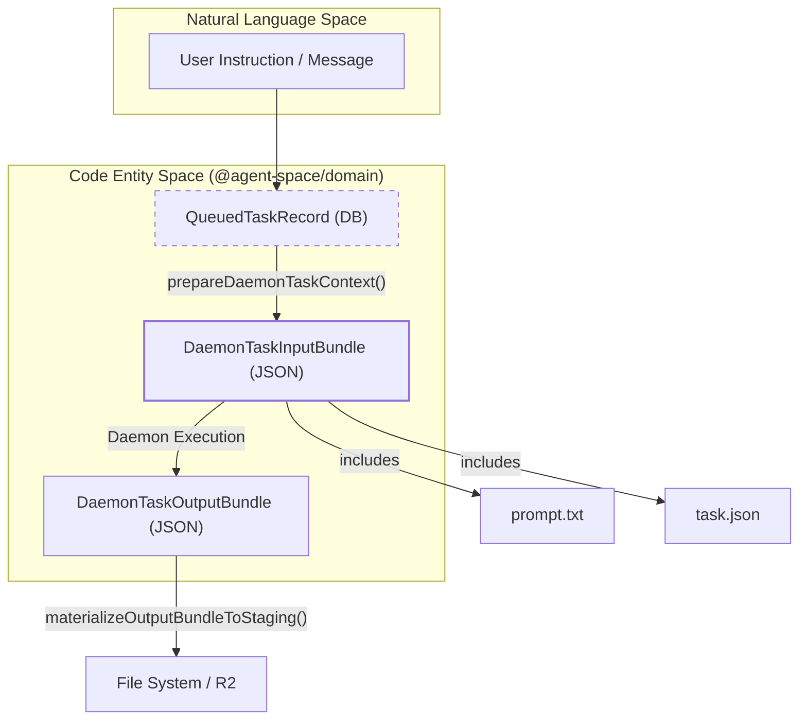
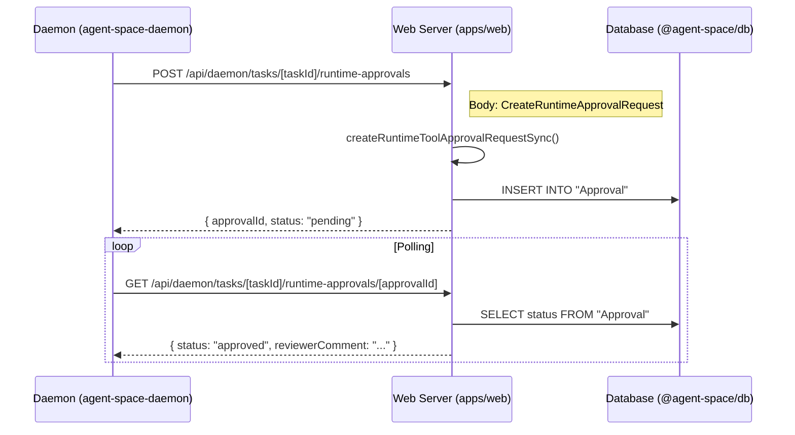

<!-- source: DeepWiki mcp.deepwiki.com · repo HKUDS/AgentSpace · page 2.1 Domain & Data Models · fetched 2026-11-09 -->

# Domain & Data Models

Relevant source files

The following files were used as context for generating this wiki page:

- [README.md](README.md)
- [apps/web/app/api/daemon/tasks/[taskId]/input-bundle/route.ts](apps/web/app/api/daemon/tasks/[taskId]/input-bundle/route.ts)
- [apps/web/app/api/daemon/tasks/[taskId]/output-bundle/route.ts](apps/web/app/api/daemon/tasks/[taskId]/output-bundle/route.ts)
- [apps/web/app/api/daemon/tasks/[taskId]/runtime-approvals/[approvalId]/route.ts](apps/web/app/api/daemon/tasks/[taskId]/runtime-approvals/[approvalId]/route.ts)
- [apps/web/app/api/daemon/tasks/[taskId]/runtime-approvals/route.ts](apps/web/app/api/daemon/tasks/[taskId]/runtime-approvals/route.ts)

The `@agent-space/domain` package serves as the single source of truth for the system's shared types and data contracts. It defines the structure of the collaborative workspace, the lifecycle of agent tasks, and the communication protocols between the **Web Server** and the **Daemon**.

## Workspace & Collaboration Models

The core of AgentSpace is the `WorkspaceState`, which represents a snapshot of the organizational context. This includes "Digital Employees" (agents), their owners, and their current readiness status.

### Workspace State Structure
The `WorkspaceState` is a computed view of the workspace, used extensively by the UI and the services layer to resolve permissions and agent identities [apps/web/app/api/daemon/tasks/[taskId]/input-bundle/route.ts:56-57]().

| Entity | Description |
| :--- | :--- |
| `ActiveEmployee` | An agent profile containing `name`, `owner`, `skills`, and `runtimeBinding`. |
| `ChannelRecord` | A communication context (Direct or Group) where humans and agents interact. |
| `AgentDocumentContext` | The association between an agent and specific documents/knowledge bases [apps/web/app/api/daemon/tasks/[taskId]/input-bundle/route.ts:74-78](). |

**Sources:** [apps/web/app/api/daemon/tasks/[taskId]/input-bundle/route.ts:21-28](), [apps/web/app/api/daemon/tasks/[taskId]/input-bundle/route.ts:56-62]()

---

## Task & Execution Models

Tasks are the primary unit of work. They transition through a lifecycle from `Queued` to `Running`, and finally to `Completed` or `Failed`.

### Task Lifecycle Data Flow
When a task is picked up by a daemon, it moves from a database record (`QueuedTaskRecord`) to a `DaemonTaskInputBundle`.

#### 1. Input Bundle (`DaemonTaskInputBundle`)
The input bundle is a self-contained JSON payload that the daemon uses to initialize the agent's environment. It contains:
*   **Prompt**: The system and user instructions for the agent [apps/web/app/api/daemon/tasks/[taskId]/input-bundle/route.ts:152-154]().
*   **Metadata**: Information about Google Workspace tokens, runtime capabilities, and session history [apps/web/app/api/daemon/tasks/[taskId]/input-bundle/route.ts:122-149]().
*   **Files**: Base64 encoded files (like `task.json` and `prompt.txt`) required for the execution sandbox [apps/web/app/api/daemon/tasks/[taskId]/input-bundle/route.ts:150-173]().

#### 2. Output Bundle (`DaemonTaskOutputBundle`)
Upon completion, the daemon submits an output bundle back to the server via `POST /api/daemon/tasks/[taskId]/output-bundle` [apps/web/app/api/daemon/tasks/[taskId]/output-bundle/route.ts:11-14]().
*   **Artifacts**: Files generated during the task (e.g., code, reports, images) [apps/web/app/api/daemon/tasks/[taskId]/output-bundle/route.ts:39-45]().
*   **Status**: Final execution state and logs.

### Diagram: Task Data Transformation
This diagram bridges the **Natural Language Space** (Task Prompt) to the **Code Entity Space** (Data Models).

**Sources:** [apps/web/app/api/daemon/tasks/[taskId]/input-bundle/route.ts:116-174](), [apps/web/app/api/daemon/tasks/[taskId]/output-bundle/route.ts:26-32]()

---

## Governance & Approval Models

AgentSpace implements a "Human-in-the-loop" model for sensitive operations. These are represented by the `ApprovalRequest` domain type.

### Runtime Approvals
When an agent attempts a restricted action (e.g., a tool call in Claude Code), the daemon pauses and creates a `CreateRuntimeApprovalRequest` [apps/web/app/api/daemon/tasks/[taskId]/runtime-approvals/route.ts:23-24]().

| Field | Description |
| :--- | :--- |
| `approvalId` | Unique identifier for the request [apps/web/app/api/daemon/tasks/[taskId]/runtime-approvals/route.ts:45](). |
| `status` | Current state: `pending`, `approved`, or `rejected` [apps/web/app/api/daemon/tasks/[taskId]/runtime-approvals/[approvalId]/route.ts:30](). |
| `toolName` | The name of the tool requiring approval [apps/web/app/api/daemon/tasks/[taskId]/runtime-approvals/route.ts:35](). |
| `contentPreview` | A snippet of the data or action for the human reviewer [apps/web/app/api/daemon/tasks/[taskId]/runtime-approvals/route.ts:37](). |

### Diagram: Approval Request Flow
This diagram shows how the system bridges the **Daemon API** to the **Domain Models**.

**Sources:** [apps/web/app/api/daemon/tasks/[taskId]/runtime-approvals/route.ts:8-41](), [apps/web/app/api/daemon/tasks/[taskId]/runtime-approvals/[approvalId]/route.ts:7-34]()

---

## Daemon API Contracts

The communication between the Web Server and the Daemon is strictly typed to ensure compatibility across different deployment modes.

### Key API Routes & Models

1.  **Input Bundle Retrieval**: `GET /api/daemon/tasks/[taskId]/input-bundle`
    *   Returns: `DaemonTaskInputBundle`
    *   Logic: Resolves agent profiles, Google Workspace tokens, and document contexts [apps/web/app/api/daemon/tasks/[taskId]/input-bundle/route.ts:36-116]().
2.  **Output Bundle Submission**: `POST /api/daemon/tasks/[taskId]/output-bundle`
    *   Accepts: `DaemonTaskOutputBundle`
    *   Logic: Materializes files to staging and records `artifact_detected` events [apps/web/app/api/daemon/tasks/[taskId]/output-bundle/route.ts:32-43]().
3.  **Approval Management**: `POST /api/daemon/tasks/[taskId]/runtime-approvals`
    *   Accepts: `CreateRuntimeApprovalRequest`
    *   Logic: Triggers notifications in the workspace channel if a channel is associated with the task [apps/web/app/api/daemon/tasks/[taskId]/runtime-approvals/route.ts:31-41]().

**Sources:** [apps/web/app/api/daemon/tasks/[taskId]/input-bundle/route.ts:20-21](), [apps/web/app/api/daemon/tasks/[taskId]/output-bundle/route.ts:2-6](), [apps/web/app/api/daemon/tasks/[taskId]/runtime-approvals/route.ts:1-2]()

---

