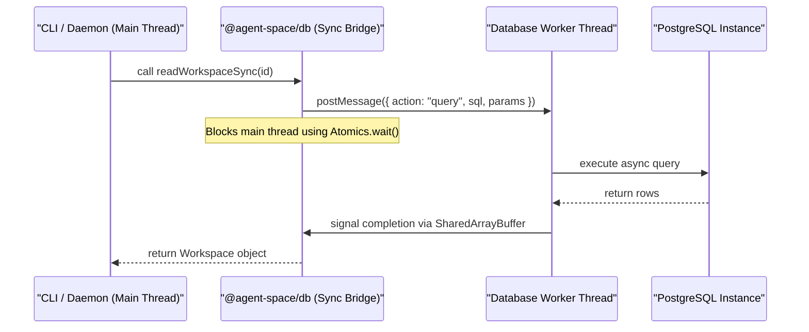
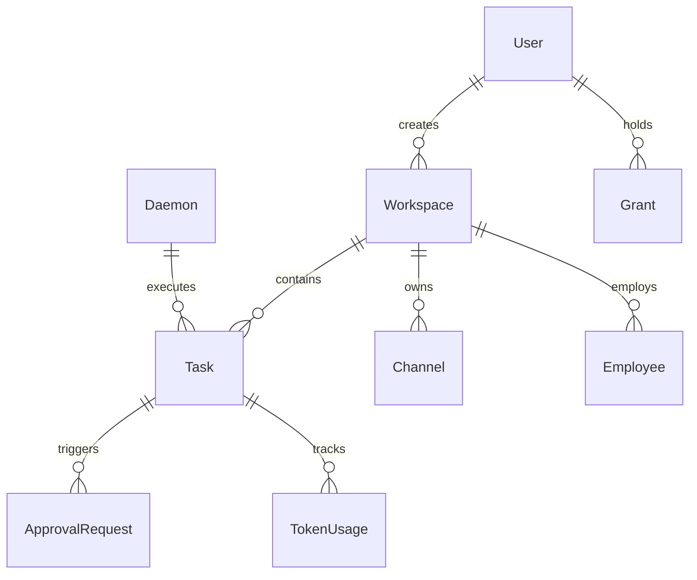

<!-- source: DeepWiki mcp.deepwiki.com · repo HKUDS/AgentSpace · page 2.2 Database Layer (@agent-space/db) · fetched 2026-11-09 -->

# Database Layer (@agent-space/db)

<details>
<summary>Relevant source files</summary>

The following files were used as context for generating this wiki page:

- [.env.example](.env.example)
- [apps/cli/src/commands/db.test.ts](apps/cli/src/commands/db.test.ts)
- [apps/cli/src/commands/db.ts](apps/cli/src/commands/db.ts)

</details>


The `@agent-space/db` package serves as the persistence engine for the entire AgentSpace ecosystem. It manages a PostgreSQL schema comprising over 50 tables, handles database migrations, and implements a unique synchronous query model designed to bridge the gap between asynchronous database drivers and synchronous CLI/Worker environments.

## Architecture & Query Model

AgentSpace utilizes a **synchronous worker-thread query model**. While modern Node.js database drivers (like `pg` or `kysely`) are inherently asynchronous, the AgentSpace CLI and certain daemon internal processes require synchronous access to the database state to simplify control flow and state management.

### Synchronous Bridge Implementation
The database layer exposes `*Sync` functions (e.g., `readWorkspaceSync`, `getDatabaseStatusSync`) by spawning a persistent worker thread that manages the actual asynchronous connection pool. Communication between the main thread and the database worker is handled via `SharedArrayBuffer` and atomic operations to block execution until the result is returned.

### Data Flow: Sync Query Path
The following diagram illustrates how a request from the CLI or Daemon reaches the PostgreSQL instance through the synchronous bridge.

**Diagram: Synchronous Database Access Flow**

Sources: [apps/cli/src/commands/db.ts:1-4](), [apps/cli/src/commands/db.test.ts:6-11]()

## Storage Strategy & Paths

AgentSpace distinguishes between structured relational data (PostgreSQL) and unstructured storage artifacts (files, logs, and channel histories). The storage configuration is determined by the `AGENT_SPACE_DEPLOYMENT_MODE` environment variable.

### Deployment Modes
| Mode | Database | Attachment Storage |
| :--- | :--- | :--- |
| `self_hosted` | Local PostgreSQL | Local Filesystem |
| `cloud` | Neon (Serverless PG) | Cloudflare R2 (S3-compatible) |

### Key Storage Paths (Self-Hosted)
When running in `self_hosted` mode, the system uses specific directory structures for persistence:
*   **Workspaces:** `${SELF_HOSTED_ATTACHMENT_LOCAL_ROOT}/workspaces`
*   **Daemon State:** `${SELF_HOSTED_ATTACHMENT_LOCAL_ROOT}/daemon`
*   **Channel History:** Managed via `getWorkspaceChannelHistoryDirPath` to store markdown-based message logs.

Sources: [.env.example:1-11](), [apps/cli/src/commands/db.test.ts:7-11]()

## Core Repositories & Functions

The database layer provides a comprehensive set of repository functions categorized by domain entities. These functions are the primary interface for the `@agent-space/services` layer.

### Workspace & Task Management
These functions manage the lifecycle of collaborative environments and the execution units (tasks) assigned to agents.
*   `createWorkspaceSync(data)`: Initializes a new workspace record and associated metadata [apps/cli/src/commands/db.test.ts:35-40]().
*   `readWorkspaceSync(idOrSlug)`: Retrieves workspace details by its unique identifier or URL slug [apps/cli/src/commands/db.ts:31-34]().
*   `getDatabaseStatusSync()`: Returns diagnostic information about the database connection and migration state [apps/cli/src/commands/db.ts:11-14]().

### Storage & Maintenance Operations
The database layer includes utilities for scanning and purging storage to maintain consistency between the relational schema and the filesystem/R2.
*   **Storage Scanning:** `scanStorageArtifactsSync()` identifies "orphans"—files that exist on disk but have no corresponding database record (e.g., `orphan-workspace`, `orphan-channel-history`) [apps/cli/src/commands/db.test.ts:60-65]().
*   **Workspace Purging:** `purgeWorkspaceStorageSync(workspaceId)` performs a hard delete of all relational data and associated files for a specific workspace [apps/cli/src/commands/db.ts:39-40]().

**Diagram: Entity Relationship Overview**

Sources: [apps/cli/src/commands/db.test.ts:35-40](), [apps/cli/src/commands/db.ts:21-42]()

## Database Management CLI

The `agent-space db` command provides a direct interface to the database layer for administrative tasks.

### Command Reference
| Subcommand | Purpose | Implementation |
| :--- | :--- | :--- |
| `status` | Checks DB connectivity and migration version. | `getDatabaseStatusSync()` |
| `storage-scan` | Detects orphaned files in workspace and daemon directories. | `scanStorageArtifactsSync()` |
| `workspace-purge` | Irreversibly deletes a workspace and all its files. | `purgeWorkspaceStorageSync()` |

### Example: Purging a Workspace
The purge operation is a two-step process: first, it verifies the workspace exists in the database using `readWorkspaceSync`, then it invokes the service-level purge which cleans up both the database and the physical storage root.

```typescript
// Internal logic in apps/cli/src/commands/db.ts
const workspace = readWorkspaceSync(workspaceIdentifier.trim());
if (workspace) {
  purgeWorkspaceStorageSync(workspace.id);
}
```
Sources: [apps/cli/src/commands/db.ts:21-42](), [apps/cli/src/commands/db.test.ts:68-101]()

## Configuration & Environment

The database layer initializes its connection pool based on the following environment variables:

*   **`SELF_HOSTED_DATABASE_URL`**: Primary connection string for local PostgreSQL.
*   **`NEON_DATABASE_URL`**: Connection string for Neon serverless PostgreSQL (used in `cloud` mode).
*   **`AGENT_SPACE_DEPLOYMENT_MODE`**: Determines whether to use local paths or cloud-native storage.
*   **`ATTACHMENT_LOCAL_ROOT`**: The base directory for file storage when not using R2.

Sources: [.env.example:4-21](), [.env.example:51-53]()

---

