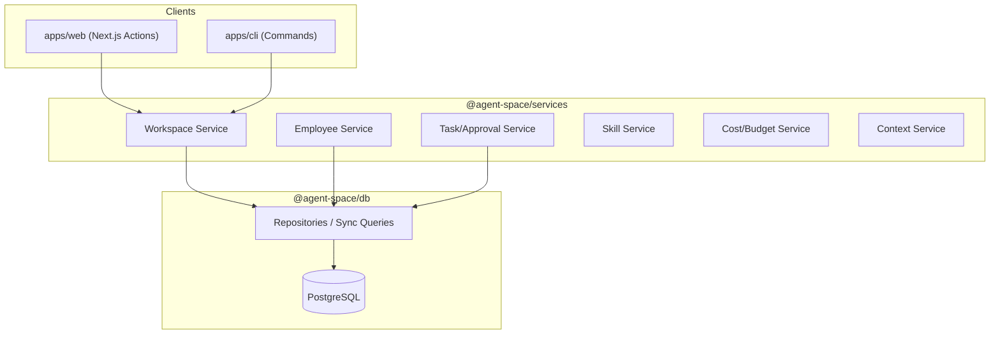
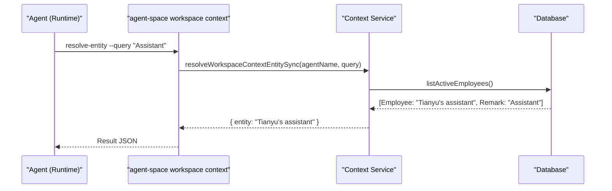

<!-- source: DeepWiki mcp.deepwiki.com · repo HKUDS/AgentSpace · page 2.3 Services Layer (@agent-space/services) · fetched 2026-11-09 -->

# Services Layer (@agent-space/services)

Relevant source files

The following files were used as context for generating this wiki page:

- [apps/cli/src/commands/cost.test.ts](apps/cli/src/commands/cost.test.ts)
- [apps/cli/src/commands/cost.ts](apps/cli/src/commands/cost.ts)
- [apps/cli/src/commands/material.ts](apps/cli/src/commands/material.ts)
- [apps/cli/src/commands/skill.ts](apps/cli/src/commands/skill.ts)
- [apps/cli/src/commands/task.ts](apps/cli/src/commands/task.ts)
- [apps/cli/src/commands/workspace.test.ts](apps/cli/src/commands/workspace.test.ts)
- [apps/cli/src/commands/workspace.ts](apps/cli/src/commands/workspace.ts)

The Services Layer (`@agent-space/services`) acts as the central business logic orchestrator for AgentSpace. It sits between the data access layer (`@agent-space/db`) and the consumption interfaces (Web and CLI). It is responsible for enforcing workspace rules, managing the lifecycle of "Digital Employees" (agents), handling task dispatching, and providing a unified context for agents during execution.

## Core Responsibilities

The services layer is partitioned into several functional domains:
*   **Workspace Management**: Initialization, state resets, and summary reporting.
*   **Employee Lifecycle**: Creating, updating, and binding agents to specific runtimes.
*   **Task & Approval Workflow**: Enqueuing tasks, managing status transitions, and handling human-in-the-loop approvals.
*   **Knowledge & Skills**: Managing materials (knowledge base) and skill imports/exports.
*   **Cost & Budgeting**: Tracking token usage and enforcing USD limits across workspaces and agents.
*   **Runtime Context**: Providing agents with a "view" of the workspace (channels, entities, messages) during task execution.

## Architectural Data Flow

The following diagram illustrates how the Services Layer mediates between the storage layer and the execution clients.

### Service Layer Orchestration

**Sources:** [apps/cli/src/commands/workspace.ts:1-10](), [apps/cli/src/commands/skill.ts:1-12](), [apps/cli/src/commands/cost.ts:9-15]()

## Key Service Modules

### 1. Workspace & Employee Management
The service handles the transition from a fresh installation to a functional organization. `initializeOrganizationSync` sets up the primary owner, default channels, and installs built-in skills.

*   **`initializeOrganizationSync`**: Creates the organization, owner, and default skills like `workspace-context`. [apps/cli/src/commands/workspace.test.ts:52-63]()
*   **`createEmployeeSync`**: Provisions a new digital employee. [apps/cli/src/commands/cost.test.ts:75-75]()
*   **`bindEmployeeRuntimeSync`**: Links an employee to a specific daemon runtime, enabling them to execute tasks. [apps/cli/src/commands/cost.test.ts:85-85]()

### 2. Task Execution & Dispatch
Tasks are created via `createTaskSync`. This service interacts with the DB to enqueue a "Native Task" which the daemon subsequently claims.

*   **`createTaskSync`**: Validates parameters and persists a new task. [apps/cli/src/commands/task.ts:46-51]()
*   **`updateTaskStatusSync`**: Manages the state machine for tasks (`todo`, `in_progress`, `blocked`, `done`). [apps/cli/src/commands/task.ts:102-102]()

### 3. Cost Control & Budgets
This module provides logic to prevent runaway AI costs. It supports workspace-wide, agent-specific, or channel-specific budgets.

| Function | Purpose |
| :--- | :--- |
| `listBudgetsWithSpentSync` | Returns budgets alongside real-time spent USD. |
| `upsertBudgetSync` | Creates or updates a budget limit with actions (warn/pause). |
| `checkAllBudgetsForAgentSync` | Logic used before task execution to ensure limits aren't exceeded. |

**Sources:** [apps/cli/src/commands/cost.ts:9-15](), [apps/cli/src/commands/cost.test.ts:105-113]()

### 4. Skill & Knowledge Management
Skills are portable units of capability (often containing code or prompts). The service layer handles their lifecycle and synchronization.

*   **`importWorkspaceSkillFromUrl`**: Downloads and installs skills from remote repositories. [apps/cli/src/commands/skill.ts:142-146]()
*   **`exportWorkspaceSkillsArchiveSync`**: Packages skills into a ZIP for sharing. [apps/cli/src/commands/skill.ts:102-105]()
*   **`addMaterialSync`**: Ingests raw data into the workspace knowledge base. [apps/cli/src/commands/material.ts:30-30]()

## Workspace Context (Agent Runtime View)

When an agent runs a task, it uses the "Workspace Context" services to understand its environment. This bridges the gap between raw database records and the entities the agent perceives.

### Context Resolution Flow

**Sources:** [apps/cli/src/commands/workspace.ts:95-103](), [apps/cli/src/commands/workspace.test.ts:30-50]()

### Environment Variables for Context
The context service relies on specific environment variables injected into the agent's sandbox to identify the caller:
*   `AGENT_SPACE_CONTEXT_AGENT_NAME`: The ID/Name of the agent executing the code. [apps/cli/src/commands/workspace.ts:15-15]()
*   `AGENT_SPACE_CONTEXT_TASK_ID`: The unique ID of the task currently being processed. [apps/cli/src/commands/workspace.ts:16-16]()

## Entity Mapping: Code to Logic

| Natural Language Concept | Code Entity (Service Layer) | Implementation File |
| :--- | :--- | :--- |
| **Digital Employee** | `ActiveEmployee` | `@agent-space/domain/workspace` |
| **Skill Import** | `importWorkspaceSkillFromUrl` | `packages/services/src/skill.ts` |
| **Budget Enforcement** | `checkAllBudgetsForAgentSync` | `packages/services/src/cost.ts` |
| **Context Search** | `searchWorkspaceContextMessagesSync` | `packages/services/src/context.ts` |
| **Initialization** | `initializeOrganizationSync` | `packages/services/src/workspace.ts` |

**Sources:** [apps/cli/src/commands/workspace.ts:1-10](), [apps/cli/src/commands/skill.ts:1-12](), [apps/cli/src/commands/workspace.test.ts:6-16]()

---

