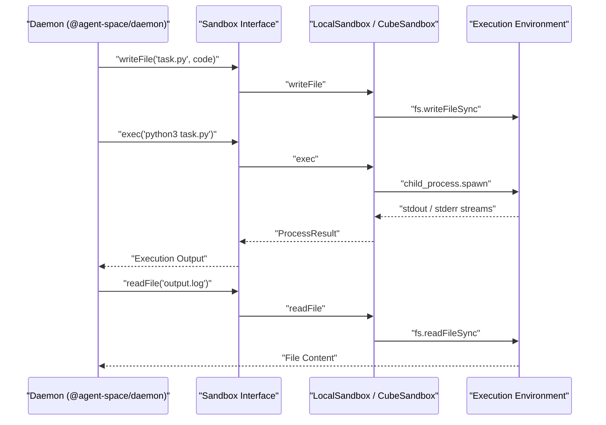
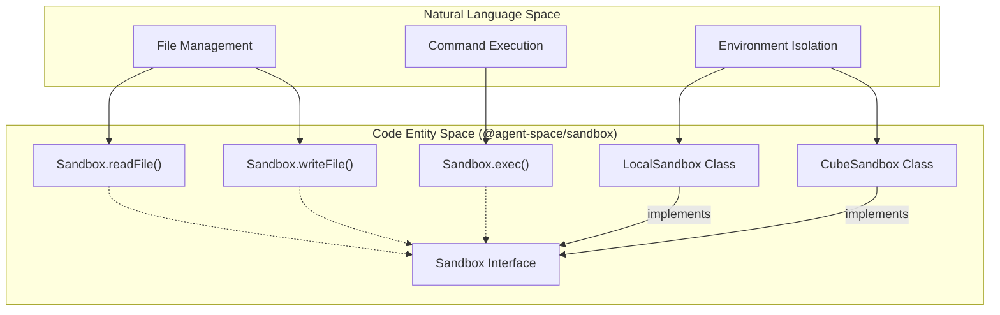
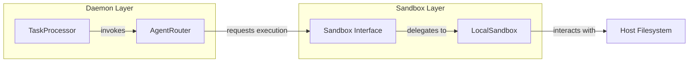

<!-- source: DeepWiki mcp.deepwiki.com · repo HKUDS/AgentSpace · page 2.4 Sandbox Abstraction (@agent-space/sandbox) · fetched 2026-11-09 -->

# Sandbox Abstraction (@agent-space/sandbox)

<details>
<summary>Relevant source files</summary>

The following files were used as context for generating this wiki page:

- [README.md](README.md)
- [agent-space-daemon-0.1.3.tgz](agent-space-daemon-0.1.3.tgz)

</details>


The `@agent-space/sandbox` package provides the execution isolation layer for AgentSpace. It abstracts the underlying environment where agent code, tool calls, and shell commands are executed. This abstraction allows the system to support multiple execution backends—such as local processes or remote containerized environments—while providing a consistent interface for the daemon to manage file operations and process execution.

## The Sandbox Interface

All sandbox implementations must adhere to the `Sandbox` interface. This interface ensures that the daemon and agent runtimes can interact with the execution environment without needing to know the specific implementation details.

### Key Operations
*   **`readFile(path: string)`**: Retrieves the content of a file from the sandbox [agent-space-daemon-0.1.3.tgz:src/sandbox/interface.ts]().
*   **`writeFile(path: string, content: string | Buffer)`**: Writes data to a specific path within the sandbox [agent-space-daemon-0.1.3.tgz:src/sandbox/interface.ts]().
*   **`exec(command: string, options?: ExecOptions)`**: Executes a shell command within the sandbox context, returning streams for `stdout` and `stderr` [agent-space-daemon-0.1.3.tgz:src/sandbox/interface.ts]().
*   **`snapshot()`**: Captures the current state of the sandbox filesystem, which can be used for task persistence or debugging [agent-space-daemon-0.1.3.tgz:src/sandbox/interface.ts]().

**Sources:** [agent-space-daemon-0.1.3.tgz:src/sandbox/interface.ts]()

---

## Sandbox Implementations

AgentSpace currently provides two primary implementations of the sandbox abstraction: `LocalSandbox` and `CubeSandbox`.

### 1. LocalSandbox
The `LocalSandbox` executes commands directly on the host machine where the daemon is running. It uses the Node.js `child_process` module for execution and `fs` for file manipulation. This is the default for self-hosted setups where the daemon has direct access to the local environment.

*   **Isolation**: Limited to the process level and directory scoping.
*   **Performance**: High, as there is no containerization overhead.
*   **Use Case**: Local development and trusted self-hosted environments.

### 2. CubeSandbox
The `CubeSandbox` (often referred to in the context of remote execution) interfaces with a containerized environment. It is designed for higher isolation and security, ensuring that agent execution is sandboxed within a Docker-like container.

*   **Isolation**: Strong, using container boundaries.
*   **State Management**: Supports clean resets and snapshotting via the container engine API.
*   **Use Case**: Cloud-hosted AgentSpace or multi-tenant environments where security is paramount.

| Feature | LocalSandbox | CubeSandbox |
| :--- | :--- | :--- |
| **Backend** | Host OS / Node.js `fs` | Container Engine (Cube) |
| **Isolation Level** | Low (Process-based) | High (Container-based) |
| **Setup Complexity** | Low | Medium |
| **File Access** | Direct Path | API-based / Mounted Volumes |

**Sources:** [agent-space-daemon-0.1.3.tgz:src/sandbox/local.ts](), [agent-space-daemon-0.1.3.tgz:src/sandbox/cube.ts]()

---

## Data Flow and Execution

The Sandbox acts as the bridge between the high-level task logic in the Daemon and the low-level OS/Container operations.

### Execution Sequence Diagram
The following diagram illustrates how the `Daemon` uses the `Sandbox` to execute an agent task.

**Title: Sandbox Execution Flow**

**Sources:** [agent-space-daemon-0.1.3.tgz:src/daemon/task-processor.ts](), [agent-space-daemon-0.1.3.tgz:src/sandbox/local.ts]()

---

## Mapping Natural Language to Code Entities

To understand how the sandbox abstraction fits into the broader system, it is helpful to map the conceptual "Execution Space" to specific code entities.

### Entity Mapping: Sandbox Components
The diagram below maps the functional requirements of an execution environment to the classes and interfaces defined in the codebase.

**Title: Sandbox Entity Mapping**

**Sources:** [agent-space-daemon-0.1.3.tgz:src/sandbox/interface.ts](), [agent-space-daemon-0.1.3.tgz:src/sandbox/local.ts]()

### Task Lifecycle Integration
The `Daemon` uses the sandbox during the `claim` and `execute` phases of a task lifecycle.

**Title: Daemon to Sandbox Integration**

**Sources:** [agent-space-daemon-0.1.3.tgz:src/daemon/task-processor.ts](), [agent-space-daemon-0.1.3.tgz:src/agent-router/index.ts]()

---

## Technical Details: Process Execution

The `exec` method is the most complex part of the sandbox. It handles:
1.  **Environment Variables**: Passing specific keys (like `OPENAI_API_KEY` or `WORKSPACE_ID`) to the child process [agent-space-daemon-0.1.3.tgz:src/sandbox/local.ts]().
2.  **Working Directory**: Ensuring the command runs in the correct workspace path [agent-space-daemon-0.1.3.tgz:src/sandbox/local.ts]().
3.  **Stream Handling**: Capturing `stdout` and `stderr` in real-time to provide feedback to the AgentSpace web UI [agent-space-daemon-0.1.3.tgz:src/sandbox/local.ts]().

```typescript
// Example of LocalSandbox.exec implementation detail
// [agent-space-daemon-0.1.3.tgz:src/sandbox/local.ts]
async exec(command: string, options: ExecOptions): Promise<ProcessResult> {
  const child = spawn(command, {
    shell: true,
    cwd: this.workDir,
    env: { ...process.env, ...options.env }
  });
  // ... stream handling logic ...
}
```

**Sources:** [agent-space-daemon-0.1.3.tgz:src/sandbox/local.ts](), [agent-space-daemon-0.1.3.tgz:src/sandbox/interface.ts]()

---

