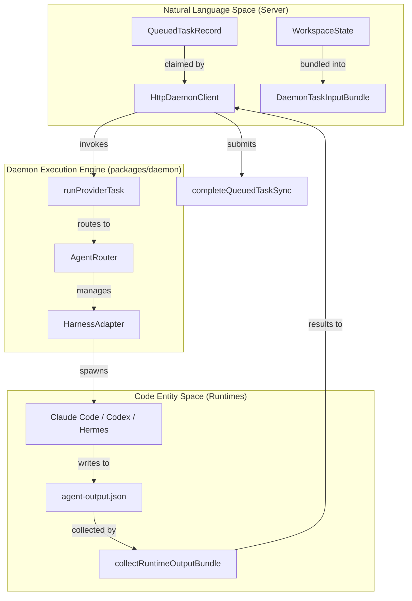
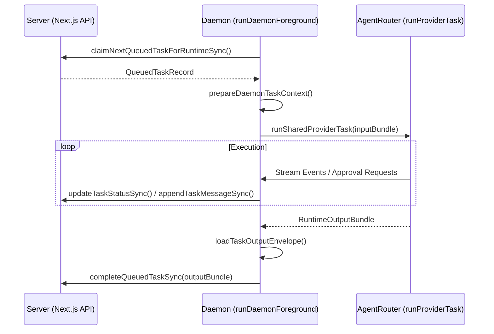

<!-- source: DeepWiki mcp.deepwiki.com · repo HKUDS/AgentSpace · page 3 Daemon & Agent Execution · fetched 2026-11-09 -->

# Daemon & Agent Execution

Relevant source files

The following files were used as context for generating this wiki page:

- [agent-space-daemon-0.1.3.tgz](agent-space-daemon-0.1.3.tgz)
- [apps/cli/src/commands/daemon.test.ts](apps/cli/src/commands/daemon.test.ts)
- [apps/cli/src/commands/daemon.ts](apps/cli/src/commands/daemon.ts)
- [apps/cli/src/lib/daemon-client.test.ts](apps/cli/src/lib/daemon-client.test.ts)
- [apps/cli/src/lib/daemon-client.ts](apps/cli/src/lib/daemon-client.ts)

The Daemon is the primary execution engine of AgentSpace. It acts as a bridge between the central server (which manages task queues and workspace state) and the local or remote compute environment where agent harnesses (like Claude Code or Codex) actually run. The execution pipeline is designed to be robust, supporting long-running tasks, streaming feedback, and human-in-the-loop approvals.

### Execution Pipeline Overview

The lifecycle of an agent execution follows a structured path from task discovery to result submission. The daemon continuously polls the server for new tasks assigned to the runtimes it supports. Once a task is claimed, the daemon prepares a secure execution environment, invokes the appropriate agent harness via `AgentRouter`, and monitors the process until completion.

Task execution is managed by the `runDaemonForeground` function [apps/cli/src/commands/daemon.ts:221-310](), which orchestrates the following high-level flow:

1.  **Registration**: The daemon registers its available runtimes with the server using `registerDaemonRuntimesSync` [apps/cli/src/commands/daemon.ts:55-55]().
2.  **Heartbeat**: A background loop maintains the daemon's "Online" status [apps/cli/src/commands/daemon.ts:44-44]().
3.  **Polling**: The daemon requests the next queued task for its active runtimes via `claimNextQueuedTaskForRuntimeSync` [apps/cli/src/commands/daemon.ts:36-36]().
4.  **Preparation**: The daemon builds a `DaemonTaskInputBundle` containing workspace state, relevant files, and conversation history.
5.  **Execution**: The task is handed off to the `runSharedProviderTask` [apps/cli/src/commands/daemon.ts:28-28](), which uses `AgentRouter` to select and invoke a harness.
6.  **Reporting**: Results are collected into an output bundle and submitted back to the server using `completeQueuedTaskSync` [apps/cli/src/commands/daemon.ts:37-37]() or `failQueuedTaskSync` [apps/cli/src/commands/daemon.ts:39-39]().

### System Component Interaction

The following diagram illustrates how the Daemon bridges the "Natural Language Space" (the user's intent and workspace) with the "Code Entity Space" (the actual execution logic and agent harnesses).

**Diagram: Daemon Execution Bridge**

Sources: [apps/cli/src/commands/daemon.ts:17-61](), [apps/cli/src/lib/daemon-client.ts:1-2](), [agent-space-daemon-0.1.3.tgz]()

---

### Key Execution Subsystems

#### [AgentRouter & Harness Adapters](#3.1)
The `AgentRouter` is the normalization layer that allows AgentSpace to support diverse agent implementations. It abstracts the specifics of different agent harnesses into a unified interface for running tasks, detecting capabilities, and merging event streams. 
*   **Harness Normalization**: Maps AgentSpace tasks to harness-specific CLI commands or API calls.
*   **Event Merging**: Consolidates stdout, stderr, and structured tool calls into a unified event log.
*   **For details, see [AgentRouter & Harness Adapters](#3.1).**

#### [Provider Runtime & Task Lifecycle](#3.2)
This subsystem handles the state machine of a task. It manages the transition from `QUEUED` to `RUNNING`, and finally to `COMPLETED` or `FAILED`. It is responsible for:
*   **Input Bundling**: Preparing the `DaemonTaskInputBundle` which includes workspace context and file snapshots.
*   **Output Collection**: Using `loadTaskOutputEnvelope` [apps/cli/src/commands/daemon.ts:99-100]() to parse the `agent-output.json` manifest and process generated artifacts.
*   **Error Handling**: Categorizing failures using `normalizeProviderTaskErrorCategory` [apps/cli/src/commands/daemon.ts:23-23]().
*   **For details, see [Provider Runtime & Task Lifecycle](#3.2).**

#### [Remote Daemon Deployment](#3.3)
Daemons can run locally or on remote servers. Remote deployment involves:
*   **Authentication**: Using `DaemonApiToken` [apps/cli/src/commands/daemon.ts:38-38]() for secure communication with the central server.
*   **Process Management**: Running as a background service via `runDaemonStart` [apps/cli/src/commands/daemon.ts:147-220]() which handles PID files and logging.
*   **For details, see [Remote Daemon Deployment](#3.3).**

---

### Task Processing Logic

The daemon uses a polling mechanism to retrieve work. When a task is available, it establishes a local work directory using `getDaemonTaskWorkDirPath` [apps/cli/src/commands/daemon.ts:42-42]().

**Diagram: Task Lifecycle in Code**

Sources: [apps/cli/src/commands/daemon.ts:33-84](), [apps/cli/src/lib/daemon-task-context.ts:94-96](), [apps/cli/src/lib/daemon-task-output.ts:98-100]()

### Daemon Commands Reference

The `runDaemonCommand` [apps/cli/src/commands/daemon.ts:110-145]() provides the CLI interface for managing the daemon process:

| Command | Function | Description |
| :--- | :--- | :--- |
| `start` | `runDaemonStart` | Starts the daemon process (foreground or background). |
| `stop` | `runDaemonStop` | Stops the running daemon by reading the PID file. |
| `status` | `runDaemonStatus` | Displays active runtimes and daemon health. |
| `logs` | `runDaemonLogs` | Streams the daemon log file. |
| `token` | `runDaemonTokenCommand` | Manages API tokens for remote daemon authentication. |

Sources: [apps/cli/src/commands/daemon.ts:110-145]()

---

