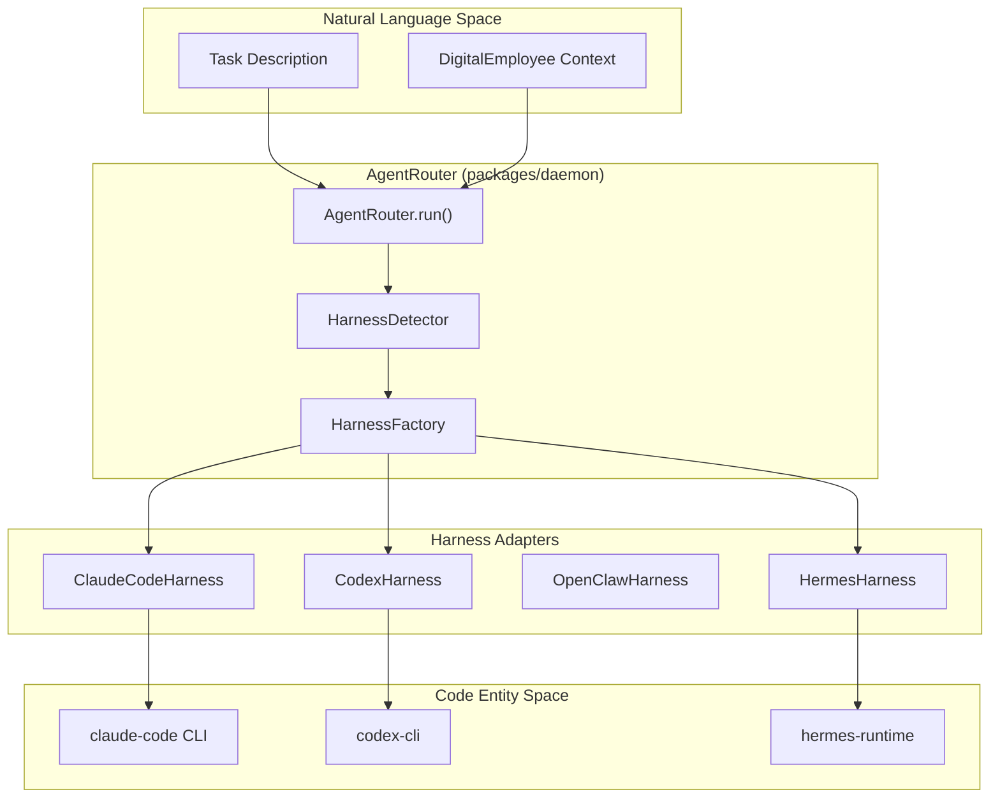
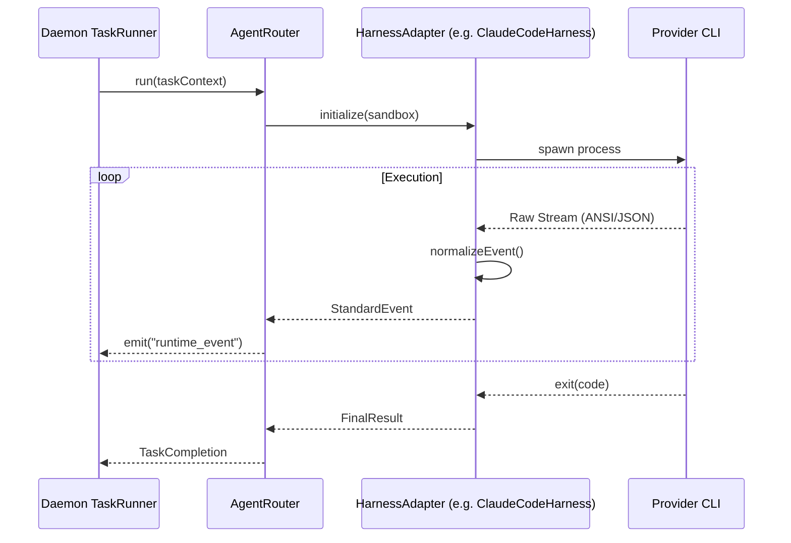

<!-- source: DeepWiki mcp.deepwiki.com · repo HKUDS/AgentSpace · page 3.1 AgentRouter & Harness Adapters · fetched 2026-11-09 -->

# AgentRouter & Harness Adapters

Relevant source files

The following files were used as context for generating this wiki page:

- [README.md](README.md)
- [README_ZH.md](README_ZH.md)
- [agent-space-daemon-0.1.3.tgz](agent-space-daemon-0.1.3.tgz)

The **AgentRouter** serves as the normalization and scheduling layer of the AgentSpace execution pipeline. It abstracts the idiosyncratic behaviors of various agent frameworks—such as **Claude Code**, **Codex**, **OpenClaw**, and **Hermes**—into a unified interface. This allows the same "Digital Employee" identity to execute tasks across different runtimes without losing context, skills, or governance oversight.

## Core Abstraction Layer

The primary goal of the AgentRouter is to decouple the agent's organizational identity (defined in the `DigitalEmployee` model) from the specific execution harness used for a task. This ensures that regardless of whether an agent is using a specialized coding harness like Claude Code or a general-purpose tool like Hermes, the event stream, file outputs, and approval requests remain consistent.

### The Unified Interface

The router implements a standard lifecycle for every agent run:
1.  **Capability Detection**: Identifying which harnesses are available on the current host.
2.  **Runtime Mapping**: Selecting the optimal harness based on the task requirements and agent configuration.
3.  **Event Normalization**: Mapping provider-specific output (e.g., terminal escapes, JSON chunks) into standard AgentSpace events.
4.  **Diagnostic Collection**: Gathering standardized logs and performance metrics across different providers.

### AgentRouter Architecture

The following diagram illustrates how the `AgentRouter` sits between the high-level Task management and the low-level provider CLIs.

**Diagram: AgentRouter Execution Flow**

Sources: `README.md:115-123`(), `README_ZH.md:116-124`()

## Supported Harness Adapters

AgentRouter currently supports five primary runtimes, each specialized for different task types.

| Harness Name | Specialized For | Provider CLI |
| :--- | :--- | :--- |
| **Claude Code** | Complex engineering, refactoring, and codebase navigation. | `claude-code` |
| **Codex** | Rapid script generation and CLI automation. | `codex-cli` |
| **OpenClaw** | Multi-step reasoning and research tasks. | `openclaw` |
| **Hermes** | General-purpose agentic workflows and tool use. | `hermes` |
| **Nanobot** | Lightweight, fast-response utility tasks. | `nanobot` |

Sources: `README.md:83-84`(), `README_ZH.md:84-85`()

## Implementation Detail: The Adapter Pattern

Each adapter implements a common interface that the Daemon's `TaskRunner` consumes. This normalization happens in `packages/daemon`.

### Event Merging and Normalization

Different providers emit different event types (e.g., Claude Code might emit incremental terminal updates, while Hermes emits JSON tool-call events). The `AgentRouter` merges these into a standard stream:

1.  **Standard Output**: Captured and cleaned of terminal escape codes.
2.  **Tool Calls**: Intercepted and mapped to AgentSpace `ApprovalRequest` objects if they require human intervention.
3.  **File Changes**: Tracked via the `Sandbox` abstraction to generate `RuntimeOutput` records.

**Diagram: Data Flow and Normalization**

Sources: `README.md:97-101`(), `README_ZH.md:165-168`()

## Capability Diagnostics

Before a task is dispatched, the `AgentRouter` performs a **Capability Diagnostic**. This check ensures the host machine has the required binaries and environment variables configured for the chosen harness.

*   **Binary Discovery**: The router checks the system `PATH` for `claude`, `codex`, `hermes`, etc.
*   **Version Validation**: Ensures the CLI version meets the minimum requirements for the adapter.
*   **Credential Check**: Verifies that necessary API keys (e.g., `ANTHROPIC_API_KEY`) are present in the environment or the workspace vault.

## Integration with Sandbox

The `AgentRouter` does not run processes directly on the host. Instead, it interacts with the `@agent-space/sandbox` package. The adapter instructs the sandbox to `exec` the provider CLI within an isolated environment (either a `LocalSandbox` or a `CubeSandbox`).

This integration allows the `AgentRouter` to:
*   **ReadFile/WriteFile**: Provide the agent with necessary context files before execution.
*   **Snapshot**: Capture the state of the filesystem after a harness completes its run.
*   **Constraint**: Limit the harness's access to specific directories within the workspace.

Sources: `README.md:142-145`(), `README_ZH.md:144-145`()

---

