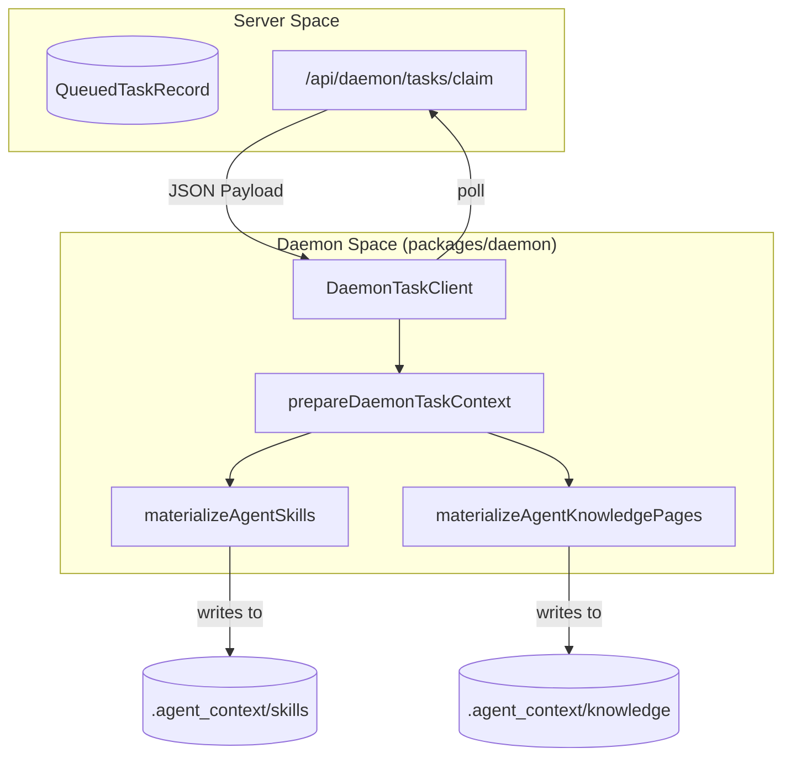
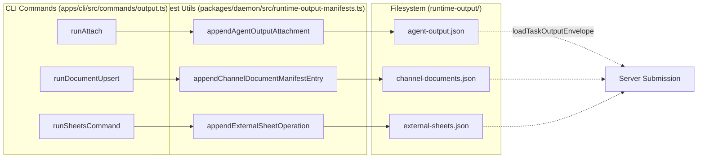

<!-- source: DeepWiki mcp.deepwiki.com · repo HKUDS/AgentSpace · page 3.2 Provider Runtime & Task Lifecycle · fetched 2026-11-09 -->

# Provider Runtime & Task Lifecycle

Relevant source files

The following files were used as context for generating this wiki page:

- [apps/cli/src/commands/output.test.ts](apps/cli/src/commands/output.test.ts)
- [apps/cli/src/commands/output.ts](apps/cli/src/commands/output.ts)
- [apps/cli/src/lib/daemon-task-context.test.ts](apps/cli/src/lib/daemon-task-context.test.ts)
- [apps/cli/src/lib/daemon-task-context.ts](apps/cli/src/lib/daemon-task-context.ts)
- [apps/cli/src/lib/daemon-task-output.ts](apps/cli/src/lib/daemon-task-output.ts)
- [apps/cli/src/lib/runtime-output.ts](apps/cli/src/lib/runtime-output.ts)

The Provider Runtime and Task Lifecycle governs the end-to-end execution of agentic tasks within AgentSpace. This process spans from the initial task claim by a remote daemon to the final submission of output bundles. The lifecycle ensures that agents have the necessary context (skills, knowledge, and files) and that their execution is monitored, approved where necessary, and correctly reported back to the workspace.

## Task Claiming & Initialization

The daemon operates on a polling loop, communicating with the server via the `DaemonTaskClient`. When a task is available, the daemon "claims" it, transitioning the task state in the database from `queued` to `running`.

### Data Flow: Claim to Execution Context
1.  **Polling**: The daemon calls the server-side claim endpoint.
2.  **Payload Parsing**: The daemon receives a `QueuedTaskRecord` and parses the `inputJson` using `parseTaskInputJson` [packages/daemon/src/task-context.ts:36-36]().
3.  **Context Preparation**: The daemon invokes `prepareDaemonTaskContext` [apps/cli/src/lib/daemon-task-context.ts:7-7]() to build the execution environment. This includes:
    *   **Skill Materialization**: Skills assigned to the agent are written to the workspace using `materializeAgentSkills`, creating both provider-native (e.g., `.claude/skills`) and compatibility fallback directories [apps/cli/src/lib/daemon-task-context.test.ts:77-83]().
    *   **Knowledge Materialization**: Relevant knowledge pages are exported as Markdown files and a `manifest.json` via `materializeAgentKnowledgePages` [apps/cli/src/lib/daemon-task-context.test.ts:133-139]().
    *   **Prompt Construction**: A system prompt is generated by `buildTaskPrompt` which references the materialized context [apps/cli/src/lib/daemon-task-context.ts:2-2]().

### Task Initialization Diagram
"Task Initialization Flow"

Sources: [apps/cli/src/lib/daemon-task-context.ts:1-13](), [apps/cli/src/lib/daemon-task-context.test.ts:77-139]()

## Provider Runtime Execution

Once the environment is prepared, the daemon uses the `AgentRouter` to invoke the specific provider harness (e.g., Claude Code, Codex).

### Input Bundling
The daemon creates a working directory (`workDir`) that serves as the root for the agent. The `AgentRouter` translates the unified task request into provider-specific commands. 
*   **Artifacts**: Input files are materialized via `materializeAttachments` [apps/cli/src/lib/daemon-task-context.ts:5-5]().
*   **Harness Invocation**: The router streams events (logs, tool calls) back to the server in real-time.

### Approvals & Human-in-the-Loop
During execution, agents may require permissions for sensitive operations.
*   **Permission Requests**: The agent can generate requests stored in `permission-requests.json` [apps/cli/src/lib/runtime-output.ts:12-12]().
*   **Polling for Approval**: The daemon pauses or checks the server status for these requests before allowing the agent to proceed with specific tool calls.

Sources: [apps/cli/src/lib/runtime-output.ts:1-22](), [apps/cli/src/lib/daemon-task-context.ts:1-13]()

## Output Bundling & Submission

As the agent completes its work, it generates various outputs. AgentSpace uses a structured manifest system located in the `runtime-output/` directory [apps/cli/src/lib/runtime-output.ts:3-3]().

### The Output Manifest System
The daemon and CLI provide utilities to append data to these manifests:
*   **`agent-output.json`**: Primary text response and file attachments [apps/cli/src/lib/runtime-output.ts:5-5]().
*   **`channel-documents.json`**: Upserts or edits to workspace documents [apps/cli/src/lib/runtime-output.ts:6-6]().
*   **`external-sheets.json`**: Operations for Google Sheets (append rows, update cells) [apps/cli/src/lib/runtime-output.ts:8-8]().
*   **`knowledge-proposals.json`**: Suggestions to create or update permanent knowledge base entries [apps/cli/src/commands/output.test.ts:197-200]().

### Submission Process
1.  **Validation**: The daemon calls `validateRuntimeOutputManifests` to ensure all paths and JSON structures are correct [apps/cli/src/commands/output.ts:18-18]().
2.  **Envelope Loading**: `loadTaskOutputEnvelope` aggregates all manifest files into a single object [apps/cli/src/lib/daemon-task-output.ts:4-4]().
3.  **Server Submission**: The daemon sends the final bundle to the server's completion endpoint.
4.  **Cleanup**: Artifacts are cleared via `clearTaskOutputArtifacts` [apps/cli/src/lib/daemon-task-output.ts:2-2]().

### Output Lifecycle Diagram
"Code Entities to Output Artifacts"

Sources: [apps/cli/src/commands/output.ts:37-88](), [apps/cli/src/lib/runtime-output.ts:3-22](), [apps/cli/src/lib/daemon-task-output.ts:1-6]()

## Key Implementation Details

| Component | File Path | Responsibility |
| :--- | :--- | :--- |
| **Manifest Definitions** | `packages/daemon/src/runtime-output-manifests.ts` | Types and append functions for output JSONs [apps/cli/src/commands/output.ts:3-29](). |
| **Output Paths** | `apps/cli/src/lib/runtime-output.ts` | Centralized constants for the `runtime-output/` directory structure [apps/cli/src/lib/runtime-output.ts:3-22](). |
| **Context Materializer** | `packages/daemon/src/task-context.ts` | Logic for writing skills and knowledge to the agent's disk [apps/cli/src/lib/daemon-task-context.ts:1-13](). |
| **CLI Output Bridge** | `apps/cli/src/commands/output.ts` | Allows agents to call CLI commands to register outputs (e.g., `agent-space output attach`) [apps/cli/src/commands/output.ts:95-124](). |

Sources: [apps/cli/src/commands/output.ts:1-33](), [apps/cli/src/lib/runtime-output.ts:1-22](), [apps/cli/src/lib/daemon-task-context.ts:1-13]()

---

