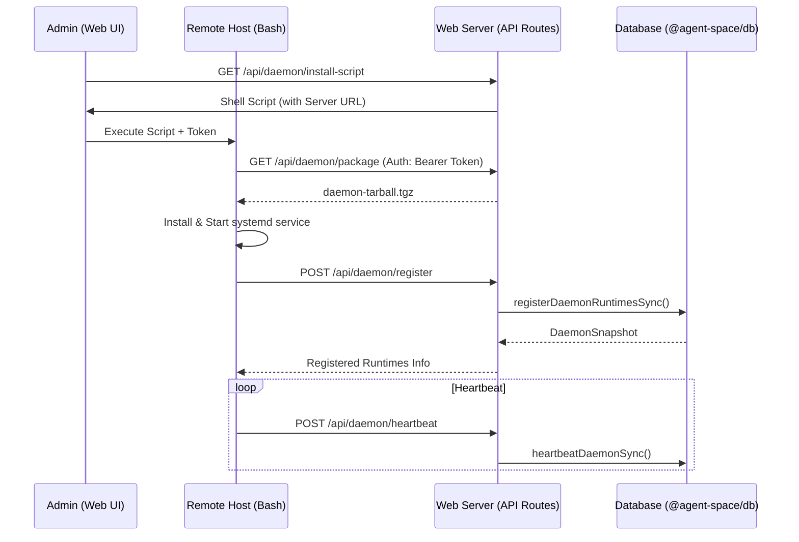

<!-- source: DeepWiki mcp.deepwiki.com · repo HKUDS/AgentSpace · page 3.3 Remote Daemon Deployment · fetched 2026-11-09 -->

# Remote Daemon Deployment

Relevant source files

The following files were used as context for generating this wiki page:

- [apps/web/app/api/daemon/_lib/auth.ts](apps/web/app/api/daemon/_lib/auth.ts)
- [apps/web/app/api/daemon/_lib/distribution.ts](apps/web/app/api/daemon/_lib/distribution.ts)
- [apps/web/app/api/daemon/deregister/route.ts](apps/web/app/api/daemon/deregister/route.ts)
- [apps/web/app/api/daemon/heartbeat/route.ts](apps/web/app/api/daemon/heartbeat/route.ts)
- [apps/web/app/api/daemon/install-script/route.ts](apps/web/app/api/daemon/install-script/route.ts)
- [apps/web/app/api/daemon/onboarding-status/route.test.ts](apps/web/app/api/daemon/onboarding-status/route.test.ts)
- [apps/web/app/api/daemon/onboarding-status/route.ts](apps/web/app/api/daemon/onboarding-status/route.ts)
- [apps/web/app/api/daemon/register/route.ts](apps/web/app/api/daemon/register/route.ts)
- [apps/web/app/api/daemon/routes.test.ts](apps/web/app/api/daemon/routes.test.ts)

Remote Daemon Deployment refers to the process of provisioning and managing the `agent-space-daemon` on external hosts. The system is designed to facilitate easy onboarding via automated shell scripts, secure authentication using scoped API tokens, and a robust lifecycle managed through heartbeats and registration flows.

## Deployment Architecture

The deployment process follows a "pull-based" model where the remote host downloads the daemon package from the central AgentSpace server and authenticates via a pre-generated token.

### Data Flow & Component Interaction

The following diagram illustrates the interaction between the remote host, the Web Server API routes, and the Database layer during the deployment and execution lifecycle.

**Remote Daemon Lifecycle Overview**

Sources: [apps/web/app/api/daemon/install-script/route.ts:6-15](), [apps/web/app/api/daemon/register/route.ts:43-55](), [apps/web/app/api/daemon/heartbeat/route.ts:24-35]()

## Installation & Distribution

AgentSpace provides automated mechanisms to generate install scripts and distribute the daemon package.

### Install Script Generation
The server dynamically generates a shell script at `/api/daemon/install-script`. This script is based on a template located at `deploy/install-remote-daemon.sh` [apps/web/app/api/daemon/_lib/distribution.ts:83-85](). The generator function `buildHostedInstallScript` injects the current server's origin into the script so that the remote daemon knows where to pull updates and report heartbeats [apps/web/app/api/daemon/_lib/distribution.ts:6-17]().

### Package Distribution
The daemon is distributed as an NPM tarball. The `buildDaemonPackageTarball` function handles the packaging [apps/web/app/api/daemon/_lib/distribution.ts:19-72]():
1. It navigates to `packages/daemon` [apps/web/app/api/daemon/_lib/distribution.ts:87-89]().
2. It executes `npm pack` to create a production-ready distribution [apps/web/app/api/daemon/_lib/distribution.ts:37-45]().
3. It serves this tarball via the `/api/daemon/package` route, which requires valid daemon token authentication [apps/web/app/api/daemon/routes.test.ts:162-171]().

Sources: [apps/web/app/api/daemon/_lib/distribution.ts:6-98](), [apps/web/app/api/daemon/install-script/route.ts:1-16]()

## Authentication & Security

Remote daemons authenticate using a `DaemonApiToken`. This token is workspace-scoped, ensuring that a daemon cannot access tasks or runtimes belonging to another workspace.

### Token Validation
All daemon API routes (except the install script) utilize `requireDaemonAuth(request)`. This function:
1. Extracts the Bearer token from the `Authorization` header [apps/web/app/api/daemon/_lib/auth.ts:19-24]().
2. Validates it against the database using `validateDaemonApiTokenSync(tokenValue)` [apps/web/app/api/daemon/_lib/auth.ts:25-28]().
3. Returns a `DaemonAuthContext` containing the token record and the associated `workspaceId` [apps/web/app/api/daemon/_lib/auth.ts:30-33]().

### Cross-Workspace Protection
The system strictly enforces workspace boundaries. If a daemon attempts to access a resource (like a task or runtime) that does not belong to its authorized workspace, the system records a `workspace.cross_workspace_access_denied` audit event and returns a 403 Forbidden error [apps/web/app/api/daemon/_lib/auth.ts:90-110]().

Sources: [apps/web/app/api/daemon/_lib/auth.ts:13-88]()

## Lifecycle Management

The daemon lifecycle is managed through three primary states: `pending`, `online`, and `offline`.

### Registration (`/api/daemon/register`)
When a daemon starts for the first time, it sends a `RegisterDaemonRequest` containing its `daemonKey`, `deviceName`, and a list of available `runtimes` (e.g., Claude Code, Codex) [apps/web/app/api/daemon/register/route.ts:19-25]().
* **Function**: `registerDaemonRuntimesSync` creates the `daemon_connection` and `agent_runtime` records in the DB [apps/web/app/api/daemon/register/route.ts:43-55]().
* **Auto-Grant**: Upon registration, the system automatically grants the user who created the daemon token permission to use the newly registered runtimes via `grantRegisteredRuntimesToTokenCreator` [apps/web/app/api/daemon/register/route.ts:56-60]().

### Heartbeat (`/api/daemon/heartbeat`)
The daemon must periodically poll the heartbeat endpoint to remain `online`.
* **Payload**: Includes metadata about the host and the current status of its runtimes [apps/web/app/api/daemon/heartbeat/route.ts:14-35]().
* **Effect**: Updates the `lastHeartbeatAt` timestamp in the database. If heartbeats stop, the server-side logic eventually treats the daemon as offline.

### Deregistration (`/api/daemon/deregister`)
When a daemon shuts down gracefully (e.g., via `SIGTERM`), it calls the deregister route [apps/web/app/api/daemon/deregister/route.ts:7-31]().
* **Function**: `markDaemonOfflineSync` updates the status to `offline` and can optionally record a `lastError` if the shutdown was due to a failure [apps/web/app/api/daemon/deregister/route.ts:23-25]().

Sources: [apps/web/app/api/daemon/register/route.ts:13-98](), [apps/web/app/api/daemon/heartbeat/route.ts:8-53](), [apps/web/app/api/daemon/deregister/route.ts:7-31]()

## Daemon API Reference

The following table summarizes the core API routes used by the remote daemon for operational tasks.

| Route | Method | Purpose | Key Code Entity |
| :--- | :--- | :--- | :--- |
| `/api/daemon/install-script` | GET | Returns the shell script for host setup. | `buildHostedInstallScript` |
| `/api/daemon/package` | GET | Downloads the daemon tarball. | `buildDaemonPackageTarball` |
| `/api/daemon/register` | POST | Registers the host and its runtimes. | `registerDaemonRuntimesSync` |
| `/api/daemon/heartbeat` | POST | Updates online status and runtime metadata. | `heartbeatDaemonSync` |
| `/api/daemon/deregister` | POST | Marks the daemon as offline. | `markDaemonOfflineSync` |
| `/api/daemon/onboarding-status` | GET | Checks if a daemon has successfully connected. | `listDaemonSnapshotsSync` |

### Onboarding Status Verification
The `/api/daemon/onboarding-status` route is used by the Web UI to provide real-time feedback during the installation process [apps/web/app/api/daemon/onboarding-status/route.ts:8-45](). It checks if a `daemonKey` exists and returns the count and status of registered runtimes [apps/web/app/api/daemon/onboarding-status/route.test.ts:46-82]().

Sources: [apps/web/app/api/daemon/onboarding-status/route.ts:8-45](), [apps/web/app/api/daemon/onboarding-status/route.test.ts:1-145]()

---

