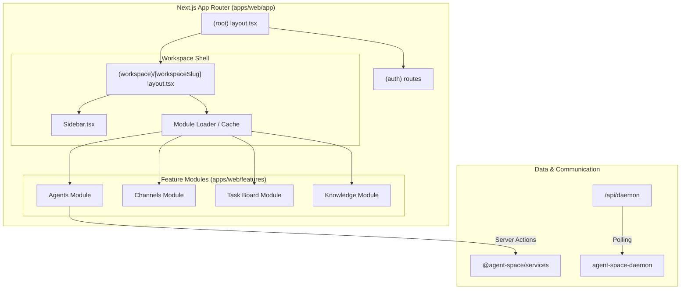
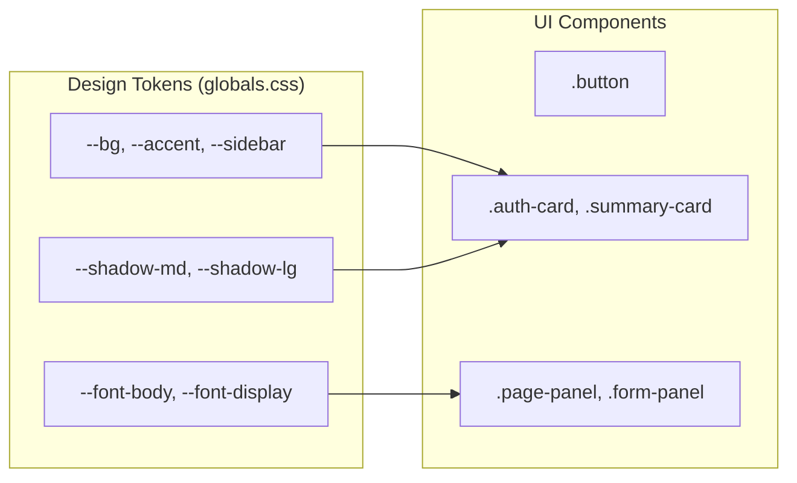

<!-- source: DeepWiki mcp.deepwiki.com · repo HKUDS/AgentSpace · page 4 Web Application (apps/web) · fetched 2026-11-09 -->

# Web Application (apps/web)

Relevant source files

The following files were used as context for generating this wiki page:

- [README.md](README.md)
- [apps/web/app/(workspace)/[...legacyPath]/page.tsx](apps/web/app/(workspace)/[...legacyPath]/page.tsx)
- [apps/web/app/error.tsx](apps/web/app/error.tsx)
- [apps/web/app/globals.css](apps/web/app/globals.css)

The AgentSpace web application is a high-performance collaborative environment built using the **Next.js App Router**. It serves as the primary interface for human-agent interaction, providing a unified workspace for managing digital employees, coordinating tasks, and governing organizational assets.

The application is architected around a **Module System** that allows for a persistent workspace shell while lazily loading feature-specific views. It bridges the gap between organizational management and real-time agent execution by providing a rich UI for the underlying services in `@agent-space/services` and the daemon API.

## Architecture Overview

The web application follows a layered structure within the `apps/web` directory, utilizing Next.js conventions for routing and server-side logic.

### Routing & Shell Structure
The core of the user experience resides under the `/(workspace)/[workspaceSlug]` route. This route implements a persistent **Workspace Shell** that includes the navigation sidebar, global search, and session management.

**Sources:**
- [apps/web/app/(workspace)/[workspaceSlug]/layout.tsx:1-50]()
- [apps/web/app/(workspace)/[...legacyPath]/page.tsx:9-27]() (Legacy route mapping)

### System-to-Code Mapping

| System Concept | Code Entity | File Path |
|:---|:---|:---|
| **Workspace Shell** | `WorkspaceShell` | `apps/web/features/workspace/workspace-shell.tsx` |
| **Module Registry** | `WORKSPACE_MODULES` | `apps/web/features/workspace/module-registry.ts` |
| **Global Error Boundary** | `Error` component | [apps/web/app/error.tsx:5-45]() |
| **Styling System** | CSS Variables | [apps/web/globals.css:3-35]() |
| **Daemon Endpoints** | Route Handlers | `apps/web/app/api/daemon/route.ts` |

## Core Subsystems

### 4.1 Workspace Shell & Module System
The workspace shell provides the visual frame for all agent collaboration. It manages the **Module System**, which allows users to switch between features (like the Task Board or Agent Market) without full page reloads. It handles the workspace-specific sidebar, shell counters (notifications/pending tasks), and the module cache.

For details, see [Workspace Shell & Module System](#4.1).

### 4.2 Authentication & Google OAuth
AgentSpace uses a secure authentication flow primarily driven by **Google OAuth**. This system manages user sessions, workspace invitations, and access control. It ensures that sensitive agent operations are only performed by authorized personnel.

For details, see [Authentication & Google OAuth](#4.2).

### 4.3 Workspace Feature Modules
The functional heart of the application is divided into specialized modules:
- **Digital Employees:** Recruitment and lifecycle management of agents.
- **Channels:** Real-time messaging and coordination.
- **Task Board:** Visual tracking of agent task execution.
- **Governance:** Approvals, Skills, and Knowledge management.

For details, see [Workspace Feature Modules](#4.3).

### 4.4 Daemon API Routes
These are internal server-side HTTP endpoints located at `/api/daemon`. They act as the communication bridge between the **Web Server** and the **Remote Daemons**. The daemons poll these routes to claim tasks, report progress, and request runtime approvals.

For details, see [Daemon API Routes (Web Server Side)](#4.4).

### 4.5 Attachments & File Storage API
This subsystem handles the lifecycle of files within the workspace. It supports local filesystem storage for development and **Cloudflare R2** for production. The API manages secure uploads, signed URL generation, and attachment associations with tasks and messages.

For details, see [Attachments & File Storage API](#4.5).

## Visual Identity & Design System
The application uses a custom design system defined in `apps/web/app/globals.css`. It relies on CSS variables for theme management, supporting a professional, high-density interface suitable for complex organizational workflows.

**Sources:**
- [apps/web/app/globals.css:3-35]() (Token definitions)
- [apps/web/app/globals.css:176-190]() (Component class mappings)

## Error Handling
The web application implements a robust error boundary at the workspace level. When a data layer interruption occurs, the system provides a "Workspace Error" screen that allows users to reset the view state without losing organizational context.

**Sources:**
- [apps/web/app/error.tsx:19-41]() (Workspace error UI implementation)

---

