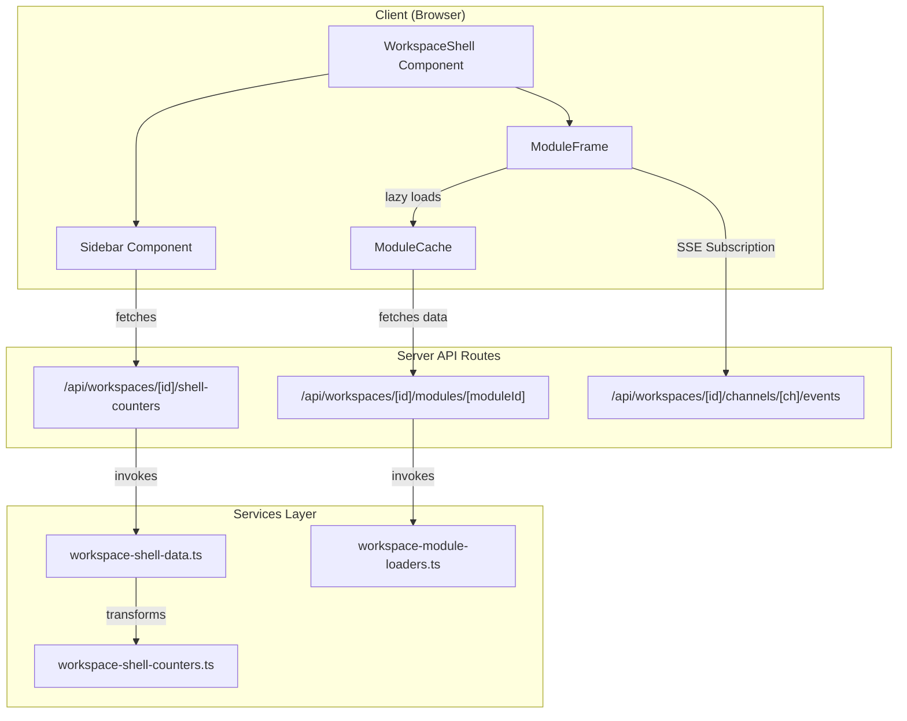
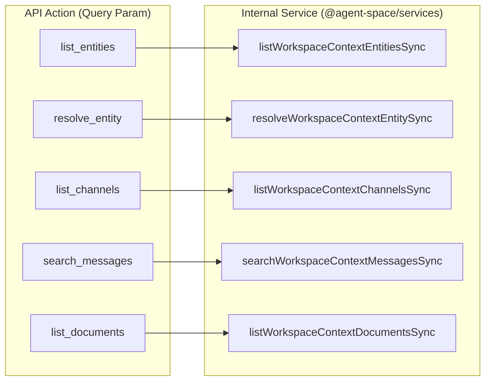

<!-- source: DeepWiki mcp.deepwiki.com · repo HKUDS/AgentSpace · page 4.1 Workspace Shell & Module System · fetched 2026-11-09 -->

# Workspace Shell & Module System

Relevant source files

The following files were used as context for generating this wiki page:

- [apps/web/app/api/workspace-context/route.test.ts](apps/web/app/api/workspace-context/route.test.ts)
- [apps/web/app/api/workspace-context/route.ts](apps/web/app/api/workspace-context/route.ts)
- [apps/web/app/api/workspaces/[workspaceId]/channels/[channelName]/events/route.test.ts](apps/web/app/api/workspaces/[workspaceId]/channels/[channelName]/events/route.test.ts)
- [apps/web/app/api/workspaces/[workspaceId]/channels/[channelName]/events/route.ts](apps/web/app/api/workspaces/[workspaceId]/channels/[channelName]/events/route.ts)
- [apps/web/app/api/workspaces/[workspaceId]/modules/[moduleId]/route.test.ts](apps/web/app/api/workspaces/[workspaceId]/modules/[moduleId]/route.test.ts)
- [apps/web/app/api/workspaces/[workspaceId]/modules/[moduleId]/route.ts](apps/web/app/api/workspaces/[workspaceId]/modules/[moduleId]/route.ts)
- [apps/web/app/api/workspaces/[workspaceId]/shell-counters/route.test.ts](apps/web/app/api/workspaces/[workspaceId]/shell-counters/route.test.ts)
- [apps/web/app/api/workspaces/[workspaceId]/shell-counters/route.ts](apps/web/app/api/workspaces/[workspaceId]/shell-counters/route.ts)

The Workspace Shell is the primary UI framework for the AgentSpace web application, hosted at the `/w/[workspaceSlug]` route. It provides a unified, multi-module interface that integrates various functional areas—such as Instant Messaging (IM), Task Management, and Knowledge bases—into a single-page experience. The system relies on a lazy-loading module architecture, a centralized shell counter service, and a real-time event bus.

## Architectural Overview

The shell is composed of a persistent **Sidebar** and a dynamic **Module Frame**. Instead of full page reloads, the shell intercepts navigation to swap the active module, fetching data through dedicated API routes.

### Component Relationship Diagram

This diagram shows how the UI components in `apps/web` interact with the server-side loaders and data providers.

**Sources:** [apps/web/app/api/workspaces/[workspaceId]/shell-counters/route.ts:1-45](), [apps/web/app/api/workspaces/[workspaceId]/modules/[moduleId]/route.ts:1-76](), [apps/web/app/api/workspaces/[workspaceId]/channels/[channelName]/events/route.ts:9-119]()

---

## Module System & Lazy Loading

AgentSpace uses a modular architecture where each feature (e.g., `im`, `tasks`, `knowledge`, `settings`) is treated as a "Workspace Module". These modules are loaded on-demand to minimize initial bundle size and server load.

### Module Resolution Flow

When a user navigates to a module, the following flow occurs:
1.  **Validation**: The shell validates the `moduleId` using `isWorkspaceModuleId` [apps/web/app/api/workspaces/[workspaceId]/modules/[moduleId]/route.ts:30-32]().
2.  **Access Control**: The system checks if the user has permission. For example, users with `channel` access scope are restricted to the `im` module [apps/web/app/api/workspaces/[workspaceId]/modules/[moduleId]/route.ts:36-38]().
3.  **Data Fetching**: The `GET` handler in the module route calls `loadWorkspaceModuleDataWithMeta` [apps/web/app/api/workspaces/[workspaceId]/modules/[moduleId]/route.ts:43-58]().
4.  **Context Injection**: The loader receives the current user's role, display name, and any URL search parameters (like `section` for settings or `focus` for IM) [apps/web/app/api/workspaces/[workspaceId]/modules/[moduleId]/route.ts:46-57]().

### Supported Modules

| Module ID | Purpose | Loader Function |
| :--- | :--- | :--- |
| `im` | Instant Messaging & Channel history | `loadWorkspaceModuleDataWithMeta` |
| `tasks` | Task board and status tracking | `loadWorkspaceModuleDataWithMeta` |
| `knowledge` | Documentation and knowledge base | `loadWorkspaceModuleDataWithMeta` |
| `settings` | Workspace and member configuration | `loadWorkspaceModuleDataWithMeta` |
| `performance` | Agent and task analytics | `loadWorkspaceModuleDataWithMeta` |

**Sources:** [apps/web/app/api/workspaces/[workspaceId]/modules/[moduleId]/route.ts:15-76](), [apps/web/app/api/workspaces/[workspaceId]/modules/[moduleId]/route.test.ts:43-156]()

---

## Shell Counters & Sidebar State

The sidebar displays real-time badges (counters) for unread messages, open tasks, and pending approvals. These are aggregated via the `/api/workspaces/[workspaceId]/shell-counters` endpoint.

### Counter Calculation Logic

The server executes `getWorkspaceShellCounterData` to retrieve raw counts from the database and then applies `deriveWorkspaceShellCounters` to format them for the UI [apps/web/app/api/workspaces/[workspaceId]/shell-counters/route.ts:26-38]().

| Counter Metric | Code Entity / Source |
| :--- | :--- |
| **Unread Notifications** | `unreadNotificationCount` |
| **Open Tasks** | `openTaskCount` |
| **Pending Approvals** | `pendingApprovalCount` |
| **Digital Employees** | `agentCount` |
| **Active Runtimes** | `runtimeCount` |

**Sources:** [apps/web/app/api/workspaces/[workspaceId]/shell-counters/route.ts:25-44](), [apps/web/app/api/workspaces/[workspaceId]/shell-counters/route.test.ts:39-56]()

---

## Real-time Event Streaming (SSE)

The workspace maintains a persistent connection to the server using Server-Sent Events (SSE) via the `/events` route. This ensures the UI updates immediately when messages are sent or tasks change.

### Event Subscription Process

1.  **Authentication**: The route verifies workspace access using `getWorkspaceAccessForIdentifier` [apps/web/app/api/workspaces/[workspaceId]/channels/[channelName]/events/route.ts:14-20]().
2.  **Authorization**: It ensures the user has specific read access to the requested channel via `canReadChannelForActorSync` [apps/web/app/api/workspaces/[workspaceId]/channels/[channelName]/events/route.ts:30-32]().
3.  **Subscription**: The server calls `subscribeWorkspaceRealtimeEvents` from the `@agent-space/services` package [apps/web/app/api/workspaces/[workspaceId]/channels/[channelName]/events/route.ts:60]().
4.  **Heartbeat**: A heartbeat is sent every 25 seconds to prevent connection timeouts [apps/web/app/api/workspaces/[workspaceId]/channels/[channelName]/events/route.ts:7-100]().

### Event Types

The shell handles several critical event types to update the module state:
-   `channel.message.created`: Triggers new message rendering in the IM module [apps/web/app/api/workspaces/[workspaceId]/channels/[channelName]/events/route.ts:69-76]().
-   `channel.thread.changed`: Updates thread metadata and unread states [apps/web/app/api/workspaces/[workspaceId]/channels/[channelName]/events/route.ts:77-83]().
-   `task.event`: Updates task progress bars and status badges [apps/web/app/api/workspaces/[workspaceId]/channels/[channelName]/events/route.ts:84-91]().

**Sources:** [apps/web/app/api/workspaces/[workspaceId]/channels/[channelName]/events/route.ts:39-109](), [apps/web/app/api/workspaces/[workspaceId]/channels/[channelName]/events/route.test.ts:58-108]()

---

## Workspace Context API

The `/api/workspace-context` route provides agents and the shell with a structured view of the workspace's entities, channels, and documents. This is used for "mention" suggestions and agent tool execution.

### Context Actions Diagram

This diagram maps the natural language "actions" to the internal service functions.

**Sources:** [apps/web/app/api/workspace-context/route.ts:82-117](), [apps/web/app/api/workspace-context/route.test.ts:130-141]()

### Loadtest & Performance Caching
To handle high-frequency requests during agent execution or load testing, the context route implements an in-memory cache `workspaceContextCacheGlobal` with a configurable TTL via `AGENT_SPACE_WORKSPACE_CONTEXT_CACHE_TTL_MS` [apps/web/app/api/workspace-context/route.ts:125-184]().

**Sources:** [apps/web/app/api/workspace-context/route.ts:133-176]()

---

