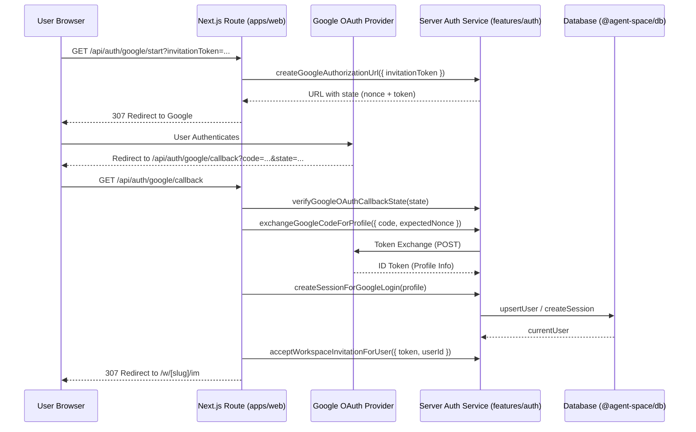

<!-- source: DeepWiki mcp.deepwiki.com · repo HKUDS/AgentSpace · page 4.2 Authentication & Google OAuth · fetched 2026-11-09 -->

# Authentication & Google OAuth

Relevant source files

The following files were used as context for generating this wiki page:

- [apps/web/app/api/auth/google/callback/route.test.ts](apps/web/app/api/auth/google/callback/route.test.ts)
- [apps/web/app/api/auth/google/callback/route.ts](apps/web/app/api/auth/google/callback/route.ts)
- [apps/web/app/api/auth/google/start/route.test.ts](apps/web/app/api/auth/google/start/route.test.ts)
- [apps/web/app/api/auth/google/start/route.ts](apps/web/app/api/auth/google/start/route.ts)
- [apps/web/app/auth/error/page.tsx](apps/web/app/auth/error/page.tsx)
- [apps/web/app/auth/link/google/page.tsx](apps/web/app/auth/link/google/page.tsx)
- [apps/web/app/auth/setup/google/page.tsx](apps/web/app/auth/setup/google/page.tsx)
- [apps/web/app/channel-invite/[invitationId]/page.tsx](apps/web/app/channel-invite/[invitationId]/page.tsx)

User authentication in AgentSpace is built around **Google OAuth 2.0**. It supports standard logins, workspace invitations via tokens, and workspace joining via alphanumeric codes. The system handles session management, profile setup for new users, and account linking for existing users.

## OAuth Lifecycle & Data Flow

The authentication flow begins at the `/api/auth/google/start` route and concludes at `/api/auth/google/callback`. The system uses a `state` parameter to maintain context (nonces, invitation tokens, or join codes) across the OAuth redirect.

### Authentication Sequence

The following diagram illustrates the flow from the initial request to session creation and workspace redirection.

**Diagram: OAuth Flow to Session Creation**

**Sources:** [apps/web/app/api/auth/google/start/route.ts:7-13](), [apps/web/app/api/auth/google/callback/route.ts:12-73](), [apps/web/app/api/auth/google/callback/route.test.ts:71-111]()

## Key Implementation Components

### Start Route (`/api/auth/google/start`)
This route handles the initiation of the OAuth flow. It extracts optional `invitationToken` or `joinCode` from the URL parameters and passes them to the URL builder [apps/web/app/api/auth/google/start/route.ts:7-13]().

### Callback Route (`/api/auth/google/callback`)
The callback route is the primary orchestrator of the authentication result.
1.  **Error Handling**: If Google returns an error (e.g., `access_denied`), the user is redirected to `/auth/error` [apps/web/app/api/auth/google/callback/route.ts:19-25]().
2.  **State Verification**: It verifies the `state` parameter to retrieve the original `nonce`, `invitationToken`, and `joinCode` [apps/web/app/api/auth/google/callback/route.ts:38-40]().
3.  **Profile Exchange**: It exchanges the authorization `code` for the user's Google profile (email, sub, displayName) [apps/web/app/api/auth/google/callback/route.ts:41-44]().
4.  **Session Creation**: It calls `createSessionForGoogleLogin` to establish the user's identity and session in the database [apps/web/app/api/auth/google/callback/route.ts:45-53]().
5.  **Workspace Entry**: If an invitation or join code was present, it triggers the respective logic to link the user to the workspace before redirecting them to the workspace UI [apps/web/app/api/auth/google/callback/route.ts:55-71]().

**Sources:** [apps/web/app/api/auth/google/callback/route.ts:12-99](), [apps/web/app/api/auth/google/callback/route.test.ts:159-192]()

## Invitation & Join Handling

AgentSpace provides two primary mechanisms for users to gain access to workspaces:

| Mechanism | Trigger | Logic Entity | Redirect Destination |
| :--- | :--- | :--- | :--- |
| **Invitation Token** | `invitationToken` in URL | `acceptWorkspaceInvitationForUser` | `/w/[slug]/im` |
| **Join Code** | `joinCode` in URL | `joinWorkspaceByCodeForUser` | `joined.redirectPath` |
| **Channel Invite** | `/channel-invite/[id]` | `acceptChannelInvitationAction` | `/w/[slug]/im?focus=[channel]` |

### Channel Invitations
Unlike workspace-level invitations, channel invitations are handled via a dedicated page [apps/web/app/channel-invite/[invitationId]/page.tsx:17-21](). If the user is not logged in, they are prompted to do so [apps/web/app/channel-invite/[invitationId]/page.tsx:49-62](). Once authenticated, they can perform a server action to accept the invite, which grants access specifically to that channel [apps/web/app/channel-invite/[invitationId]/page.tsx:81-89]().

**Sources:** [apps/web/app/api/auth/google/callback/route.ts:55-71](), [apps/web/app/channel-invite/[invitationId]/page.tsx:23-89]()

## Special Auth States

The system identifies scenarios where a simple login is insufficient and redirects to specialized "handoff" screens.

### Profile Setup & Account Linking
*   **`auth.google_profile_setup_required`**: Redirects to `/auth/setup/google`. This occurs when a new user needs to provide a display name or confirm details before the account is finalized [apps/web/app/api/auth/google/callback/route.ts:82-84](). The page reads from `readPendingGoogleRegistrationHandoff` [apps/web/app/auth/setup/google/page.tsx:9-13]().
*   **`auth.google_account_link_required`**: Redirects to `/auth/link/google`. This occurs when a user tries to log in with a Google account that matches an existing email but isn't yet linked [apps/web/app/api/auth/google/callback/route.ts:76-81](). It uses `readPendingGoogleLinkHandoff` to restore context [apps/web/app/auth/link/google/page.tsx:9-12]().

### Error Handling
The `/auth/error` page displays the `AuthErrorScreen` based on error codes passed in the query string (e.g., `access_denied`, `auth.google_exchange_failed`) [apps/web/app/auth/error/page.tsx:11-18]().

**Sources:** [apps/web/app/api/auth/google/callback/route.ts:74-98](), [apps/web/app/auth/setup/google/page.tsx:8-30](), [apps/web/app/auth/link/google/page.tsx:8-29]()

## Code Entity Mapping

This diagram maps the natural language authentication concepts to the specific code entities and functions within the `apps/web` package.

**Diagram: Authentication Code Entity Map**

```mermaid
graph TD
    subgraph "Routes (Code Entities)"
        R_START["GET /api/auth/google/start"]
        R_CALLBACK["GET /api/auth/google/callback"]
        R_SETUP["/auth/setup/google"]
        R_LINK["/auth/link/google"]
    end

    subgraph "Logic Functions (Code Entities)"
        F_AUTH_URL["createGoogleAuthorizationUrl"]
        F_VERIFY["verifyGoogleOAuthCallbackState"]
        F_EXCHANGE["exchangeGoogleCodeForProfile"]
        F_SESSION["createSessionForGoogleLogin"]
        F_INVITE["acceptWorkspaceInvitationForUser"]
        F_JOIN["joinWorkspaceByCodeForUser"]
    end

    subgraph "Monitoring & Data (Code Entities)"
        M_REPORT["reportGoogleAuthCallbackIssue"]
        D_HANDOFF_REG["readPendingGoogleRegistrationHandoff"]
        D_HANDOFF_LINK["readPendingGoogleLinkHandoff"]
    end

    R_START --> F_AUTH_URL
    R_CALLBACK --> F_VERIFY
    R_CALLBACK --> F_EXCHANGE
    R_CALLBACK --> F_SESSION
    R_CALLBACK --> F_INVITE
    R_CALLBACK --> F_JOIN
    R_CALLBACK -- "Error/Phase" --> M_REPORT
    
    R_SETUP --> D_HANDOFF_REG
    R_LINK --> D_HANDOFF_LINK
```

**Sources:** [apps/web/app/api/auth/google/start/route.ts:2-11](), [apps/web/app/api/auth/google/callback/route.ts:2-7](), [apps/web/app/auth/setup/google/page.tsx:3-9](), [apps/web/app/auth/link/google/page.tsx:3-9]()

---

