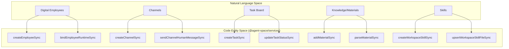
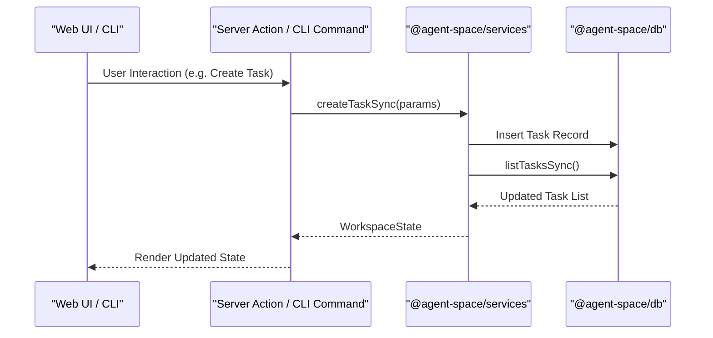

<!-- source: DeepWiki mcp.deepwiki.com · repo HKUDS/AgentSpace · page 4.3 Workspace Feature Modules · fetched 2026-11-09 -->

# Workspace Feature Modules

Relevant source files

The following files were used as context for generating this wiki page:

- [apps/cli/src/commands/channel.ts](apps/cli/src/commands/channel.ts)
- [apps/cli/src/commands/employee.ts](apps/cli/src/commands/employee.ts)
- [apps/cli/src/commands/im.ts](apps/cli/src/commands/im.ts)
- [apps/cli/src/commands/material.ts](apps/cli/src/commands/material.ts)
- [apps/cli/src/commands/message.ts](apps/cli/src/commands/message.ts)
- [apps/cli/src/commands/skill.ts](apps/cli/src/commands/skill.ts)
- [apps/cli/src/commands/task.ts](apps/cli/src/commands/task.ts)
- [apps/cli/src/lib/channel-documents.test.ts](apps/cli/src/lib/channel-documents.test.ts)
- [apps/cli/src/lib/channel-documents.ts](apps/cli/src/lib/channel-documents.ts)

Workspace feature modules constitute the core UI and business logic layers of the AgentSpace web application. These modules provide the interface for managing digital employees, coordinating tasks via channels, governing approvals, and managing shared knowledge.

## Module Architecture and Data Flow

The workspace UI is organized into discrete modules, each backed by a set of server actions and repository functions. Data typically flows from the UI through **Server Actions** to the **Services Layer** (`@agent-space/services`), which interacts with the **Database Layer** (`@agent-space/db`).

### Entity Mapping: UI to Code

The following diagram maps high-level workspace features to their primary implementation entities in the codebase.

**Natural Language Space to Code Entity Space**

**Sources:** [apps/cli/src/commands/employee.ts:1-7](), [apps/cli/src/commands/channel.ts:1-6](), [apps/cli/src/commands/task.ts:1-5](), [apps/cli/src/commands/material.ts:1-6](), [apps/cli/src/commands/skill.ts:2-12]()

---

## Digital Employees (Agents)

The Employees module manages the lifecycle and configuration of autonomous agents.

*   **Creation**: Agents are initialized with a name, role, traits, and an origin label [apps/cli/src/commands/employee.ts:34-72]().
*   **Runtime Binding**: Agents must be bound to a specific runtime (e.g., a specific LLM harness or environment) to execute tasks [apps/cli/src/commands/employee.ts:74-94]().
*   **State Management**: The service layer tracks active employees and their channel memberships [apps/cli/src/commands/employee.ts:16-31]().

**Sources:** [apps/cli/src/commands/employee.ts:1-123]()

---

## Channels & Messaging

Channels serve as the communication hub where humans and agents interact.

*   **Channel Operations**: Supports creation, deletion, and renaming of communication contexts [apps/cli/src/commands/channel.ts:20-72]().
*   **Message Types**: Distinguishes between `human` messages (sent by users) and `agent` messages (posted by digital employees) [apps/cli/src/commands/message.ts:15-42]().
*   **Channel Documents**: Agents can produce or update documents within a channel context. These operations are processed via `applyChannelDocumentOperations`, which synchronizes filesystem artifacts from the daemon back to the workspace database [apps/cli/src/lib/channel-documents.ts:1-8](), [apps/cli/src/lib/channel-documents.test.ts:90-104]().

**Sources:** [apps/cli/src/commands/channel.ts:1-79](), [apps/cli/src/commands/message.ts:1-49](), [apps/cli/src/lib/channel-documents.ts:1-8]()

---

## Task Board

The Task Board manages the lifecycle of discrete work units assigned to agents.

*   **Task Creation**: Tasks require a title, target channel, and an assignee (employee) [apps/cli/src/commands/task.ts:31-62]().
*   **Status Workflow**: Tasks move through states: `todo`, `in_progress`, `blocked`, and `done` [apps/cli/src/commands/task.ts:90-110]().
*   **Queue Integration**: The task board UI reflects the underlying execution queue status, showing whether a task is currently claimed by a daemon or pending [apps/cli/src/commands/task.ts:15-28]().

**Sources:** [apps/cli/src/commands/task.ts:1-121]()

---

## Knowledge & Materials

This module handles the ingestion of external data to be used by agents.

*   **Material Ingestion**: Supports adding raw sources or importing files with specific labels and status tracking [apps/cli/src/commands/material.ts:20-67]().
*   **Parsing**: Materials can be triggered for parsing to generate previews and structured data for agent consumption [apps/cli/src/commands/material.ts:69-88]().

**Sources:** [apps/cli/src/commands/material.ts:1-103]()

---

## Skills

Skills are reusable sets of files (code, prompts, or configuration) that extend agent capabilities.

*   **Skill Management**: Includes standard CRUD operations on skills and their constituent files [apps/cli/src/commands/skill.ts:21-84]().
*   **File Upsert**: Individual files within a skill can be updated or created via `upsertWorkspaceSkillFileSync` [apps/cli/src/commands/skill.ts:185-200]().
*   **Portability**: Skills can be exported as ZIP archives or imported from URLs, allowing for sharing across workspaces [apps/cli/src/commands/skill.ts:86-123](), [apps/cli/src/commands/skill.ts:129-149]().

**Sources:** [apps/cli/src/commands/skill.ts:1-163]()

---

## System Integration Diagram

The following diagram illustrates the interaction between the UI Feature Modules and the underlying Service layer.

**Feature Module Interaction Flow**

**Sources:** [apps/cli/src/commands/task.ts:46-61](), [apps/cli/src/commands/channel.ts:29-35](), [apps/cli/src/commands/employee.ts:54-71]()

---

