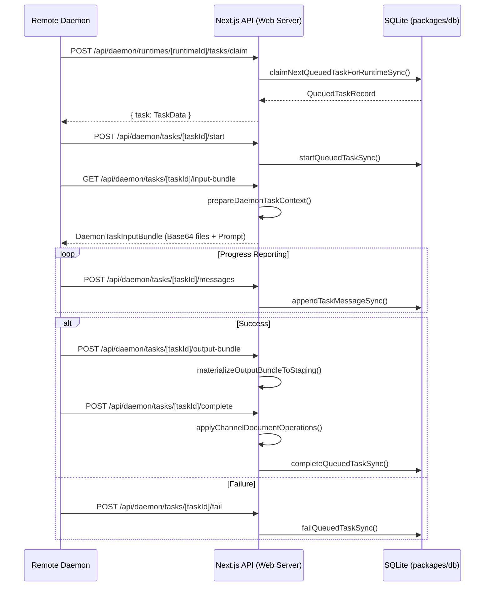
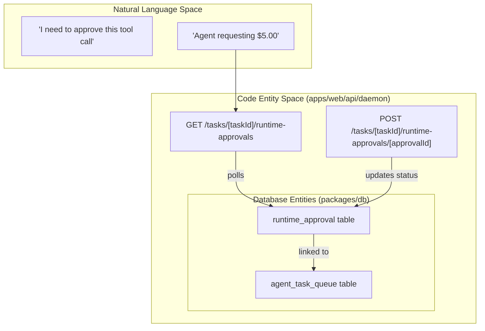

<!-- source: DeepWiki mcp.deepwiki.com · repo HKUDS/AgentSpace · page 4.4 Daemon API Routes (Web Server Side) · fetched 2026-11-09 -->

# Daemon API Routes (Web Server Side)

Relevant source files

The following files were used as context for generating this wiki page:

- [apps/web/app/api/daemon/_lib/output-bundle.test.ts](apps/web/app/api/daemon/_lib/output-bundle.test.ts)
- [apps/web/app/api/daemon/_lib/output-bundle.ts](apps/web/app/api/daemon/_lib/output-bundle.ts)
- [apps/web/app/api/daemon/client.integration.test.ts](apps/web/app/api/daemon/client.integration.test.ts)
- [apps/web/app/api/daemon/runtime-app-operations/[operationId]/complete/route.ts](apps/web/app/api/daemon/runtime-app-operations/[operationId]/complete/route.ts)
- [apps/web/app/api/daemon/runtime-app-operations/[operationId]/fail/route.ts](apps/web/app/api/daemon/runtime-app-operations/[operationId]/fail/route.ts)
- [apps/web/app/api/daemon/runtime-app-operations/[operationId]/start/route.ts](apps/web/app/api/daemon/runtime-app-operations/[operationId]/start/route.ts)
- [apps/web/app/api/daemon/runtimes/[runtimeId]/apps/operations/claim/route.ts](apps/web/app/api/daemon/runtimes/[runtimeId]/apps/operations/claim/route.ts)
- [apps/web/app/api/daemon/runtimes/[runtimeId]/tasks/claim/route.ts](apps/web/app/api/daemon/runtimes/[runtimeId]/tasks/claim/route.ts)
- [apps/web/app/api/daemon/tasks/[taskId]/complete/route.ts](apps/web/app/api/daemon/tasks/[taskId]/complete/route.ts)
- [apps/web/app/api/daemon/tasks/[taskId]/fail/route.ts](apps/web/app/api/daemon/tasks/[taskId]/fail/route.ts)
- [apps/web/app/api/daemon/tasks/[taskId]/input-bundle/route.ts](apps/web/app/api/daemon/tasks/[taskId]/input-bundle/route.ts)
- [apps/web/app/api/daemon/tasks/[taskId]/messages/route.ts](apps/web/app/api/daemon/tasks/[taskId]/messages/route.ts)
- [apps/web/app/api/daemon/tasks/[taskId]/output-bundle/route.ts](apps/web/app/api/daemon/tasks/[taskId]/output-bundle/route.ts)
- [apps/web/app/api/daemon/tasks/[taskId]/runtime-approvals/[approvalId]/route.ts](apps/web/app/api/daemon/tasks/[taskId]/runtime-approvals/[approvalId]/route.ts)
- [apps/web/app/api/daemon/tasks/[taskId]/runtime-approvals/route.ts](apps/web/app/api/daemon/tasks/[taskId]/runtime-approvals/route.ts)
- [apps/web/app/api/daemon/tasks/[taskId]/start/route.ts](apps/web/app/api/daemon/tasks/[taskId]/start/route.ts)

The server-side Daemon API routes in `apps/web` provide the communication interface for remote daemons to synchronize task state, download execution contexts, report progress, and manage runtime assets. These routes act as the bridge between the persistent database and the ephemeral execution environments managed by the daemon.

## Overview of API Surface

The API is structured around the lifecycle of a task execution. The daemon typically follows a polling-and-report pattern:
1. **Claiming**: Polling for new tasks assigned to its runtimes.
2. **Context Retrieval**: Downloading the `DaemonTaskInputBundle`.
3. **Execution Reporting**: Sending "thinking" logs, tool calls, and status updates.
4. **Completion/Failure**: Uploading results and artifacts via `DaemonTaskOutputBundle`.

### Authentication
All daemon routes utilize the `requireDaemonAuth` middleware [apps/web/app/api/daemon/_lib/auth.ts]() (referenced in [apps/web/app/api/daemon/runtimes/[runtimeId]/tasks/claim/route.ts:11-15]()). This ensures that the daemon token is valid and scoped to the correct workspace.

## Task Lifecycle Routes

The following diagram illustrates the flow of a task from the server's perspective as it interacts with the daemon.

### Task Execution Sequence
The sequence starts with `claim` and ends with either `complete` or `fail`.

**Sources:** [apps/web/app/api/daemon/runtimes/[runtimeId]/tasks/claim/route.ts:22-40](), [apps/web/app/api/daemon/tasks/[taskId]/input-bundle/route.ts:84-176](), [apps/web/app/api/daemon/tasks/[taskId]/complete/route.ts:44-64](), [apps/web/app/api/daemon/tasks/[taskId]/messages/route.ts:13-35]()

## Input and Output Bundles

Bundles are the primary mechanism for transferring files between the server and the daemon.

### Input Bundle Generation
The `GET /api/daemon/tasks/[taskId]/input-bundle` route uses `prepareDaemonTaskContext` to assemble a complete execution environment [apps/web/app/api/daemon/tasks/[taskId]/input-bundle/route.ts:84-94]().
- **Files**: Includes `prompt.txt`, `task.json`, and any documents linked to the channel [apps/web/app/api/daemon/tasks/[taskId]/input-bundle/route.ts:150-173]().
- **Metadata**: Contains Google Workspace tokens, runtime app definitions, and router session state [apps/web/app/api/daemon/tasks/[taskId]/input-bundle/route.ts:122-149]().

### Output Bundle Materialization
When a task completes, the daemon uploads a `DaemonTaskOutputBundle` via `POST /api/daemon/tasks/[taskId]/output-bundle`.
- **Validation**: Files must be under the `runtime-output/` prefix [apps/web/app/api/daemon/_lib/output-bundle.ts:44-46]().
- **Staging**: Files are written to a temporary staging directory on the server using `materializeOutputBundleToStaging` [apps/web/app/api/daemon/_lib/output-bundle.ts:23-66]().
- **Limits**: Max 64 files, 10MB per file, 25MB total [apps/web/app/api/daemon/_lib/output-bundle.ts:6-8]().

**Sources:** [apps/web/app/api/daemon/_lib/output-bundle.ts:1-67](), [apps/web/app/api/daemon/tasks/[taskId]/input-bundle/route.ts:116-174]()

## Runtime App Operations

Daemons manage the lifecycle of "Apps" (tools/skills) installed within their runtimes. The server issues commands (install, uninstall) that the daemon claims and executes.

| Route | Function | Description |
| :--- | :--- | :--- |
| `POST .../operations/claim` | `claimNextRuntimeAppOperationForRuntimeSync` | Daemon picks up the next install/uninstall request [apps/web/app/api/daemon/runtimes/[runtimeId]/apps/operations/claim/route.ts:23-26](). |
| `POST .../[operationId]/start` | `startRuntimeAppOperationSync` | Marks the operation as `running` [apps/web/app/api/daemon/runtime-app-operations/[operationId]/start/route.ts:22-29](). |
| `POST .../[operationId]/complete`| `completeRuntimeAppOperationSync` | Finalizes the app installation and updates metadata [apps/web/app/api/daemon/runtime-app-operations/[operationId]/complete/route.ts:25-31](). |
| `POST .../[operationId]/fail` | `failRuntimeAppOperationSync` | Records the error and stderr tail [apps/web/app/api/daemon/runtime-app-operations/[operationId]/fail/route.ts:28-35](). |

**Sources:** [apps/web/app/api/daemon/runtimes/[runtimeId]/apps/operations/claim/route.ts:8-49](), [apps/web/app/api/daemon/runtime-app-operations/[operationId]/complete/route.ts:9-52]()

## Runtime Approvals (Human-in-the-loop)

The daemon polls for approval status when an agent requests a sensitive action (e.g., spending budget or accessing restricted files).

- **Polling**: Daemons use `GET /api/daemon/tasks/[taskId]/runtime-approvals` to check if pending requests have been approved or rejected by a human.
- **Reporting**: Daemons can create new approval requests via `POST /api/daemon/tasks/[taskId]/runtime-approvals`.

**Sources:** [apps/web/app/api/daemon/tasks/[taskId]/runtime-approvals/route.ts](), [apps/web/app/api/daemon/tasks/[taskId]/runtime-approvals/[approvalId]/route.ts]()

## Post-Completion Processing

The `POST /api/daemon/tasks/[taskId]/complete` route is one of the most complex in the system, as it triggers side effects across multiple services:

1. **Document Sync**: Calls `applyChannelDocumentOperations` to move files from staging to permanent storage [apps/web/app/api/daemon/tasks/[taskId]/complete/route.ts:89-97]().
2. **Skill Imports**: Calls `applySkillImportOperations` if the agent generated new executable code [apps/web/app/api/daemon/tasks/[taskId]/complete/route.ts:98-101]().
3. **Google Workspace**: Synchronizes permissions for any created Google Sheets via `syncAgentCreatedGoogleSheetPermissions` [apps/web/app/api/daemon/tasks/[taskId]/complete/route.ts:111-115]().
4. **Knowledge Proposals**: Processes any new knowledge entries extracted by the agent [apps/web/app/api/daemon/tasks/[taskId]/complete/route.ts:118-124]().
5. **Message Routing**: Finalizes the conversation by calling `completeAgentChannelReplySync` or `postMessageSync` [apps/web/app/api/daemon/tasks/[taskId]/complete/route.ts:241-260]().

**Sources:** [apps/web/app/api/daemon/tasks/[taskId]/complete/route.ts:1-260]()

---

