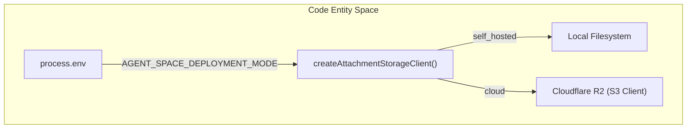
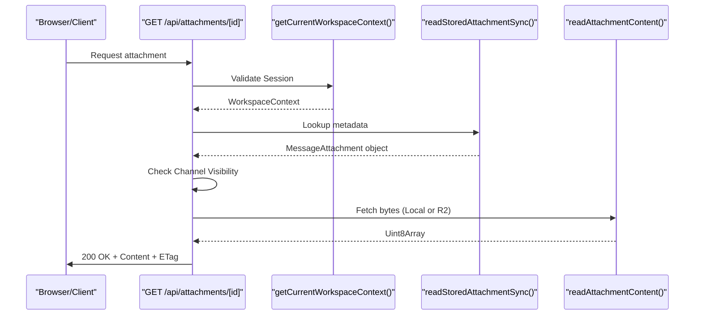

<!-- source: DeepWiki mcp.deepwiki.com · repo HKUDS/AgentSpace · page 4.5 Attachments & File Storage API · fetched 2026-11-09 -->

# Attachments & File Storage API

Relevant source files

The following files were used as context for generating this wiki page:

- [.env.example](.env.example)
- [apps/web/app/api/attachments/[attachmentId]/route.test.ts](apps/web/app/api/attachments/[attachmentId]/route.test.ts)
- [apps/web/app/api/attachments/[attachmentId]/route.ts](apps/web/app/api/attachments/[attachmentId]/route.ts)

The Attachments & File Storage API manages the lifecycle of files within AgentSpace, including uploads from agents or users, secure storage, and authenticated retrieval. The system supports two primary storage backends: a local filesystem for self-hosted deployments and Cloudflare R2 for cloud-scale deployments.

## Storage Architecture & Configuration

AgentSpace determines its storage strategy based on the `AGENT_SPACE_DEPLOYMENT_MODE` environment variable [`.env.example:1-4`]().

### Storage Providers
1.  **Self-Hosted (`self_hosted`)**: Files are stored on the local disk at the path specified by `SELF_HOSTED_ATTACHMENT_LOCAL_ROOT` [`.env.example:10-11`]().
2.  **Cloud (`cloud`)**: Files are stored in Cloudflare R2 object storage. Configuration requires an S3-compatible endpoint, access keys, and bucket details [`.env.example:32-40`]().

### Global Policies
*   **Max Upload Size**: Defined by `ATTACHMENT_MAX_UPLOAD_BYTES` (default 50MB) [`.env.example:48-48`]().
*   **URL Expiration**: Signed URLs for cloud storage use `ATTACHMENT_SIGNED_URL_TTL_SECONDS` [`.env.example:47-47`]().
*   **Local Fallback**: `ATTACHMENT_ENABLE_LOCAL_FALLBACK` allows the system to look for files on disk even if a cloud provider is configured, assisting in migrations [`.env.example:53-53`]().

### Data Flow: Storage Selection
The following diagram illustrates how the system selects the storage client based on configuration.

**Storage Provider Resolution**

Sources: [`.env.example:1-4`](), [`apps/web/app/api/attachments/[attachmentId]/route.ts:8-8`]()

---

## The Attachments API Route

The primary interface for accessing files is the dynamic route `/api/attachments/[attachmentId]`. This route handles authorization, integrity checks, and content delivery.

### Request Handling Flow
1.  **Context Verification**: The route calls `getCurrentWorkspaceContext()` to ensure the user is authenticated and belongs to the workspace [`apps/web/app/api/attachments/[attachmentId]/route.ts:29-32`]().
2.  **Cross-Workspace Guard**: It validates that the requested `workspaceId` matches the session context to prevent IDOR (Insecure Direct Object Reference) attacks [`apps/web/app/api/attachments/[attachmentId]/route.ts:35-52`]().
3.  **Visibility Check**: Access is restricted based on channel visibility. If an attachment is linked to a specific channel, the user must have permission to view that channel [`apps/web/app/api/attachments/[attachmentId]/route.ts:54-77`]().
4.  **Metadata Retrieval**: The system fetches attachment metadata (sha256, fileName, mediaType) via `readStoredAttachmentSync` [`apps/web/app/api/attachments/[attachmentId]/route.ts:67-67`]().

### Content Delivery & Caching
The API implements aggressive caching for images and strict validation for files:
*   **Images**: Uses `private, max-age=3600, stale-while-revalidate=86400` [`apps/web/app/api/attachments/[attachmentId]/route.ts:21-21`]().
*   **Files**: Uses `private, no-cache` [`apps/web/app/api/attachments/[attachmentId]/route.ts:22-22`]().
*   **ETags**: The route generates ETags based on the file's SHA256 hash. If the `If-None-Match` header matches, it returns a `304 Not Modified` response to save bandwidth [`apps/web/app/api/attachments/[attachmentId]/route.ts:96-109`]().

**Attachment Access Sequence**

Sources: [`apps/web/app/api/attachments/[attachmentId]/route.ts:25-155`](), [`apps/web/app/api/attachments/[attachmentId]/route.test.ts:153-170`]()

---

## Technical Implementation Details

### Attachment Metadata
Attachments are represented by the `MessageAttachment` domain type. Key properties include:
| Property | Description |
| :--- | :--- |
| `id` | Unique identifier for the attachment. |
| `sha256` | Hash for integrity and ETags. |
| `storedPath` | Absolute path on disk (for local storage). |
| `storageKey` | Object key (for R2/S3 storage). |
| `mediaType` | MIME type (e.g., `image/png`, `application/pdf`). |

Sources: [`apps/web/app/api/attachments/[attachmentId]/route.ts:5-14`](), [`apps/web/app/api/attachments/[attachmentId]/route.test.ts:153-170`]()

### Content-Disposition Logic
The API dynamically calculates the `Content-Disposition` header:
*   **Inline**: Used for images to allow browser rendering [`apps/web/app/api/attachments/[attachmentId]/route.ts:93-93`]().
*   **Attachment**: Used for other files to force a download [`apps/web/app/api/attachments/[attachmentId]/route.ts:93-93`]().
*   **Filename Encoding**: Handles non-ASCII characters by providing an ASCII fallback and a UTF-8 encoded `filename*` parameter [`apps/web/app/api/attachments/[attachmentId]/route.ts:177-189`]().

### Audit Logging
Security events, such as denied cross-workspace access or missing storage objects, are recorded in the workspace audit log using `tryRecordWorkspaceAuditEventSync` [`apps/web/app/api/attachments/[attachmentId]/route.ts:37-50`](), [`apps/web/app/api/attachments/[attachmentId]/route.ts:117-127`]().

### Error Handling
If a file is missing from the underlying storage (e.g., deleted manually from disk or R2), the API catches the error, logs an audit event, and returns a `404 Not Found` [`apps/web/app/api/attachments/[attachmentId]/route.ts:114-129`]().

Sources: [`apps/web/app/api/attachments/[attachmentId]/route.ts:1-190`](), [`.env.example:1-82`]()

---

