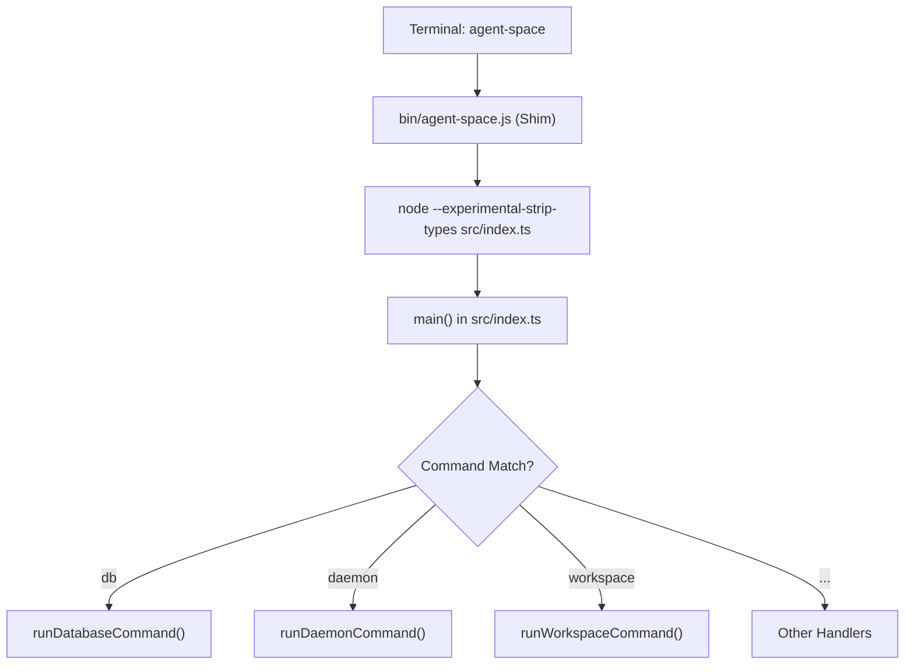
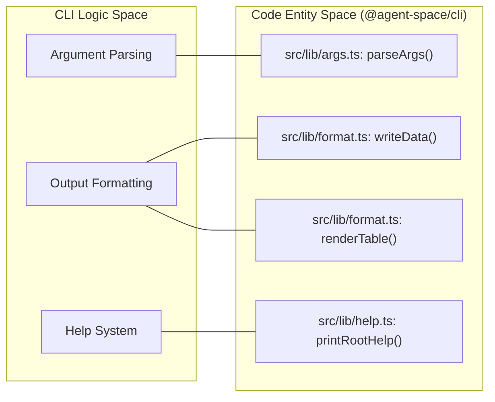

<!-- source: DeepWiki mcp.deepwiki.com · repo HKUDS/AgentSpace · page 5 CLI Application (apps/cli) · fetched 2026-11-09 -->

# CLI Application (apps/cli)

Relevant source files

The following files were used as context for generating this wiki page:

- [apps/cli/bin/agent-space.js](apps/cli/bin/agent-space.js)
- [apps/cli/package.json](apps/cli/package.json)
- [apps/cli/src/index.ts](apps/cli/src/index.ts)
- [apps/cli/src/lib/args.ts](apps/cli/src/lib/args.ts)
- [apps/cli/src/lib/format.ts](apps/cli/src/lib/format.ts)
- [apps/cli/src/lib/help.ts](apps/cli/src/lib/help.ts)

The `apps/cli` package provides the `agent-space` command-line tool, a unified interface for managing AgentSpace workspaces, interacting with the daemon, and performing administrative tasks. It serves as both a local control plane for developers and a runtime utility for agents to communicate back to the system.

## Entrypoint & Bootstrap

The CLI is designed to run in a Node.js environment and leverages modern TypeScript features via the `--experimental-strip-types` flag.

### Bootstrap Process
1.  **Binary Wrapper**: The `agent-space` command is defined in `package.json` [apps/cli/package.json:7-9]() and points to a small JavaScript shim `bin/agent-space.js` [apps/cli/bin/agent-space.js:1-13]().
2.  **Type Stripping**: The shim uses `node:child_process.spawnSync` to execute the TypeScript entrypoint `src/index.ts` using the experimental type-stripping flag [apps/cli/bin/agent-space.js:9-11]().
3.  **Main Dispatch**: The `main()` function in `src/index.ts` handles initial argument normalization, such as stripping `pnpm` separators [apps/cli/src/index.ts:21-26](), and then dispatches the request to specific command handlers based on the first positional argument [apps/cli/src/index.ts:38-96]().

**CLI Entrypoint Flow**

Sources: [apps/cli/bin/agent-space.js:1-13](), [apps/cli/src/index.ts:20-100]().

## Command Structure

The CLI follows a `<command> <subcommand> [options]` pattern. It supports global flags for output formatting, specifically `--json` for machine-readable output [apps/cli/src/lib/format.ts:12-15]().

### Available Command Modules
The CLI delegates logic to specialized command files located in `src/commands/`.

| Command | Handler Function | Purpose |
| :--- | :--- | :--- |
| `workspace` | `runWorkspaceCommand` | Manage workspace initialization and context [apps/cli/src/index.ts:58-60](). |
| `daemon` | `runDaemonCommand` | Control the local daemon and manage remote tokens [apps/cli/src/index.ts:46-48](). |
| `db` | `runDatabaseCommand` | Database status, storage scanning, and purging [apps/cli/src/index.ts:42-44](). |
| `employee` | `runEmployeeCommand` | Manage digital employees and their runtime bindings [apps/cli/src/index.ts:70-72](). |
| `task` | `runTaskCommand` | Create, list, and move tasks on the board [apps/cli/src/index.ts:82-84](). |
| `skill` | `runSkillCommand` | Import, export, and list agent skills [apps/cli/src/index.ts:86-88](). |
| `output` | `runOutputCommand` | Register agent execution results (Sheets, Docs, Files) [apps/cli/src/index.ts:90-92](). |

For a complete list of arguments and flags for every command, see **[CLI Commands Reference](#5.1)**.

Sources: [apps/cli/src/index.ts:3-16](), [apps/cli/src/lib/help.ts:7-50]().

## Library Utilities

The CLI relies on a set of internal utilities in `src/lib/` to handle argument parsing, output formatting, and communication.

### Argument Parsing & Formatting
*   **`parseArgs`**: A custom parser that separates positional arguments from flags (e.g., `--key value` or `--flag`) [apps/cli/src/lib/args.ts:6-31]().
*   **`writeData`**: A central utility that inspects the requested `OutputFormat` (`text` or `json`). For text output, it automatically renders arrays as tables with calculated column widths [apps/cli/src/lib/format.ts:30-47]().
*   **`renderTable`**: Dynamically generates ASCII tables for CLI readability [apps/cli/src/lib/format.ts:55-73]().

### Logic-to-Code Mapping
The following diagram maps CLI concepts to their underlying library implementations.

**CLI Utility Mapping**

Sources: [apps/cli/src/lib/args.ts:6-31](), [apps/cli/src/lib/format.ts:30-73](), [apps/cli/src/lib/help.ts:1-51]().

For technical details on daemon communication and runtime output helpers, see **[CLI Library Utilities](#5.2)**.

## Related Pages
*   **[CLI Commands Reference](#5.1)**: Detailed documentation of every command and flag.
*   **[CLI Library Utilities](#5.2)**: Deep dive into the internal helper modules used by the CLI.
*   **[Daemon & Agent Execution](#3)**: How the `daemon` command interacts with the background agent process.

---

