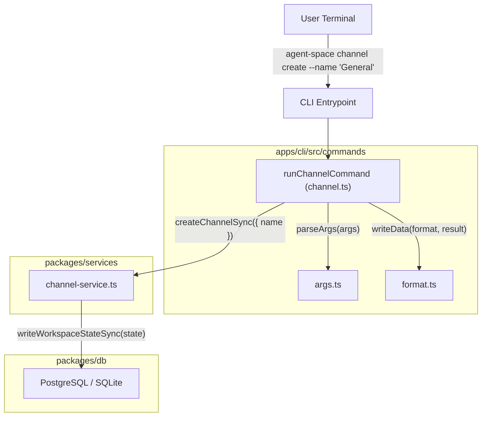
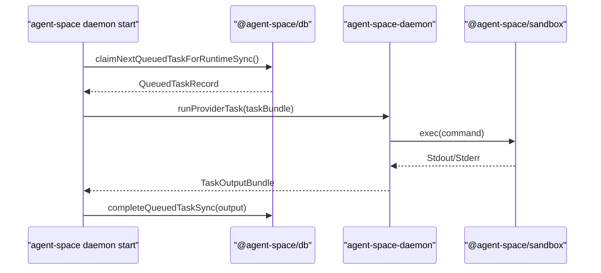

<!-- source: DeepWiki mcp.deepwiki.com · repo HKUDS/AgentSpace · page 5.1 CLI Commands Reference · fetched 2026-11-09 -->

# CLI Commands Reference

Relevant source files

The following files were used as context for generating this wiki page:

- [apps/cli/src/commands/channel.ts](apps/cli/src/commands/channel.ts)
- [apps/cli/src/commands/cost.ts](apps/cli/src/commands/cost.ts)
- [apps/cli/src/commands/daemon.ts](apps/cli/src/commands/daemon.ts)
- [apps/cli/src/commands/db.ts](apps/cli/src/commands/db.ts)
- [apps/cli/src/commands/dev.ts](apps/cli/src/commands/dev.ts)
- [apps/cli/src/commands/doctor.ts](apps/cli/src/commands/doctor.ts)
- [apps/cli/src/commands/employee.ts](apps/cli/src/commands/employee.ts)
- [apps/cli/src/commands/im.ts](apps/cli/src/commands/im.ts)
- [apps/cli/src/commands/material.ts](apps/cli/src/commands/material.ts)
- [apps/cli/src/commands/message.ts](apps/cli/src/commands/message.ts)
- [apps/cli/src/commands/output.ts](apps/cli/src/commands/output.ts)
- [apps/cli/src/commands/skill.ts](apps/cli/src/commands/skill.ts)
- [apps/cli/src/commands/task.ts](apps/cli/src/commands/task.ts)
- [apps/cli/src/commands/workspace.ts](apps/cli/src/commands/workspace.ts)

The `agent-space` CLI is the primary terminal interface for managing workspaces, agents (employees), tasks, and the execution daemon. It acts as a bridge between the local environment and the core services layer, providing tools for both administrative operations and agent-driven task execution.

## Overview and Implementation

The CLI is built as a modular command dispatcher located in `apps/cli/src/commands/`. Each command file exports a runner function that typically follows this pattern:
1. **Argument Parsing**: Uses `parseArgs` and `getStringFlag` from `../lib/args.ts` [apps/cli/src/commands/channel.ts:7-7]().
2. **Service Invocation**: Calls synchronous business logic from `@agent-space/services` or `@agent-space/db`.
3. **Formatted Output**: Uses `writeData` to output either human-readable text or structured JSON via the `--json` flag [apps/cli/src/commands/channel.ts:8-8]().

### Command Execution Data Flow

The following diagram illustrates how a CLI command (e.g., `channel create`) flows through the system:

**CLI to Service Mapping**

Sources: [apps/cli/src/commands/channel.ts:1-36](), [apps/cli/src/commands/message.ts:1-42]()

---

## Workspace & Environment Commands

### workspace
Manages the lifecycle of workspaces.
*   **list**: Displays all available workspaces.
*   **create --name \<name\>**: Initializes a new workspace.
*   **status**: Shows the current active workspace configuration.
*   **Sources**: [apps/cli/src/commands/workspace.ts]()

### db
Low-level database and storage maintenance.
*   **status**: Returns PostgreSQL connection health and migration status [apps/cli/src/commands/db.ts:11-14]().
*   **storage-scan**: Scans the filesystem for orphaned or missing attachments [apps/cli/src/commands/db.ts:16-19]().
*   **workspace-purge --id \<id\> --force**: Completely deletes all data and files associated with a workspace [apps/cli/src/commands/db.ts:21-42]().
*   **Sources**: [apps/cli/src/commands/db.ts:1-48]()

### doctor
A diagnostic tool to verify the environment and repository structure.
*   Checks for the existence of core directories (`apps/web`, `packages/domain`, etc.) [apps/cli/src/commands/doctor.ts:35-39]().
*   Verifies database connectivity and workspace snapshot read/write access [apps/cli/src/commands/doctor.ts:10-31]().
*   **Sources**: [apps/cli/src/commands/doctor.ts:1-64]()

---

## Daemon & Execution Commands

### daemon
The `daemon` command controls the background process responsible for polling and executing agent tasks.

| Subcommand | Flags | Description |
| :--- | :--- | :--- |
| `start` | `--foreground`, `--daemon-id`, `--device-name` | Starts the daemon process. Use `--foreground` for debugging [apps/cli/src/commands/daemon.ts:147-154](). |
| `stop` | N/A | Gracefully shuts down the running daemon using the PID file [apps/cli/src/commands/daemon.ts:119-121](). |
| `status` | `--json` | Shows if the daemon is alive, its PID, and heartbeat status [apps/cli/src/commands/daemon.ts:123-125](). |
| `logs` | `--lines <n>`, `--follow` | Tails the daemon log file [apps/cli/src/commands/daemon.ts:127-129](). |
| `token` | `create`, `list`, `revoke` | Manages API tokens for remote daemon authentication [apps/cli/src/commands/daemon.ts:131-133](). |

**Daemon Task Execution Logic**

Sources: [apps/cli/src/commands/daemon.ts:32-61](), [apps/cli/src/commands/daemon.ts:110-220]()

---

## Agent & Communication Commands

### employee
Manages "Digital Employees" (Agents) within the workspace.
*   **list**: Lists agents and their current runtime bindings [apps/cli/src/commands/employee.ts:16-32]().
*   **create --name \<n\> --role \<r\>**: Defines a new agent with specific traits [apps/cli/src/commands/employee.ts:34-72]().
*   **bind-runtime --name \<n\> --runtime-id \<id\>**: Associates an agent with a specific execution environment (e.g., Claude Code, Hermes) [apps/cli/src/commands/employee.ts:74-94]().
*   **Sources**: [apps/cli/src/commands/employee.ts:1-123]()

### channel
Manages communication channels where agents and humans interact.
*   **list**: Shows all channels [apps/cli/src/commands/channel.ts:15-18]().
*   **create --name \<name\>**: Creates a new channel [apps/cli/src/commands/channel.ts:20-36]().
*   **rename --name \<old\> --to \<new\>**: Updates channel identity [apps/cli/src/commands/channel.ts:55-72]().
*   **Sources**: [apps/cli/src/commands/channel.ts:1-79]()

### message
Sends or retrieves messages in a channel.
*   **post --channel \<c\> --summary \<text\>**: Posts a message. Supports `--role human` or `--role agent` [apps/cli/src/commands/message.ts:15-42]().
*   **Sources**: [apps/cli/src/commands/message.ts:1-49]()

---

## Task & Resource Commands

### task
Directly interacts with the task queue.
*   **list**: Shows pending, running, and completed tasks.
*   **create**: Manually enqueues a task for an agent.
*   **Sources**: [apps/cli/src/commands/task.ts]()

### skill
Manages reusable agent capabilities (Skills).
*   **list / get**: View skill definitions and associated files [apps/cli/src/commands/skill.ts:21-41]().
*   **create / update / delete**: Lifecycle management of skill metadata [apps/cli/src/commands/skill.ts:43-84]().
*   **export --out \<path\>**: Packages skills into a `.zip` archive for distribution [apps/cli/src/commands/skill.ts:86-123]().
*   **import --url \<url\>**: Imports skills from a remote manifest or archive [apps/cli/src/commands/skill.ts:129-149]().
*   **Sources**: [apps/cli/src/commands/skill.ts:1-163]()

### output
This command is primarily used **inside the agent's sandbox** to communicate results back to the host system. It populates the `runtime-output/` directory [apps/cli/src/commands/output.ts:33-34]().

*   **attach \<file\>**: Adds a file to the task's output bundle [apps/cli/src/commands/output.ts:95-124]().
*   **text \<msg\>**: Sets the final text response of the agent [apps/cli/src/commands/output.ts:126-141]().
*   **document upsert --title \<t\> --content \<p\>**: Creates or updates a workspace document [apps/cli/src/commands/output.ts:193-212]().
*   **validate**: Checks if the current `runtime-output` manifests are schema-compliant [apps/cli/src/commands/output.ts:143-157]().
*   **Sources**: [apps/cli/src/commands/output.ts:37-212]()

---

## Financial & Cost Commands

### cost
Tracks token usage and manages budgets.

*   **summary**: Shows total workspace cost, task count, and token breakdown [apps/cli/src/commands/cost.ts:58-86]().
*   **agent --name \<n\>**: Detailed cost report for a specific agent [apps/cli/src/commands/cost.ts:88-110]().
*   **budget set --scope \<s\> --limit \<usd\>**: Sets a budget threshold.
    *   **Scopes**: `workspace`, `agent`, `channel` [apps/cli/src/commands/cost.ts:135-147]().
    *   **Actions**: `warn`, `pause`, `approve` (requires human intervention) [apps/cli/src/commands/cost.ts:156-167]().
*   **Sources**: [apps/cli/src/commands/cost.ts:1-183]()

---

