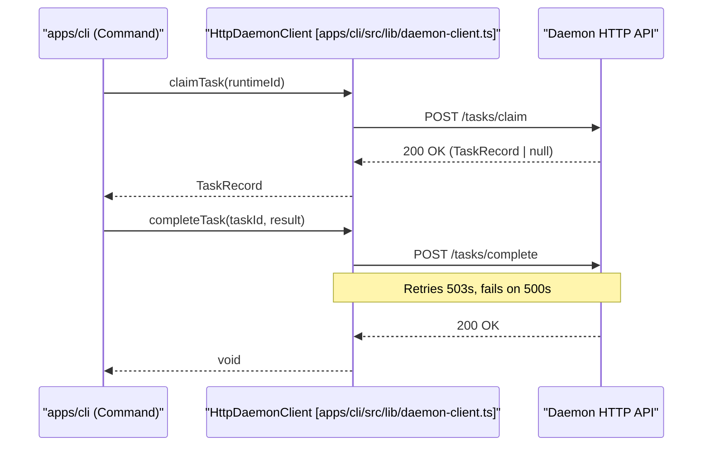
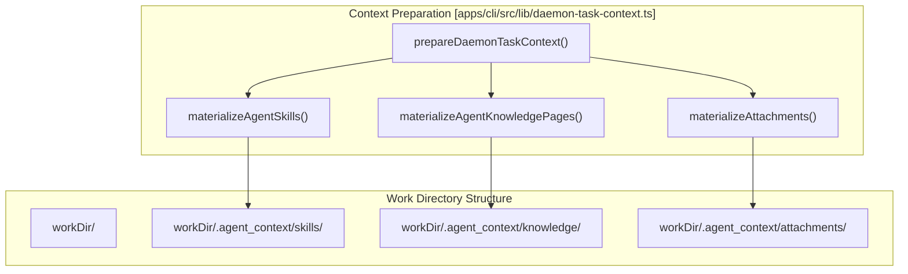

<!-- source: DeepWiki mcp.deepwiki.com · repo HKUDS/AgentSpace · page 5.2 CLI Library Utilities · fetched 2026-11-09 -->

# CLI Library Utilities

Relevant source files

The following files were used as context for generating this wiki page:

- [apps/cli/src/lib/channel-documents.ts](apps/cli/src/lib/channel-documents.ts)
- [apps/cli/src/lib/daemon-client.test.ts](apps/cli/src/lib/daemon-client.test.ts)
- [apps/cli/src/lib/daemon-client.ts](apps/cli/src/lib/daemon-client.ts)
- [apps/cli/src/lib/daemon-task-context.test.ts](apps/cli/src/lib/daemon-task-context.test.ts)
- [apps/cli/src/lib/daemon-task-context.ts](apps/cli/src/lib/daemon-task-context.ts)
- [apps/cli/src/lib/daemon-task-output.ts](apps/cli/src/lib/daemon-task-output.ts)
- [apps/cli/src/lib/runtime-output.ts](apps/cli/src/lib/runtime-output.ts)
- [apps/cli/src/lib/skill-imports.ts](apps/cli/src/lib/skill-imports.ts)

The CLI Library Utilities provide the underlying logic for the `apps/cli` package, facilitating communication with the daemon, preparing execution environments for agents, and processing the outputs generated by agent runtimes. These utilities largely act as a bridge between the CLI's command layer and the shared logic within the `agent-space-daemon` package.

## Daemon Communication (daemon-client)

The `HttpDaemonClient` is the primary interface for the CLI to communicate with a running AgentSpace daemon via HTTP. It handles task lifecycle operations such as claiming, starting, and completing tasks.

### Key Features
- **Retry Logic**: Implements automatic retries for transient failures (e.g., 503 Service Unavailable) using a configurable delay and maximum attempt count `[apps/cli/src/lib/daemon-client.test.ts:5-34]()`.
- **Non-Retryable Safety**: Certain operations, such as task completion with specific error codes (e.g., 500 Internal Server Error), are treated as non-retryable to prevent inconsistent state `[apps/cli/src/lib/daemon-client.test.ts:36-65]()`.

### Communication Flow
The diagram below illustrates how the `HttpDaemonClient` interacts with the daemon's HTTP endpoints.

**Daemon Client Interaction**

**Sources:** `[apps/cli/src/lib/daemon-client.ts:1-2]()`, `[apps/cli/src/lib/daemon-client.test.ts:24-30]()`.

## Task Context Preparation (daemon-task-context)

Before an agent starts execution, the CLI must prepare a "work directory" populated with the necessary context. This process is handled by `prepareDaemonTaskContext` and its associated materialization functions.

### Materialization Logic
- **Agent Skills**: `materializeAgentSkills` writes skill definitions into both a compatibility directory (`.agent_context/skills`) and a provider-native directory (e.g., `.claude/skills` for Claude Code) `[apps/cli/src/lib/daemon-task-context.test.ts:77-93]()`.
- **Knowledge Pages**: `materializeAgentKnowledgePages` exports workspace knowledge into a structured format containing a `manifest.json` and individual Markdown files `[apps/cli/src/lib/daemon-task-context.test.ts:117-139]()`.
- **Skill Resolution**: `resolveAgentSkills` ensures that an agent's assigned skills are correctly identified, prioritizing stored assignments over stale profile data and including built-in skills like `BUILTIN_WORKSPACE_CONTEXT_SKILL_NAME` `[apps/cli/src/lib/daemon-task-context.test.ts:56-75]()`.

**Context Materialization Architecture**

**Sources:** `[apps/cli/src/lib/daemon-task-context.ts:1-13]()`, `[apps/cli/src/lib/daemon-task-context.test.ts:32-35]()`.

## Runtime Output Management (runtime-output)

Agents communicate their results and side-effect requests (like skill imports or document operations) by writing files into a specific directory structure within the `workDir`.

### Output Directory Structure
The standard output directory is `runtime-output/` `[apps/cli/src/lib/runtime-output.ts:3]()`. The library provides helpers to resolve paths for various output types:

| Constant / Helper | File / Path | Purpose |
|:---|:---|:---|
| `RUNTIME_OUTPUT_MANIFEST_FILE` | `agent-output.json` | Final task status and text output `[apps/cli/src/lib/runtime-output.ts:5]()`. |
| `RUNTIME_OUTPUT_ARTIFACTS_DIR` | `artifacts/` | Files generated by the agent to be uploaded `[apps/cli/src/lib/runtime-output.ts:4]()`. |
| `RUNTIME_OUTPUT_CHANNEL_DOCUMENTS_FILE` | `channel-documents.json` | Operations on workspace channel documents `[apps/cli/src/lib/runtime-output.ts:6]()`. |
| `RUNTIME_OUTPUT_SKILL_IMPORTS_FILE` | `skill-imports.json` | Requests to import new skills into the workspace `[apps/cli/src/lib/runtime-output.ts:7]()`. |
| `RUNTIME_OUTPUT_PERMISSION_REQUESTS_FILE` | `permission-requests.json` | Requests for additional runtime permissions `[apps/cli/src/lib/runtime-output.ts:12]()`. |

**Sources:** `[apps/cli/src/lib/runtime-output.ts:3-22]()`, `[apps/cli/src/lib/runtime-output.ts:24-62]()`.

## Specialized Handlers

The CLI includes specific utilities for handling complex side effects requested by agents during their runtime.

### Channel Documents and Skills
- **Channel Documents**: `applyChannelDocumentOperations` processes the JSON manifest produced by agents to update, create, or delete documents within a workspace channel `[apps/cli/src/lib/channel-documents.ts:2-7]()`.
- **Skill Imports**: `applySkillImportOperations` and `prepareSkillImportOperationArtifacts` handle the ingestion of new skills discovered or authored by the agent during execution `[apps/cli/src/lib/skill-imports.ts:1-8]()`.

### Task Output Finalization
The `daemon-task-output` module provides utilities to clean up the environment after a task finishes:
- `loadTaskOutputEnvelope`: Reads the manifest and artifacts from the `runtime-output` directory `[apps/cli/src/lib/daemon-task-output.ts:4]()`.
- `clearTaskOutputArtifacts`: Deletes local artifacts once they have been successfully uploaded to the server `[apps/cli/src/lib/daemon-task-output.ts:2]()`.

**Sources:** `[apps/cli/src/lib/channel-documents.ts:1-7]()`, `[apps/cli/src/lib/skill-imports.ts:1-8]()`, `[apps/cli/src/lib/daemon-task-output.ts:1-5]()`.

---

