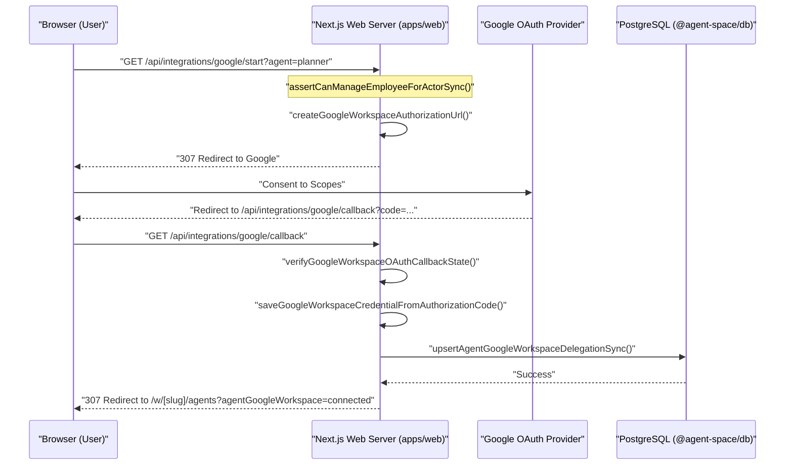
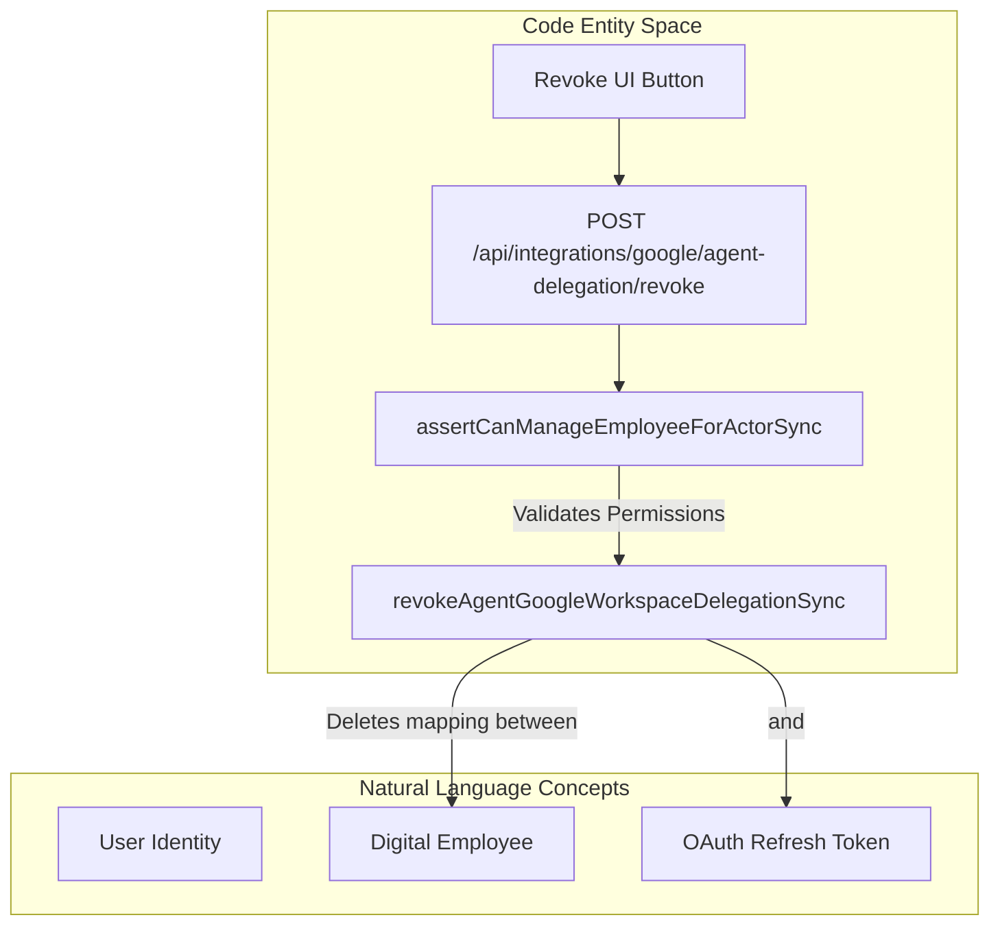

<!-- source: DeepWiki mcp.deepwiki.com · repo HKUDS/AgentSpace · page 6 Google Workspace Integration · fetched 2026-11-09 -->

# Google Workspace Integration

Relevant source files

The following files were used as context for generating this wiki page:

- [.env.example](.env.example)
- [apps/web/app/api/integrations/google/agent-delegation/revoke/route.test.ts](apps/web/app/api/integrations/google/agent-delegation/revoke/route.test.ts)
- [apps/web/app/api/integrations/google/agent-delegation/revoke/route.ts](apps/web/app/api/integrations/google/agent-delegation/revoke/route.ts)
- [apps/web/app/api/integrations/google/callback/route.test.ts](apps/web/app/api/integrations/google/callback/route.test.ts)
- [apps/web/app/api/integrations/google/callback/route.ts](apps/web/app/api/integrations/google/callback/route.ts)
- [apps/web/app/api/integrations/google/disconnect/route.test.ts](apps/web/app/api/integrations/google/disconnect/route.test.ts)
- [apps/web/app/api/integrations/google/disconnect/route.ts](apps/web/app/api/integrations/google/disconnect/route.ts)
- [apps/web/app/api/integrations/google/start/route.test.ts](apps/web/app/api/integrations/google/start/route.test.ts)
- [apps/web/app/api/integrations/google/start/route.ts](apps/web/app/api/integrations/google/start/route.ts)

AgentSpace provides deep integration with Google Workspace (Sheets, Docs, and Drive), allowing both users and agents to interact with Google services. This integration supports user authentication via Google OAuth and a delegation model where users can grant specific agents the authority to act on their behalf within Google Workspace.

## Integration Architecture

The integration is built on a secure OAuth 2.0 flow. It distinguishes between **User Authentication** (logging into AgentSpace) and **Workspace Integration** (granting the system access to Google files).

### OAuth Flow and Delegation
When a user integrates Google Workspace, they can either connect it to their own profile for personal use or delegate that access to a specific **Digital Employee** (Agent).

#### Data Flow: Agent Delegation
The following diagram illustrates how a user delegates their Google Workspace authority to an agent.

"Agent Delegation Flow"

**Sources:** [apps/web/app/api/integrations/google/start/route.ts:10-39](), [apps/web/app/api/integrations/google/callback/route.ts:15-82]()

## Key Implementation Details

### 1. Secure Credential Storage
Credentials obtained from Google are encrypted before being stored in the database.
- **Encryption**: The system uses `AGENT_SPACE_GOOGLE_WORKSPACE_TOKEN_ENCRYPTION_KEY` to encrypt refresh tokens [ .env.example:79-79]().
- **Scoped Access**: AgentSpace typically requests `https://www.googleapis.com/auth/drive.file`, limiting the agent's access to only files created by the app or explicitly opened by it [apps/web/app/api/integrations/google/callback/route.test.ts:61-61]().

### 2. Identity Verification
During the OAuth callback, the server strictly validates that the user returning from Google is the same user who initiated the request to prevent session injection attacks.
- The `state` parameter is signed and verified via `verifyGoogleWorkspaceOAuthCallbackState` [apps/web/app/api/integrations/google/callback/route.ts:35-40]().
- The server checks if the user has an `active` membership in the target workspace via `readWorkspaceMembershipSync` [apps/web/app/api/integrations/google/callback/route.ts:42-45]().

### 3. Agent Delegation Logic
Delegation allows an agent (e.g., "Planner") to use a specific user's Google identity. This is managed through the `upsertAgentGoogleWorkspaceDelegationSync` function, which maps a `workspaceId`, `employeeName`, and `userId` to a `googleOAuthCredentialId` [apps/web/app/api/integrations/google/callback/route.ts:58-66]().

## API Endpoints

| Route | Method | Description |
| :--- | :--- | :--- |
| `/api/integrations/google/start` | `GET` | Initiates OAuth flow; accepts `agent` and `redirectAfter` params [apps/web/app/api/integrations/google/start/route.ts:10-10](). |
| `/api/integrations/google/callback` | `GET` | Handles Google redirect, exchanges code for tokens, and saves delegation [apps/web/app/api/integrations/google/callback/route.ts:15-15](). |
| `/api/integrations/google/disconnect` | `POST` | Revokes the user's personal Google Workspace connection [apps/web/app/api/integrations/google/disconnect/route.ts:8-8](). |
| `/api/integrations/google/agent-delegation/revoke` | `POST` | Removes an agent's delegated access to a user's Google account [apps/web/app/api/integrations/google/agent-delegation/revoke/route.ts:9-9](). |

## Revocation Flows

AgentSpace provides granular control over revoking access. Users can disconnect their entire Google integration or target specific agents.

### Disconnect vs. Revoke
- **Disconnect**: Calls `revokeGoogleOAuthCredentialSync` to remove the user's primary credential from the workspace [apps/web/app/api/integrations/google/disconnect/route.ts:15-18]().
- **Agent Revoke**: Calls `revokeAgentGoogleWorkspaceDelegationSync`. This only stops a specific agent from using the user's Google identity but leaves the user's credential intact for other agents or personal use [apps/web/app/api/integrations/google/agent-delegation/revoke/route.ts:28-32]().

"Credential Revocation Logic"

**Sources:** [apps/web/app/api/integrations/google/agent-delegation/revoke/route.ts:21-32](), [apps/web/app/api/integrations/google/disconnect/route.ts:15-18]()

## Configuration
To enable these features, the following environment variables must be configured in the web server environment:

- `AGENT_SPACE_GOOGLE_WORKSPACE_CLIENT_ID`: Google Cloud Console client ID [ .env.example:74-74]().
- `AGENT_SPACE_GOOGLE_WORKSPACE_CLIENT_SECRET`: Google Cloud Console client secret [ .env.example:75-75]().
- `AGENT_SPACE_GOOGLE_WORKSPACE_CALLBACK_URL`: Must match the URI registered in Google Console [ .env.example:76-76]().
- `AGENT_SPACE_GOOGLE_WORKSPACE_TOKEN_ENCRYPTION_KEY`: 32-byte base64 key for encrypting tokens at rest [ .env.example:79-79]().

**Sources:** [ .env.example:72-82]()

---

